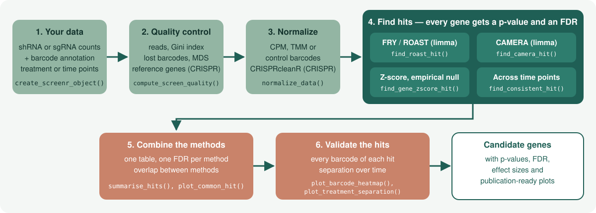

<!-- README.md is generated from README.Rmd. Please edit that file -->

```{r, include = FALSE}
knitr::opts_chunk$set(
    collapse = TRUE,
    comment = "#>",
    fig.path = "man/figures/README-",
    out.width = "100%",
    dpi = 150
)
```

# ScreenR <a href="https://emanuelsoda.github.io/ScreenR/"></a>

<!-- badges: start -->
[](https://bioconductor.org/packages/ScreenR)
[](https://bioconductor.org/checkResults/release/bioc-LATEST/ScreenR/)
[](https://bioconductor.org/checkResults/devel/bioc-LATEST/ScreenR/)
[](https://github.com/EmanuelSoda/ScreenR/actions/workflows/R-CMD-check.yaml)
[](https://codecov.io/gh/EmanuelSoda/ScreenR)
<!-- badges: end -->

**Find the genes that matter in pooled shRNA screens — with p-values you can
trust, quality control built in and publication-ready plots.**

ScreenR takes the barcode counts of a pooled shRNA screen and tells you which
genes are depleted or enriched by your treatment, how confident you can be in
each of them, and whether the result holds up at the level of the single
barcodes. It is built on the statistics of
[edgeR](https://bioconductor.org/packages/edgeR) and
[limma](https://bioconductor.org/packages/limma), stores the data in a
Bioconductor `SummarizedExperiment`, and draws every plot with ggplot2.



## Why ScreenR?

- **Every hit comes with a p-value and a false discovery rate.** The
  gene-level tests are calibrated: in screens without any real effect about
  5% of the genes have p < 0.05, as they should.
- **Benchmarked against the main tools.** On simulated screens and on
  published shRNA (K562) and CRISPR-Cas9 (HAP1) essentiality screens,
  ScreenR ranks the true hits as well as the best of MAGeCK, BAGEL2,
  gscreend and plain edgeR/limma workflows, keeps the FDR below the nominal
  level and runs in seconds
  ([benchmark](https://emanuelsoda.github.io/ScreenR/articles/Benchmark_MAGeCK.html)).
- **Several complementary methods, one table.** A permutation test on the
  barcode Z-scores, limma CAMERA, ROAST and FRY, and an edgeR model for time
  courses; `summarise_hits()` combines them and `plot_common_hit()` shows how
  they agree.
- **Uses your replicates.** Barcode statistics come from the edgeR
  quasi-likelihood model, so replicate variability is part of the test.
- **Quality control included.** Mapped reads, library evenness (Gini index),
  lost barcodes, replicate correlation and MDS plots, before you look at a
  single hit.
- **Works with your files as they are.** Any column names, sample
  descriptions from a table, helpful messages when something does not match.
- **shRNA and CRISPR.** Works with shRNA and CRISPR-Cas9 libraries, checks
  the screen with essential and non-essential reference genes
  (`compute_screen_quality()`), and corrects CRISPR copy-number bias through
  [CRISPRcleanR](https://github.com/francescojm/CRISPRcleanR)
  (`correct_crispr_bias()`).
- **Bioconductor native.** The ScreenR object is a `SummarizedExperiment`, so
  it works with the rest of the Bioconductor ecosystem.

## Installation

ScreenR requires R 4.3 or later. Install the release version from
[Bioconductor](https://bioconductor.org/packages/ScreenR):

```{r install, eval = FALSE}
if (!requireNamespace("BiocManager", quietly = TRUE)) {
    install.packages("BiocManager")
}
BiocManager::install("ScreenR")
```

or the development version from GitHub:

```{r install-dev, eval = FALSE}
BiocManager::install("EmanuelSoda/ScreenR")
```

## Quick start

The package includes an example screen: shRNA counts for treated (`TRT`) and
control (`CTRL`) cells at several time points, with three replicates.

```{r quick-start, message = FALSE}
library(ScreenR)

data(count_table)
data(annotation_table)
counts <- count_table[count_table$Barcode != "*", ]
colnames(counts) <- c(
    "Barcode", "Time1", "Time2", "Time3_TRT_A", "Time3_TRT_B", "Time3_TRT_C",
    "Time3_CTRL_A", "Time3_CTRL_B", "Time3_CTRL_C",
    "Time4_TRT_A", "Time4_TRT_B", "Time4_TRT_C",
    "Time4_CTRL_A", "Time4_CTRL_B", "Time4_CTRL_C"
)
groups <- factor(c(
    "T1/T2", "T1/T2", rep("Time3_TRT", 3), rep("Time3_CTRL", 3),
    rep("Time4_TRT", 3), rep("Time4_CTRL", 3)
))

# 1. Create the object and normalize the counts
object <- create_screenr_object(
    table = counts, annotation = annotation_table, groups = groups
)
object <- compute_data_table(normalize_data(remove_all_zero_row(object)))
object
```

Check the samples before looking for hits: replicates should cluster together.

```{r qc, fig.height = 3.5, fig.width = 7}
plot_mds(object) + ggplot2::theme_bw()
```

Compare treated and control cells at the last time point with two
independent tests, and combine them:

```{r hits}
# 2. Define the comparison
design <- create_design_matrix(object)
contrast <- create_contrast(design, treatment = "Time4_TRT", control = "Time4_CTRL")

# 3. Gene-level permutation test on replicate-aware barcode statistics
barcode_statistics <- compute_barcode_statistics(object, design, contrast)
zscore <- find_gene_zscore_hit(barcode_statistics, fdr = 1, seed = 1)

# 4. limma CAMERA on the barcodes of each gene
camera <- find_camera_hit(object, design, contrast, fdr = 1)

# 5. One table with the FDR of both methods, best supported genes first
#    (the example screen has a weak effect, so we use a lenient FDR of 25%)
hits <- summarise_hits(list(zscore = zscore, camera = camera), fdr = 0.25)
head(hits)
```

Look at the barcodes of the top candidate before trusting it:

```{r top-gene, fig.height = 3.5, fig.width = 7}
top_gene <- as.character(hits$Gene[1])
plot_boxplot(object,
    genes = top_gene, group_var = c("TRT", "CTRL"), fill_var = "Treatment"
) +
    ggplot2::scale_fill_manual(values = c(CTRL = "#93B5A3", TRT = "#C9836A")) +
    ggplot2::theme_bw() +
    ggplot2::theme(axis.text.x = ggplot2::element_text(angle = 45, hjust = 1))
```

## Which method should I use?

Every method looks for **depleted** genes by default; set
`direction = "Up"` to find **enriched** genes (for example in a resistance
screen).

| Question | Function | Notes |
|---|---|---|
| Which genes are depleted or enriched? | `find_gene_zscore_hit()` | Permutation test on the barcode scores; robust default. Use `statistic = "median"` against off-target effects. |
| Do the barcodes of a gene change more than the others? | `find_camera_hit()` | limma CAMERA, competitive test; works with a single control sample. |
| Do the barcodes of a gene change at all? | `find_roast_hit()` | limma ROAST or FRY (`method = "fry"`), self-contained; needs replicates in both groups. |
| Does the effect change over time? | `find_time_hit()` | edgeR model of the whole time course. |
| Which genes are supported by several methods? | `summarise_hits()`, `plot_common_hit()` | One table with the FDR of every method. |

## How ScreenR compares

```{r benchmark, echo = FALSE, message = FALSE, fig.height = 3.6, fig.width = 8}
library(ggplot2)
benchmark_dir <- system.file("extdata", "benchmark", package = "ScreenR")
bench <- rbind(
    read.csv(file.path(benchmark_dir, "simulation.csv")),
    read.csv(file.path(benchmark_dir, "simulation_competitors.csv"))
)
keep <- c(
    MAGeCK_RRA = "MAGeCK RRA", MAGeCK_MLE = "MAGeCK MLE",
    BAGEL2 = "BAGEL2", gscreend = "gscreend",
    limma_voom_camera = "limma-voom + camera",
    ScreenR_CAMERA = "ScreenR CAMERA",
    ScreenR_Zscore_mean = "ScreenR Z-score"
)
scenarios <- c(S1_baseline = "Baseline", S2_weak_effect = "Weak effect",
    S3_two_replicates = "2 replicates", S4_noisy = "Noisy",
    S5_off_target = "Off-target")
bench <- subset(bench, method %in% names(keep) & alpha == 0.05 &
    scenario %in% names(scenarios))
summary <- aggregate(cbind(AUPRC, FDP) ~ method + scenario, bench, mean)
summary$Method <- factor(keep[summary$method], levels = keep)
summary$Scenario <- factor(scenarios[summary$scenario], levels = scenarios)
ggplot(summary, aes(Scenario, AUPRC, fill = Method)) +
    geom_col(position = position_dodge(0.8), width = 0.75) +
    coord_cartesian(ylim = c(0.5, 1)) +
    scale_fill_manual(values = c("#E3A894", "#B5523A", "#5B4E9E", "#D4A72C",
        "#9ECAE9", "#93B5A3", "#1F5F55")) +
    labs(x = NULL, y = "Precision-recall AUC", fill = NULL,
        title = "Ranking of the true hits in 25 simulated screens") +
    theme_minimal(base_size = 11) +
    theme(legend.position = "bottom", panel.grid.major.x = element_blank())
```

In the simulations ScreenR ranks the true hits as well as the best tools and
keeps the false discovery rate below the nominal level; at a fixed FDR it is
more conservative than MAGeCK MLE and BAGEL2, which find more hits but exceed
the nominal FDR in some scenarios. On the published K562 shRNA screen
included in the package (`k562_count_table`) the ScreenR Z-score test is
comparable to MAGeCK RRA and BAGEL2. The
[benchmark article](https://emanuelsoda.github.io/ScreenR/articles/Benchmark_MAGeCK.html)
has all the details and reruns the ScreenR side of the comparison.

## Learn more

| | |
|---|---|
| [Tutorial 1: Getting your data into ScreenR](https://emanuelsoda.github.io/ScreenR/articles/Tutorial_1_Creating_the_object.html) | Count tables, annotations, sample descriptions and the ScreenR object |
| [Tutorial 2: Quality control](https://emanuelsoda.github.io/ScreenR/articles/Tutorial_2_Quality_control.html) | Sequencing depth, library evenness, replicates, normalization |
| [Tutorial 3: Finding and validating hits](https://emanuelsoda.github.io/ScreenR/articles/Tutorial_3_Finding_hits.html) | All the hit-finding methods, combining them and checking the hits |
| [Statistics in ScreenR](https://emanuelsoda.github.io/ScreenR/articles/Improved_Statistics.html) | How the tests work and why |
| [Benchmark against MAGeCK and other tools](https://emanuelsoda.github.io/ScreenR/articles/Benchmark_MAGeCK.html) | Simulations, an shRNA and a CRISPR screen with known hits, compared with MAGeCK, BAGEL2, gscreend and edgeR/limma |
| [Function reference](https://emanuelsoda.github.io/ScreenR/reference/index.html) | Every function, grouped by analysis step |

## Getting help

- Questions about using ScreenR: the
  [Bioconductor support site](https://support.bioconductor.org/tag/ScreenR)
  (tag `ScreenR`).
- Bugs and feature requests:
  [GitHub issues](https://github.com/EmanuelSoda/ScreenR/issues).

## Citation

```{r citation, eval = requireNamespace("ScreenR"), comment = ""}
print(citation("ScreenR"), bibtex = FALSE)
```

## Code of Conduct

The ScreenR project is released with the
[Bioconductor Code of Conduct](https://bioconductor.org/about/code-of-conduct/).
By contributing to this project, you agree to abide by its terms.
