# ScreenR Example Analysis

## Importing Package

``` r

knitr::opts_chunk$set(collapse = TRUE, comment = "#>")
library(ggplot2)
library(dplyr)
```

    ## 
    ## Attaching package: 'dplyr'

    ## The following objects are masked from 'package:stats':
    ## 
    ##     filter, lag

    ## The following objects are masked from 'package:base':
    ## 
    ##     intersect, setdiff, setequal, union

``` r

library(tidyr)
```

## Introduction

The R package **ScreenR** has been developed to perform analysis of
High-throughput RNA interference screening using pooled shRNA libraries
and next generation sequencing.. Nowadays several short hairpin RNA
(shRNA) libraries are commercial available, and in the last years the
interest in this type of analysis, often called barcode screening, has
greatly increased for their benefits both from a time-consuming point of
view and for the possibility of carrying out screening on a large number
of genes simultaneously. However, the bioinformatic analysis of this
type of screening still lacks a golden standard. Here, ScreenR allows
the user to carry out a preliminary quality check of the experiment,
visually inspect the data and finally identify the most significant hits
of the experiment through a series of plots and cross-statistical
analyses.

This vignette gives an overview of the whole analysis. Each step is
explained in detail in three tutorials:

1.  **Getting your data into ScreenR**: the input tables, the creation
    of the ScreenR object and the preparation of the data.
2.  **Quality control**: how to check that the screen worked.
3.  **Finding and validating hits**: the statistical methods, how to
    combine them and how to check the candidate genes.

## Installation

### Bioconductor

**ScreenR** requires several CRAN and Bioconductor R packages to be
installed. Dependencies are usually handled automatically, when
installing the package using the following commands:

``` r

if (!require("BiocManager", quietly = TRUE))
    install.packages("BiocManager")

BiocManager::install("ScreenR")
```

### Github

The newest version can directly be installed from GitHub using the CRAN
package devtools:

``` r

if (!require("devtools", quietly = TRUE))
   install.packages("devtools")

devtools::install_github("EmanuelSoda/ScreenR")
```

## Analysis

Here is reported the ScreenR pipeline
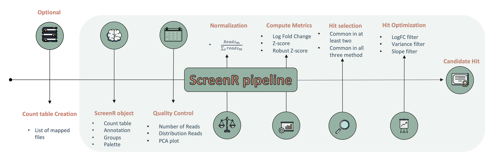

### Loading the package

After installation, loading the package is simple as :

``` r

library(ScreenR)
#> Warning: replacing previous import 'S4Arrays::makeNindexFromArrayViewport' by
#> 'DelayedArray::makeNindexFromArrayViewport' when loading 'SummarizedExperiment'
#> 
#> Welcome to ScreenR
#> --------------------------
#> 
#> See ?ScreenR for a list of
#> available functions.
#> 
#> Enjoy!
#> 
```

### Read Data

The input of ScreenR is a count table obtained from barcode alignment to
the reference genome/library. A count table is usually the starting
point of an RNA-seq deferentially expressed genes analysis and consists
of a matrix containing reads count organized with:

- Genes on the rows
- Samples on the columns

For this vignette we will use as an example a Loss of Function Chemical
lethality Genetic Screening performed using shRNA libraries where each
gene is represented by ten slightly different shRNA each labeled with a
unique barcode coming from an unpublished dataset generated using the
[Cellecta](https://cellecta.com/) protocol.

First of all the data has to be read. Then another very important step
is to set up the column names in the following way:

- The first part of the string is the timepoint
- The second is the type of sample (example: treated or control or the
  name of the treatment)
- Third slot is a way to make each replicate unique (for example a
  letter or a number)

In the end we have

**`Time point_Type of sample_replicate`**

and for example we could have **h24_control_1** which mean the first
replicate of the control sample at 24 hour.

Since this dataset comes from a Chemical Synthetic Lethality experiments
the samples treated with the drug combined with the shRNAs knockdown
should present a decreased number of reads compared to the controls.

``` r

data(count_table)
data(annotation_table)

data <- count_table
colnames(data) <- c(
    "Barcode", "Time1", "Time2", "Time3_TRT_A", "Time3_TRT_B", "Time3_TRT_C",
    "Time3_CTRL_A", "Time3_CTRL_B", "Time3_CTRL_C", 
    "Time4_TRT_A", "Time4_TRT_B", "Time4_TRT_C", 
    "Time4_CTRL_A", "Time4_CTRL_B", "Time4_CTRL_C"
)
data <- data %>%
    dplyr::mutate(Barcode = as.factor(Barcode)) %>%
    dplyr::filter(Barcode != "*") %>%  
  tibble()


total_Annotation <- annotation_table
```

### Object Creation

The second needed step is to create a **ScreenR object** from the count
table. The ScreenR object is created using the function
**create_screenr_object()** and will be used to store the most important
information to perform the analysis. Most of the ScreenR function takes
as main input the ScreenR object to perform the needed operation and
return a result.

``` r

groups <- factor(c(
    "T1/T2", "T1/T2",
    "Time3_TRT", "Time3_TRT", "Time3_TRT",
    "Time3_CTRL", "Time3_CTRL", "Time3_CTRL",
    "Time4_TRT", "Time4_TRT", "Time4_TRT",
    "Time4_CTRL", "Time4_CTRL", "Time4_CTRL"
))


palette <- c("#66c2a5", "#fc8d62", rep("#8da0cb", 3), rep("#e78ac3", 3),
    rep("#a6d854", 3), rep("#ffd92f", 3))


object <- create_screenr_object(
    table = data, annotation = total_Annotation, groups = groups,
    replicates = ""
)
#> The Day and the Treatment of each sample are taken from the sample names (Day_Treatment_Replicate). For 2 sample(s) (Time1, Time2) they cannot be separated and are both set to the first part of the name. If this is not intended, give them with the sample_table argument. Check them with get_sample_table().
```

### Removing all zero rows

``` r

object <- remove_all_zero_row(object)
```

### Computing the needed tables

Once the object is created, the data must be normalized to start the
analysis. ScreenR uses *Counts Per Million* (**CPM**) normalization
which has the following mathematical expression:

``` math
CPM = \frac{Number \; of \; mapped \; reads \; to \; a \; barcode} 
             { \sum_{sample}{Number\; of \;mapped \; reads}} *10^{6}
```

The number of reads mapped for each barcode in a sample are normalized
by the number of reads in that sample and multiplied by one million.

This information is store in a *data table* which is a tidy version of
the original *count table* and will be used throughout the analysis.

``` r

object <- normalize_data(object)
object <- compute_data_table(object)
```

### Quality Check

The first step to perform when dealing with sequencing data is to check
the quality of the samples. In ScreenR this can be done using several
methods.

#### Mapped Reads

The total number of mapped reads can be displayed with a barplot with
the formula.

``` r

plot <- plot_mapped_reads(object, palette) +
    ggplot2::coord_flip() +
    ggplot2::scale_y_continuous(labels = scales::comma) +
    ggplot2::theme(legend.position = "none") +
    ggplot2::ggtitle("Number of Mapped Reads in each sample")

plot
```

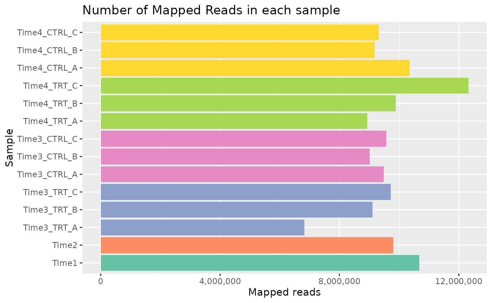

For example the distribution can be seen using both boxplots or density
plots.

\#### Boxplot Mapped Reads

``` r

plot <- plot_mapped_reads_distribution(
    object, palette,
    alpha = 0.8,
    type = "boxplot"
) +
    coord_flip() +
    theme(legend.position = "none") 

plot
```

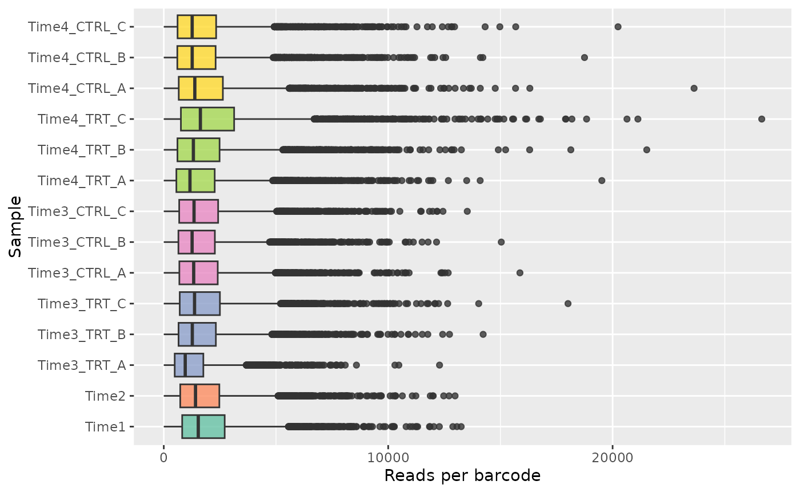

##### Density plot

``` r

plot <- plot_mapped_reads_distribution(
    object, palette,
    alpha = 0.5,
    type = "density"
) +
    ggplot2::theme(legend.position = "none") 

plot
```

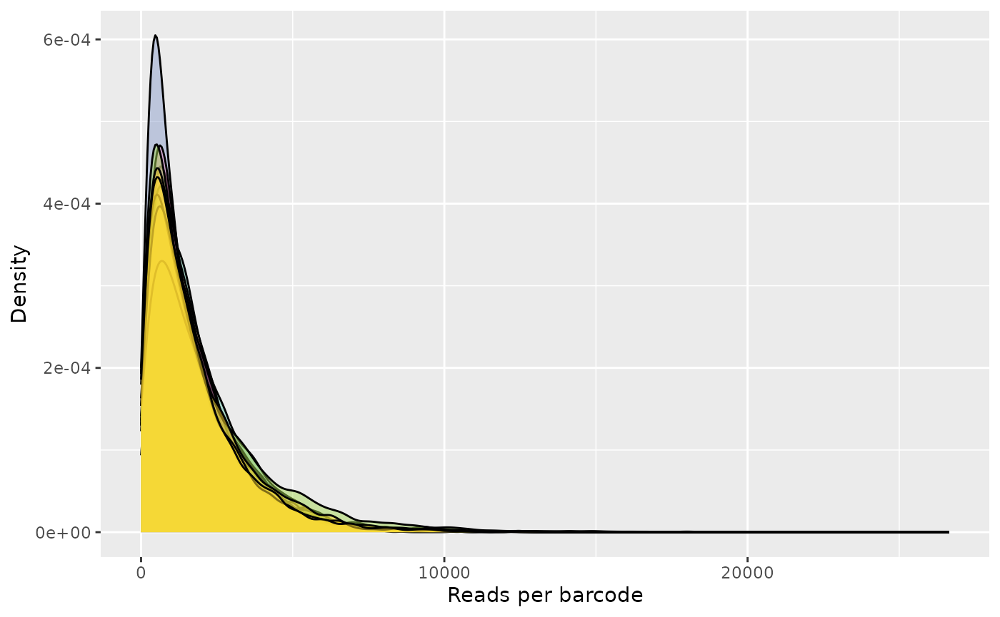

#### Barcode Lost

Another very important quality check when a Genetic Screening is
performed is to check the barcode lost during the experiment, meaning
the barcode that after different time points or treatments results in
reads count equal to zero. ScreenR implements a function able to compute
and plot the number of barcodes lost for each samples.

``` r

plot <- plot_barcode_lost(screenR_Object = object, palette = palette) +
    ggplot2::coord_flip()
plot
```

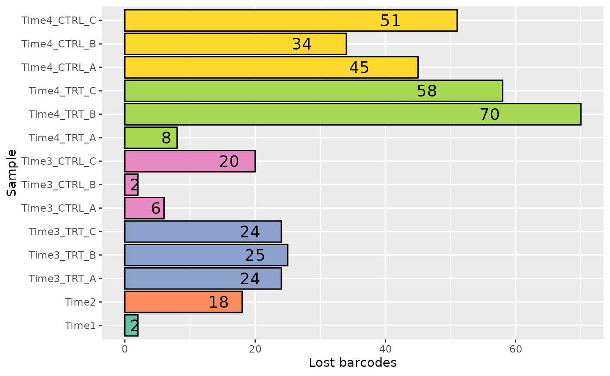

Moreover it is important to check if the lost barcodes in a sample all
belong to the same gene, in order to verify that an adequate number of
barcodes per gene are still present. This can be done by visualizing the
number of barcode lost in a sample by gene.

``` r

plot <- plot_barcode_lost_for_gene(object,
    samples = c("Time4_TRT_C", "Time4_CTRL_C")
)
plot
```

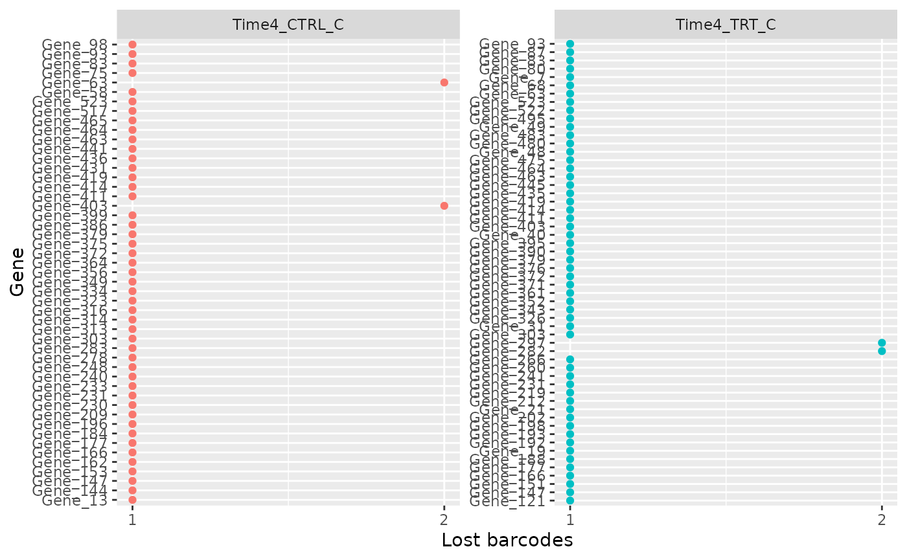

#### Plot MDS

In order to see the samples clusterization an initial MDS analysis can
be conducted. In ScreenR this can be done using the *plot_mds* function
and the user can decide the color code of the graph in order to
highlight the trend of the samples based on replicates, treatment or
timepoints simply by modifying the field levels in the plot_mds
function.

##### For Sample

``` r

plot_mds(screenR_Object = object)
```

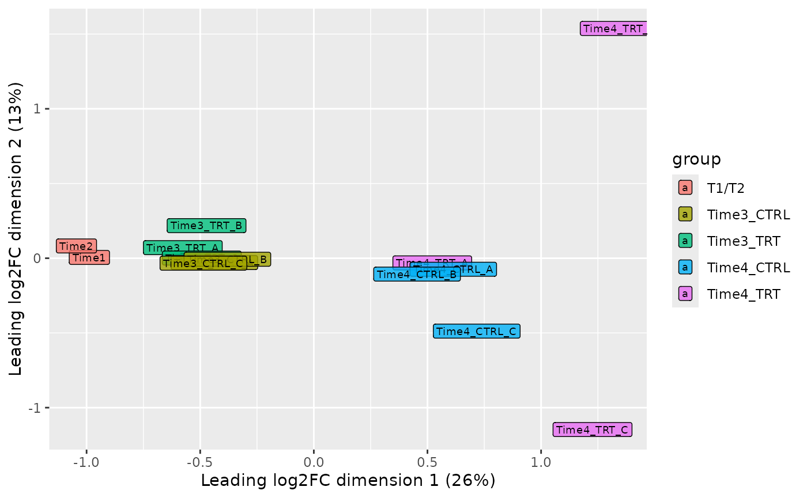

##### For Treatment

``` r

group_table <- get_data_table(object)   %>%
    select(Sample, Day, Treatment) %>%
    distinct()
#> ScreenR normalized data table: 74438 rows, 9 columns

group_treatment <- group_table$Treatment

plot_mds(
    screenR_Object = object,
    groups = factor(x = group_treatment, levels = unique(group_treatment))
)
```

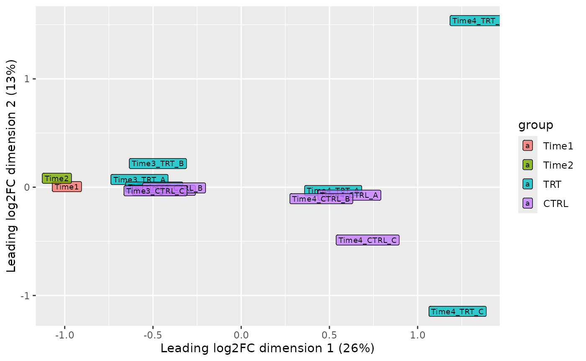

##### For Day

``` r

group_day <- group_table$Day

plot_mds(
    screenR_Object = object,
    groups = factor(x = group_day, levels = unique(group_day))
)
```

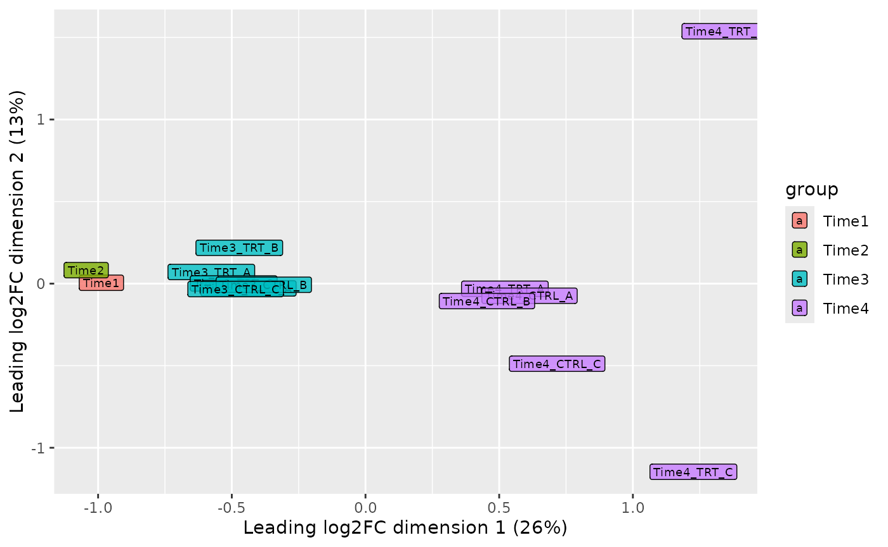

### Statistical Analysis

Once the various steps of the quality check have been passed, the actual
statistical analysis can begin. The statistical Analysis of ScreenR is
based on three different methods:

- [Z-score filtering](https://pubmed.ncbi.nlm.nih.gov/21515799/)
- [CAMERA
  filtering](https://www.ncbi.nlm.nih.gov/pmc/articles/PMC3458527/)
- [ROAST
  filtering](https://www.ncbi.nlm.nih.gov/pmc/articles/PMC2922896/)

#### Z-score hit

In order to compute the Z-score, first a list of metrics has to be
computed. In particular a *Log2FC* is computed for the treated vs
control samples in the different conditions. This can be done using the
function *compute_metrics()*. Here is reported an example of treated vs
control in different day.

Then the different distribution of the Z-score can be plotted using the
*plot_zscore_distribution* function.

``` r

# 2DG
data_with_measure_TRT <- list(
    Time3 = compute_metrics(
        object,
        control = "CTRL", treatment = "TRT",
        day = "Time3"
    ),
    Time4 = compute_metrics(
        object,
        control = "CTRL", treatment = "TRT",
        day = "Time4"
    )
)

plot_zscore_distribution(data_with_measure_TRT, alpha = 0.8) 
```

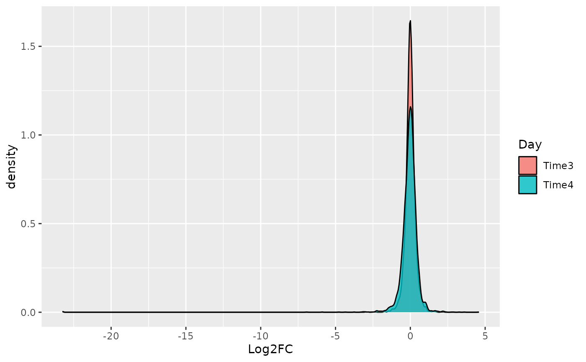

#### Z-score hit

Based on these metrics the Z-score hit identification can be computed
using the *find_zscore_hit* function.

``` r

zscore_hit_TRT <- list(
    Time3 = find_zscore_hit(
        table_treate_vs_control = data_with_measure_TRT$Time3,
        number_barcode = 6, metric = "median"
    ),
    Time4 = find_zscore_hit(
        table_treate_vs_control = data_with_measure_TRT$Time4,
        number_barcode = 6, metric = "median"
    )
)
zscore_hit_TRT
#> $Time3
#> # A tibble: 84 × 2
#>    Gene     numberOfBarcode
#>    <chr>              <int>
#>  1 Gene_1                 7
#>  2 Gene_11                7
#>  3 Gene_116               8
#>  4 Gene_120               8
#>  5 Gene_121               7
#>  6 Gene_128               8
#>  7 Gene_15                7
#>  8 Gene_156               8
#>  9 Gene_158               7
#> 10 Gene_160               7
#> # ℹ 74 more rows
#> 
#> $Time4
#> # A tibble: 97 × 2
#>    Gene     numberOfBarcode
#>    <chr>              <int>
#>  1 Gene_107               7
#>  2 Gene_121               8
#>  3 Gene_125               7
#>  4 Gene_126               7
#>  5 Gene_134               7
#>  6 Gene_138               7
#>  7 Gene_139               7
#>  8 Gene_14                7
#>  9 Gene_147               8
#> 10 Gene_148               9
#> # ℹ 87 more rows
```

#### Design matrix and contrasts

CAMERA and ROAST are based on a linear model, which needs a *design
matrix* (which sample belongs to which group) and a *contrast* (which
groups to compare). The function *create_design_matrix* creates a design
matrix with one column for each group, and *create_contrast* creates the
contrast comparing the treated and the control samples of the same time
point.

``` r

matrix_model <- create_design_matrix(object)
colnames(matrix_model)
#> [1] "T1.T2"      "Time3_CTRL" "Time3_TRT"  "Time4_CTRL" "Time4_TRT"

contrast_TRT <- list(
    Time3 = create_contrast(matrix_model,
        treatment = "Time3_TRT", control = "Time3_CTRL"
    ),
    Time4 = create_contrast(matrix_model,
        treatment = "Time4_TRT", control = "Time4_CTRL"
    )
)
contrast_TRT$Time3
#>      T1.T2 Time3_CTRL  Time3_TRT Time4_CTRL  Time4_TRT 
#>          0         -1          1          0          0
```

#### CAMERA

The same can be done with the CAMERA hit using the function
*find_camera_hit*. Only the genes with a False Discovery Rate (FDR)
lower or equal to the *fdr* argument are returned (default 0.05). In
this example dataset the effect of the treatment is weak, so for
illustration we use a lenient FDR of 25%. The column *Log2FC* is the
median log2 fold change of the barcodes of each gene.

``` r

camera_hit_TRT <- list(
    Time3 = find_camera_hit(
        screenR_Object = object, matrix_model = matrix_model,
        contrast = contrast_TRT$Time3, fdr = 0.25
    ),
    Time4 = find_camera_hit(
        screenR_Object = object, matrix_model = matrix_model,
        contrast = contrast_TRT$Time4, fdr = 0.25
    )
)

camera_hit_TRT
#> $Time3
#> # A tibble: 0 × 6
#> # ℹ 6 variables: Gene <chr>, NGenes <dbl>, Direction <fct>, PValue <dbl>,
#> #   FDR <dbl>, Log2FC <dbl>
#> 
#> $Time4
#> # A tibble: 7 × 6
#>   Gene     NGenes Direction   PValue    FDR Log2FC
#>   <chr>     <dbl> <fct>        <dbl>  <dbl>  <dbl>
#> 1 Gene_173     10 Down      0.000214 0.0882 -0.515
#> 2 Gene_422     10 Down      0.000418 0.0882 -0.433
#> 3 Gene_296     10 Down      0.000495 0.0882 -0.508
#> 4 Gene_352     10 Down      0.00200  0.232  -0.467
#> 5 Gene_87      10 Down      0.00250  0.232  -0.436
#> 6 Gene_370     10 Down      0.00295  0.232  -0.344
#> 7 Gene_15      10 Down      0.00304  0.232  -0.325
```

#### ROAST

Last but not least this is done also for the ROAST hit using the
function  
*find_roast_hit*. ROAST uses random rotations, so the *seed* argument is
set to make the result reproducible.

``` r

roast_hit_TRT <- list(
    Time3 = find_roast_hit(
        screenR_Object = object, matrix_model = matrix_model,
        contrast = contrast_TRT$Time3, fdr = 0.25, seed = 42
    ),
    Time4 = find_roast_hit(
        screenR_Object = object, matrix_model = matrix_model,
        contrast = contrast_TRT$Time4, fdr = 0.25, seed = 42
    )
)

roast_hit_TRT
#> $Time3
#> # A tibble: 1 × 10
#>   Gene     NGenes PropDown PropUp Direction  PValue   FDR PValue.Mixed FDR.Mixed
#>   <chr>     <int>    <dbl>  <dbl> <fct>       <dbl> <dbl>        <dbl>     <dbl>
#> 1 Gene_446     10      0.2      0 Down      0.00045 0.240        0.283     1.000
#> # ℹ 1 more variable: Log2FC <dbl>
#> 
#> $Time4
#> # A tibble: 53 × 10
#>    Gene    NGenes PropDown PropUp Direction PValue    FDR PValue.Mixed FDR.Mixed
#>    <chr>    <int>    <dbl>  <dbl> <fct>      <dbl>  <dbl>        <dbl>     <dbl>
#>  1 Gene_1…     10      0.5    0.1 Down      5  e-5 0.0134       0.0001    0.0134
#>  2 Gene_4…     10      0.5    0.1 Down      5  e-5 0.0134       0.0002    0.0267
#>  3 Gene_2…     10      0.6    0   Down      1  e-4 0.0134       0.0292    0.143 
#>  4 Gene_4…     10      0.5    0   Down      1  e-4 0.0134       0.0006    0.0434
#>  5 Gene_15     10      0.5    0   Down      2.5e-4 0.0267       0.0032    0.0647
#>  6 Gene_3…     10      0.4    0   Down      3  e-4 0.0267       0.0014    0.0584
#>  7 Gene_3…     10      0.3    0.1 Down      4.5e-4 0.0326       0.0141    0.104 
#>  8 Gene_4…     10      0.2    0   Down      5  e-4 0.0326       0.331     0.457 
#>  9 Gene_3…     10      0.2    0   Down      5.5e-4 0.0326       0.163     0.306 
#> 10 Gene_59     10      0.3    0   Down      1.1e-3 0.0587       0.0431    0.167 
#> # ℹ 43 more rows
#> # ℹ 1 more variable: Log2FC <dbl>
```

#### Find Common Hit

ScreenR considers as final hit only the one result as candidate hit in
all three statistical methods. However this is a particularly stringent
method and in some cases leads to a small number of results. For this
reason the user can also decide to opt for a less stringent method that
considers only the hits present in at least two of the statistical
methods. The two different strategies can be computed with the
function::

- **common_hit_TRT_at_least_2**: considering candidate Hits the one
  present in at least two of the three methods (less stringent)

- **common_hit_TRT_at_least_3**: considering candidate Hits the one
  present in all of the three methods

``` r

common_hit_TRT_at_least_2 <- list(
    Time3 = find_common_hit(
        zscore_hit_TRT$Time3, camera_hit_TRT$Time3, roast_hit_TRT$Time3,
        common_in = 2
    ),
    Time4 = find_common_hit(
        zscore_hit_TRT$Time4, camera_hit_TRT$Time4, roast_hit_TRT$Time4,
        common_in = 2
    )
)

common_hit_TRT_at_least_3 <- list(
    Time3 = find_common_hit(
        zscore_hit_TRT$Time3, camera_hit_TRT$Time3, roast_hit_TRT$Time3,
        common_in = 3
    ),
    Time4 = find_common_hit(
        zscore_hit_TRT$Time4, camera_hit_TRT$Time4, roast_hit_TRT$Time4,
        common_in = 3
    )
)
```

#### Plot common hit

The intersection of the hits found by the three statistical methods can
be easily visualized using the *plot_common_hit* function.

``` r

plot_common_hit(
    hit_zscore = zscore_hit_TRT$Time4, hit_camera = camera_hit_TRT$Time4,
    roast_hit_TRT$Time4, show_elements = FALSE, show_percentage = TRUE
)
```

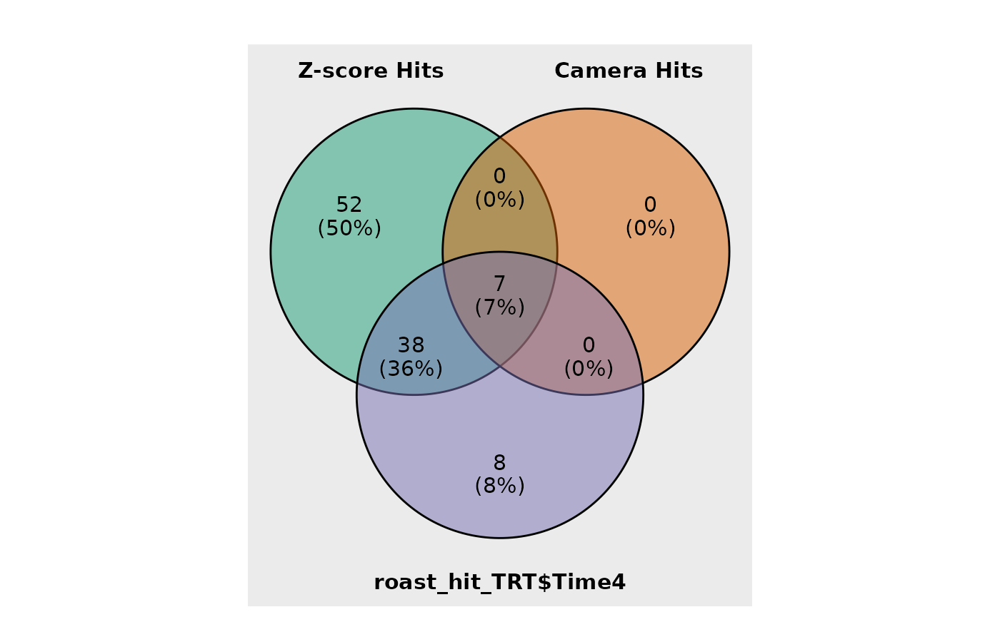

As we all know, when we deal with statistical methods the is the
possibility of *type I* error also known as “false positive”. For this
reason is important to visualize the results obtained. This can be done
by visualizing the trend of the candidate hits obtained using the
function **plot_trend**.

``` r

candidate_hits <- common_hit_TRT_at_least_2$Time4

plot_trend(screenR_Object = object, 
           genes = candidate_hits[1], 
           nrow = 2, ncol = 2, 
           group_var = c("Time1", "Time2", "TRT"))
```

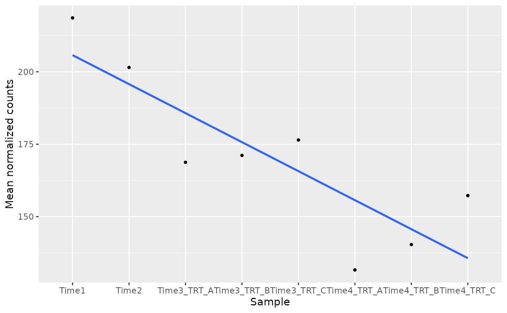

``` r


plot_trend(screenR_Object = object, 
           genes = candidate_hits[2], 
           nrow = 2, ncol = 2, 
           group_var = c("Time1", "Time2", "TRT"))
```

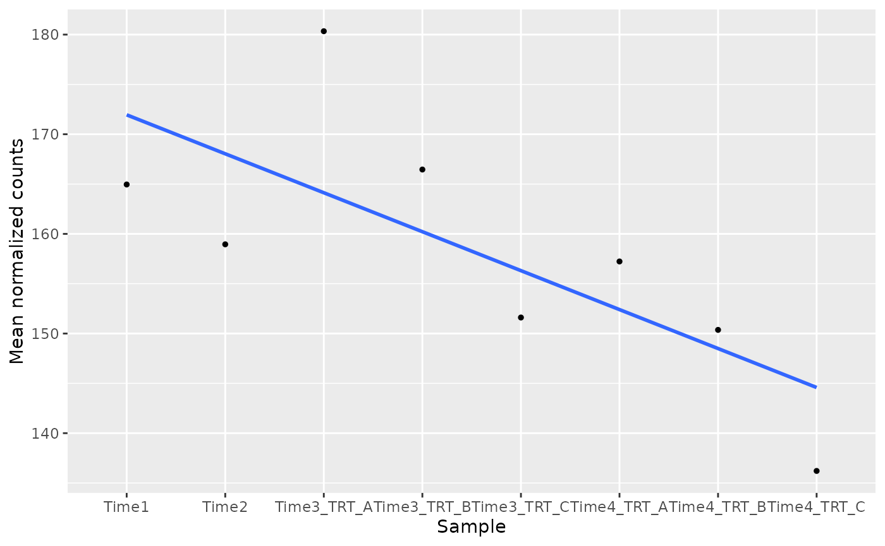

### More statistical methods

The vignette *Improved statistical analysis with ScreenR* shows further
methods: a gene-level Z-score test with p-values and FDR,
replicate-aware barcode statistics, a single model for the whole time
course, the combination of the results of several methods and additional
quality controls.

``` r

sessionInfo()
#> R version 4.6.1 (2026-06-24)
#> Platform: x86_64-pc-linux-gnu
#> Running under: Ubuntu 24.04.5 LTS
#> 
#> Matrix products: default
#> BLAS:   /usr/lib/x86_64-linux-gnu/openblas-pthread/libblas.so.3 
#> LAPACK: /usr/lib/x86_64-linux-gnu/openblas-pthread/libopenblasp-r0.3.26.so;  LAPACK version 3.12.0
#> 
#> locale:
#>  [1] LC_CTYPE=C.UTF-8       LC_NUMERIC=C           LC_TIME=C.UTF-8       
#>  [4] LC_COLLATE=C.UTF-8     LC_MONETARY=C.UTF-8    LC_MESSAGES=C.UTF-8   
#>  [7] LC_PAPER=C.UTF-8       LC_NAME=C              LC_ADDRESS=C          
#> [10] LC_TELEPHONE=C         LC_MEASUREMENT=C.UTF-8 LC_IDENTIFICATION=C   
#> 
#> time zone: UTC
#> tzcode source: system (glibc)
#> 
#> attached base packages:
#> [1] stats     graphics  grDevices utils     datasets  methods   base     
#> 
#> other attached packages:
#> [1] ScreenR_1.15.15  tidyr_1.3.2      dplyr_1.2.1      ggplot2_4.0.3   
#> [5] BiocStyle_2.40.0
#> 
#> loaded via a namespace (and not attached):
#>  [1] SummarizedExperiment_1.42.0 gtable_0.3.6               
#>  [3] xfun_0.61                   bslib_0.12.0               
#>  [5] Biobase_2.72.0              lattice_0.22-9             
#>  [7] vctrs_0.7.3                 tools_4.6.1                
#>  [9] generics_0.1.4              stats4_4.6.1               
#> [11] tibble_3.3.1                pkgconfig_2.0.3            
#> [13] Matrix_1.7-5                RColorBrewer_1.1-3         
#> [15] S7_0.2.2                    desc_1.4.3                 
#> [17] S4Vectors_0.50.3            lifecycle_1.0.5            
#> [19] compiler_4.6.1              farver_2.1.2               
#> [21] stringr_1.6.0               textshaping_1.0.5          
#> [23] statmod_1.5.2               Seqinfo_1.2.0              
#> [25] ggvenn_0.1.19               htmltools_0.5.9            
#> [27] sass_0.4.10                 yaml_2.3.12                
#> [29] pillar_1.11.1               pkgdown_2.2.1              
#> [31] jquerylib_0.1.4             cachem_1.1.0               
#> [33] DelayedArray_0.38.2         limma_3.68.5               
#> [35] abind_1.4-8                 nlme_3.1-169               
#> [37] tidyselect_1.2.1            locfit_1.5-9.12            
#> [39] digest_0.6.39               stringi_1.8.9              
#> [41] purrr_1.2.2                 bookdown_0.48              
#> [43] splines_4.6.1               labeling_0.4.3             
#> [45] fastmap_1.2.0               grid_4.6.1                 
#> [47] cli_3.6.6                   SparseArray_1.12.3         
#> [49] magrittr_2.0.5              patchwork_1.3.2            
#> [51] S4Arrays_1.12.1             utf8_1.2.6                 
#> [53] edgeR_4.10.5                withr_3.0.3                
#> [55] scales_1.4.0                rmarkdown_2.32             
#> [57] XVector_0.52.0              matrixStats_1.5.0          
#> [59] otel_0.2.0                  ragg_1.5.2                 
#> [61] evaluate_1.0.5              knitr_1.52                 
#> [63] GenomicRanges_1.64.0        IRanges_2.46.0             
#> [65] mgcv_1.9-4                  rlang_1.3.0                
#> [67] glue_1.8.1                  BiocManager_1.30.27        
#> [69] BiocGenerics_0.58.1         jsonlite_2.0.0             
#> [71] R6_2.6.1                    MatrixGenerics_1.24.0      
#> [73] systemfonts_1.3.2           fs_2.1.0
```
