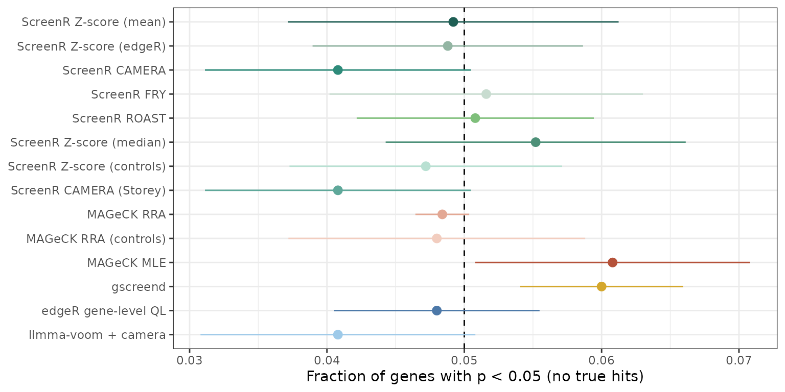
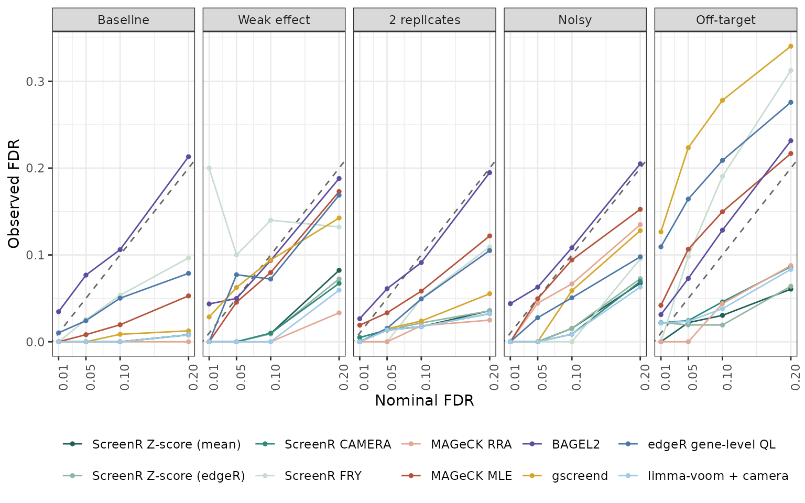
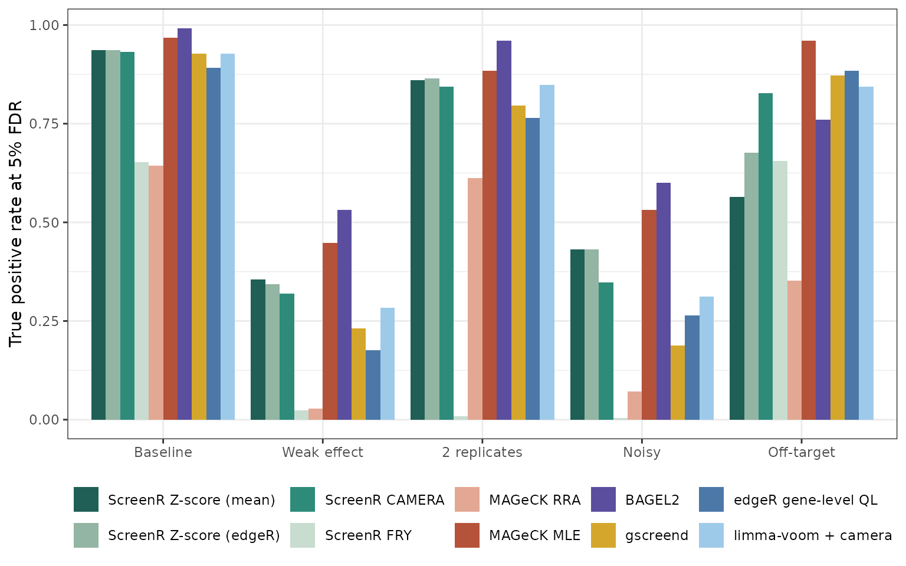
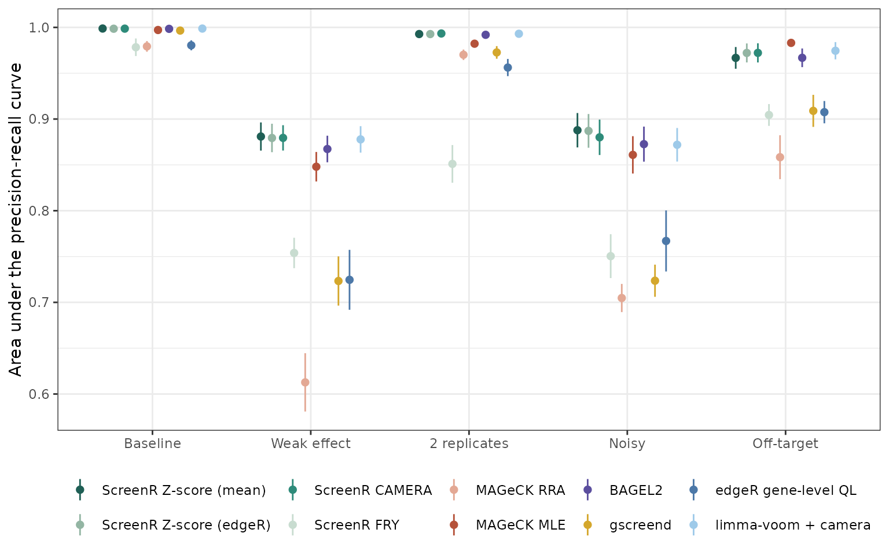
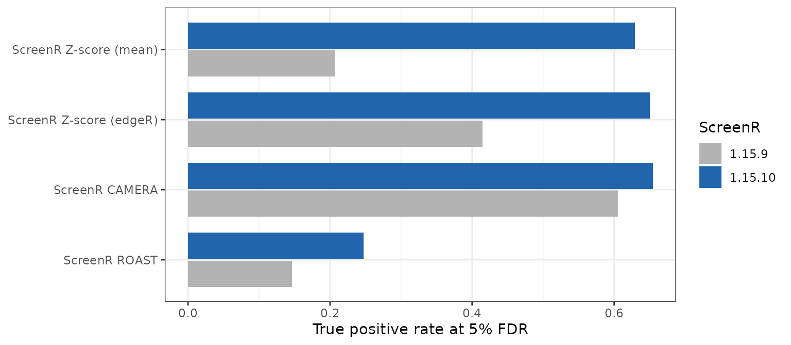
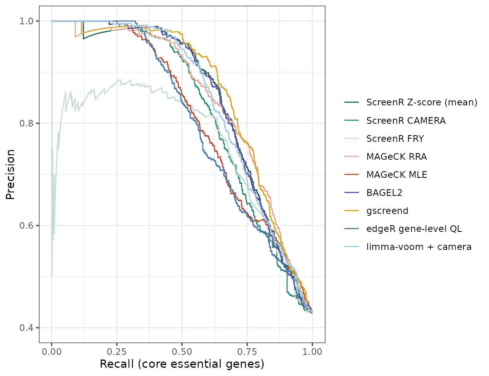
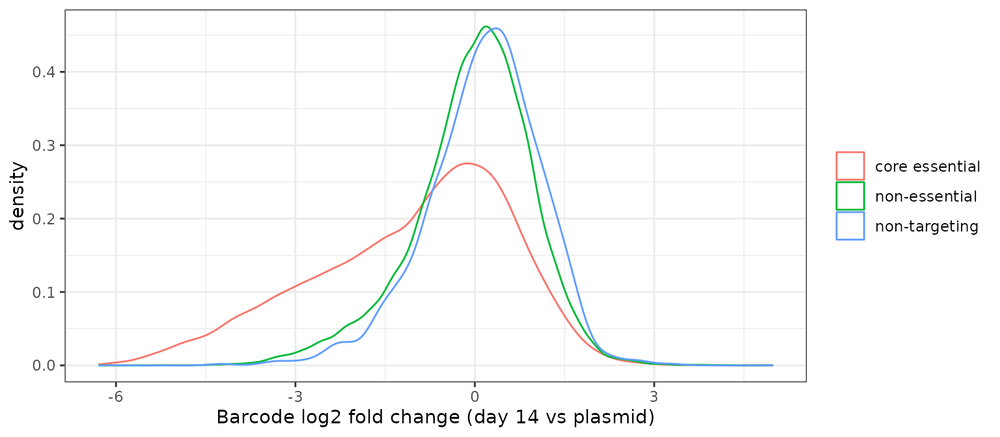
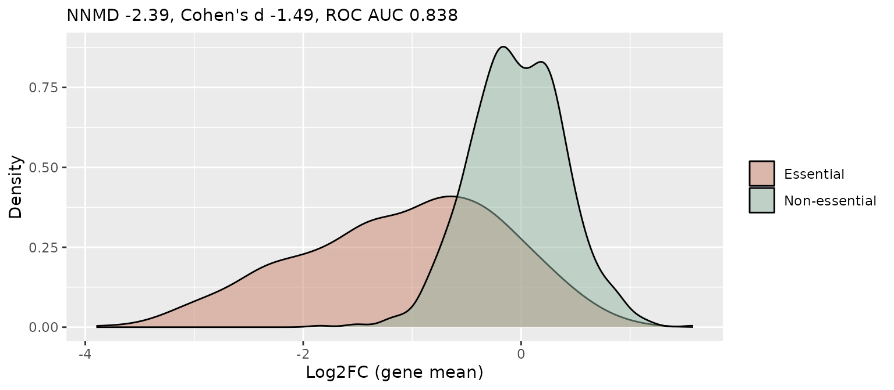
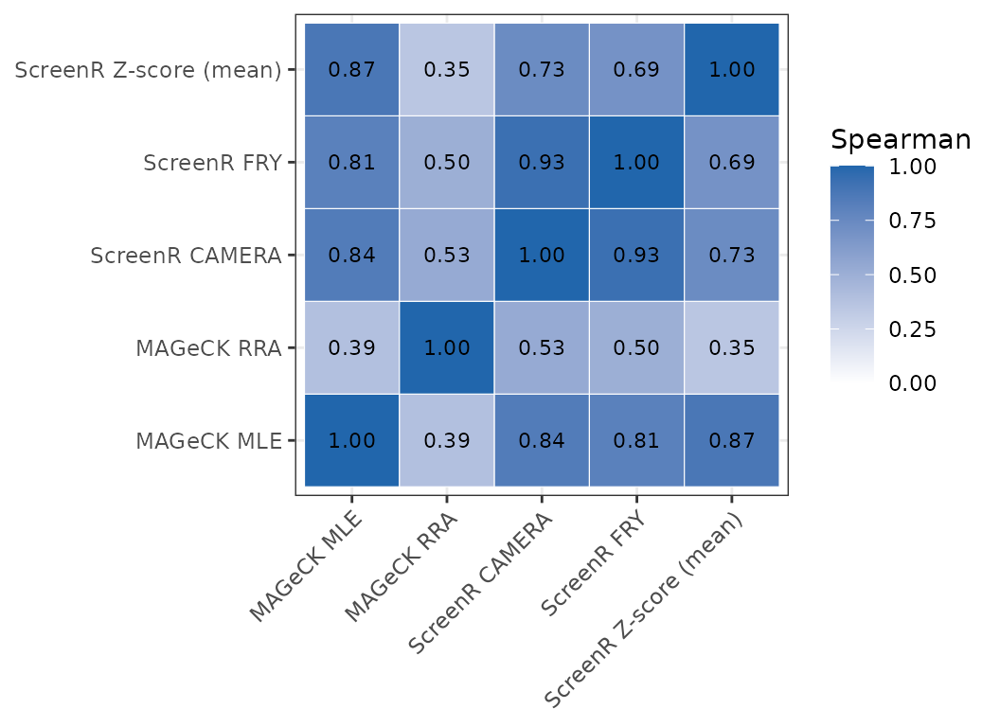

# Benchmark against MAGeCK and other tools

## About this vignette

This vignette compares the hit-finding methods of ScreenR with other
tools for pooled screens:

- MAGeCK RRA and MAGeCK MLE (Li et al. 2014, 2015), the most used tools;
- BAGEL2 (Kim and Hart 2021), a supervised classifier of essential
  genes;
- gscreend (Imkeller et al. 2020), a Bioconductor package for CRISPR
  screens;
- two plain edgeR/limma workflows: edgeR quasi-likelihood test on the
  counts summed by gene, and limma-voom with camera on the barcodes of
  each gene (as proposed for shRNA and CRISPR screens by Dai et
  al. 2014).

The comparisons use

1.  simulated screens, where the true hits are known exactly;
2.  a published K562 shRNA essentiality screen (`k562_count_table`),
    where the core essential genes are the true hits and the
    non-essential genes the true negatives;
3.  a published HAP1 CRISPR-Cas9 essentiality screen, evaluated in the
    same way;
4.  the ScreenR example dataset (`count_table`), which has no ground
    truth.

The other tools are Python programs or packages that are not
dependencies of ScreenR, so their results (MAGeCK 0.5.9.5, BAGEL2,
gscreend 1.17.2, edgeR 4.0, limma 3.58) and the simulation results are
precomputed and distributed in `inst/extdata/benchmark`. The ScreenR
methods on the K562 screen are run here, so this vignette also shows how
to compare ScreenR with other tools on your own data. The scripts that
produced the precomputed results are in the `benchmark` folder of the
[GitHub repository](https://github.com/EmanuelSoda/ScreenR).

Some differences in how the tools were run matter for the
interpretation:

- **BAGEL2 is supervised**: it needs genes known to be essential and
  non-essential to train its classifier. In the simulations it was
  trained on half of the true hits and half of the genes without effect,
  and on the real screens on the reference genes used for the evaluation
  (with 10-fold cross-validation, its standard use). It reports Bayes
  factors, not p-values, so it has no null calibration and its calls use
  its own FDR estimate.
- **MAGeCK MLE** p-values were computed from its Wald statistic
  (`pnorm(z)`, Benjamini-Hochberg), not from its permutation FDR.
- **gscreend** accepts a single reference sample, so the control
  replicates were summed. It is deprecated in Bioconductor 3.19.

``` r

library(ScreenR)
library(dplyr)
library(tidyr)
library(ggplot2)
benchmark_dir <- system.file("extdata", "benchmark", package = "ScreenR")
```

``` r

labels <- c(
    ScreenR_Zscore_mean = "ScreenR Z-score (mean)",
    ScreenR_Zscore_edgeR = "ScreenR Z-score (edgeR)",
    ScreenR_CAMERA = "ScreenR CAMERA",
    ScreenR_FRY = "ScreenR FRY",
    ScreenR_ROAST = "ScreenR ROAST",
    ScreenR_Zscore_median = "ScreenR Z-score (median)",
    ScreenR_Zscore_controls = "ScreenR Z-score (controls)",
    ScreenR_CAMERA_storey = "ScreenR CAMERA (Storey)",
    ScreenR_legacy_rule = "ScreenR legacy rule",
    MAGeCK_RRA = "MAGeCK RRA",
    MAGeCK_RRA_controls = "MAGeCK RRA (controls)",
    MAGeCK_MLE = "MAGeCK MLE",
    BAGEL2 = "BAGEL2",
    gscreend = "gscreend",
    edgeR_gene_QL = "edgeR gene-level QL",
    limma_voom_camera = "limma-voom + camera"
)
colours <- c(
    "ScreenR Z-score (mean)" = "#1F5F55", "ScreenR Z-score (edgeR)" = "#93B5A3",
    "ScreenR CAMERA" = "#2E8B7A", "ScreenR FRY" = "#C8DCD0",
    "ScreenR ROAST" = "#7FBF7B", "ScreenR Z-score (median)" = "#4D9078",
    "ScreenR Z-score (controls)" = "#B8E0D2",
    "ScreenR CAMERA (Storey)" = "#5FA89A", "ScreenR legacy rule" = "grey50",
    "MAGeCK RRA" = "#E3A894", "MAGeCK RRA (controls)" = "#F2CDBF",
    "MAGeCK MLE" = "#B5523A", "BAGEL2" = "#5B4E9E", "gscreend" = "#D4A72C",
    "edgeR gene-level QL" = "#4C78A8", "limma-voom + camera" = "#9ECAE9"
)
# The methods shown in the figures (all methods are in the tables)
main <- c("ScreenR_Zscore_mean", "ScreenR_Zscore_edgeR", "ScreenR_CAMERA",
    "ScreenR_FRY", "MAGeCK_RRA", "MAGeCK_MLE", "BAGEL2", "gscreend",
    "edgeR_gene_QL", "limma_voom_camera")
scenarios <- c(
    S0_null = "No hits", S1_baseline = "Baseline",
    S2_weak_effect = "Weak effect", S3_two_replicates = "2 replicates",
    S4_noisy = "Noisy", S5_off_target = "Off-target"
)
```

## Simulated screens

### Design

Each simulated screen has 500 genes with 10 shRNAs each and 500
non-targeting shRNAs, with 3 control and 3 treated samples. The counts
are negative binomial, and the abundance of the shRNAs in the library is
log-normal. 10% of the genes are true hits, depleted in the treated
samples: each of their shRNAs has its own knockdown efficiency and 20%
of them do not work at all. Six scenarios were simulated, each with 5
random seeds:

| Scenario     | Change from the baseline                                |
|--------------|---------------------------------------------------------|
| No hits      | no true hits: every call is false                       |
| Baseline     | 3 vs 3 replicates, log2 fold change -1, dispersion 0.05 |
| Weak effect  | log2 fold change -0.5                                   |
| 2 replicates | 2 vs 2 replicates                                       |
| Noisy        | dispersion 0.2 (four times more biological variability) |
| Off-target   | 3% of the shRNAs depleted whatever gene they target     |

The ScreenR methods are
[`find_camera_hit()`](https://emanuelsoda.github.io/ScreenR/reference/find_camera_hit.md)
(with Benjamini-Hochberg or Storey FDR),
[`find_roast_hit()`](https://emanuelsoda.github.io/ScreenR/reference/find_roast_hit.md)
(ROAST and FRY),
[`find_gene_zscore_hit()`](https://emanuelsoda.github.io/ScreenR/reference/find_gene_zscore_hit.md)
(mean, median, with the non-targeting shRNAs as reference and on the
statistics of
[`compute_barcode_statistics()`](https://emanuelsoda.github.io/ScreenR/reference/compute_barcode_statistics.md))
and the legacy rule of
[`find_zscore_hit()`](https://emanuelsoda.github.io/ScreenR/reference/find_zscore_hit.md).
The other tools are MAGeCK RRA (also with the non-targeting shRNAs as
controls, `--control-sgrna`), MAGeCK MLE, BAGEL2, gscreend, the edgeR
gene-level test and limma-voom with camera.

``` r

simulation <- bind_rows(
    read.csv(file.path(benchmark_dir, "simulation.csv")),
    read.csv(file.path(benchmark_dir, "simulation_competitors.csv"))
) %>%
    mutate(
        Method = factor(labels[method], levels = labels),
        Scenario = factor(scenarios[scenario], levels = scenarios)
    )
head(simulation)
#>                method alpha n_called FDP TPR null_p_below AUPRC  time scenario
#> 1          MAGeCK_RRA  0.01        0   0  NA        0.012    NA 0.708  S0_null
#> 2          MAGeCK_RRA  0.05        1   1  NA        0.048    NA 0.708  S0_null
#> 3          MAGeCK_RRA  0.10        1   1  NA        0.092    NA 0.708  S0_null
#> 4          MAGeCK_RRA  0.20        1   1  NA        0.198    NA 0.708  S0_null
#> 5 MAGeCK_RRA_controls  0.01        0   0  NA        0.006    NA 0.724  S0_null
#> 6 MAGeCK_RRA_controls  0.05        0   0  NA        0.046    NA 0.724  S0_null
#>   seed                Method Scenario
#> 1    1            MAGeCK RRA  No hits
#> 2    1            MAGeCK RRA  No hits
#> 3    1            MAGeCK RRA  No hits
#> 4    1            MAGeCK RRA  No hits
#> 5    1 MAGeCK RRA (controls)  No hits
#> 6    1 MAGeCK RRA (controls)  No hits
```

For each method, screen and nominal FDR level (`alpha`) the table has
the number of genes called (`n_called`), the false discovery proportion
(`FDP`, the fraction of called genes that are not true hits), the true
positive rate (`TPR`), the fraction of genes without effect with p-value
below `alpha` (`null_p_below`), the area under the precision-recall
curve of the p-value ranking (`AUPRC`) and the run time in seconds.

### Are the p-values valid?

In the screens without hits, a valid test has about 5% of the genes with
p \< 0.05.

``` r

simulation %>%
    filter(scenario == "S0_null", alpha == 0.05, !is.na(null_p_below),
        method != "ScreenR_legacy_rule") %>%
    group_by(Method) %>%
    summarise(fraction = mean(null_p_below), se = sd(null_p_below) / sqrt(n())) %>%
    ggplot(aes(fraction, Method, colour = Method)) +
    geom_vline(xintercept = 0.05, linetype = "dashed") +
    geom_pointrange(aes(xmin = fraction - 2 * se, xmax = fraction + 2 * se)) +
    scale_colour_manual(values = colours, guide = "none") +
    scale_y_discrete(limits = rev) +
    labs(x = "Fraction of genes with p < 0.05 (no true hits)", y = NULL) +
    theme_bw()
```



All the methods are close to 5% (BAGEL2 has no p-values). The legacy
rule, which has no p-value, called on average 87 genes in these screens,
all of them false.

### Is the FDR controlled?

A method controls the FDR when the observed FDR (the mean false
discovery proportion) is at or below the nominal level, the dashed line.

``` r

simulation %>%
    filter(scenario != "S0_null", method %in% main) %>%
    group_by(Method, Scenario, alpha) %>%
    summarise(FDR = mean(FDP), .groups = "drop") %>%
    ggplot(aes(alpha, FDR, colour = Method)) +
    geom_abline(linetype = "dashed", colour = "grey40") +
    geom_line() +
    geom_point(size = 1) +
    facet_wrap(~Scenario, nrow = 1) +
    scale_colour_manual(values = colours) +
    scale_x_continuous(breaks = c(0.01, 0.05, 0.1, 0.2)) +
    labs(x = "Nominal FDR", y = "Observed FDR", colour = NULL) +
    theme_bw() +
    theme(legend.position = "bottom", axis.text.x = element_text(angle = 90))
```



``` r

fdr_table <- simulation %>%
    filter(scenario != "S0_null", alpha == 0.05) %>%
    group_by(Method, Scenario) %>%
    summarise(FDP = mean(FDP), .groups = "drop") %>%
    pivot_wider(names_from = Scenario, values_from = FDP)
knitr::kable(fdr_table, digits = 3,
    caption = "Observed FDR at a nominal FDR of 5% (mean over 5 seeds).")
```

| Method                     | Baseline | Weak effect | 2 replicates | Noisy | Off-target |
|:---------------------------|---------:|------------:|-------------:|------:|-----------:|
| ScreenR Z-score (mean)     |    0.000 |       0.000 |        0.013 | 0.000 |      0.022 |
| ScreenR Z-score (edgeR)    |    0.000 |       0.000 |        0.013 | 0.000 |      0.019 |
| ScreenR CAMERA             |    0.000 |       0.000 |        0.014 | 0.000 |      0.024 |
| ScreenR FRY                |    0.025 |       0.100 |        0.000 | 0.000 |      0.098 |
| ScreenR ROAST              |    0.026 |       0.000 |        0.000 | 0.000 |      0.064 |
| ScreenR Z-score (median)   |    0.013 |       0.000 |        0.023 | 0.031 |      0.022 |
| ScreenR Z-score (controls) |    0.046 |       0.039 |        0.075 | 0.056 |      0.053 |
| ScreenR CAMERA (Storey)    |    0.000 |       0.000 |        0.014 | 0.000 |      0.024 |
| ScreenR legacy rule        |    0.501 |       0.604 |        0.516 | 0.575 |      0.530 |
| MAGeCK RRA                 |    0.000 |       0.000 |        0.000 | 0.044 |      0.000 |
| MAGeCK RRA (controls)      |    0.190 |       0.071 |        0.096 | 0.156 |      0.073 |
| MAGeCK MLE                 |    0.008 |       0.046 |        0.033 | 0.050 |      0.107 |
| BAGEL2                     |    0.077 |       0.050 |        0.061 | 0.063 |      0.073 |
| gscreend                   |    0.000 |       0.062 |        0.015 | 0.000 |      0.224 |
| edgeR gene-level QL        |    0.024 |       0.077 |        0.015 | 0.028 |      0.164 |
| limma-voom + camera        |    0.000 |       0.000 |        0.013 | 0.000 |      0.024 |

Observed FDR at a nominal FDR of 5% (mean over 5 seeds). {.table}

The ScreenR CAMERA and Z-score tests, limma-voom with camera and MAGeCK
RRA stay below the nominal FDR in every scenario. BAGEL2 is slightly
above it in most scenarios; MAGeCK MLE, gscreend and the edgeR
gene-level test exceed it with off-target effects (gscreend up to about
20%); MAGeCK RRA with the non-targeting controls exceeds it in every
scenario, and the legacy rule has about 50% false hits.

### How many hits are found?

``` r

simulation %>%
    filter(scenario != "S0_null", alpha == 0.05, method %in% main) %>%
    group_by(Method, Scenario) %>%
    summarise(TPR = mean(TPR), .groups = "drop") %>%
    ggplot(aes(Scenario, TPR, fill = Method)) +
    geom_col(position = position_dodge(0.9)) +
    scale_fill_manual(values = colours) +
    labs(x = NULL, y = "True positive rate at 5% FDR", fill = NULL) +
    theme_bw() +
    theme(legend.position = "bottom")
```



The true positive rate depends on the FDR threshold, so it should be
read together with the previous section: the legacy rule finds almost
all the hits because it calls many false ones. The area under the
precision-recall curve measures how well the true hits are ranked first,
whatever the threshold:

``` r

simulation %>%
    filter(scenario != "S0_null", alpha == 0.05, !is.na(AUPRC),
        method %in% main) %>%
    group_by(Method, Scenario) %>%
    summarise(se = sd(AUPRC) / sqrt(n()), AUPRC = mean(AUPRC),
        .groups = "drop") %>%
    ggplot(aes(Scenario, AUPRC, colour = Method)) +
    geom_pointrange(aes(ymin = AUPRC - se, ymax = AUPRC + se),
        position = position_dodge(0.7), size = 0.3) +
    scale_colour_manual(values = colours) +
    labs(x = NULL, y = "Area under the precision-recall curve",
        colour = NULL) +
    theme_bw() +
    theme(legend.position = "bottom")
```



``` r

simulation %>%
    filter(scenario != "S0_null", alpha == 0.05) %>%
    group_by(Method) %>%
    summarise(`Observed FDR` = mean(FDP), TPR = mean(TPR),
        AUPRC = mean(AUPRC), `Time (s)` = median(time)) %>%
    knitr::kable(digits = 3,
        caption = "Mean over the five scenarios with hits, at 5% FDR.")
```

| Method                     | Observed FDR |   TPR | AUPRC | Time (s) |
|:---------------------------|-------------:|------:|------:|---------:|
| ScreenR Z-score (mean)     |        0.007 | 0.630 | 0.945 |    1.701 |
| ScreenR Z-score (edgeR)    |        0.007 | 0.650 | 0.946 |    1.660 |
| ScreenR CAMERA             |        0.008 | 0.654 | 0.945 |    1.676 |
| ScreenR FRY                |        0.045 | 0.269 | 0.848 |    1.560 |
| ScreenR ROAST              |        0.018 | 0.247 | 0.852 |    3.431 |
| ScreenR Z-score (median)   |        0.018 | 0.628 | 0.921 |    6.852 |
| ScreenR Z-score (controls) |        0.054 | 0.807 | 0.946 |    0.339 |
| ScreenR CAMERA (Storey)    |        0.008 | 0.654 | 0.945 |    1.500 |
| ScreenR legacy rule        |        0.545 | 0.912 |    NA |       NA |
| MAGeCK RRA                 |        0.009 | 0.342 | 0.825 |    1.693 |
| MAGeCK RRA (controls)      |        0.117 | 0.570 | 0.828 |    1.515 |
| MAGeCK MLE                 |        0.049 | 0.758 | 0.934 |  370.529 |
| BAGEL2                     |        0.065 | 0.769 | 0.939 |   39.744 |
| gscreend                   |        0.060 | 0.603 | 0.865 |    9.032 |
| edgeR gene-level QL        |        0.062 | 0.596 | 0.867 |    0.125 |
| limma-voom + camera        |        0.007 | 0.643 | 0.943 |    1.222 |

Mean over the five scenarios with hits, at 5% FDR. {.table}

In these simulations the ScreenR CAMERA and Z-score tests rank the hits
as well as the best tools (limma-voom with camera, BAGEL2 and MAGeCK
MLE) and better than MAGeCK RRA, gscreend and the edgeR gene-level test,
which lose most with weak effects or noisy data. At the same nominal FDR
they are more conservative: BAGEL2 and MAGeCK MLE find more hits, but
BAGEL2 is trained on known hits and both exceed the nominal FDR in some
scenarios. ROAST and FRY test each gene on its own barcodes, so they
have little power with two replicates or noisy data. limma-voom with
camera behaves almost exactly like the ScreenR CAMERA test: they are the
same kind of test, which ScreenR wraps in a complete workflow.

The simulations use a simple model (independent barcodes, the same
number of barcodes for every gene, depletion only), so they show how the
methods behave rather than how they rank on every real screen.

### Before and after the calibration of ScreenR 1.15.10

The first version of this benchmark showed that the ScreenR tests were
valid but too conservative (two-sided p-values used for a one-sided
question and a binomial gene test with few possible p-values). ScreenR
1.15.10 fixed both.

``` r

before <- read.csv(file.path(benchmark_dir, "simulation_before_1.15.10.csv"))
compared <- c("ScreenR_CAMERA", "ScreenR_ROAST", "ScreenR_Zscore_mean",
    "ScreenR_Zscore_edgeR")
bind_rows(
    before %>%
        mutate(method = recode(method, ScreenR_Zscore = "ScreenR_Zscore_mean"),
            version = "1.15.9"),
    simulation %>% mutate(version = "1.15.10")
) %>%
    filter(method %in% compared, scenario != "S0_null", alpha == 0.05) %>%
    mutate(Method = factor(labels[method], levels = labels),
        version = factor(version, c("1.15.9", "1.15.10"))) %>%
    group_by(Method, version) %>%
    summarise(TPR = mean(TPR), .groups = "drop") %>%
    ggplot(aes(TPR, Method, fill = version)) +
    geom_col(position = position_dodge(0.8), width = 0.75) +
    scale_fill_manual(values = c("grey70", "#2166AC")) +
    scale_y_discrete(limits = rev) +
    labs(x = "True positive rate at 5% FDR", y = NULL, fill = "ScreenR") +
    theme_bw()
```



## K562 essentiality screen

### The data

`k562_count_table` is a subset of the genome-wide shRNA screen of
Morgens et al. (2016): the plasmid library and two replicates after 14
days of growth of K562 cells. The shRNAs of the genes needed for growth
are depleted. The reference genes of Hart et
al. (`k562_reference_genes`) give the truth: the 681 core essential
genes should be called, the 904 non-essential genes should not.

``` r

data(k562_count_table)
data(k562_annotation_table)
data(k562_reference_genes)
samples <- data.frame(
    Sample = c("Plasmid", "T14_A", "T14_B"),
    Day = c("Plasmid", "T14", "T14"),
    Treatment = "Untreated"
)
k562 <- create_screenr_object(
    table = k562_count_table, annotation = k562_annotation_table,
    groups = factor(c("Plasmid", "T14", "T14")), sample_table = samples
)
k562 <- compute_data_table(normalize_data(k562))
k562
#> class: screenr_object 
#> dim: 67358 3 
#> metadata(2): screenr_layout normalization
#> assays(1): counts
#> rownames(67358): 0_H01__01204 0_H01__01217 ... 9978_H02__24
#>   9978_H02_~_25
#> rowData names(4): Barcode Gene Gene_ID Class
#> colnames(3): Plasmid T14_A T14_B
#> colData names(5): Sample Day Treatment Group EffectiveLibSize
#> normalization: cpm (effective library sizes in colData(object)$EffectiveLibSize)
```

### Running the ScreenR methods

The comparison is day 14 against the plasmid. `fdr = 1` returns every
gene, so that the methods can be evaluated at any threshold.

``` r

design <- create_design_matrix(k562)
contrast <- create_contrast(design, treatment = "T14", control = "Plasmid")
metrics <- compute_metrics(k562,
    control = "Plasmid", treatment = "T14", condition_column = "Day"
)
results <- list(
    `ScreenR_CAMERA` = find_camera_hit(k562, design, contrast,
        fdr = 1, number_barcode = 1),
    `ScreenR_FRY` = find_roast_hit(k562, design, contrast,
        method = "fry", fdr = 1, number_barcode = 1),
    `ScreenR_Zscore_mean` = find_gene_zscore_hit(metrics,
        fdr = 1, min_barcodes = 1, n_permutations = 20000, seed = 1),
    `ScreenR_Zscore_controls` = find_gene_zscore_hit(metrics,
        control_genes = "non-targeting", fdr = 1, min_barcodes = 1,
        n_permutations = 20000, seed = 1)
)
results <- lapply(results, function(x) select(x, Gene, PValue, FDR))
```

### Adding the results of the other tools

The other tools were run on the same counts: `mageck test` for RRA,
`mageck mle` with a design with intercept and treatment, BAGEL2 trained
on the reference genes, gscreend and the two edgeR/limma workflows.

``` r

others <- bind_rows(
    read.csv(file.path(benchmark_dir, "mageck_k562.csv")),
    read.csv(file.path(benchmark_dir, "competitors_k562.csv"))
)
results <- c(split(select(others, -method), others$method), results)
names(results)
#>  [1] "BAGEL2"                  "edgeR_gene_QL"          
#>  [3] "gscreend"                "limma_voom_camera"      
#>  [5] "MAGeCK_MLE"              "MAGeCK_RRA"             
#>  [7] "ScreenR_CAMERA"          "ScreenR_FRY"            
#>  [9] "ScreenR_Zscore_mean"     "ScreenR_Zscore_controls"
```

### Evaluation on the reference genes

``` r

evaluate <- function(result, alpha = 0.05) {
    # Genes are sorted by name, so that tied p-values are ordered the same
    # way for every method
    merged <- left_join(k562_reference_genes, result, by = "Gene") %>%
        mutate(PValue = coalesce(PValue, 1), FDR = coalesce(FDR, 1)) %>%
        arrange(Gene)
    essential <- merged$Class == "core essential"
    called <- merged$FDR <= alpha
    hit <- essential[order(merged$PValue)]
    precision <- cumsum(hit) / seq_along(hit)
    tibble(
        `Essential called` = sum(called & essential),
        `Non-essential called` = sum(called & !essential),
        Recall = mean(called[essential]),
        `Non-essential fraction` = sum(called & !essential) / max(1, sum(called)),
        AUPRC = sum(precision[hit]) / sum(hit)
    )
}
k562_evaluation <- bind_rows(lapply(results, evaluate), .id = "method") %>%
    mutate(Method = labels[method]) %>%
    select(Method, everything(), -method) %>%
    arrange(desc(AUPRC))
knitr::kable(k562_evaluation, digits = 3,
    caption = "K562: reference genes called at 5% FDR.")
```

| Method | Essential called | Non-essential called | Recall | Non-essential fraction | AUPRC |
|:---|---:|---:|---:|---:|---:|
| gscreend | 331 | 7 | 0.486 | 0.021 | 0.861 |
| MAGeCK RRA | 326 | 18 | 0.479 | 0.052 | 0.847 |
| ScreenR Z-score (mean) | 332 | 13 | 0.488 | 0.038 | 0.847 |
| BAGEL2 | 350 | 18 | 0.514 | 0.049 | 0.847 |
| limma-voom + camera | 316 | 10 | 0.464 | 0.031 | 0.844 |
| ScreenR CAMERA | 312 | 17 | 0.458 | 0.052 | 0.824 |
| MAGeCK MLE | 417 | 130 | 0.612 | 0.238 | 0.809 |
| edgeR gene-level QL | 405 | 142 | 0.595 | 0.260 | 0.801 |
| ScreenR Z-score (controls) | 547 | 292 | 0.803 | 0.348 | 0.767 |
| ScreenR FRY | 0 | 0 | 0.000 | 0.000 | 0.757 |

K562: reference genes called at 5% FDR. {.table}

``` r

precision_recall <- bind_rows(lapply(results, function(result) {
    merged <- left_join(k562_reference_genes, result, by = "Gene") %>%
        mutate(PValue = coalesce(PValue, 1)) %>%
        arrange(Gene)
    hit <- merged$Class[order(merged$PValue)] == "core essential"
    tibble(recall = cumsum(hit) / sum(hit),
        precision = cumsum(hit) / seq_along(hit))
}), .id = "method") %>%
    filter(method %in% main) %>%
    mutate(Method = factor(labels[method], levels = labels))
ggplot(precision_recall, aes(recall, precision, colour = Method)) +
    geom_line() +
    scale_colour_manual(values = colours) +
    coord_cartesian(ylim = c(0.4, 1)) +
    labs(x = "Recall (core essential genes)", y = "Precision", colour = NULL) +
    theme_bw()
```



The tools that control the FDR call between 310 and 350 of the 681
essential genes with few non-essential genes, and their rankings are
close (AUPRC 0.82 to 0.86, gscreend best): on this screen the ScreenR
Z-score test is comparable to MAGeCK RRA and BAGEL2. MAGeCK MLE and the
edgeR gene-level test find more essential genes but also many
non-essential ones (MAGeCK MLE skipped the genes with more than about 40
shRNAs, which count as not called here).

Two ScreenR results show the limits of some methods:

- **FRY calls no gene.** It tests each gene on its own barcodes and
  relies on the variability between replicates, but the control group is
  a single plasmid sample. With one control sample use CAMERA or the
  Z-score test.
- **The non-targeting reference calls hundreds of non-essential genes.**
  In shRNA screens the targeting shRNAs are usually somewhat depleted
  compared with the non-targeting ones, so every gene looks depleted
  against them. Before using `control_genes`, check that the controls
  behave like genes without effect:

``` r

metrics %>%
    left_join(distinct(k562_annotation_table, Gene, Class), by = "Gene") %>%
    filter(Class %in% c("non-targeting", "non-essential", "core essential")) %>%
    ggplot(aes(Log2FC, colour = Class)) +
    geom_density() +
    labs(x = "Barcode log2 fold change (day 14 vs plasmid)", colour = NULL) +
    theme_bw()
```



The non-targeting shRNAs (the reference) are shifted to the right of the
non-essential genes, so they are not a good model of a gene without
effect.

### Checking the quality of the screen

The same reference genes measure the quality of a dropout screen before
looking at any hit.
[`compute_screen_quality()`](https://emanuelsoda.github.io/ScreenR/reference/compute_screen_quality.md)
reports how well the essential genes are separated from the
non-essential ones, and
[`plot_reference_separation()`](https://emanuelsoda.github.io/ScreenR/reference/plot_reference_separation.md)
shows it; `hart_reference_genes` has the full lists of Hart et al.,
usable with any human screen.

``` r

data(hart_reference_genes)
essential <- hart_reference_genes$Gene[
    hart_reference_genes$Class == "core essential"]
nonessential <- hart_reference_genes$Gene[
    hart_reference_genes$Class == "non-essential"]
compute_screen_quality(metrics, essential, nonessential)
#> # A tibble: 1 × 7
#>   NEssential NNonessential MeanEssential MeanNonessential  NNMD CohenD   AUC
#>        <int>         <int>         <dbl>            <dbl> <dbl>  <dbl> <dbl>
#> 1        660           890         -1.07          -0.0380 -2.39  -1.49 0.838
plot_reference_separation(metrics, essential, nonessential)
```



[`scale_by_reference()`](https://emanuelsoda.github.io/ScreenR/reference/scale_by_reference.md)
rescales the fold changes so that the non-essential genes are at 0 and
the essential genes at -1, which makes screens of different strength
comparable.

## CRISPR-Cas9 screen

ScreenR also works with CRISPR-Cas9 screens: sgRNAs play the role of the
shRNAs. As a test we used the HAP1 screen with the TKOv3 library (Hart
et al. 2017; the example data of BAGEL2): about 71,000 sgRNAs, 4 for
each of 18,000 genes, a T0 sample and three replicates after 18 days.
The analysis compares day 18 with T0 and is evaluated on the core
essential and non-essential genes of `hart_reference_genes`. The results
of every method, restricted to the reference genes, are precomputed.

``` r

hap1 <- read.csv(file.path(benchmark_dir, "crispr_hap1.csv"))
hap1_results <- split(select(hap1, -method), hap1$method)
evaluate_crispr <- function(result, alpha = 0.05) {
    merged <- left_join(hart_reference_genes, result, by = "Gene") %>%
        filter(!is.na(PValue)) %>%
        arrange(Gene)
    essential <- merged$Class == "core essential"
    called <- merged$FDR <= alpha
    hit <- essential[order(merged$PValue)]
    precision <- cumsum(hit) / seq_along(hit)
    tibble(
        `Essential called` = sum(called & essential),
        `Non-essential called` = sum(called & !essential),
        Recall = mean(called[essential]),
        AUPRC = sum(precision[hit]) / sum(hit)
    )
}
bind_rows(lapply(hap1_results, evaluate_crispr), .id = "method") %>%
    mutate(Method = labels[method]) %>%
    select(Method, everything(), -method) %>%
    arrange(desc(AUPRC)) %>%
    knitr::kable(digits = 3,
        caption = "HAP1 CRISPR screen: reference genes called at 5% FDR.")
```

| Method                  | Essential called | Non-essential called | Recall | AUPRC |
|:------------------------|-----------------:|---------------------:|-------:|------:|
| BAGEL2                  |              638 |                   33 |  0.988 | 0.998 |
| ScreenR Z-score (mean)  |              396 |                    0 |  0.613 | 0.998 |
| ScreenR CAMERA          |              513 |                    0 |  0.803 | 0.998 |
| ScreenR Z-score (edgeR) |              459 |                    0 |  0.711 | 0.997 |
| limma-voom + camera     |              487 |                    0 |  0.754 | 0.997 |
| gscreend                |              591 |                    3 |  0.915 | 0.996 |
| edgeR gene-level QL     |              539 |                    1 |  0.834 | 0.995 |
| MAGeCK RRA              |              362 |                    0 |  0.560 | 0.994 |
| ScreenR FRY             |                2 |                    0 |  0.003 | 0.983 |

HAP1 CRISPR screen: reference genes called at 5% FDR. {.table}

This screen has strong effects and every method ranks the essential
genes almost perfectly. The ScreenR tests make no false calls but, with
only 4 sgRNAs per gene, are more conservative at 5% FDR than gscreend
and BAGEL2 (which is trained on the reference genes). As with the K562
plasmid, FRY finds nothing with a single T0 sample.

Three functions help with CRISPR screens:

- [`barcodes_per_gene()`](https://emanuelsoda.github.io/ScreenR/reference/barcodes_per_gene.md)
  counts the sgRNAs of each gene. The hit-finding functions warn when
  their threshold on the number of barcodes (`number_barcode`,
  `min_barcodes`) excludes many genes, which happens with the
  shRNA-oriented defaults and 4 sgRNAs per gene, and suggest a value.
- [`compute_screen_quality()`](https://emanuelsoda.github.io/ScreenR/reference/compute_screen_quality.md)
  and
  [`scale_by_reference()`](https://emanuelsoda.github.io/ScreenR/reference/scale_by_reference.md),
  shown above.
- [`correct_crispr_bias()`](https://emanuelsoda.github.io/ScreenR/reference/correct_crispr_bias.md)
  corrects the copy-number and proximity bias of CRISPR-Cas9 screens
  (sgRNAs cutting amplified regions deplete the cells whatever their
  target) by calling the CRISPRcleanR package (Iorio et al. 2018), which
  must be installed separately because it is not on CRAN or Bioconductor
  (`BiocManager::install("francescojm/CRISPRcleanR")`).

## ScreenR example dataset

The example dataset has no ground truth, so we only measure the
agreement between the methods on the day 4 comparison of treated and
control samples.

``` r

data(count_table)
data(annotation_table)
counts <- count_table
colnames(counts) <- c(
    "Barcode", "Time1", "Time2", "Time3_TRT_A", "Time3_TRT_B", "Time3_TRT_C",
    "Time3_CTRL_A", "Time3_CTRL_B", "Time3_CTRL_C",
    "Time4_TRT_A", "Time4_TRT_B", "Time4_TRT_C",
    "Time4_CTRL_A", "Time4_CTRL_B", "Time4_CTRL_C"
)
counts <- filter(counts, Barcode != "*")
groups <- factor(c(
    "T1/T2", "T1/T2",
    rep("Time3_TRT", 3), rep("Time3_CTRL", 3),
    rep("Time4_TRT", 3), rep("Time4_CTRL", 3)
))
object <- create_screenr_object(
    table = counts, annotation = annotation_table, groups = groups
)
object <- compute_data_table(normalize_data(remove_all_zero_row(object)))
design <- create_design_matrix(object)
contrast <- create_contrast(design, "Time4_TRT", "Time4_CTRL")
metrics <- compute_metrics(object,
    control = "CTRL", treatment = "TRT", day = "Time4"
)
example <- list(
    ScreenR_CAMERA = find_camera_hit(object, design, contrast,
        fdr = 1, number_barcode = 1),
    ScreenR_FRY = find_roast_hit(object, design, contrast,
        method = "fry", fdr = 1, number_barcode = 1),
    ScreenR_Zscore_mean = find_gene_zscore_hit(metrics,
        fdr = 1, min_barcodes = 1, n_permutations = 20000, seed = 1)
)
example <- lapply(example, function(x) select(x, Gene, PValue, FDR))
mageck <- read.csv(file.path(benchmark_dir, "mageck_screenr_dataset.csv"))
example <- c(split(select(mageck, -method), mageck$method), example)
```

``` r

genes <- Reduce(intersect, lapply(example, function(x) as.character(x$Gene)))
ranks <- sapply(example, function(x) {
    rank(x$PValue[match(genes, as.character(x$Gene))])
})
colnames(ranks) <- labels[colnames(ranks)]
as.data.frame(as.table(cor(ranks, method = "spearman"))) %>%
    ggplot(aes(Var1, Var2, fill = Freq)) +
    geom_tile(colour = "white") +
    geom_text(aes(label = sprintf("%.2f", Freq)), size = 3) +
    scale_fill_gradient(low = "white", high = "#2166AC", limits = c(0, 1)) +
    labs(x = NULL, y = NULL, fill = "Spearman") +
    theme_bw() +
    theme(axis.text.x = element_text(angle = 45, hjust = 1))
```



``` r

vapply(example, function(x) sum(x$FDR <= 0.05), integer(1))
#>          MAGeCK_MLE          MAGeCK_RRA      ScreenR_CAMERA         ScreenR_FRY 
#>                   4                   0                   0                   9 
#> ScreenR_Zscore_mean 
#>                   0
```

The treatment effect in the example dataset is weak and few genes pass
5% FDR. The rankings of the ScreenR methods agree well with MAGeCK MLE
and less with MAGeCK RRA.

## Recommendations

- Use
  [`find_gene_zscore_hit()`](https://emanuelsoda.github.io/ScreenR/reference/find_gene_zscore_hit.md)
  or
  [`find_camera_hit()`](https://emanuelsoda.github.io/ScreenR/reference/find_camera_hit.md)
  to call hits: they controlled the FDR in every scenario, ranked the
  hits as well as the best tools and run in seconds. They are
  conservative at a fixed FDR, so look at the ranking (and validate the
  top genes) when few genes pass the cut-off. Use `statistic = "median"`
  when off-target effects are a concern.
- Use
  [`find_roast_hit()`](https://emanuelsoda.github.io/ScreenR/reference/find_roast_hit.md)
  (ROAST or FRY) only with replicates in both groups.
- Keep the default reference of
  [`find_gene_zscore_hit()`](https://emanuelsoda.github.io/ScreenR/reference/find_gene_zscore_hit.md)
  unless the control genes are shown to behave like genes without
  effect.
- Do not use the legacy rule of
  [`find_zscore_hit()`](https://emanuelsoda.github.io/ScreenR/reference/find_zscore_hit.md)
  to call hits: about half of its hits are false.
- For dropout screens, check the screen with
  [`compute_screen_quality()`](https://emanuelsoda.github.io/ScreenR/reference/compute_screen_quality.md)
  first; for CRISPR-Cas9 screens, consider correcting copy-number bias
  with
  [`correct_crispr_bias()`](https://emanuelsoda.github.io/ScreenR/reference/correct_crispr_bias.md).

## Literature

- Li W, Xu H, Xiao T et al. (2014). MAGeCK enables robust identification
  of essential genes from genome-scale CRISPR/Cas9 knockout screens.
  Genome Biol 15:554.
- Li W, Köster J, Xu H et al. (2015). Quality control, modeling, and
  visualization of CRISPR screens with MAGeCK-VISPR. Genome Biol 16:281.
- Morgens DW, Deans RM, Li A, Bassik MC (2016). Systematic comparison of
  CRISPR/Cas9 and RNAi screens for essential genes. Nat Biotechnol
  34:634-636.
- Hart T, Brown KR, Sircoulomb F, Rottapel R, Moffat J (2014). Measuring
  error rates in genomic perturbation screens: gold standards for human
  functional genomics. Mol Syst Biol 10:733.
- Hart T, Tong AHY, Chan K et al. (2017). Evaluation and design of
  genome-wide CRISPR/SpCas9 knockout screens. G3 7:2719-2727.
- Kim E, Hart T (2021). Improved analysis of CRISPR fitness screens and
  reduced off-target effects with the BAGEL2 gene essentiality
  classifier. Genome Med 13:2.
- Imkeller K, Ambrosi G, Boutros M, Huber W (2020). gscreend: modelling
  asymmetric count ratios in CRISPR screens to decrease experiment size
  and improve phenotype detection. Genome Biol 21:53.
- Dai Z, Sheridan JM, Gearing LJ et al. (2014). edgeR: a versatile tool
  for the analysis of shRNA-seq and CRISPR-Cas9 genetic screens.
  F1000Research 3:95.
- Iorio F, Behan FM, Goncalves E et al. (2018). Unsupervised correction
  of gene-independent cell responses to CRISPR-Cas9 targeting. BMC
  Genomics 19:604.

## Session info

``` r

sessionInfo()
#> R version 4.6.1 (2026-06-24)
#> Platform: x86_64-pc-linux-gnu
#> Running under: Ubuntu 24.04.5 LTS
#> 
#> Matrix products: default
#> BLAS:   /usr/lib/x86_64-linux-gnu/openblas-pthread/libblas.so.3 
#> LAPACK: /usr/lib/x86_64-linux-gnu/openblas-pthread/libopenblasp-r0.3.26.so;  LAPACK version 3.12.0
#> 
#> locale:
#>  [1] LC_CTYPE=C.UTF-8       LC_NUMERIC=C           LC_TIME=C.UTF-8       
#>  [4] LC_COLLATE=C.UTF-8     LC_MONETARY=C.UTF-8    LC_MESSAGES=C.UTF-8   
#>  [7] LC_PAPER=C.UTF-8       LC_NAME=C              LC_ADDRESS=C          
#> [10] LC_TELEPHONE=C         LC_MEASUREMENT=C.UTF-8 LC_IDENTIFICATION=C   
#> 
#> time zone: UTC
#> tzcode source: system (glibc)
#> 
#> attached base packages:
#> [1] stats     graphics  grDevices utils     datasets  methods   base     
#> 
#> other attached packages:
#> [1] ggplot2_4.0.3    tidyr_1.3.2      dplyr_1.2.1      ScreenR_1.15.16 
#> [5] BiocStyle_2.40.0
#> 
#> loaded via a namespace (and not attached):
#>  [1] SummarizedExperiment_1.42.0 gtable_0.3.6               
#>  [3] xfun_0.62                   bslib_0.12.0               
#>  [5] Biobase_2.72.0              lattice_0.22-9             
#>  [7] vctrs_0.7.3                 tools_4.6.1                
#>  [9] generics_0.1.4              stats4_4.6.1               
#> [11] tibble_3.3.1                pkgconfig_2.0.3            
#> [13] Matrix_1.7-5                RColorBrewer_1.1-3         
#> [15] S7_0.2.2                    desc_1.4.3                 
#> [17] S4Vectors_0.50.3            lifecycle_1.0.5            
#> [19] compiler_4.6.1              farver_2.1.2               
#> [21] stringr_1.6.0               textshaping_1.0.5          
#> [23] statmod_1.5.2               Seqinfo_1.2.0              
#> [25] htmltools_0.5.9             sass_0.4.10                
#> [27] yaml_2.3.12                 pillar_1.11.1              
#> [29] pkgdown_2.2.1               jquerylib_0.1.4            
#> [31] DelayedArray_0.38.2         cachem_1.1.0               
#> [33] limma_3.68.5                abind_1.4-8                
#> [35] tidyselect_1.2.1            locfit_1.5-9.12            
#> [37] digest_0.6.39               stringi_1.8.9              
#> [39] purrr_1.2.2                 bookdown_0.48              
#> [41] splines_4.6.1               labeling_0.4.3             
#> [43] fastmap_1.2.0               grid_4.6.1                 
#> [45] cli_3.6.6                   SparseArray_1.12.3         
#> [47] magrittr_2.0.5              patchwork_1.3.2            
#> [49] S4Arrays_1.12.1             withr_3.0.3                
#> [51] edgeR_4.10.6                scales_1.4.0               
#> [53] rmarkdown_2.32              XVector_0.52.0             
#> [55] matrixStats_1.5.0           otel_0.2.0                 
#> [57] ragg_1.5.2                  evaluate_1.0.5             
#> [59] knitr_1.52                  GenomicRanges_1.64.0       
#> [61] IRanges_2.46.0              rlang_1.3.0                
#> [63] glue_1.8.1                  BiocManager_1.30.27        
#> [65] BiocGenerics_0.58.1         jsonlite_2.0.0             
#> [67] R6_2.6.1                    MatrixGenerics_1.24.0      
#> [69] systemfonts_1.3.2           fs_2.1.0
```
