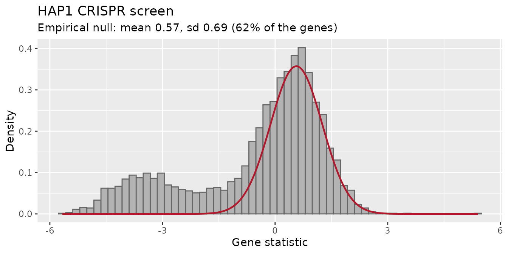
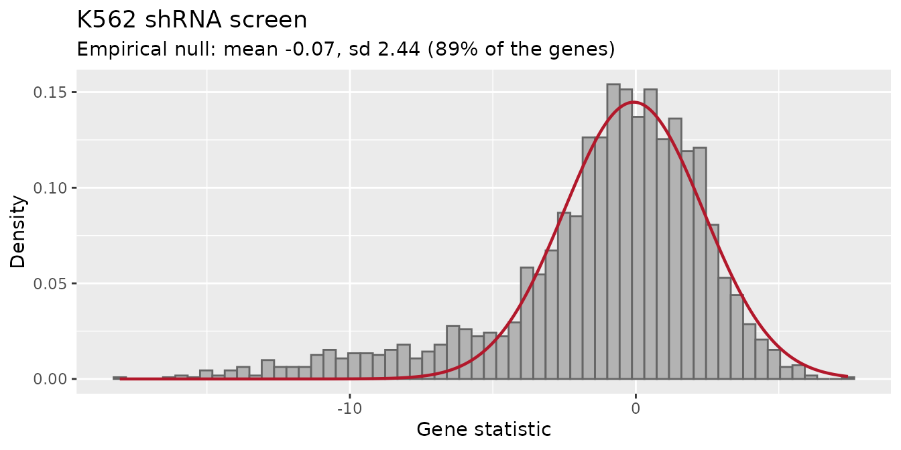

# Choosing the reference of the gene-level test

## In short

[`find_gene_zscore_hit()`](https://emanuelsoda.github.io/ScreenR/reference/find_gene_zscore_hit.md)
decides whether a gene is a hit by comparing its score with a
**reference**: what the score of a gene without effect looks like. Two
references are available:

- `reference = "random"` (the default): random sets of barcodes, drawn
  from all the barcodes or from those of `control_genes`;
- `reference = "empirical"`: an **empirical null**, the distribution of
  the scores of the genes without effect estimated from the data.

**We suggest `reference = "empirical"`** for libraries with hundreds of
genes or more, most of them without effect, which is the case of
genome-wide and of most focused screens:

``` r

find_gene_zscore_hit(table, reference = "empirical")
```

The random barcodes have two problems, shown below with the screens
distributed with ScreenR: in dropout screens the hits make them
conservative (many hits are missed), and in shRNA screens they give
p-values that are too small (genes without effect are called). The
empirical null has neither problem. The default is still `"random"`, so
that the results of existing analyses do not change.

| Your screen | Suggested call |
|----|----|
| CRISPR knockout, dropout or positive selection | `reference = "empirical", empirical_fit = "one-sided"` |
| shRNA, or when unsure | `reference = "empirical"` (`empirical_fit = "central"`, the default) |
| Small library (fewer than a few hundred genes), or most genes with an effect | `reference = "random"`, ideally with `control_genes` checked against known non-essential genes |

Always look at
[`plot_empirical_null()`](https://emanuelsoda.github.io/ScreenR/reference/plot_empirical_null.md)
(see [Checking the fit](#checking-the-fit)).

``` r

library(ScreenR)
library(dplyr)
library(ggplot2)
```

## How the gene-level test works

Each gene gets a score, the mean of the Z-scores of its barcodes (see
[Tutorial
3](https://emanuelsoda.github.io/ScreenR/articles/Tutorial_3_Finding_hits.md)).
A hit is a gene whose score is more extreme than the scores of genes
without effect, so the test needs to know how those scores are
distributed.

With the **random barcodes**, the score of a gene of *k* barcodes is
compared with the scores of many random sets of *k* barcodes. This
assumes that the barcodes of a gene without effect behave like barcodes
taken at random from the reference.

With the **empirical null**, the score of each gene is standardized into
a statistic (centred on the median of all the barcode scores and divided
by their median absolute deviation over $`\sqrt{k}`$). Most genes have
no effect, so the centre of the distribution of these statistics is made
of genes without effect: a normal distribution is fitted there, and the
p-value of each gene comes from it. The hits, in the tail, are left out
of the fit. Two fits are available:

- `empirical_fit = "central"` (default): a parabola is fitted to the log
  density of the statistics around its mode (central matching, as in
  Efron’s `locfdr`);
- `empirical_fit = "one-sided"`: the centre is the mode and the spread
  is estimated only on the side without hits (above the mode for
  depleted genes, below it with `direction = "Up"`).

## Two screens with known answers

The core essential and non-essential genes of Hart et al. give the
answer: essential genes should be hits, non-essential genes should not.
Half of the non-essential genes are used as `control_genes` (the best
possible reference, when such genes are known); the other half is kept
out of every reference, to count the false calls.

``` r

data(hart_reference_genes)
essential <- hart_reference_genes$Gene[
    hart_reference_genes$Class == "core essential"]
nonessential <- hart_reference_genes$Gene[
    hart_reference_genes$Class == "non-essential"]
set.seed(2017)
reference <- sample(nonessential, length(nonessential) %/% 2)
held_out <- setdiff(nonessential, reference)

evaluate <- function(result) {
    called <- result$Gene[result$FDR <= 0.05]
    tested_null <- result$Gene %in% held_out
    data.frame(
        Called = length(called),
        `Essential found` = mean(essential[essential %in% result$Gene]
            %in% called),
        `NE called` = sum(called %in% held_out),
        `NE p <= 0.05` = mean(result$PValue[tested_null] <= 0.05),
        check.names = FALSE
    )
}
```

The columns of the tables below are the number of genes called at 5% FDR
(`Called`), the share of the core essential genes among them
(`Essential found`), the number of held-out non-essential genes called
(`NE called`) and the share of held-out non-essential genes with a
p-value below 0.05 (`NE p <= 0.05`). The last one is the check of the
p-values: these genes have no effect, so about 5% of them should have a
p-value below 0.05. Much less means a conservative test (hits are
missed), much more means p-values that are too small (genes without
effect are called).

### A CRISPR dropout screen: the random barcodes miss hits

`hap1_count_table` is a CRISPR-Cas9 screen of HAP1 cells (TKOv3
library), compared here at day 18 against T0, as in [Tutorial
4](https://emanuelsoda.github.io/ScreenR/articles/Tutorial_4_CRISPR_screens.md):

``` r

data(hap1_count_table)
data(hap1_annotation_table)
samples <- data.frame(
    Sample = colnames(hap1_count_table)[-1],
    Day = c("T0", "T3", "T3", "T3", "T18", "T18", "T18"),
    Treatment = "Untreated"
)
hap1 <- create_screenr_object(
    table = hap1_count_table, annotation = hap1_annotation_table,
    groups = factor(samples$Day, levels = c("T0", "T3", "T18")),
    sample_table = samples
)
hap1 <- compute_data_table(normalize_data(remove_all_zero_row(hap1)))
design <- create_design_matrix(hap1)
contrast <- create_contrast(design, treatment = "T18", control = "T0")
hap1_statistics <- compute_barcode_statistics(hap1, design, contrast)
```

``` r

hap1_results <- list(
    `Random, all barcodes (default)` = find_gene_zscore_hit(
        hap1_statistics, fdr = 1, n_permutations = 2e4, seed = 1),
    `Random, non-essential controls` = find_gene_zscore_hit(
        hap1_statistics, control_genes = reference, fdr = 1,
        n_permutations = 2e4, seed = 1),
    `Empirical, central` = find_gene_zscore_hit(
        hap1_statistics, reference = "empirical", fdr = 1),
    `Empirical, one-sided` = find_gene_zscore_hit(
        hap1_statistics, reference = "empirical",
        empirical_fit = "one-sided", fdr = 1)
)
knitr::kable(bind_rows(lapply(hap1_results, evaluate), .id = "Reference"),
    digits = 3)
```

| Reference | Called | Essential found | NE called | NE p \<= 0.05 |
|:---|---:|---:|---:|---:|
| Random, all barcodes (default) | 332 | 0.457 | 0 | 0.000 |
| Random, non-essential controls | 917 | 0.986 | 5 | 0.048 |
| Empirical, central | 798 | 0.949 | 3 | 0.013 |
| Empirical, one-sided | 932 | 0.986 | 7 | 0.051 |

With the default reference only a minority of the core essential genes
is found, and not a single held-out non-essential gene has a p-value
below 0.05: the test is far too conservative. The reason is that the
random barcodes are drawn from all the genes, and in a dropout screen
many of them are hits. Their depleted barcodes widen the reference, so a
gene must be very depleted to stand out from it. The empirical null is
fitted where the genes without effect are and is not widened by the
hits: it finds about as many essential genes as the non-essential
controls, without needing them, and with no more false positives than
expected (`"one-sided"` close to the nominal 5%, `"central"` somewhat
conservative).

### An shRNA screen: the random barcodes call genes without effect

`k562_count_table` is an shRNA screen of K562 cells, compared at day 14
against the plasmid. Each gene has about 20 shRNAs.

``` r

data(k562_count_table)
data(k562_annotation_table)
data(k562_reference_genes)
k562 <- create_screenr_object(
    table = k562_count_table, annotation = k562_annotation_table,
    groups = factor(c("Plasmid", "T14", "T14")),
    sample_table = data.frame(
        Sample = c("Plasmid", "T14_A", "T14_B"),
        Day = c("Plasmid", "T14", "T14"), Treatment = "Untreated"
    )
)
k562 <- compute_data_table(normalize_data(k562))
k562_metrics <- compute_metrics(k562,
    control = "Plasmid", treatment = "T14", condition_column = "Day"
)
```

The reference genes of this screen are in `k562_reference_genes`; as
above, half of the non-essential genes are the controls and half are
kept out.

``` r

essential <- k562_reference_genes$Gene[
    k562_reference_genes$Class == "core essential"]
nonessential <- k562_reference_genes$Gene[
    k562_reference_genes$Class != "core essential"]
set.seed(2017)
reference <- sample(nonessential, length(nonessential) %/% 2)
held_out <- setdiff(nonessential, reference)

k562_results <- list(
    `Random, all barcodes (default)` = find_gene_zscore_hit(
        k562_metrics, fdr = 1, min_barcodes = 1, n_permutations = 2e4,
        seed = 1),
    `Random, non-essential controls` = find_gene_zscore_hit(
        k562_metrics, control_genes = reference, fdr = 1, min_barcodes = 1,
        n_permutations = 2e4, seed = 1),
    `Empirical, central` = find_gene_zscore_hit(
        k562_metrics, reference = "empirical", fdr = 1, min_barcodes = 1),
    `Empirical, one-sided` = find_gene_zscore_hit(
        k562_metrics, reference = "empirical", empirical_fit = "one-sided",
        fdr = 1, min_barcodes = 1)
)
knitr::kable(bind_rows(lapply(k562_results, evaluate), .id = "Reference"),
    digits = 3)
```

| Reference | Called | Essential found | NE called | NE p \<= 0.05 |
|:---|---:|---:|---:|---:|
| Random, all barcodes (default) | 384 | 0.488 | 5 | 0.049 |
| Random, non-essential controls | 717 | 0.695 | 57 | 0.195 |
| Empirical, central | 240 | 0.323 | 0 | 0.013 |
| Empirical, one-sided | 203 | 0.273 | 0 | 0.007 |

Here the non-essential controls, the reference that worked best in the
CRISPR screen, call dozens of non-essential genes, and far more than 5%
of them have a p-value below 0.05. The random barcodes assume that the
barcodes of a gene without effect behave like barcodes taken at random.
They do not: the shRNAs of a gene share its knockdown efficiency, its
expression and its off-target profile, so they tend to move together,
and the scores of whole genes vary more than those of random sets of
barcodes. This can be measured on the held-out non-essential genes:
their standardized statistic would have a standard deviation of 1 if
their barcodes behaved like random barcodes.

``` r

statistic <- k562_results[["Empirical, central"]]
sd(statistic$Statistic[statistic$Gene %in% held_out])
#> [1] 2.039191
```

It is about twice as large, and with about 20 barcodes per gene this
extra variation dominates. The empirical null measures the spread of the
gene statistics directly, so it includes it, and keeps the false
positives below the nominal rate.

The default reference looks well calibrated on this dataset, but only by
chance: its reference is widened by the many essential genes of the
subset (26% of the genes are core essential), which hides the problem.
With the essential genes as rare as in a genome-wide library it calls
genes without effect too (see the [benchmark](#benchmark) below).

The empirical null finds fewer essential genes here. This is the honest
result: with so much variation between genes, the weak shRNAs of many
essential genes cannot be told apart from genes without effect. The
other references find more only because their p-values are too small.

## Checking the fit

[`plot_empirical_null()`](https://emanuelsoda.github.io/ScreenR/reference/plot_empirical_null.md)
shows the gene statistics and the fitted null. The null (red line)
should follow the central peak; the hits are in the tail on the side of
`direction`:

``` r

plot_empirical_null(hap1_statistics, empirical_fit = "one-sided") +
    ggtitle("HAP1 CRISPR screen")
```



``` r

plot_empirical_null(k562_metrics, min_barcodes = 1) +
    ggtitle("K562 shRNA screen")
```



The subtitle gives the fitted mean and standard deviation and the share
of genes described by the null. Things to look for:

- **The null does not follow the central peak**, or the peak is not
  clear: the screen may have too few genes, or too many genes with an
  effect, for an empirical null. Use the random barcodes with checked
  control genes.
- **The tail is on the wrong side**: check `direction` (“Down” for
  depleted genes, “Up” for enriched genes).
- **A standard deviation much larger than 1** means that the genes vary
  more than their barcodes (as in K562): the random barcodes would give
  too small p-values.

[`find_gene_zscore_hit()`](https://emanuelsoda.github.io/ScreenR/reference/find_gene_zscore_hit.md)
also returns the fitted null as an attribute:

``` r

attr(hap1_results[["Empirical, one-sided"]], "null")
#>      mean        sd 
#> 0.5670556 0.6900248
```

## Central or one-sided?

`"one-sided"` uses only the side of the distribution without hits, so
the hits cannot enter the fit at all: it has the most power when the
hits are well separated from the genes without effect, as in CRISPR
knockout screens. `"central"` is the safer choice when hits and genes
without effect overlap, as in shRNA screens, where `"one-sided"` can be
too conservative. In the benchmark below `"central"` never gave too
small p-values.

## Benchmark

The bundled screens are subsets that keep all the reference genes, so
essential genes are much more frequent than in a genome-wide library
(about 4%). The script `benchmark/realdata/empirical_null.R` of the
GitHub repository repeats the comparison on the complete HAP1 TKOv3
screen (70,797 sgRNAs, 18,056 genes) and on the two subsets with the
essential genes removed at random until they are 5% or 10% of the genes
(mean of three random draws). `Essential` is the share of core essential
genes in the data; the other columns are as above:

``` r

benchmark <- read.csv(system.file("extdata", "benchmark",
    "empirical_null.csv", package = "ScreenR"), check.names = FALSE)
benchmark %>%
    mutate(Essential = paste0(round(100 * Essential, 1), "%")) %>%
    select(Data, Essential, Reference = Method,
        `Essential found` = Recall, `NE called`,
        `NE p <= 0.05` = `NE p<=0.05`) %>%
    knitr::kable(digits = c(0, 0, 0, 3, 1, 3))
```

| Data | Essential | Reference | Essential found | NE called | NE p \<= 0.05 |
|:---|:---|:---|---:|---:|---:|
| HAP1 genome-wide | 3.6% | Empirical, central | 0.899 | 1.7 | 0.020 |
| HAP1 genome-wide | 3.6% | Empirical, one-sided | 0.940 | 4.7 | 0.028 |
| HAP1 genome-wide | 3.6% | Random, all barcodes (default) | 0.584 | 0.0 | 0.008 |
| HAP1 genome-wide | 3.6% | Random, non-essential controls | 0.957 | 5.0 | 0.047 |
| HAP1 subset | 5% | Empirical, central | 0.887 | 1.0 | 0.021 |
| HAP1 subset | 5% | Empirical, one-sided | 0.955 | 4.0 | 0.049 |
| HAP1 subset | 5% | Random, all barcodes (default) | 0.608 | 0.0 | 0.005 |
| HAP1 subset | 5% | Random, non-essential controls | 0.955 | 4.0 | 0.054 |
| HAP1 subset | 10% | Empirical, central | 0.907 | 1.0 | 0.021 |
| HAP1 subset | 10% | Empirical, one-sided | 0.956 | 4.0 | 0.049 |
| HAP1 subset | 10% | Random, all barcodes (default) | 0.551 | 0.0 | 0.003 |
| HAP1 subset | 10% | Random, non-essential controls | 0.960 | 4.0 | 0.054 |
| HAP1 subset | 19% | Empirical, central | 0.909 | 1.0 | 0.013 |
| HAP1 subset | 19% | Empirical, one-sided | 0.967 | 5.0 | 0.044 |
| HAP1 subset | 19% | Random, all barcodes (default) | 0.379 | 0.0 | 0.000 |
| HAP1 subset | 19% | Random, non-essential controls | 0.967 | 8.0 | 0.054 |
| K562 | 5% | Empirical, central | 0.303 | 0.0 | 0.037 |
| K562 | 5% | Empirical, one-sided | 0.220 | 0.0 | 0.007 |
| K562 | 5% | Random, all barcodes (default) | 0.577 | 26.3 | 0.131 |
| K562 | 5% | Random, non-essential controls | 0.657 | 50.0 | 0.195 |
| K562 | 10% | Empirical, central | 0.289 | 0.0 | 0.027 |
| K562 | 10% | Empirical, one-sided | 0.220 | 0.0 | 0.007 |
| K562 | 10% | Random, all barcodes (default) | 0.533 | 17.0 | 0.110 |
| K562 | 10% | Random, non-essential controls | 0.667 | 51.0 | 0.195 |
| K562 | 26% | Empirical, central | 0.323 | 0.0 | 0.013 |
| K562 | 26% | Empirical, one-sided | 0.273 | 0.0 | 0.007 |
| K562 | 26% | Random, all barcodes (default) | 0.488 | 5.0 | 0.049 |
| K562 | 26% | Random, non-essential controls | 0.695 | 57.0 | 0.195 |

- In the CRISPR screen the default reference finds 55-61% of the core
  essential genes when they are as rare as in a genome-wide library
  (including the complete library), and fewer when they are more
  frequent; the empirical null finds about 90% (`"central"`) and 94-97%
  (`"one-sided"`), with no more false positives than expected. Only the
  non-essential controls do as well, and they need reference genes.
- In the shRNA screen, with genome-wide proportions of essential genes,
  the default reference gives 11-13% of non-essential genes with a
  p-value below 0.05 and calls 17 to 26 of them, and the non-essential
  controls about 20% and 50. The empirical null stays below 4% and calls
  none.

## When not to use the empirical null

The empirical null needs the genes without effect to be the majority,
and enough genes (hundreds) to estimate their distribution. It is not
suited to:

- small focused libraries, or the toy dataset of the other tutorials
  ([`find_gene_zscore_hit()`](https://emanuelsoda.github.io/ScreenR/reference/find_gene_zscore_hit.md)
  warns when fewer than 100 genes are tested);
- screens where most genes have an effect;
- comparisons where the genes without effect are not at the centre, for
  example when a normalization problem shifts all the genes: check the
  normalization first ([Tutorial
  2](https://emanuelsoda.github.io/ScreenR/articles/Tutorial_2_Quality_control.md)).

In these cases use the random barcodes, if possible with control genes
that were checked against known non-essential genes.

## Session info

``` r

sessionInfo()
#> R version 4.6.1 (2026-06-24)
#> Platform: x86_64-pc-linux-gnu
#> Running under: Ubuntu 24.04.5 LTS
#> 
#> Matrix products: default
#> BLAS:   /usr/lib/x86_64-linux-gnu/openblas-pthread/libblas.so.3 
#> LAPACK: /usr/lib/x86_64-linux-gnu/openblas-pthread/libopenblasp-r0.3.26.so;  LAPACK version 3.12.0
#> 
#> locale:
#>  [1] LC_CTYPE=C.UTF-8       LC_NUMERIC=C           LC_TIME=C.UTF-8       
#>  [4] LC_COLLATE=C.UTF-8     LC_MONETARY=C.UTF-8    LC_MESSAGES=C.UTF-8   
#>  [7] LC_PAPER=C.UTF-8       LC_NAME=C              LC_ADDRESS=C          
#> [10] LC_TELEPHONE=C         LC_MEASUREMENT=C.UTF-8 LC_IDENTIFICATION=C   
#> 
#> time zone: UTC
#> tzcode source: system (glibc)
#> 
#> attached base packages:
#> [1] stats     graphics  grDevices utils     datasets  methods   base     
#> 
#> other attached packages:
#> [1] ggplot2_4.0.3    dplyr_1.2.1      ScreenR_1.15.16  BiocStyle_2.40.0
#> 
#> loaded via a namespace (and not attached):
#>  [1] SummarizedExperiment_1.42.0 gtable_0.3.6               
#>  [3] xfun_0.62                   bslib_0.12.0               
#>  [5] Biobase_2.72.0              lattice_0.22-9             
#>  [7] vctrs_0.7.3                 tools_4.6.1                
#>  [9] generics_0.1.4              stats4_4.6.1               
#> [11] tibble_3.3.1                pkgconfig_2.0.3            
#> [13] Matrix_1.7-5                RColorBrewer_1.1-3         
#> [15] S7_0.2.2                    desc_1.4.3                 
#> [17] S4Vectors_0.50.3            lifecycle_1.0.5            
#> [19] compiler_4.6.1              farver_2.1.2               
#> [21] stringr_1.6.0               textshaping_1.0.5          
#> [23] statmod_1.5.2               Seqinfo_1.2.0              
#> [25] htmltools_0.5.9             sass_0.4.10                
#> [27] yaml_2.3.12                 pillar_1.11.1              
#> [29] pkgdown_2.2.1               jquerylib_0.1.4            
#> [31] tidyr_1.3.2                 DelayedArray_0.38.2        
#> [33] cachem_1.1.0                limma_3.68.5               
#> [35] abind_1.4-8                 tidyselect_1.2.1           
#> [37] locfit_1.5-9.12             digest_0.6.39              
#> [39] stringi_1.8.9               purrr_1.2.2                
#> [41] bookdown_0.48               labeling_0.4.3             
#> [43] fastmap_1.2.0               grid_4.6.1                 
#> [45] cli_3.6.6                   SparseArray_1.12.3         
#> [47] magrittr_2.0.5              patchwork_1.3.2            
#> [49] S4Arrays_1.12.1             withr_3.0.3                
#> [51] edgeR_4.10.6                scales_1.4.0               
#> [53] rmarkdown_2.32              XVector_0.52.0             
#> [55] matrixStats_1.5.0           otel_0.2.0                 
#> [57] ragg_1.5.2                  evaluate_1.0.5             
#> [59] knitr_1.52                  GenomicRanges_1.64.0       
#> [61] IRanges_2.46.0              rlang_1.3.0                
#> [63] glue_1.8.1                  BiocManager_1.30.27        
#> [65] BiocGenerics_0.58.1         jsonlite_2.0.0             
#> [67] R6_2.6.1                    MatrixGenerics_1.24.0      
#> [69] systemfonts_1.3.2           fs_2.1.0
```
