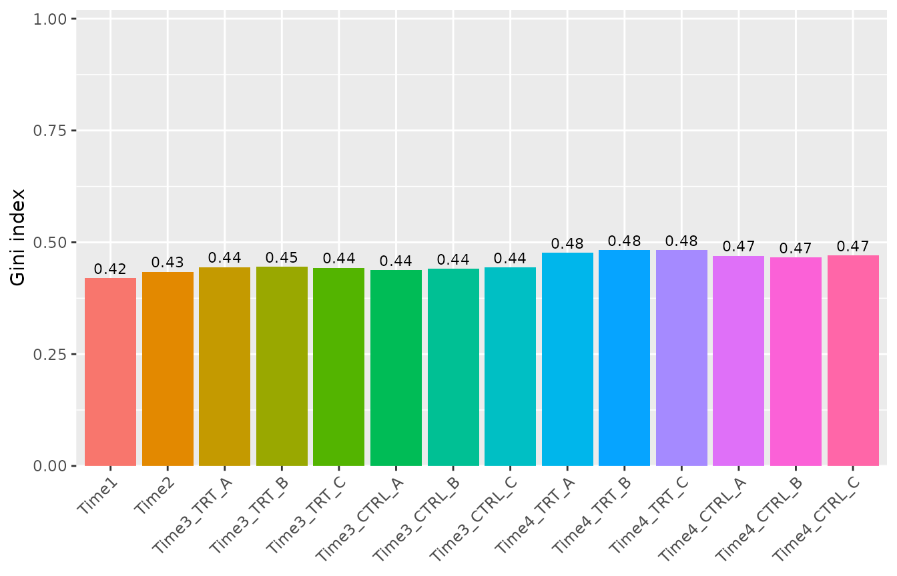
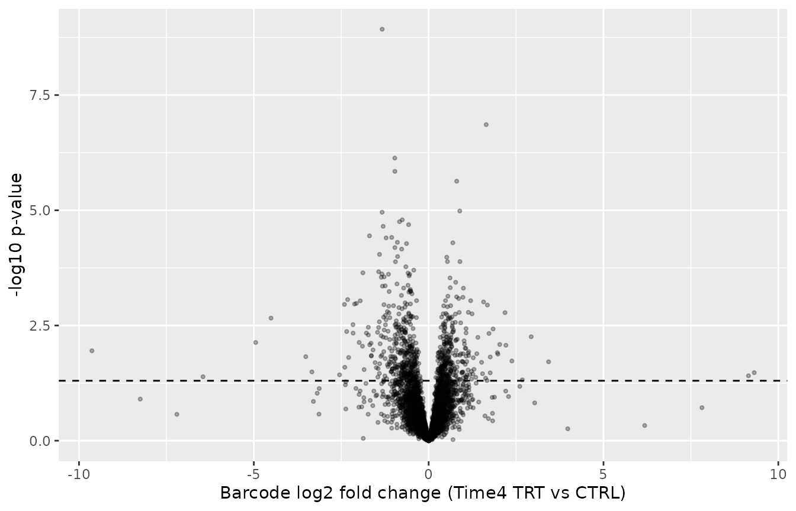
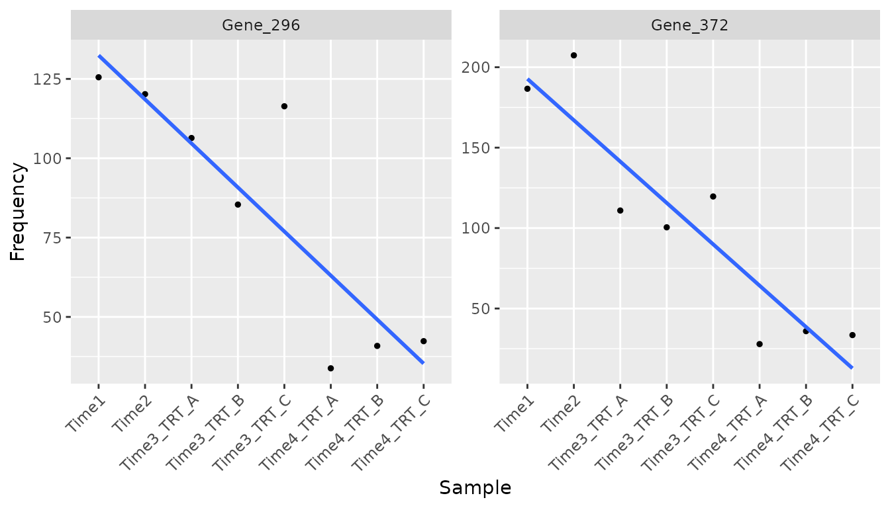
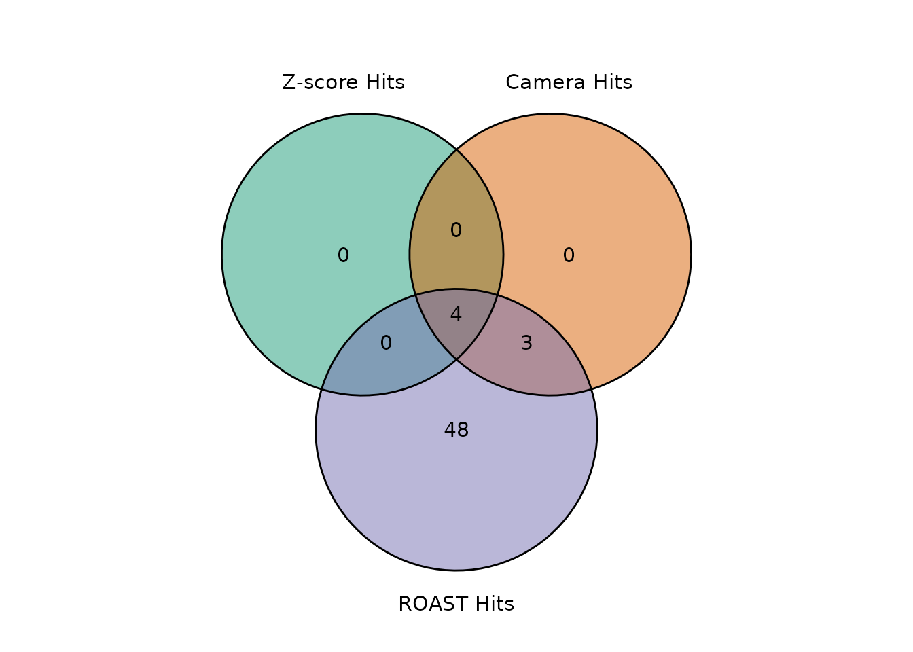

# Improved statistical analysis with ScreenR

## Introduction

This vignette shows the statistical methods added to ScreenR in version
1.15.4 and explains why they were added. It complements the vignette
*ScreenR Example Analysis*, which shows the complete pipeline.

| Topic | New or changed functions |
|----|----|
| Design matrix and contrasts | [`create_design_matrix()`](https://emanuelsoda.github.io/ScreenR/reference/create_design_matrix.md), [`create_contrast()`](https://emanuelsoda.github.io/ScreenR/reference/create_contrast.md) |
| Significance of CAMERA and ROAST hits | `fdr` and `seed` arguments, `Log2FC` column |
| Fold change of barcodes with zero reads | `pseudocount` argument of [`compute_metrics()`](https://emanuelsoda.github.io/ScreenR/reference/compute_metrics.md) |
| Normalization | `method` argument of [`normalize_data()`](https://emanuelsoda.github.io/ScreenR/reference/normalize_data.md) |
| Gene-level Z-score test | [`find_gene_zscore_hit()`](https://emanuelsoda.github.io/ScreenR/reference/find_gene_zscore_hit.md) |
| Replicate-aware barcode statistics | [`compute_barcode_statistics()`](https://emanuelsoda.github.io/ScreenR/reference/compute_barcode_statistics.md) |
| One model for the whole time course | [`find_time_hit()`](https://emanuelsoda.github.io/ScreenR/reference/find_time_hit.md) |
| Combining the methods | [`summarise_hits()`](https://emanuelsoda.github.io/ScreenR/reference/summarise_hits.md) |
| Quality control | [`plot_replicate_correlation()`](https://emanuelsoda.github.io/ScreenR/reference/plot_replicate_correlation.md), [`compute_gini()`](https://emanuelsoda.github.io/ScreenR/reference/compute_gini.md), [`find_discordant_barcodes()`](https://emanuelsoda.github.io/ScreenR/reference/find_discordant_barcodes.md) |

``` r

library(ScreenR)
library(dplyr)
library(ggplot2)
```

## Data

We use the example dataset of the package: an shRNA chemical lethality
screen with 10 barcodes for most genes, two early time points (Time1 and
Time2) and treated (TRT) and control (CTRL) samples in triplicate at two
later time points (Time3 and Time4).

``` r

data(count_table)
data(annotation_table)

counts <- count_table
colnames(counts) <- c(
    "Barcode", "Time1", "Time2", "Time3_TRT_A", "Time3_TRT_B", "Time3_TRT_C",
    "Time3_CTRL_A", "Time3_CTRL_B", "Time3_CTRL_C",
    "Time4_TRT_A", "Time4_TRT_B", "Time4_TRT_C",
    "Time4_CTRL_A", "Time4_CTRL_B", "Time4_CTRL_C"
)
counts <- counts %>%
    mutate(Barcode = as.factor(Barcode)) %>%
    filter(Barcode != "*") %>%
    tibble()

groups <- factor(c(
    "T1/T2", "T1/T2",
    rep("Time3_TRT", 3), rep("Time3_CTRL", 3),
    rep("Time4_TRT", 3), rep("Time4_CTRL", 3)
))

object <- create_screenr_object(
    table = counts, annotation = annotation_table, groups = groups,
    replicates = ""
)
object <- remove_all_zero_row(object)
object <- normalize_data(object)
object <- compute_data_table(object)
```

## Quality control

### Replicate correlation

Replicates of the same condition should be more similar to each other
than to the other samples.
[`plot_replicate_correlation()`](https://emanuelsoda.github.io/ScreenR/reference/plot_replicate_correlation.md)
shows the correlation of the log2 counts per million between all the
pairs of samples.

``` r

plot_replicate_correlation(object)
```


### Library evenness

The Gini index measures how unevenly the reads are spread over the
barcodes: 0 means all the barcodes have the same number of reads, values
close to 1 mean that a few barcodes take most of the reads. In a dropout
screen it usually increases over time; a strong increase or a large
difference between replicates can signal a bottleneck.

[`compute_gini()`](https://emanuelsoda.github.io/ScreenR/reference/compute_gini.md)
returns the values and
[`plot_gini()`](https://emanuelsoda.github.io/ScreenR/reference/plot_gini.md)
plots them.

``` r

compute_gini(object)
#> # A tibble: 14 × 2
#>    Sample        Gini
#>    <fct>        <dbl>
#>  1 Time1        0.420
#>  2 Time2        0.434
#>  3 Time3_TRT_A  0.444
#>  4 Time3_TRT_B  0.445
#>  5 Time3_TRT_C  0.443
#>  6 Time3_CTRL_A 0.437
#>  7 Time3_CTRL_B 0.440
#>  8 Time3_CTRL_C 0.444
#>  9 Time4_TRT_A  0.477
#> 10 Time4_TRT_B  0.482
#> 11 Time4_TRT_C  0.482
#> 12 Time4_CTRL_A 0.470
#> 13 Time4_CTRL_B 0.466
#> 14 Time4_CTRL_C 0.471
plot_gini(object)
```



### Normalization

By default
[`normalize_data()`](https://emanuelsoda.github.io/ScreenR/reference/normalize_data.md)
divides by the total number of reads of each sample (`method = "cpm"`).
When strong hits deplete a large part of the library, the total number
of reads is a biased measure of the sequencing depth. `method = "tmm"`
corrects it with the TMM normalization factors of edgeR, and
`method = "control"` normalizes to a set of control barcodes (for
example non-targeting shRNAs), when the library has them.

``` r

object_tmm <- normalize_data(object, method = "tmm")

# Ratio between the TMM and the total-count normalized values of each sample
ratio <- colMeans(SummarizedExperiment::assay(object_tmm, "normalized")) /
    colMeans(SummarizedExperiment::assay(object, "normalized"))
tibble(Sample = names(ratio), TMM_over_CPM = round(ratio, 3))
#> # A tibble: 14 × 2
#>    Sample       TMM_over_CPM
#>    <chr>               <dbl>
#>  1 Time1               0.983
#>  2 Time2               0.997
#>  3 Time3_TRT_A         0.998
#>  4 Time3_TRT_B         0.987
#>  5 Time3_TRT_C         0.998
#>  6 Time3_CTRL_A        0.983
#>  7 Time3_CTRL_B        0.982
#>  8 Time3_CTRL_C        0.992
#>  9 Time4_TRT_A         1.01 
#> 10 Time4_TRT_B         1.02 
#> 11 Time4_TRT_C         1.02 
#> 12 Time4_CTRL_A        1.00 
#> 13 Time4_CTRL_B        1.01 
#> 14 Time4_CTRL_C        1.01
```

In this dataset the two methods agree within a few percent, so we keep
the default.

## Design matrix and contrasts

The edgeR/limma based methods need a design matrix and a contrast. A
common pitfall is to rename the columns of `model.matrix(~ groups)`:
[`model.matrix()`](https://rdrr.io/r/stats/model.matrix.html) orders the
columns alphabetically by group and the first group becomes the
intercept, so renaming them in another order silently compares the wrong
samples.

``` r

wrong <- model.matrix(~groups)
colnames(wrong) <- unique(groups)
# The column called "Time3_TRT" actually marks the Time3_CTRL samples
as.character(groups[wrong[, "Time3_TRT"] == 1])
#> [1] "Time3_CTRL" "Time3_CTRL" "Time3_CTRL"
```

[`create_design_matrix()`](https://emanuelsoda.github.io/ScreenR/reference/create_design_matrix.md)
creates a design matrix with one column for each group (no intercept)
and
[`create_contrast()`](https://emanuelsoda.github.io/ScreenR/reference/create_contrast.md)
creates the comparison between groups by name, which avoids this
problem.

``` r

design <- create_design_matrix(object)
colnames(design)
#> [1] "T1.T2"      "Time3_CTRL" "Time3_TRT"  "Time4_CTRL" "Time4_TRT"

contrasts <- list(
    Time3 = create_contrast(design,
        treatment = "Time3_TRT", control = "Time3_CTRL"
    ),
    Time4 = create_contrast(design,
        treatment = "Time4_TRT", control = "Time4_CTRL"
    )
)
contrasts$Time4
#>      T1.T2 Time3_CTRL  Time3_TRT Time4_CTRL  Time4_TRT 
#>          0          0          0         -1          1
```

## CAMERA and ROAST with a significance cut off

[`find_camera_hit()`](https://emanuelsoda.github.io/ScreenR/reference/find_camera_hit.md)
and
[`find_roast_hit()`](https://emanuelsoda.github.io/ScreenR/reference/find_roast_hit.md)
now return only the genes with an FDR lower or equal to `fdr` (default
0.05) and report `Log2FC`, the median log2 fold change of the barcodes
of each gene. Previously CAMERA returned all the genes with the
requested direction (about half of the genes) and ROAST used the raw
p-value.

The p-values are **one-sided** for the requested direction: camera and
roast report two-sided p-values, which are twice too large for a test of
depletion only. The FDR is computed from the one-sided p-values over all
the genes, with the Benjamini-Hochberg method or, with
`fdr_method = "storey"`, with the less conservative Storey method when
many genes have an effect.

ROAST uses random rotations: the `seed` argument makes the result
reproducible, and its smallest p-value is 1 / (`nrot` + 1).
`method = "fry"` uses
[`limma::fry()`](https://rdrr.io/pkg/limma/man/roast.html), an exact and
fast approximation of ROAST with continuous p-values. ROAST and fry are
self-contained tests (does the gene change?), while CAMERA is
competitive (does the gene change more than the others?) and becomes
conservative when many genes have an effect.

``` r

camera <- find_camera_hit(object, design, contrasts$Time4, fdr = 1)
roast <- find_roast_hit(object, design, contrasts$Time4,
    nrot = 999, seed = 42, fdr = 1
)
fry <- find_roast_hit(object, design, contrasts$Time4,
    method = "fry", fdr = 1
)

# Number of genes at different FDR levels
fdr_levels <- c(0.05, 0.1, 0.25)
tibble(
    FDR = fdr_levels,
    CAMERA = vapply(fdr_levels, function(x) sum(camera$FDR <= x), 1L),
    ROAST = vapply(fdr_levels, function(x) sum(roast$FDR <= x), 1L),
    fry = vapply(fdr_levels, function(x) sum(fry$FDR <= x), 1L)
)
#> # A tibble: 3 × 4
#>     FDR CAMERA ROAST   fry
#>   <dbl>  <int> <int> <int>
#> 1  0.05      0     0     9
#> 2  0.1       3    11    12
#> 3  0.25      7    55    53

head(camera)
#> # A tibble: 6 × 6
#>   Gene     NGenes Direction   PValue    FDR Log2FC
#>   <chr>     <dbl> <fct>        <dbl>  <dbl>  <dbl>
#> 1 Gene_173     10 Down      0.000214 0.0882 -0.515
#> 2 Gene_422     10 Down      0.000418 0.0882 -0.433
#> 3 Gene_296     10 Down      0.000495 0.0882 -0.508
#> 4 Gene_352     10 Down      0.00200  0.232  -0.467
#> 5 Gene_87      10 Down      0.00250  0.232  -0.436
#> 6 Gene_370     10 Down      0.00295  0.232  -0.344
```

The treatment effect in this example dataset is weak: at Time4 there are
0 genes at an FDR of 5% with CAMERA, 0 with ROAST and 9 with fry; at an
FDR of 25% there are 7, 55 and 53.

## A gene-level test for the Z-score

### Why a new test

[`find_zscore_hit()`](https://emanuelsoda.github.io/ScreenR/reference/find_zscore_hit.md)
calls a gene a hit when more than `number_barcode` of its barcodes have
a Z-score below the median Z-score. By definition half of all barcodes
are below the median, so for a gene without any effect the number of
such barcodes is binomial with probability 0.5. With 10 barcodes and
`number_barcode = 6` the probability of being called a hit by chance is

``` r

pbinom(6, size = 10, prob = 0.5, lower.tail = FALSE)
#> [1] 0.171875
```

so about 17% of the genes without any effect are called hits.

### The test

[`find_gene_zscore_hit()`](https://emanuelsoda.github.io/ScreenR/reference/find_gene_zscore_hit.md)
computes for each gene a score, the mean (or, with
`statistic = "median"`, the median) of the Z-scores of its barcodes, and
compares it with the scores of many random sets of barcodes of the same
size (`n_permutations`, default 100000). The p-value is the proportion
of random sets with a score at least as extreme. This permutation test
makes no assumption on the distribution of the Z-scores and gives
continuous, well-calibrated p-values. The random barcodes are drawn from
the whole library (default) or only from control genes
(`control_genes`). Controls remove the true hits from the reference, but
they must behave like genes without effect: in shRNA screens the
non-targeting shRNAs often do not (targeting shRNAs are usually somewhat
depleted compared with them), and in the K562 screen distributed with
ScreenR they made hundreds of non-essential genes look like hits. Use
them only after checking them, for example against known non-essential
genes. The p-values are corrected with the Benjamini-Hochberg (or
Storey) method.

The log2 fold changes are now computed with a pseudocount
(`compute_metrics(pseudocount = 0.5)`, in counts per million), so
barcodes with zero reads in the treated samples get a finite fold change
instead of about -23, which would distort the Z-scores of all the other
barcodes.

``` r

metrics <- compute_metrics(object,
    control = "CTRL", treatment = "TRT", day = "Time4"
)
range(metrics$Log2FC)
#> [1] -4.384243  4.224517

gene_zscore <- find_gene_zscore_hit(metrics, fdr = 1, seed = 1)
head(gene_zscore)
#> # A tibble: 6 × 6
#>   Gene     NBarcodes  Score Log2FC    PValue    FDR
#>   <chr>        <int>  <dbl>  <dbl>     <dbl>  <dbl>
#> 1 Gene_364        12 -1.55  -0.473 0.0000500 0.0267
#> 2 Gene_296        10 -1.31  -0.499 0.000460  0.123 
#> 3 Gene_322        10 -1.13  -0.386 0.00148   0.263 
#> 4 Gene_419        10 -1.08  -0.311 0.00209   0.279 
#> 5 Gene_352        10 -1.02  -0.455 0.00318   0.340 
#> 6 Gene_422        10 -0.951 -0.430 0.00455   0.405

c(
    old_rule_hits = nrow(find_zscore_hit(metrics, number_barcode = 6)),
    gene_test_FDR_0.25 = sum(gene_zscore$FDR <= 0.25)
)
#>      old_rule_hits gene_test_FDR_0.25 
#>                 97                  2
```

### Replicate-aware barcode statistics

[`compute_metrics()`](https://emanuelsoda.github.io/ScreenR/reference/compute_metrics.md)
averages the replicates before computing the fold change, so a barcode
that is noisy across replicates counts as much as a consistent one.
[`compute_barcode_statistics()`](https://emanuelsoda.github.io/ScreenR/reference/compute_barcode_statistics.md)
tests each barcode with the edgeR quasi-likelihood F-test, which uses
the variability between replicates, and reports a signed Z-score that
can be used with
[`find_gene_zscore_hit()`](https://emanuelsoda.github.io/ScreenR/reference/find_gene_zscore_hit.md).

``` r

barcode_statistics <- compute_barcode_statistics(
    object, design, contrasts$Time4
)
head(barcode_statistics)
#> # A tibble: 6 × 8
#>   Barcode Gene     Log2FC logCPM     F PValue   FDR Zscore
#>   <chr>   <chr>     <dbl>  <dbl> <dbl>  <dbl> <dbl>  <dbl>
#> 1 10208   Gene_380  0.109   8.56 0.438 0.510  0.835  0.658
#> 2 10502   Gene_380 -0.480   4.97 0.748 0.390  0.765 -0.859
#> 3 10796   Gene_380 -0.665   6.61 2.49  0.120  0.515 -1.56 
#> 4 11089   Gene_380 -0.169   8.44 0.992 0.323  0.716 -0.988
#> 5 11382   Gene_380 -0.651   5.62 1.44  0.235  0.643 -1.19 
#> 6 11675   Gene_380 -0.286   9.66 6.71  0.0119 0.219 -2.51

gene_zscore_edger <- find_gene_zscore_hit(barcode_statistics, fdr = 1,
    seed = 1)
head(gene_zscore_edger)
#> # A tibble: 6 × 6
#>   Gene     NBarcodes Score Log2FC   PValue   FDR
#>   <chr>        <int> <dbl>  <dbl>    <dbl> <dbl>
#> 1 Gene_173        10 -1.58 -0.521 0.000240 0.128
#> 2 Gene_422        10 -1.45 -0.451 0.000700 0.187
#> 3 Gene_15         10 -1.37 -0.321 0.00131  0.233
#> 4 Gene_296        10 -1.31 -0.493 0.00187  0.250
#> 5 Gene_370        10 -1.24 -0.394 0.00304  0.280
#> 6 Gene_168        10 -1.21 -0.256 0.00355  0.280
```

``` r

ggplot(barcode_statistics, aes(x = Log2FC, y = -log10(PValue))) +
    geom_point(alpha = 0.3, size = 0.8) +
    geom_hline(yintercept = -log10(0.05), linetype = "dashed") +
    labs(
        x = "Barcode log2 fold change (Time4 TRT vs CTRL)",
        y = "-log10 p-value"
    )
```



## One model for the whole time course

Analysing each time point separately answers “is there an effect at
Time3?” and “is there an effect at Time4?”.
[`find_time_hit()`](https://emanuelsoda.github.io/ScreenR/reference/find_time_hit.md)
answers “does the effect of the treatment change over time?” with a
single model, log(abundance) = a + b \* time + d \* treated + c \* time
\* treated. The untreated and the treated samples each follow their own
line over the time points (treated as equally spaced); c is the
difference between the two slopes, i.e. how much the treatment effect
changes per time point, and is 0 when the effect is constant. The
coefficient c is tested for the barcodes of each gene with CAMERA. The
early time points can be added as untreated baseline samples, so that
the untreated line is estimated from four time points.

``` r

time_hit <- find_time_hit(object,
    treatment = "TRT", control = "CTRL",
    baseline = c("Time1", "Time2"),
    days = c("Time1", "Time2", "Time3", "Time4"),
    fdr = 1
)
head(time_hit)
#> # A tibble: 6 × 6
#>   Gene     NGenes Direction      PValue       FDR Log2FC
#>   <chr>     <dbl> <fct>           <dbl>     <dbl>  <dbl>
#> 1 Gene_372     12 Down      0.000000157 0.0000836 -0.974
#> 2 Gene_296     10 Down      0.000000706 0.000135  -1.17 
#> 3 Gene_364     12 Down      0.000000760 0.000135  -1.01 
#> 4 Gene_412     10 Down      0.000112    0.0149    -0.815
#> 5 Gene_370     10 Down      0.000565    0.0604    -0.389
#> 6 Gene_349     10 Down      0.00376     0.318     -0.192
```

The column `Log2FC` is the median over the barcodes of the gene of c,
the change of the treatment log2 fold change per time point. The top
genes can be inspected with
[`plot_trend()`](https://emanuelsoda.github.io/ScreenR/reference/plot_trend.md).

``` r

plot_trend(object,
    genes = time_hit$Gene[1:2], group_var = c("Time1", "Time2", "TRT"),
    nrow = 1, ncol = 2
) +
    theme(axis.text.x = element_text(angle = 45, hjust = 1))
```



## Combining the methods

The overlap between the hits of the three methods can be shown with
[`plot_common_hit()`](https://emanuelsoda.github.io/ScreenR/reference/plot_common_hit.md).
Here each list contains the genes with an FDR of at most 25% (for the
Z-score, the replicate-aware gene-level test).

``` r

alpha <- 0.25
plot_common_hit(
    hit_zscore = filter(gene_zscore_edger, FDR <= alpha),
    hit_camera = filter(camera, FDR <= alpha),
    hit_roast = filter(roast, FDR <= alpha),
    show_elements = FALSE, show_percentage = FALSE
)
```



[`find_common_hit()`](https://emanuelsoda.github.io/ScreenR/reference/find_common_hit.md)
returns the genes in the intersection.
[`summarise_hits()`](https://emanuelsoda.github.io/ScreenR/reference/summarise_hits.md)
also shows how strongly each gene is supported: it puts the FDR of each
method in one table and adds `MaxFDR`, the largest of them, which can be
used as a conservative score to rank the genes supported by all the
methods. Since an FDR is never smaller than the corresponding p-value,
`MaxFDR <= alpha` means that the gene has a p-value of at most `alpha`
in every method: for each single gene this is a level-`alpha` test,
whatever the dependence between the methods. The list of genes with
`MaxFDR <= alpha` does not, however, have a guaranteed false discovery
rate, because the false discoveries of the single methods can
concentrate in their intersection: treat it as a short list to validate.

``` r

summary <- summarise_hits(
    list(
        zscore = gene_zscore_edger, camera = camera,
        roast = roast, time = time_hit
    ),
    fdr = alpha
)
head(summary, 10)
#> # A tibble: 10 × 8
#>    Gene     FDR_zscore FDR_camera FDR_roast FDR_time NMethods MaxFDR Hit  
#>    <chr>         <dbl>      <dbl>     <dbl>    <dbl>    <dbl>  <dbl> <lgl>
#>  1 Gene_296      0.250     0.0882    0.0534 0.000135        4  0.250 TRUE 
#>  2 Gene_370      0.280     0.232     0.111  0.0604          3  0.280 FALSE
#>  3 Gene_349      0.390     0.263     0.0668 0.318           1  0.390 FALSE
#>  4 Gene_352      0.280     0.232     0.157  0.508           2  0.508 FALSE
#>  5 Gene_87       0.280     0.232     0.207  0.508           2  0.508 FALSE
#>  6 Gene_422      0.187     0.0882    0.0534 0.545           3  0.545 FALSE
#>  7 Gene_412      0.590     0.306     0.0534 0.0149          2  0.590 FALSE
#>  8 Gene_325      0.649     0.738     0.0534 0.318           1  0.738 FALSE
#>  9 Gene_173      0.128     0.0882    0.0534 0.742           3  0.742 FALSE
#> 10 Gene_168      0.280     0.380     0.153  0.742           1  0.742 FALSE
```

In this dataset the genes with `MaxFDR <= 0.25` are: Gene_296. The top
gene of the time course model is Gene_372.

## Discordant barcodes

A gene can be called a hit because of one or two barcodes with a strong
effect, for example because of off-target effects.
[`find_discordant_barcodes()`](https://emanuelsoda.github.io/ScreenR/reference/find_discordant_barcodes.md)
reports the barcodes whose log2 fold change is more than `threshold`
median absolute deviations away from the median of their gene.

``` r

discordant <- find_discordant_barcodes(metrics, threshold = 3)
nrow(discordant)
#> [1] 280
head(discordant)
#> # A tibble: 6 × 5
#>   Barcode Gene     Log2FC GeneLog2FC Deviation
#>   <fct>   <chr>     <dbl>      <dbl>     <dbl>
#> 1 142     Gene_343 -3.78     -0.0657     -18.1
#> 2 310     Gene_202 -2.75      0.0809     -15.4
#> 3 1038    Gene_358 -0.822    -0.0606     -13.5
#> 4 10686   Gene_177  4.22      0.139       13.5
#> 5 1033    Gene_358 -0.820    -0.0606     -13.5
#> 6 10318   Gene_21  -3.80      0.101      -12.1

# Discordant barcodes among the top genes
filter(discordant, Gene %in% head(summary$Gene, 10))
#> # A tibble: 5 × 5
#>   Barcode Gene     Log2FC GeneLog2FC Deviation
#>   <fct>   <chr>     <dbl>      <dbl>     <dbl>
#> 1 548     Gene_352 -1.50      -0.455     -4.41
#> 2 10677   Gene_168 -0.919     -0.231     -4.31
#> 3 13132   Gene_370  0.402     -0.340      3.69
#> 4 13544   Gene_87   0.175     -0.435      3.58
#> 5 994     Gene_349 -1.61      -0.180     -3.21
```

## Session information

``` r

sessionInfo()
#> R version 4.6.1 (2026-06-24)
#> Platform: x86_64-pc-linux-gnu
#> Running under: Ubuntu 24.04.5 LTS
#> 
#> Matrix products: default
#> BLAS:   /usr/lib/x86_64-linux-gnu/openblas-pthread/libblas.so.3 
#> LAPACK: /usr/lib/x86_64-linux-gnu/openblas-pthread/libopenblasp-r0.3.26.so;  LAPACK version 3.12.0
#> 
#> locale:
#>  [1] LC_CTYPE=C.UTF-8       LC_NUMERIC=C           LC_TIME=C.UTF-8       
#>  [4] LC_COLLATE=C.UTF-8     LC_MONETARY=C.UTF-8    LC_MESSAGES=C.UTF-8   
#>  [7] LC_PAPER=C.UTF-8       LC_NAME=C              LC_ADDRESS=C          
#> [10] LC_TELEPHONE=C         LC_MEASUREMENT=C.UTF-8 LC_IDENTIFICATION=C   
#> 
#> time zone: UTC
#> tzcode source: system (glibc)
#> 
#> attached base packages:
#> [1] stats     graphics  grDevices utils     datasets  methods   base     
#> 
#> other attached packages:
#> [1] ggplot2_4.0.3    dplyr_1.2.1      ScreenR_1.15.15  BiocStyle_2.40.0
#> 
#> loaded via a namespace (and not attached):
#>  [1] SummarizedExperiment_1.42.0 gtable_0.3.6               
#>  [3] xfun_0.61                   bslib_0.12.0               
#>  [5] Biobase_2.72.0              lattice_0.22-9             
#>  [7] vctrs_0.7.3                 tools_4.6.1                
#>  [9] generics_0.1.4              stats4_4.6.1               
#> [11] tibble_3.3.1                pkgconfig_2.0.3            
#> [13] Matrix_1.7-5                RColorBrewer_1.1-3         
#> [15] S7_0.2.2                    desc_1.4.3                 
#> [17] S4Vectors_0.50.3            lifecycle_1.0.5            
#> [19] compiler_4.6.1              farver_2.1.2               
#> [21] stringr_1.6.0               textshaping_1.0.5          
#> [23] statmod_1.5.2               Seqinfo_1.2.0              
#> [25] ggvenn_0.1.19               htmltools_0.5.9            
#> [27] sass_0.4.10                 yaml_2.3.12                
#> [29] pillar_1.11.1               pkgdown_2.2.1              
#> [31] jquerylib_0.1.4             tidyr_1.3.2                
#> [33] DelayedArray_0.38.2         cachem_1.1.0               
#> [35] limma_3.68.5                abind_1.4-8                
#> [37] nlme_3.1-169                tidyselect_1.2.1           
#> [39] locfit_1.5-9.12             digest_0.6.39              
#> [41] stringi_1.8.9               purrr_1.2.2                
#> [43] bookdown_0.48               splines_4.6.1              
#> [45] labeling_0.4.3              fastmap_1.2.0              
#> [47] grid_4.6.1                  cli_3.6.6                  
#> [49] SparseArray_1.12.3          magrittr_2.0.5             
#> [51] patchwork_1.3.2             S4Arrays_1.12.1            
#> [53] utf8_1.2.6                  withr_3.0.3                
#> [55] edgeR_4.10.5                scales_1.4.0               
#> [57] rmarkdown_2.32              XVector_0.52.0             
#> [59] matrixStats_1.5.0           otel_0.2.0                 
#> [61] ragg_1.5.2                  evaluate_1.0.5             
#> [63] knitr_1.52                  GenomicRanges_1.64.0       
#> [65] IRanges_2.46.0              mgcv_1.9-4                 
#> [67] rlang_1.3.0                 glue_1.8.1                 
#> [69] BiocManager_1.30.27         BiocGenerics_0.58.1        
#> [71] jsonlite_2.0.0              R6_2.6.1                   
#> [73] MatrixGenerics_1.24.0       systemfonts_1.3.2          
#> [75] fs_2.1.0
```
