# Analysis of a longitudinal screen: from counts to treatment-specific hits

## About this tutorial

This tutorial analyses a complete pooled shRNA screen with ScreenR, from
the raw barcode counts to a list of genes whose knockdown is depleted
**because of the treatment**, and to the evidence that supports each of
them. The screen has the structure of many drug-sensitization screens:
an infected and selected cell population is split into control and
treated cultures, which are sampled at two time points with three
biological replicates each.

The question is not only “which genes are depleted?”, but:

- Which genes are depleted in **treated cells compared with control
  cells at the same time point**, rather than lost in all cultures
  because they are needed for growth (essential genes)?
- Is the depletion supported by **several shRNAs** of the gene and by
  the **biological replicates**?
- Is it present at **both time points**, or does it appear (or grow)
  over time?

Each step explains why it is needed, what ScreenR does, how to read the
result and which decisions it involves. The tutorials
[1](https://emanuelsoda.github.io/ScreenR/articles/Tutorial_1_Creating_the_object.md),
[2](https://emanuelsoda.github.io/ScreenR/articles/Tutorial_2_Quality_control.md)
and
[3](https://emanuelsoda.github.io/ScreenR/articles/Tutorial_3_Finding_hits.md)
describe the individual functions in more detail; this one puts them
together for a longitudinal design.

``` r

library(ScreenR)
library(SummarizedExperiment)
library(dplyr)
library(ggplot2)
library(patchwork)
```

## The experiment

### Design

The cells are infected with a pooled library of barcoded shRNAs (about
10 shRNAs for each of 534 genes) and selected with puromycin, which
kills the cells that were not infected. The selected population is then
split into control and treated cultures, sampled at two time points:

| Sample(s) | Stage | Condition | Replicates | Role in the analysis |
|----|----|----|----|----|
| T0 | Right after infection, before selection | Infected cells | 1 | Representation of the library in the cells; quality control of the infection |
| Puro | After puromycin selection | Baseline | 1 | Starting population of all the cultures; reference for the loss of fitness |
| T3 | First time point | Control | 3 | Reference for the treatment effect at T3 |
| T3 | First time point | Treated | 3 | Treatment effect at T3 |
| T4 | Second time point | Control | 3 | Reference for the treatment effect at T4 |
| T4 | Second time point | Treated | 3 | Treatment effect at T4 |

That is 14 samples. The controls and the treated cultures have the same
history except the treatment, so **the treatment effect is measured as
treated versus control at the same time point**: whatever happens in
both (for example the loss of shRNAs against genes needed for growth)
cancels out. The T0 and Puro samples are single references: they
describe where the cultures start from and are used for quality control
and for the fitness effects, not for the treatment effect.

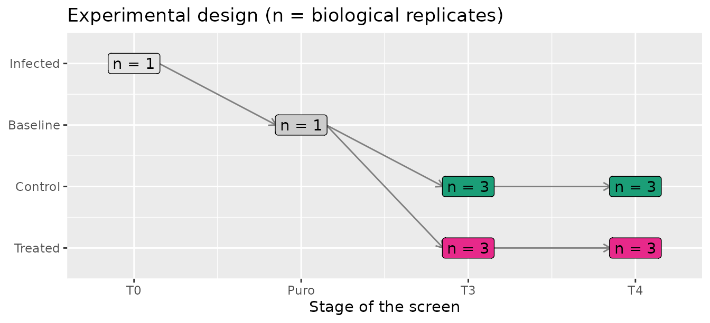

### The data

ScreenR includes this screen as `count_table` (the reads of each barcode
in each sample, from the alignment of the sequencing reads to the
library) and `annotation_table` (the gene targeted by each barcode). See
[`?count_table`](https://emanuelsoda.github.io/ScreenR/reference/count_table.md)
and
[`?annotation_table`](https://emanuelsoda.github.io/ScreenR/reference/annotation_table.md).

``` r

data(count_table)
data(annotation_table)
dim(count_table)
#> [1] 5323   15
colnames(count_table)
#>  [1] "Barcode"         "Time_1"          "Time_2"          "Time_3_TRT_rep1"
#>  [5] "Time_3_TRT_rep2" "Time_3_TRT_rep3" "Time_3_rep1"     "Time_3_rep2"    
#>  [9] "Time_3_rep3"     "Time_4_TRT_rep1" "Time_4_TRT_rep2" "Time_4_TRT_rep3"
#> [13] "Time_4_rep1"     "Time_4_rep2"     "Time_4_rep3"
head(annotation_table[, c("Barcode", "Gene")], 3)
#>   Barcode     Gene
#> 1   10208 Gene_380
#> 2   10502 Gene_380
#> 3   10796 Gene_380
```

The count table has three rows with the barcode `"*"`: the reads that
could not be assigned to any shRNA. They are not barcodes and appear
several times, so they are removed. ScreenR would refuse duplicated
barcode identifiers rather than guess how to combine them
(`duplicate_barcodes` can sum them instead).

``` r

table(count_table$Barcode == "*")
#> 
#> FALSE  TRUE 
#>  5320     3
counts <- count_table[count_table$Barcode != "*", ]
```

The original sample names are not self-explanatory, so the samples are
renamed, and their stage, condition and replicate are described
explicitly in a sample table instead of being parsed from the names:

``` r

samples <- tibble(
    Original = colnames(counts)[-1],
    Sample = c("T0_Infected", "Puro_Baseline",
        paste0("T3_TRT_", 1:3), paste0("T3_CTRL_", 1:3),
        paste0("T4_TRT_", 1:3), paste0("T4_CTRL_", 1:3)),
    Day = c("T0", "Puro", rep("T3", 6), rep("T4", 6)),
    Treatment = c("Infected", "Baseline", rep(c("TRT", "CTRL"), each = 3),
        rep(c("TRT", "CTRL"), each = 3)),
    Replicate = c(NA, NA, rep(1:3, 4))
)
samples$Group <- ifelse(samples$Day %in% c("T0", "Puro"), samples$Day,
    paste(samples$Day, samples$Treatment, sep = "_"))
knitr::kable(samples)
```

| Original        | Sample        | Day  | Treatment | Replicate | Group   |
|:----------------|:--------------|:-----|:----------|----------:|:--------|
| Time_1          | T0_Infected   | T0   | Infected  |        NA | T0      |
| Time_2          | Puro_Baseline | Puro | Baseline  |        NA | Puro    |
| Time_3_TRT_rep1 | T3_TRT_1      | T3   | TRT       |         1 | T3_TRT  |
| Time_3_TRT_rep2 | T3_TRT_2      | T3   | TRT       |         2 | T3_TRT  |
| Time_3_TRT_rep3 | T3_TRT_3      | T3   | TRT       |         3 | T3_TRT  |
| Time_3_rep1     | T3_CTRL_1     | T3   | CTRL      |         1 | T3_CTRL |
| Time_3_rep2     | T3_CTRL_2     | T3   | CTRL      |         2 | T3_CTRL |
| Time_3_rep3     | T3_CTRL_3     | T3   | CTRL      |         3 | T3_CTRL |
| Time_4_TRT_rep1 | T4_TRT_1      | T4   | TRT       |         1 | T4_TRT  |
| Time_4_TRT_rep2 | T4_TRT_2      | T4   | TRT       |         2 | T4_TRT  |
| Time_4_TRT_rep3 | T4_TRT_3      | T4   | TRT       |         3 | T4_TRT  |
| Time_4_rep1     | T4_CTRL_1     | T4   | CTRL      |         1 | T4_CTRL |
| Time_4_rep2     | T4_CTRL_2     | T4   | CTRL      |         2 | T4_CTRL |
| Time_4_rep3     | T4_CTRL_3     | T4   | CTRL      |         3 | T4_CTRL |

``` r

colnames(counts) <- c("Barcode", samples$Sample)
```

The **groups** define the statistical model: one group for each
combination of time point and condition (and one for each reference
sample). Replicates of the same group are what the model uses to measure
the biological variability.

## The ScreenR object

``` r

object <- create_screenr_object(
    table = counts,
    annotation = annotation_table,
    groups = factor(samples$Group,
        levels = c("T0", "Puro", "T3_CTRL", "T3_TRT", "T4_CTRL", "T4_TRT")),
    sample_table = samples[, c("Sample", "Day", "Treatment")],
    replicates = samples$Replicate
)
object
#> class: screenr_object 
#> dim: 5320 14 
#> metadata(1): screenr_layout
#> assays(1): counts
#> rownames(5320): 10208 10502 ... 13876 13995
#> rowData names(5): Barcode Gene Gene_ID Sequence Library
#> colnames(14): T0_Infected Puro_Baseline ... T4_CTRL_2 T4_CTRL_3
#> colData names(5): Sample Day Treatment Group Replicate
#> normalization: none (run normalize_data())
```

The ScreenR object is a `SummarizedExperiment`, the standard
Bioconductor container for assays with row and column annotation. Each
piece of information is stored once, in the place that fits it:

- `assay(object, "counts")`: the raw counts only, one row per barcode
  and one column per sample. The barcode identifiers are the row names
  (as text), not a column of the counts.
- `rowData(object)`: the annotation of each barcode (its gene), aligned
  with the rows.
- `colData(object)`: the Day, Treatment, Group and Replicate of each
  sample, aligned with the columns.

``` r

assay(object, "counts")[1:3, 1:4]
#>       T0_Infected Puro_Baseline T3_TRT_1 T3_TRT_2
#> 10208        3520          4283     2493     3998
#> 10502         280           339      140      542
#> 10796        1507          1533     1120     1125
rowData(object)[1:3, c("Barcode", "Gene")]
#> DataFrame with 3 rows and 2 columns
#>           Barcode        Gene
#>       <character> <character>
#> 10208       10208    Gene_380
#> 10502       10502    Gene_380
#> 10796       10796    Gene_380
colData(object)[c(1, 2, 3, 9), c("Day", "Treatment", "Group", "Replicate")]
#> DataFrame with 4 rows and 4 columns
#>                       Day   Treatment    Group Replicate
#>               <character> <character> <factor> <integer>
#> T0_Infected            T0    Infected   T0            NA
#> Puro_Baseline        Puro    Baseline   Puro          NA
#> T3_TRT_1               T3         TRT   T3_TRT         1
#> T4_TRT_1               T4         TRT   T4_TRT         1
```

Because rows and columns are matched by identifier, subsetting or
reordering the object keeps counts, annotation and sample information
together, and the object can be used with any Bioconductor tool that
accepts a `SummarizedExperiment`. The barcodes with no read in any
sample carry no information and are removed:

``` r

object <- remove_all_zero_row(object)
dim(object)
#> [1] 5317   14
```

## Quality control

Before looking for hits, we check that the screen worked: enough reads
in every sample, a library that is still well represented, and
replicates that agree. These checks use the raw counts, except where
noted.

### Sequencing depth

Each sample should have many more reads than barcodes, so that the
counts of each shRNA are not dominated by sampling noise.

``` r

plot_mapped_reads(object) +
    scale_x_discrete(guide = guide_axis(angle = 45))
```

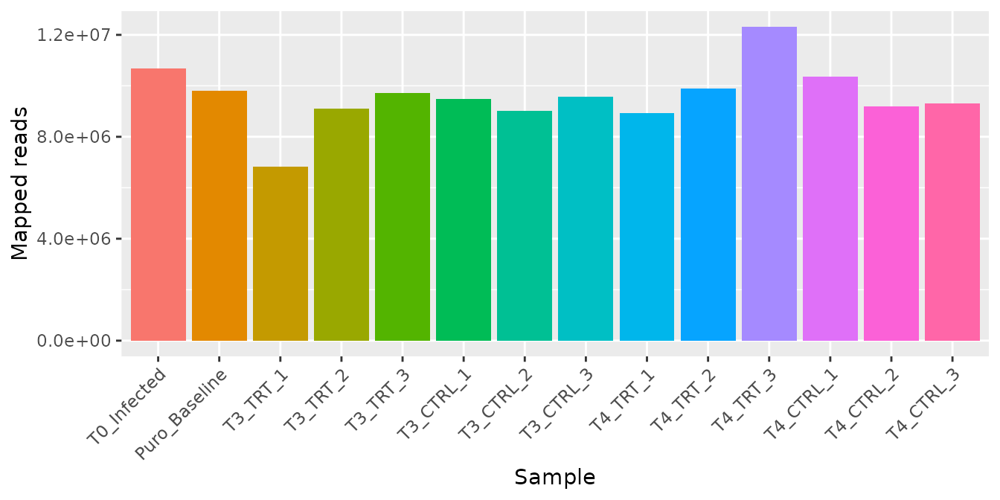

``` r

depth <- mapped_reads(object)
range(depth$Mapped) / nrow(object)
#> [1] 1283.595 2318.060
```

Every sample has between 1284 and 2318 reads per barcode on average,
well above the usual minimum of a few hundred.

### Library representation over the screen

Infection and puromycin selection are bottlenecks: shRNAs carried by few
cells can be lost by chance, independently of their target. The number
of barcodes without any read and the Gini index (how unevenly the reads
are spread over the barcodes: 0 when even, close to 1 when a few
barcodes take most reads) show how the representation evolves.

``` r

(plot_barcode_lost(object) +
    scale_x_discrete(guide = guide_axis(angle = 45))) /
    plot_gini(object)
```

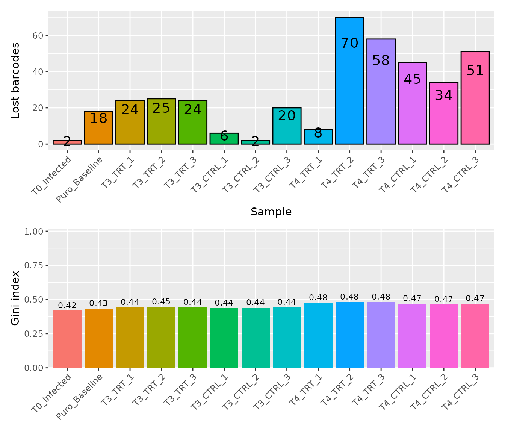

Few barcodes are lost at T0 and after selection, and the Gini index
increases slowly over time, as expected when the shRNAs against genes
needed for growth drop out. Neither the infection nor the selection
caused a bottleneck that would make the counts unreliable.

### Agreement between replicates

The replicates of a condition should be more similar to each other than
to the other samples. This and the following plots compare
**normalized** counts, so the counts are normalized first (the choice of
the normalization is discussed in the next section).

``` r

object <- normalize_data(object, method = "cpm")
```

``` r

plot_replicate_correlation(object)
```

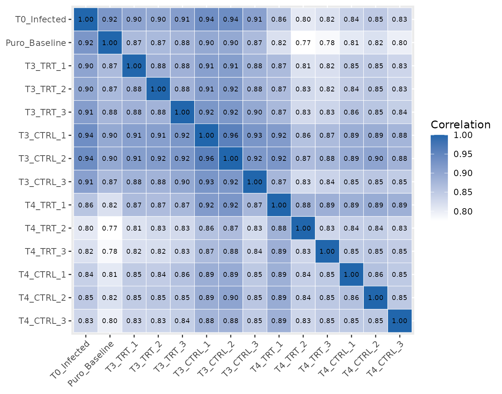

``` r

correlation <- cor(log2(get_normalized_count_table(object)[, -1] + 1))
round(correlation["T4_TRT_1", c("T4_TRT_2", "T4_TRT_3", "T3_CTRL_2",
    "T3_TRT_1")], 3)
#>  T4_TRT_2  T4_TRT_3 T3_CTRL_2  T3_TRT_1 
#>     0.883     0.887     0.924     0.870
```

All the correlations are high, and the T3 samples are more similar to
each other than to the T4 samples. One sample stands out: **T4_TRT_1**
is more correlated with some T3 samples (for example T3_CTRL_2) than
with the other two T4 treated replicates, and it lost far fewer barcodes
than them (see above). Removing a replicate needs a technical reason,
which we do not have, so it is kept; the [sensitivity
analysis](#sensitivity) at the end checks that the conclusions do not
depend on it.

### Structure of the samples

Multidimensional scaling (MDS) and principal component analysis (PCA)
place similar samples close to each other.

``` r

plot_mds(object)
```

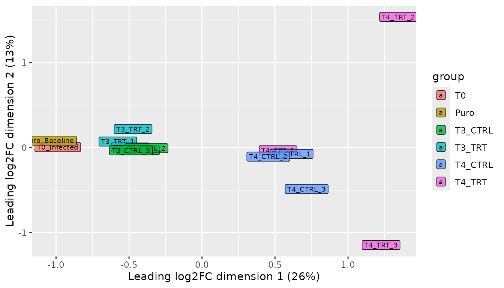

``` r

plot_pca(object)
```

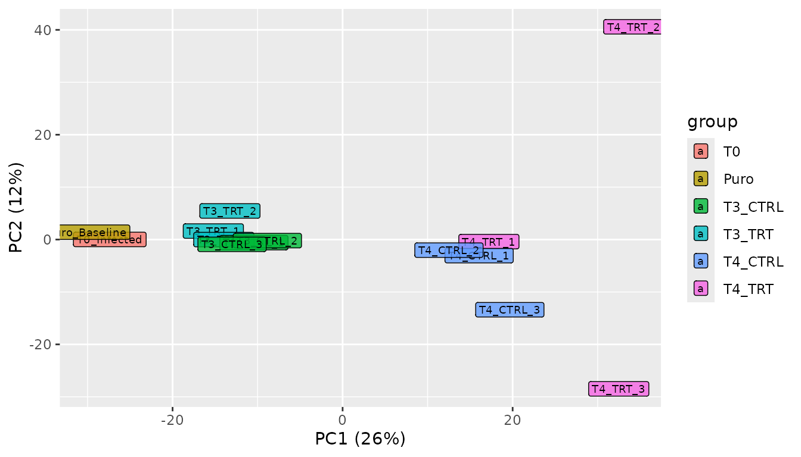

The first dimension orders the samples by time (T0 and Puro, then T3,
then T4): the largest source of variation is the growth of the cells,
which changes the representation of the shRNAs against growth genes in
all the cultures. This is why the treatment effect must be measured
**within each time point**. At T3 the treated and control samples
overlap. At T4 two treated replicates (T4_TRT_2 and T4_TRT_3) move away
from the controls, in different directions on the second dimension,
while T4_TRT_1 stays with the controls: the treated cultures at T4 are
heterogeneous, which limits the power to detect treatment effects.

## Normalization

Samples are sequenced at different depths, so counts are compared after
dividing each sample by an **effective library size**. ScreenR offers
three choices in
[`normalize_data()`](https://emanuelsoda.github.io/ScreenR/reference/normalize_data.md):

- `"cpm"`: the total number of reads of the sample;
- `"tmm"`: the total corrected with the TMM factors of edgeR, which are
  more robust when many barcodes are depleted in some samples;
- `"control"`: the reads of control barcodes known to be without effect
  (this library has none).

The normalization matters when many barcodes change in the same samples,
because they change the total. A simple check is to compare the
effective library sizes of the two methods:

``` r

tmm <- normalize_data(object, method = "tmm")
ratio <- get_normalization(object)$effective_library_size /
    get_normalization(tmm)$effective_library_size
round(range(ratio), 3)
#> [1] 0.982 1.023
```

The two methods differ by at most 2% in any sample: the treatment and
the growth do not change the composition of the library enough to bias
the totals, so we keep counts per million. With a strong compositional
imbalance, TMM (or control barcodes) would be the right choice.

**One normalization for the whole analysis.** ScreenR records the
normalization in the object (the effective library sizes in the colData,
the method in the metadata) and never changes the raw counts. Every
result below uses this same normalization: the normalized counts of the
plots, the descriptive fold changes and the statistical models. The
models use the raw counts, as negative binomial models require, with the
effective library sizes as offsets:

``` r

get_normalization(object)$method
#> [1] "cpm"
dge <- create_edger_obj(object)
all.equal(dge$samples$lib.size * dge$samples$norm.factors,
    unname(get_normalization(object)$effective_library_size))
#> [1] TRUE
```

Changing the normalization with
[`normalize_data()`](https://emanuelsoda.github.io/ScreenR/reference/normalize_data.md)
would update all of them at once.

## The statistical model

### Why a model with all the samples

The treatment effect of a gene could be measured with fold changes of
mean counts, but this ignores two essential sources of information: the
**replicates**, which tell how much a fold change varies between
independent cultures, and the **several shRNAs** of each gene, whose
agreement makes a hit credible. ScreenR therefore models the raw counts
of each barcode with the negative binomial generalized linear model of
edgeR, and then tests the barcodes of each gene together.

The model has one coefficient for each group (the mean abundance of the
barcode in that group), and every comparison is a **contrast**, a
combination of group coefficients. All 14 samples enter the same model,
so the variability between replicates is estimated from all the
replicated groups at once.

``` r

design <- create_design_matrix(object)
colnames(design)
#> [1] "T0"      "Puro"    "T3_CTRL" "T3_TRT"  "T4_CTRL" "T4_TRT"
```

### The comparisons

The questions of the screen are contrasts between these groups:

``` r

contrasts <- list(
    # Treatment effect at each time point: treated vs control
    T3 = create_contrast(design, treatment = "T3_TRT", control = "T3_CTRL"),
    T4 = create_contrast(design, treatment = "T4_TRT", control = "T4_CTRL"),
    # Average treatment effect over the two time points
    Average = create_contrast(design,
        treatment = c("T3_TRT", "T4_TRT"), control = c("T3_CTRL", "T4_CTRL")),
    # Loss of fitness: T4 vs the post-selection baseline, in each condition
    Fitness_CTRL = create_contrast(design, treatment = "T4_CTRL",
        control = "Puro"),
    Fitness_TRT = create_contrast(design, treatment = "T4_TRT",
        control = "Puro")
)
contrasts$T4
#>      T0    Puro T3_CTRL  T3_TRT T4_CTRL  T4_TRT 
#>       0       0       0       0      -1       1
```

A gene that is lost in all the cultures because it is needed for growth
has a strong fitness effect in both conditions but no treatment effect,
because treated and control cultures lose it in the same way. A
treatment-specific hit has a treatment effect: it is depleted in treated
cultures **compared with the controls of the same time point**.

### Gene-level test

For each contrast, `find_roast_hit(method = "fry")` tests whether the
barcodes of a gene, taken together, are depleted. FRY is a fast,
self-contained gene-set test of limma: it uses the replicate variability
of the edgeR model and all the shRNAs of the gene, so a gene is called
when its shRNAs are depleted consistently, relative to the variability
between replicates. Its `Log2FC` is the median log2 fold change of the
shRNAs of the gene. In the screens with known hits of the
[benchmark](https://emanuelsoda.github.io/ScreenR/articles/Benchmark_MAGeCK.md)
and of [Tutorial
4](https://emanuelsoda.github.io/ScreenR/articles/Tutorial_4_CRISPR_screens.md),
FRY found most of the essential genes with few false calls.

The function returns one-sided p-values for the requested direction. To
combine contrasts, we want the p-value of depletion for **every** gene,
so this small helper also converts the genes that change in the other
direction (their p-value of depletion is one minus their p-value of
enrichment):

``` r

gene_test <- function(contrast) {
    down <- find_roast_hit(object, design, contrast,
        method = "fry", direction = "Down", fdr = 1)
    up <- find_roast_hit(object, design, contrast,
        method = "fry", direction = "Up", fdr = 1)
    bind_rows(
        transmute(down, Gene, NBarcodes = NGenes, Log2FC, PValue),
        transmute(up, Gene, NBarcodes = NGenes, Log2FC, PValue = 1 - PValue)
    ) %>%
        mutate(FDR = p.adjust(PValue, method = "BH")) %>%
        arrange(PValue)
}
tests <- lapply(contrasts, gene_test)
head(tests$T4)
#> # A tibble: 6 × 5
#>   Gene     NBarcodes Log2FC   PValue    FDR
#>   <chr>        <int>  <dbl>    <dbl>  <dbl>
#> 1 Gene_412        10 -0.325 0.000110 0.0254
#> 2 Gene_422        10 -0.433 0.000133 0.0254
#> 3 Gene_173        10 -0.515 0.000188 0.0254
#> 4 Gene_15         10 -0.325 0.000218 0.0254
#> 5 Gene_296        10 -0.508 0.000266 0.0254
#> 6 Gene_349        10 -0.182 0.000285 0.0254
```

The FDR column corrects for testing all the genes (Benjamini-Hochberg):
a gene with FDR at most 0.05 is a hit, and on average at most 5% of the
hits are false.

``` r

sapply(tests, function(result) c(
    `FDR <= 0.05` = sum(result$FDR <= 0.05),
    `FDR <= 0.10` = sum(result$FDR <= 0.10)
))
#>             T3 T4 Average Fitness_CTRL Fitness_TRT
#> FDR <= 0.05  0  7       0           24          38
#> FDR <= 0.10  0 12       1           36          83
```

### How much signal is there?

Before reading the lists of hits, the distribution of the p-values tells
how many genes respond at all. Without any effect, the two-sided
p-values (for a change in either direction) are uniform between 0 and 1;
genes with an effect add an excess of small p-values.

``` r

two_sided <- function(result) 2 * pmin(result$PValue, 1 - result$PValue)
bind_rows(lapply(tests[c("T3", "T4", "Average")],
    function(result) tibble(PValue = two_sided(result))), .id = "Contrast") %>%
    ggplot(aes(PValue)) +
    geom_histogram(breaks = seq(0, 1, 0.05), colour = "white") +
    facet_wrap(~Contrast) +
    labs(x = "Two-sided p-value (FRY)", y = "Genes")
```

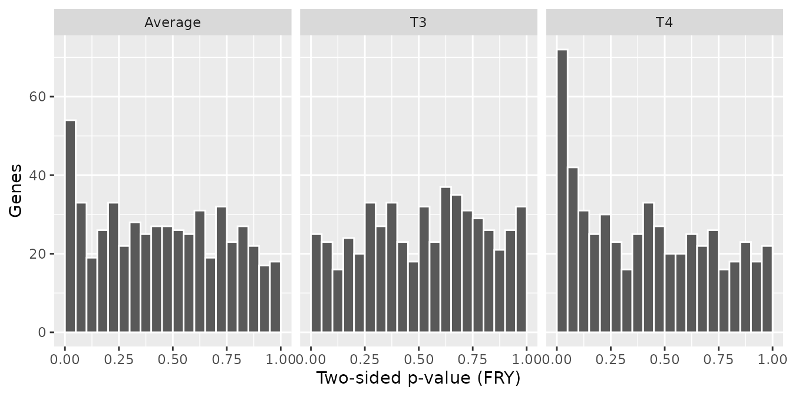

The share of genes with an effect can be estimated as one minus the
share of uniform p-values (estimated from the p-values above 0.5):

``` r

with_effect <- function(result) {
    1 - min(1, mean(two_sided(result) > 0.5) / 0.5)
}
round(sapply(tests[c("T3", "T4", "Average")], with_effect), 2)
#>      T3      T4 Average 
#>    0.00    0.21    0.10
```

About 0% of the genes respond to the treatment at T3 and 21% at T4: **at
T3 there is no detectable treatment effect**, while at T4 a group of
genes changes. The same is visible in the distribution of the barcode
log2 fold changes (treated vs control), which is wider at T4:

``` r

metrics <- list(
    T3 = compute_metrics(object, control = "CTRL", treatment = "TRT",
        day = "T3"),
    T4 = compute_metrics(object, control = "CTRL", treatment = "TRT",
        day = "T4")
)
plot_zscore_distribution(metrics, alpha = 0.5)
```

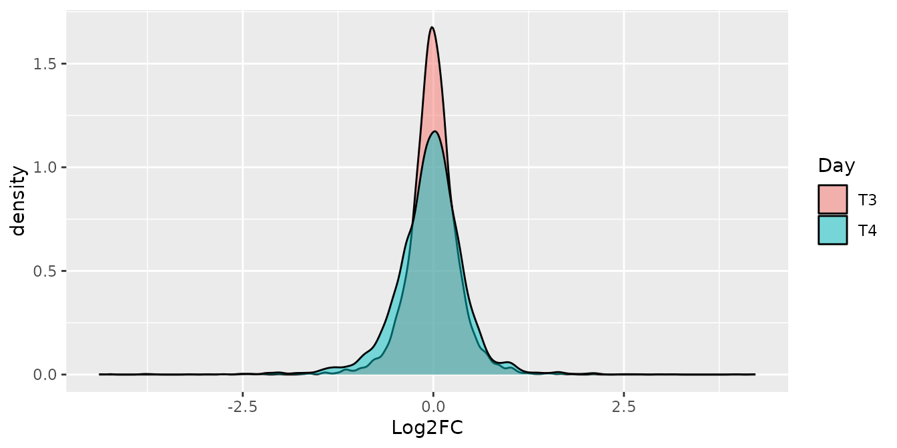

## Treatment-specific hits

### At each time point

``` r

hits_t3 <- filter(tests$T3, FDR <= 0.05)
hits_t4 <- filter(tests$T4, FDR <= 0.05)
hits_t4
#> # A tibble: 7 × 5
#>   Gene     NBarcodes Log2FC   PValue    FDR
#>   <chr>        <int>  <dbl>    <dbl>  <dbl>
#> 1 Gene_412        10 -0.325 0.000110 0.0254
#> 2 Gene_422        10 -0.433 0.000133 0.0254
#> 3 Gene_173        10 -0.515 0.000188 0.0254
#> 4 Gene_15         10 -0.325 0.000218 0.0254
#> 5 Gene_296        10 -0.508 0.000266 0.0254
#> 6 Gene_349        10 -0.182 0.000285 0.0254
#> 7 Gene_322        10 -0.393 0.000442 0.0337
```

At 5% FDR, 0 genes are depleted at T3 and 7 at T4.

**Are the T4 hits robust to the choice of the test?** CAMERA (a
competitive test: is the gene more depleted than the other genes?) and
the gene-level Z-score test with an empirical null (see the vignette
[Choosing the reference of the gene-level
test](https://emanuelsoda.github.io/ScreenR/articles/Empirical_null.md))
look at the same barcodes with different assumptions.
[`summarise_hits()`](https://emanuelsoda.github.io/ScreenR/reference/summarise_hits.md)
combines them:

``` r

statistics_t4 <- compute_barcode_statistics(object, design, contrasts$T4)
agreement <- summarise_hits(list(
    FRY = tests$T4,
    CAMERA = find_camera_hit(object, design, contrasts$T4, fdr = 1),
    Zscore = find_gene_zscore_hit(statistics_t4, reference = "empirical",
        fdr = 1)
), fdr = 0.05)
agreement %>%
    filter(Gene %in% hits_t4$Gene) %>%
    select(Gene, NMethods, starts_with("FDR")) %>%
    knitr::kable(digits = 4)
```

| Gene     | NMethods | FDR_FRY | FDR_CAMERA | FDR_Zscore |
|:---------|---------:|--------:|-----------:|-----------:|
| Gene_173 |        1 |  0.0254 |     0.0941 |     0.0637 |
| Gene_422 |        1 |  0.0254 |     0.0941 |     0.0995 |
| Gene_296 |        1 |  0.0254 |     0.0969 |     0.1721 |
| Gene_15  |        1 |  0.0254 |     0.2264 |     0.1452 |
| Gene_349 |        1 |  0.0254 |     0.2708 |     0.3174 |
| Gene_412 |        1 |  0.0254 |     0.3037 |     0.5310 |
| Gene_322 |        1 |  0.0337 |     0.7162 |     0.3174 |

[`compute_barcode_statistics()`](https://emanuelsoda.github.io/ScreenR/reference/compute_barcode_statistics.md)
tests every barcode with the same edgeR model (quasi-likelihood F-test),
so the Z-scores used here already include the replicate variability.

The T4 hits are called by FRY only: none reaches 5% FDR with CAMERA or
with the Z-score test, and a few are close (CAMERA FDR about 0.1). The
tests ask different questions. FRY asks whether the shRNAs of the gene
are depleted, relative to the variability between replicates; CAMERA and
the Z-score test ask whether the gene is more depleted than the other
genes of the library. The effects of the T4 hits are moderate (median
log2 fold changes between -0.51 and -0.18), so they are significant as
depletions but do not stand out against all the other genes. They are
**candidates with moderate effects** that need independent validation,
not unambiguous hits.

### Across the two time points: three different questions

“Consistently depleted over time” can mean three different things, which
need three different tests. Being significant at T3 and, separately, at
T4 answers none of them exactly.

1.  **Is the gene depleted at T3 and at T4?** This is tested by the
    *intersection-union test*: the gene is called only if both one-sided
    tests reject, so its p-value is the larger of the two (p =
    max(p_(T3), p_(T4))), corrected for the number of genes. It is the
    formal test of reproducibility across time points.
2.  **Is the gene depleted on average over the two time points?** The
    `Average` contrast tests the mean of the two treatment effects. It
    can be significant because of one time point only.
3.  **Does the treatment effect change between T3 and T4?** This is the
    interaction, (T4 treated - T4 control) - (T3 treated - T3 control),
    tested by
    [`find_time_hit()`](https://emanuelsoda.github.io/ScreenR/reference/find_time_hit.md)
    (next section).

``` r

genes <- tests$T3$Gene
both <- tibble(
    Gene = genes,
    Log2FC_T3 = tests$T3$Log2FC[match(genes, tests$T3$Gene)],
    Log2FC_T4 = tests$T4$Log2FC[match(genes, tests$T4$Gene)],
    P_T3 = tests$T3$PValue[match(genes, tests$T3$Gene)],
    P_T4 = tests$T4$PValue[match(genes, tests$T4$Gene)]
) %>%
    mutate(
        PValue_both = pmax(P_T3, P_T4),
        FDR_both = p.adjust(PValue_both, method = "BH"),
        FDR_average = tests$Average$FDR[match(Gene, tests$Average$Gene)]
    ) %>%
    arrange(PValue_both)
head(both, 5)
#> # A tibble: 5 × 8
#>   Gene     Log2FC_T3 Log2FC_T4    P_T3     P_T4 PValue_both FDR_both FDR_average
#>   <chr>        <dbl>     <dbl>   <dbl>    <dbl>       <dbl>    <dbl>       <dbl>
#> 1 Gene_173   -0.222    -0.515  0.0121  0.000188      0.0121    0.999      0.0692
#> 2 Gene_457   -0.134     0.0677 0.00710 0.0280        0.0280    0.999      0.171 
#> 3 Gene_394   -0.0935   -0.128  0.0366  0.0274        0.0366    0.999      0.238 
#> 4 Gene_121   -0.0867   -0.177  0.0381  0.00609       0.0381    0.999      0.171 
#> 5 Gene_86    -0.346    -0.173  0.00938 0.0461        0.0461    0.999      0.177
```

``` r

c(
    `depleted at T3 and at T4 (intersection-union)` =
        sum(both$FDR_both <= 0.05),
    `depleted on average` = sum(both$FDR_average <= 0.05),
    `depleted at T4` = nrow(hits_t4)
)
#> depleted at T3 and at T4 (intersection-union) 
#>                                             0 
#>                           depleted on average 
#>                                             0 
#>                                depleted at T4 
#>                                             7
```

No gene is depleted at both time points, and the average effect
identifies 0 gene(s): the average is diluted by the T3 effects, which
are close to zero. In this screen **the treatment-specific depletion
appears at T4**; it is not a constant effect present from T3.

### Does the effect change over time?

[`find_time_hit()`](https://emanuelsoda.github.io/ScreenR/reference/find_time_hit.md)
fits a single model to the control and treated samples of the two time
points, with a separate line for each condition, and tests the
difference between their slopes, the change of the treatment effect from
T3 to T4, with CAMERA. With two time points this is the interaction
defined above. It uses only the samples of the given days, so its
variance estimates differ slightly from those of the model with all the
samples.

``` r

time_hits <- find_time_hit(object, treatment = "TRT", control = "CTRL",
    days = c("T3", "T4"), direction = "Down", fdr = 1)
head(time_hits)
#> # A tibble: 6 × 6
#>   Gene     NGenes Direction   PValue   FDR Log2FC
#>   <chr>     <dbl> <fct>        <dbl> <dbl>  <dbl>
#> 1 Gene_296     10 Down      0.000608 0.321 -0.676
#> 2 Gene_372     12 Down      0.00158  0.321 -0.729
#> 3 Gene_422     10 Down      0.00180  0.321 -0.473
#> 4 Gene_412     10 Down      0.00487  0.485 -0.569
#> 5 Gene_419     10 Down      0.00508  0.485 -0.582
#> 6 Gene_87      10 Down      0.00571  0.485 -0.412
sum(time_hits$FDR <= 0.05)
#> [1] 0
```

``` r

time_hits %>%
    filter(Gene %in% hits_t4$Gene) %>%
    select(Gene, Log2FC, PValue, FDR)
#> # A tibble: 7 × 4
#>   Gene     Log2FC   PValue   FDR
#>   <chr>     <dbl>    <dbl> <dbl>
#> 1 Gene_296 -0.676 0.000608 0.321
#> 2 Gene_422 -0.473 0.00180  0.321
#> 3 Gene_412 -0.569 0.00487  0.485
#> 4 Gene_349 -0.270 0.00636  0.485
#> 5 Gene_15  -0.306 0.0426   0.861
#> 6 Gene_322 -0.355 0.0530   0.861
#> 7 Gene_173 -0.497 0.0587   0.870
```

No gene passes the FDR threshold. 4 of the 7 T4 hits have p-values below
0.01 for a stronger depletion at T4 than at T3, which agrees with an
effect that develops over time, but this is not significant after
correcting for the number of genes. A non-significant interaction is
**not** evidence that the effect is the same at the two time points: it
only means that a change could not be demonstrated with three
replicates. Showing that two effects are equal would need an equivalence
test, which ScreenR does not provide (see [Limitations](#limitations)).

## Essential genes: loss of fitness in all the cultures

Some genes are depleted in every culture, treated or not, because the
cells need them to grow. They are found with the fitness contrasts (T4
against the post-selection baseline) in each condition.

``` r

fitness <- tibble(Gene = genes) %>%
    mutate(
        Log2FC_CTRL = tests$Fitness_CTRL$Log2FC[
            match(Gene, tests$Fitness_CTRL$Gene)],
        FDR_CTRL = tests$Fitness_CTRL$FDR[
            match(Gene, tests$Fitness_CTRL$Gene)],
        Log2FC_TRT = tests$Fitness_TRT$Log2FC[
            match(Gene, tests$Fitness_TRT$Gene)],
        FDR_TRT = tests$Fitness_TRT$FDR[match(Gene, tests$Fitness_TRT$Gene)],
        FDR_treatment = tests$T4$FDR[match(Gene, tests$T4$Gene)]
    )
essential <- fitness %>%
    filter(FDR_CTRL <= 0.05, FDR_TRT <= 0.05, FDR_treatment > 0.05) %>%
    arrange(Log2FC_CTRL)
nrow(essential)
#> [1] 16
head(essential, 5)
#> # A tibble: 5 × 6
#>   Gene     Log2FC_CTRL  FDR_CTRL Log2FC_TRT   FDR_TRT FDR_treatment
#>   <chr>          <dbl>     <dbl>      <dbl>     <dbl>         <dbl>
#> 1 Gene_364       -3.66 0.0000158     -4.11  0.0000152         0.193
#> 2 Gene_372       -2.34 0.0000726     -2.62  0.0000225         0.224
#> 3 Gene_323       -1.59 0.00352       -1.42  0.00180           0.641
#> 4 Gene_374       -1.58 0.000497      -1.52  0.000214          0.268
#> 5 Gene_80        -1.52 0.0215        -0.647 0.0229            0.944
```

16 genes are depleted in both conditions with no significant treatment
effect: they behave like essential genes. They are not
treatment-specific hits, even though they are among the most depleted
genes of the screen. For the two most depleted ones the treated cultures
lose slightly more than the controls at T4 (see the figure below), but
this treatment effect is not significant. The baseline has a single
sample, so these contrasts rely on the variability estimated from the
replicated groups.

## Classification of the genes

Each gene gets one class, from the tests above:

``` r

classes <- both %>%
    left_join(select(fitness, Gene, FDR_CTRL, FDR_TRT), by = "Gene") %>%
    mutate(
        FDR_T3 = tests$T3$FDR[match(Gene, tests$T3$Gene)],
        FDR_T4 = tests$T4$FDR[match(Gene, tests$T4$Gene)],
        Class = case_when(
            FDR_both <= 0.05 ~ "Treatment: T3 and T4",
            FDR_T4 <= 0.05 ~ "Treatment: T4",
            FDR_T3 <= 0.05 ~ "Treatment: T3",
            FDR_CTRL <= 0.05 & FDR_TRT <= 0.05 ~ "Fitness (both conditions)",
            TRUE ~ "Not significant"
        )
    )
dplyr::count(classes, Class)
#> # A tibble: 3 × 2
#>   Class                         n
#>   <chr>                     <int>
#> 1 Fitness (both conditions)    16
#> 2 Not significant             511
#> 3 Treatment: T4                 7
```

The figure that summarizes the screen compares the treatment effect of
each gene at T3 and at T4. Genes depleted at both time points would lie
in the lower left quadrant, near the diagonal; genes whose effect
appears at T4 lie below zero on the vertical axis only.

``` r

colours <- c(
    "Treatment: T3 and T4" = "#D95F02", "Treatment: T4" = "#E7298A",
    "Treatment: T3" = "#7570B3", "Fitness (both conditions)" = "#1B9E77",
    "Not significant" = "grey75"
)
# Label the treatment hits and the two most depleted fitness genes
labelled <- filter(classes, startsWith(Class, "Treatment") |
    Gene %in% essential$Gene[1:2])
ggplot(arrange(classes, Class != "Not significant"),
    aes(Log2FC_T3, Log2FC_T4, colour = Class)) +
    geom_hline(yintercept = 0, colour = "grey60") +
    geom_vline(xintercept = 0, colour = "grey60") +
    geom_abline(linetype = "dashed", colour = "grey60") +
    geom_point(size = 1.8) +
    geom_text(data = labelled, aes(label = Gene), size = 2.6,
        vjust = -0.8, show.legend = FALSE) +
    scale_colour_manual(values = colours, drop = FALSE) +
    labs(
        x = "Treatment effect at T3 (median log2 fold change, TRT vs CTRL)",
        y = "Treatment effect at T4 (median log2 fold change, TRT vs CTRL)",
        colour = NULL
    ) +
    coord_equal()
```

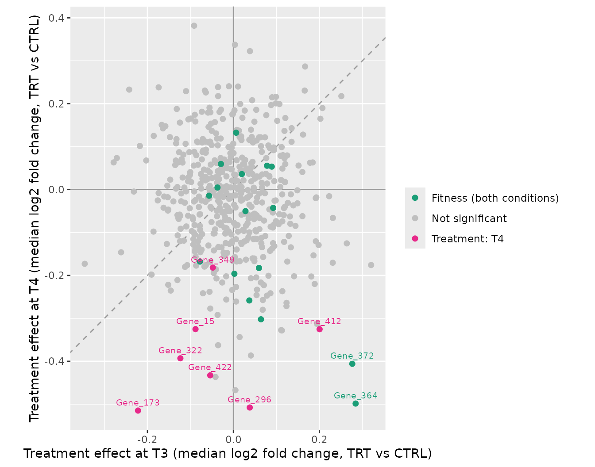

The treatment-specific hits are depleted at T4 (negative vertical axis)
with small or no effects at T3 (horizontal axis): they lie away from the
diagonal, because their depletion appears between the two time points.
Most fitness genes have small treatment effects: they are lost in
treated and control cultures alike, so treated and control samples of
the same time point differ little even though both are strongly depleted
over time.

## Evidence for the candidate hits

A gene-level p-value is only as good as the shRNAs behind it. For the
top treatment-specific hit and the top essential gene, we look at the
reagents and at the samples.

``` r

top_hit <- hits_t4$Gene[1]
top_essential <- essential$Gene[1]
c(hit = top_hit, essential = top_essential)
#>        hit  essential 
#> "Gene_412" "Gene_364"
```

### Every shRNA of the gene

[`plot_barcode_hit()`](https://emanuelsoda.github.io/ScreenR/reference/plot_barcode_hit.md)
ranks all the barcodes of the library by their log2 fold change in a
contrast and marks the barcodes of the gene: most of them should be on
the depleted side.

``` r

plot_barcode_hit(object, design, contrasts$T4, gene = top_hit) +
    plot_annotation(caption = "Treated vs control at T4")
```

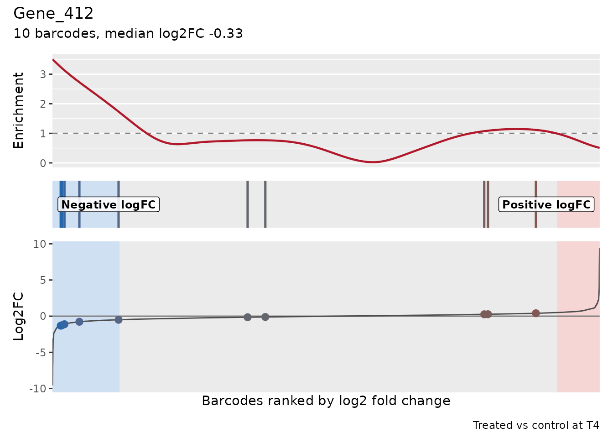

``` r

plot_barcode_hit(object, design, contrasts$T3, gene = top_hit) +
    plot_annotation(caption = "Treated vs control at T3")
```

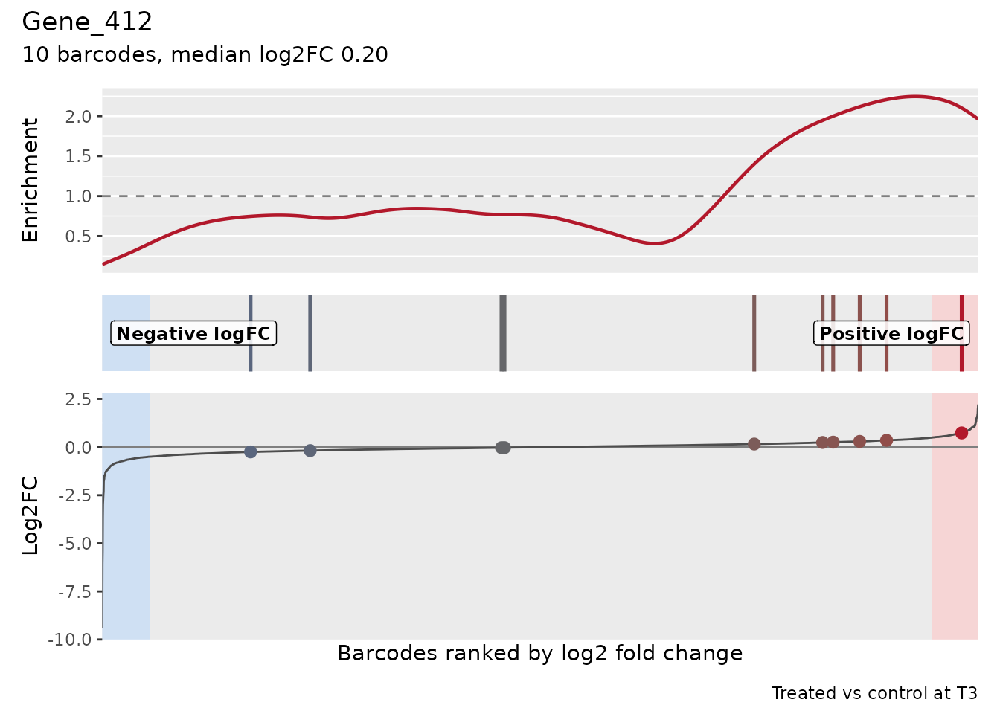

At T4 half of the shRNAs of the gene are among the most depleted
barcodes of the library and the others are close to zero, as often
happens with shRNAs of different knockdown efficiency; at T3 they lean
slightly towards enrichment.
[`plot_barcode_trend()`](https://emanuelsoda.github.io/ScreenR/reference/plot_barcode_trend.md)
follows each shRNA from T3 to T4 (log2 fold change of treated vs
control):

``` r

plot_barcode_trend(metrics, genes = top_hit)[[1]]
```

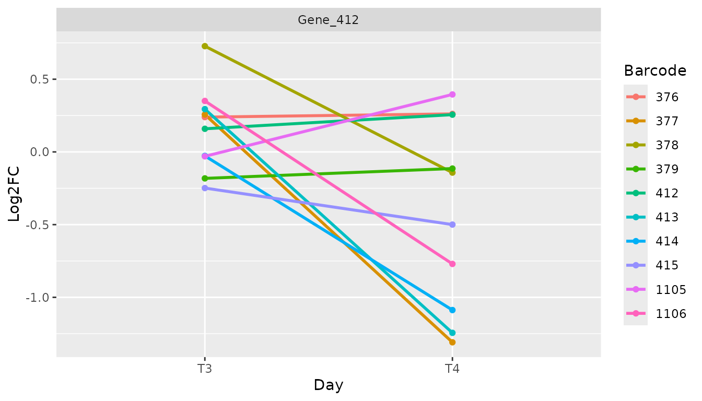

Several shRNAs go from no effect at T3 to a clear depletion at T4, while
the others stay close to zero: the depletion of the gene appears between
the two time points and is carried by its most effective shRNAs.

[`find_discordant_barcodes()`](https://emanuelsoda.github.io/ScreenR/reference/find_discordant_barcodes.md)
lists the shRNAs that behave very differently from the others of their
gene, for example because of off-target effects (a deviation of more
than 3 median absolute deviations from the median of the gene):

``` r

find_discordant_barcodes(metrics$T4, threshold = 3) %>%
    filter(Gene %in% c(top_hit, hits_t4$Gene))
#> # A tibble: 3 × 5
#>   Barcode Gene     Log2FC GeneLog2FC Deviation
#>   <fct>   <chr>     <dbl>      <dbl>     <dbl>
#> 1 13838   Gene_322  -2.01     -0.386     -3.98
#> 2 13246   Gene_322  -1.82     -0.386     -3.51
#> 3 994     Gene_349  -1.61     -0.180     -3.21
```

None of the shRNAs of the top hit is discordant. Gene_322 has two shRNAs
much more depleted than its other shRNAs: its call depends more on a few
reagents and deserves more caution.

### Every sample

The normalized counts of the shRNAs in every sample show the difference
between a treatment-specific hit and an essential gene directly:

``` r

plot_boxplot(object, genes = c(top_hit, top_essential),
    group_var = c("Infected", "Baseline", "CTRL", "TRT"),
    fill_var = "Treatment", ncol = 2) +
    scale_y_continuous(transform = "log1p",
        breaks = c(0, 10, 100, 1000, 10000)) +
    scale_x_discrete(guide = guide_axis(angle = 60))
```

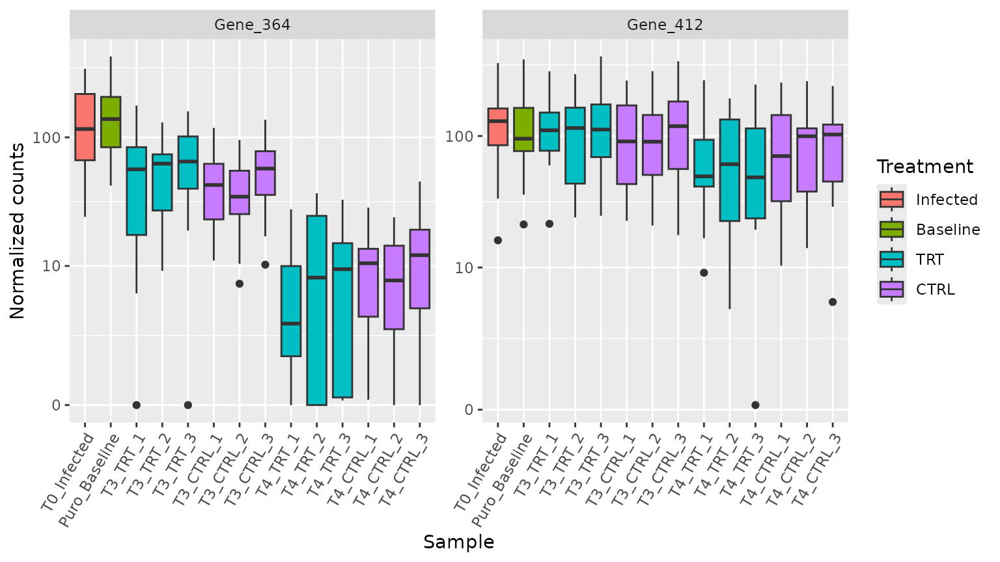

The essential gene decreases from the baseline in control and treated
cultures alike. The treatment-specific hit stays close to its baseline
level in the controls, while in the treated cultures it is lower at T4.

[`plot_trend()`](https://emanuelsoda.github.io/ScreenR/reference/plot_trend.md)
summarizes the same data as a line over the stages of the screen,
separately for the control and the treated cultures (the stages are
taken as equally spaced; give their real times with `time` if known):

The trend lines (mean normalized count of the shRNAs of the gene in each
sample) show a slight decrease of the treatment-specific hit also in the
controls, and a larger one in the treated cultures, which end lower at
T4: the treatment effect adds to a small decrease shared by all the
cultures.

``` r

trend <- function(condition) {
    plot_trend(object, genes = c(top_hit, top_essential),
        group_var = c("Infected", "Baseline", condition), ncol = 2) +
        ggtitle(condition)
}
trend("CTRL") / trend("TRT")
```

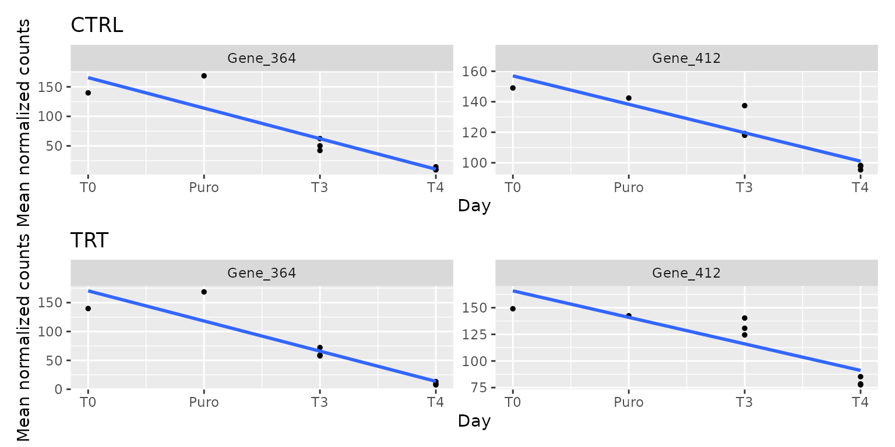

## Sensitivity analysis

The quality control showed that T4_TRT_1 resembles the T3 samples.
Refitting the model without it shows whether the conclusions depend on
this sample:

``` r

without <- object[, colnames(object) != "T4_TRT_1"]
design_without <- create_design_matrix(without)
t4_without <- find_roast_hit(without, design_without,
    create_contrast(design_without, "T4_TRT", "T4_CTRL"),
    method = "fry", direction = "Down", fdr = 0.05)
t3_without <- find_roast_hit(without, design_without,
    create_contrast(design_without, "T3_TRT", "T3_CTRL"),
    method = "fry", direction = "Down", fdr = 0.05)
c(T3 = nrow(t3_without), T4 = nrow(t4_without),
    `T4 hits also found with all samples` =
        sum(t4_without$Gene %in% hits_t4$Gene))
#>                                  T3                                  T4 
#>                                   0                                  10 
#> T4 hits also found with all samples 
#>                                   6
```

Without T4_TRT_1 there are still no hits at T3 and a similar set of hits
at T4, which includes most of the hits found with all the samples. The
subset keeps the normalization of the full object: the retained samples
keep their effective library sizes.

## Conclusions

- The screen is of good quality: deep sequencing, no bottleneck at
  infection or selection, and consistent replicates. The treated
  replicates at T4 are heterogeneous (T4_TRT_1 is close to the
  controls), which does not change the conclusions but limits the power.
- The strongest depletion in the screen is a **loss of fitness** shared
  by control and treated cultures: 16 genes behave like essential genes
  and are not treatment-specific hits.
- **Treatment-specific depletion appears at T4**, not at T3: 7 genes are
  depleted in treated compared with control cultures at T4 (5% FDR),
  with moderate effects, while no gene is depleted at T3 and none at
  both time points. They should be described as late treatment effects,
  not as effects constant over time.
- These candidates are supported by several shRNAs and by the replicate
  variability (FRY), and some of them also by a trend towards a stronger
  effect at T4, but not by the competitive tests (CAMERA, Z-score): they
  are moderate effects to validate independently, for example with
  individual shRNAs or another screen.

## Limitations

The analysis above uses only methods whose statistical formulation fits
the question. Some questions of a longitudinal design are not fully
covered by ScreenR at present:

- **No built-in test of reproducibility across time points.** The
  intersection-union test is computed here from the per-time-point
  results; ScreenR has no function that does it, or that classifies
  genes as above.
- **No equivalence test.** ScreenR can show that a treatment effect
  changes over time (interaction), but not that it is the same at two
  time points: that needs an equivalence test with a margin chosen by
  the user.
- **Time as equally spaced steps.**
  [`find_time_hit()`](https://emanuelsoda.github.io/ScreenR/reference/find_time_hit.md)
  treats the time points as equally spaced and tests a linear change of
  the treatment effect; with two time points this is the interaction,
  with more it assumes linearity.
- **Gene-level effect sizes without uncertainty.** The gene log2 fold
  change is the median over its shRNAs, reported without a confidence
  interval.
- **Independent replicates.** The model treats the replicates of
  different time points as independent cultures. If replicate 1 at T3
  and replicate 1 at T4 come from the same culture, a design with the
  culture as a blocking factor would be more appropriate; the
  edgeR/limma based functions accept any design matrix, but
  [`create_design_matrix()`](https://emanuelsoda.github.io/ScreenR/reference/create_design_matrix.md)
  does not build it.
- **Single-sample references.** T0 and the baseline have one sample
  each, so the fitness contrasts rely on the variability estimated from
  the replicated groups.
- **Multiplicity across questions.** The FDR is controlled within each
  contrast, not over all the contrasts together.

## Session info

``` r

sessionInfo()
#> R version 4.6.1 (2026-06-24)
#> Platform: x86_64-pc-linux-gnu
#> Running under: Ubuntu 24.04.5 LTS
#> 
#> Matrix products: default
#> BLAS:   /usr/lib/x86_64-linux-gnu/openblas-pthread/libblas.so.3 
#> LAPACK: /usr/lib/x86_64-linux-gnu/openblas-pthread/libopenblasp-r0.3.26.so;  LAPACK version 3.12.0
#> 
#> locale:
#>  [1] LC_CTYPE=C.UTF-8       LC_NUMERIC=C           LC_TIME=C.UTF-8       
#>  [4] LC_COLLATE=C.UTF-8     LC_MONETARY=C.UTF-8    LC_MESSAGES=C.UTF-8   
#>  [7] LC_PAPER=C.UTF-8       LC_NAME=C              LC_ADDRESS=C          
#> [10] LC_TELEPHONE=C         LC_MEASUREMENT=C.UTF-8 LC_IDENTIFICATION=C   
#> 
#> time zone: UTC
#> tzcode source: system (glibc)
#> 
#> attached base packages:
#> [1] stats4    stats     graphics  grDevices utils     datasets  methods  
#> [8] base     
#> 
#> other attached packages:
#>  [1] patchwork_1.3.2             ggplot2_4.0.3              
#>  [3] dplyr_1.2.1                 SummarizedExperiment_1.42.0
#>  [5] Biobase_2.72.0              GenomicRanges_1.64.0       
#>  [7] Seqinfo_1.2.0               IRanges_2.46.0             
#>  [9] S4Vectors_0.50.3            BiocGenerics_0.58.1        
#> [11] generics_0.1.4              MatrixGenerics_1.24.0      
#> [13] matrixStats_1.5.0           ScreenR_1.15.16            
#> [15] BiocStyle_2.40.0           
#> 
#> loaded via a namespace (and not attached):
#>  [1] gtable_0.3.6        xfun_0.62           bslib_0.12.0       
#>  [4] lattice_0.22-9      vctrs_0.7.3         tools_4.6.1        
#>  [7] tibble_3.3.1        pkgconfig_2.0.3     Matrix_1.7-5       
#> [10] RColorBrewer_1.1-3  S7_0.2.2            desc_1.4.3         
#> [13] lifecycle_1.0.5     compiler_4.6.1      farver_2.1.2       
#> [16] stringr_1.6.0       textshaping_1.0.5   statmod_1.5.2      
#> [19] htmltools_0.5.9     sass_0.4.10         yaml_2.3.12        
#> [22] pillar_1.11.1       pkgdown_2.2.1       jquerylib_0.1.4    
#> [25] tidyr_1.3.2         DelayedArray_0.38.2 cachem_1.1.0       
#> [28] limma_3.68.5        abind_1.4-8         nlme_3.1-169       
#> [31] tidyselect_1.2.1    locfit_1.5-9.12     digest_0.6.39      
#> [34] stringi_1.8.9       purrr_1.2.2         bookdown_0.48      
#> [37] splines_4.6.1       labeling_0.4.3      fastmap_1.2.0      
#> [40] grid_4.6.1          cli_3.6.6           SparseArray_1.12.3 
#> [43] magrittr_2.0.5      S4Arrays_1.12.1     utf8_1.2.6         
#> [46] withr_3.0.3         edgeR_4.10.6        scales_1.4.0       
#> [49] rmarkdown_2.32      XVector_0.52.0      otel_0.2.0         
#> [52] ragg_1.5.2          evaluate_1.0.5      knitr_1.52         
#> [55] mgcv_1.9-4          rlang_1.3.0         glue_1.8.1         
#> [58] BiocManager_1.30.27 jsonlite_2.0.0      R6_2.6.1           
#> [61] systemfonts_1.3.2   fs_2.1.0
```
