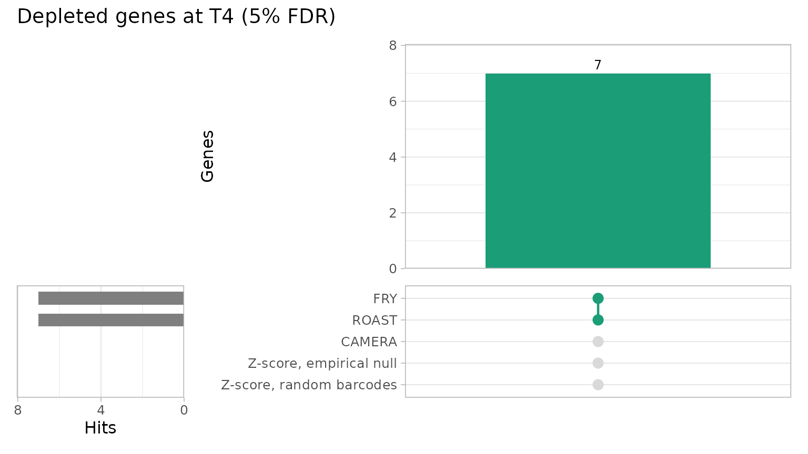
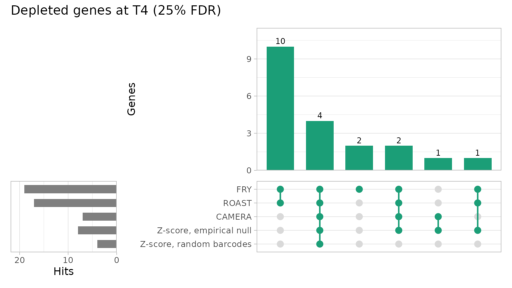
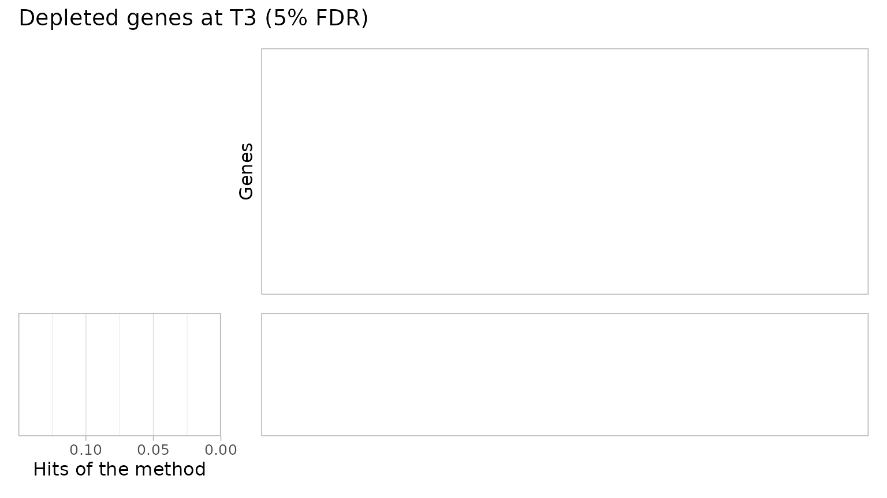
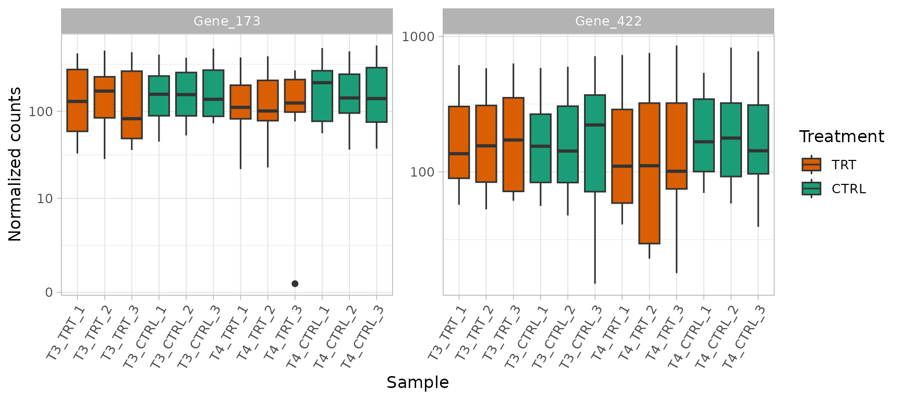
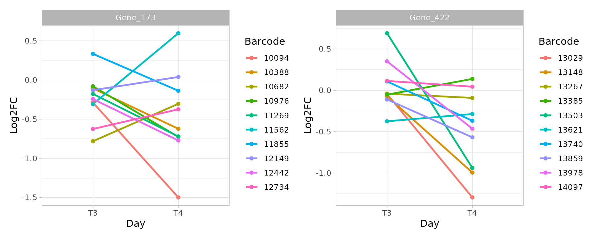
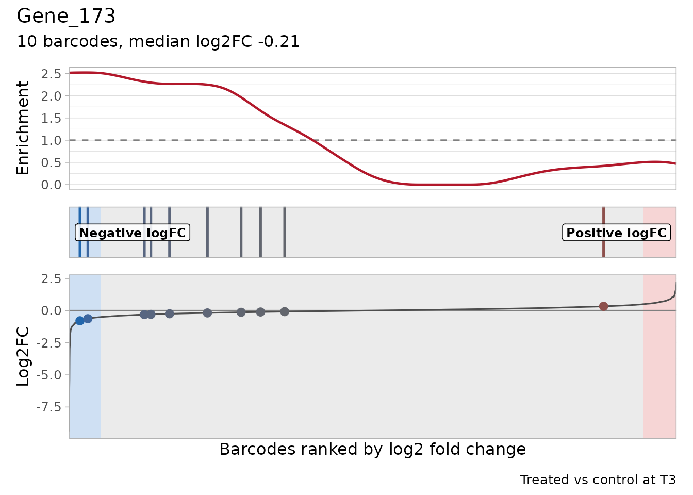
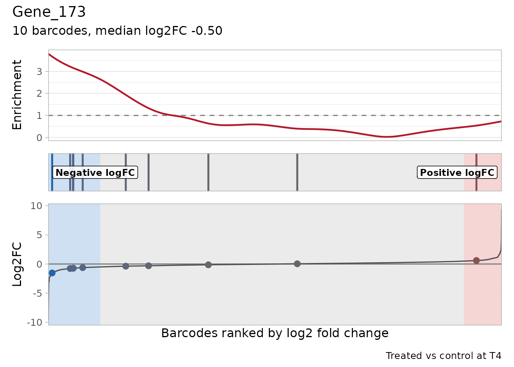
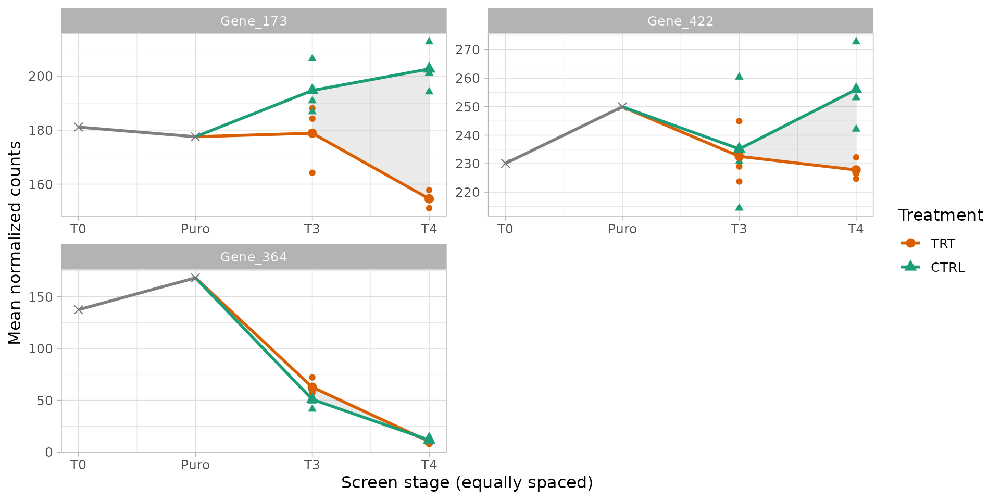
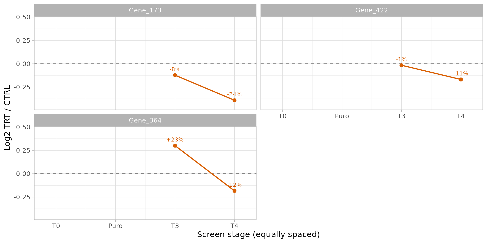
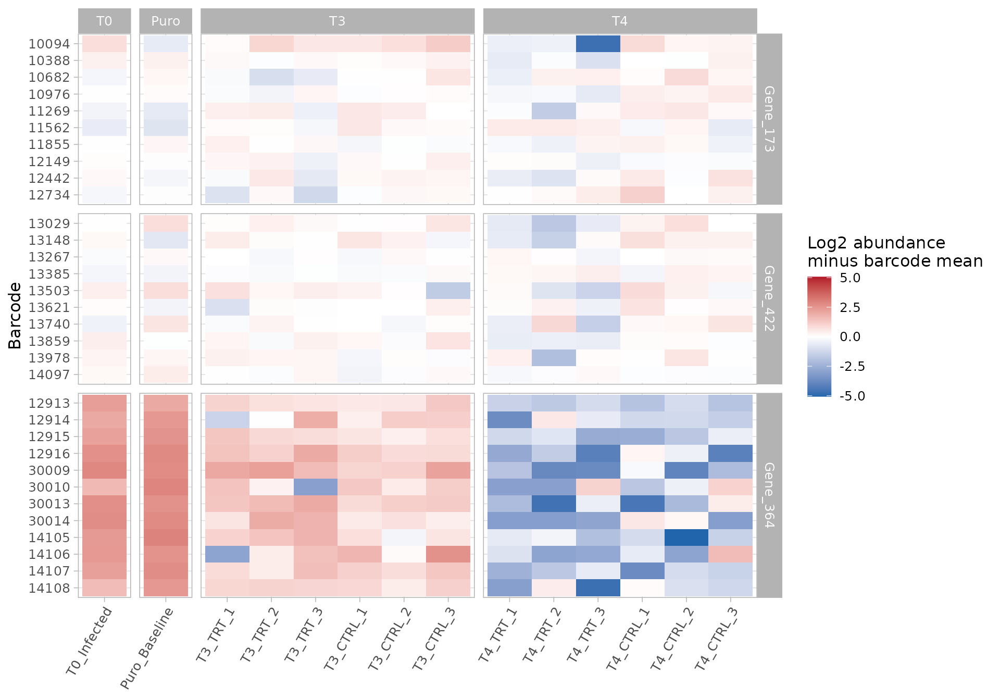

# Analysis of a longitudinal screen: from counts to treatment-specific hits

## About this tutorial

This tutorial analyses a complete pooled shRNA screen with ScreenR, from
the raw barcode counts to a list of genes whose knockdown is depleted
**because of the treatment**, and to the evidence that supports each of
them. The screen has the structure of many drug-sensitization screens:
an infected and selected cell population is split into control and
treated cultures, which are sampled at two time points with three
biological replicates each.

The question is not only “which genes are depleted?”, but:

- Which genes are depleted in **treated cells compared with control
  cells at the same time point**, rather than lost in all cultures
  because they are needed for growth (essential genes)?
- Is the depletion supported by **several shRNAs** of the gene and by
  the **biological replicates**?
- Is it present at **both time points**, or does it appear (or grow)
  over time?

Each step explains why it is needed, what ScreenR does, how to read the
result and which decisions it involves. The tutorials
[1](https://emanuelsoda.github.io/ScreenR/articles/Tutorial_1_Creating_the_object.md),
[2](https://emanuelsoda.github.io/ScreenR/articles/Tutorial_2_Quality_control.md)
and
[3](https://emanuelsoda.github.io/ScreenR/articles/Tutorial_3_Finding_hits.md)
describe the individual functions in more detail; this one puts them
together for a longitudinal design.

``` r

library(ScreenR)
library(SummarizedExperiment)
library(dplyr)
library(ggplot2)
library(patchwork)
```

ScreenR does not impose a look on its plots: they use the current
ggplot2 theme, so a theme set once with
[`theme_set()`](https://ggplot2.tidyverse.org/reference/get_theme.html)
applies to every plot of the analysis. Here we use a light theme with
slightly larger text:

``` r

theme_set(theme_light(base_size = 12))
```

## The experiment

### Design

The cells are infected with a pooled library of barcoded shRNAs (about
10 shRNAs for each of 534 genes) and selected with puromycin, which
kills the cells that were not infected. The selected population is then
split into control and treated cultures, sampled at two time points:

| Sample(s) | Stage | Condition | Replicates | Role in the analysis |
|----|----|----|----|----|
| T0 | Right after infection, before selection | Infected cells | 1 | Representation of the library in the cells; quality control of the infection |
| Puro | After puromycin selection | Baseline | 1 | Starting population of all the cultures; reference for the loss of fitness |
| T3 | First time point | Control | 3 | Reference for the treatment effect at T3 |
| T3 | First time point | Treated | 3 | Treatment effect at T3 |
| T4 | Second time point | Control | 3 | Reference for the treatment effect at T4 |
| T4 | Second time point | Treated | 3 | Treatment effect at T4 |

That is 14 samples. The controls and the treated cultures have the same
history except the treatment, so **the treatment effect is measured as
treated versus control at the same time point**: whatever happens in
both (for example the loss of shRNAs against genes needed for growth)
cancels out. The T0 and Puro samples are single references: they
describe where the cultures start from and are used for quality control
and for the fitness effects, not for the treatment effect.


### The data

ScreenR includes this screen as `count_table` (the reads of each barcode
in each sample, from the alignment of the sequencing reads to the
library) and `annotation_table` (the gene targeted by each barcode). See
[`?count_table`](https://emanuelsoda.github.io/ScreenR/reference/count_table.md)
and
[`?annotation_table`](https://emanuelsoda.github.io/ScreenR/reference/annotation_table.md).

``` r

data(count_table)
data(annotation_table)
dim(count_table)
#> [1] 5323   15
colnames(count_table)
#>  [1] "Barcode"         "Time_1"          "Time_2"          "Time_3_TRT_rep1"
#>  [5] "Time_3_TRT_rep2" "Time_3_TRT_rep3" "Time_3_rep1"     "Time_3_rep2"    
#>  [9] "Time_3_rep3"     "Time_4_TRT_rep1" "Time_4_TRT_rep2" "Time_4_TRT_rep3"
#> [13] "Time_4_rep1"     "Time_4_rep2"     "Time_4_rep3"
head(annotation_table[, c("Barcode", "Gene")], 3)
#>   Barcode     Gene
#> 1   10208 Gene_380
#> 2   10502 Gene_380
#> 3   10796 Gene_380
```

The count table has three rows with the barcode `"*"`: the reads that
could not be assigned to any shRNA. They are not barcodes and appear
several times, so they are removed. ScreenR would refuse duplicated
barcode identifiers rather than guess how to combine them
(`duplicate_barcodes` can sum them instead).

``` r

table(count_table$Barcode == "*")
#> 
#> FALSE  TRUE 
#>  5320     3
counts <- count_table[count_table$Barcode != "*", ]
```

The original sample names are not self-explanatory, so the samples are
renamed, and their stage, condition and replicate are described
explicitly in a sample table instead of being parsed from the names:

``` r

samples <- tibble(
    Original = colnames(counts)[-1],
    Sample = c("T0_Infected", "Puro_Baseline",
        paste0("T3_TRT_", 1:3), paste0("T3_CTRL_", 1:3),
        paste0("T4_TRT_", 1:3), paste0("T4_CTRL_", 1:3)),
    Day = c("T0", "Puro", rep("T3", 6), rep("T4", 6)),
    Treatment = c("Infected", "Baseline", rep(c("TRT", "CTRL"), each = 3),
        rep(c("TRT", "CTRL"), each = 3)),
    Replicate = c(NA, NA, rep(1:3, 4))
)
samples$Group <- ifelse(samples$Day %in% c("T0", "Puro"), samples$Day,
    paste(samples$Day, samples$Treatment, sep = "_"))
knitr::kable(samples)
```

| Original        | Sample        | Day  | Treatment | Replicate | Group   |
|:----------------|:--------------|:-----|:----------|----------:|:--------|
| Time_1          | T0_Infected   | T0   | Infected  |        NA | T0      |
| Time_2          | Puro_Baseline | Puro | Baseline  |        NA | Puro    |
| Time_3_TRT_rep1 | T3_TRT_1      | T3   | TRT       |         1 | T3_TRT  |
| Time_3_TRT_rep2 | T3_TRT_2      | T3   | TRT       |         2 | T3_TRT  |
| Time_3_TRT_rep3 | T3_TRT_3      | T3   | TRT       |         3 | T3_TRT  |
| Time_3_rep1     | T3_CTRL_1     | T3   | CTRL      |         1 | T3_CTRL |
| Time_3_rep2     | T3_CTRL_2     | T3   | CTRL      |         2 | T3_CTRL |
| Time_3_rep3     | T3_CTRL_3     | T3   | CTRL      |         3 | T3_CTRL |
| Time_4_TRT_rep1 | T4_TRT_1      | T4   | TRT       |         1 | T4_TRT  |
| Time_4_TRT_rep2 | T4_TRT_2      | T4   | TRT       |         2 | T4_TRT  |
| Time_4_TRT_rep3 | T4_TRT_3      | T4   | TRT       |         3 | T4_TRT  |
| Time_4_rep1     | T4_CTRL_1     | T4   | CTRL      |         1 | T4_CTRL |
| Time_4_rep2     | T4_CTRL_2     | T4   | CTRL      |         2 | T4_CTRL |
| Time_4_rep3     | T4_CTRL_3     | T4   | CTRL      |         3 | T4_CTRL |

``` r

colnames(counts) <- c("Barcode", samples$Sample)
```

The **groups** define the statistical model: one group for each
combination of time point and condition (and one for each reference
sample). Replicates of the same group are what the model uses to measure
the biological variability.

## The ScreenR object

### Colors that mean the same thing in every plot

When the object is created, a palette can be given for each sample
variable (Treatment, Group, Day, Sample, …). Every plot of ScreenR that
colors the samples by one of these variables then uses it, so that, for
example, the treated cultures have the same color in all the figures.
Here the controls are green and the treated cultures orange, darker at
the later time point, and the two reference samples are grey:

``` r

group_colors <- c(T0 = "#CCCCCC", Puro = "#999999",
    T3_CTRL = "#66C2A5", T3_TRT = "#FC8D62",
    T4_CTRL = "#1B9E77", T4_TRT = "#D95F02")
palettes <- list(
    Treatment = c(Infected = "#CCCCCC", Baseline = "#999999",
        CTRL = "#1B9E77", TRT = "#D95F02"),
    Group = group_colors,
    Day = c(T0 = "#CCCCCC", Puro = "#999999", T3 = "#7570B3",
        T4 = "#E7298A"),
    # Each sample takes the color of its group
    Sample = setNames(group_colors[samples$Group], samples$Sample)
)
```

### Creating the object

``` r

object <- create_screenr_object(
    table = counts,
    annotation = annotation_table,
    groups = factor(samples$Group,
        levels = c("T0", "Puro", "T3_CTRL", "T3_TRT", "T4_CTRL", "T4_TRT")),
    sample_table = samples[, c("Sample", "Day", "Treatment")],
    replicates = samples$Replicate,
    palettes = palettes
)
object
#> class: screenr_object 
#> dim: 5320 14 
#> metadata(2): screenr_layout palettes
#> assays(1): counts
#> rownames(5320): 10208 10502 ... 13876 13995
#> rowData names(5): Barcode Gene Gene_ID Sequence Library
#> colnames(14): T0_Infected Puro_Baseline ... T4_CTRL_2 T4_CTRL_3
#> colData names(5): Sample Day Treatment Group Replicate
#> normalization: none (run normalize_data())
names(get_palettes(object))
#> [1] "Treatment" "Group"     "Day"       "Sample"
```

The palettes are checked when they are set (every value of the variable
must have a color) and can be changed later with
[`set_palettes()`](https://emanuelsoda.github.io/ScreenR/reference/get_palettes.md).
A palette given directly to a plot replaces the one of the object.

The ScreenR object is a `SummarizedExperiment`, the standard
Bioconductor container for assays with row and column annotation. Each
piece of information is stored once, in the place that fits it:

- `assay(object, "counts")`: the raw counts only, one row per barcode
  and one column per sample. The barcode identifiers are the row names
  (as text), not a column of the counts.
- `rowData(object)`: the annotation of each barcode (its gene), aligned
  with the rows.
- `colData(object)`: the Day, Treatment, Group and Replicate of each
  sample, aligned with the columns.

``` r

assay(object, "counts")[1:3, 1:4]
#>       T0_Infected Puro_Baseline T3_TRT_1 T3_TRT_2
#> 10208        3520          4283     2493     3998
#> 10502         280           339      140      542
#> 10796        1507          1533     1120     1125
rowData(object)[1:3, c("Barcode", "Gene")]
#> DataFrame with 3 rows and 2 columns
#>           Barcode        Gene
#>       <character> <character>
#> 10208       10208    Gene_380
#> 10502       10502    Gene_380
#> 10796       10796    Gene_380
colData(object)[c(1, 2, 3, 9), c("Day", "Treatment", "Group", "Replicate")]
#> DataFrame with 4 rows and 4 columns
#>                       Day   Treatment    Group Replicate
#>               <character> <character> <factor> <integer>
#> T0_Infected            T0    Infected   T0            NA
#> Puro_Baseline        Puro    Baseline   Puro          NA
#> T3_TRT_1               T3         TRT   T3_TRT         1
#> T4_TRT_1               T4         TRT   T4_TRT         1
```

Because rows and columns are matched by identifier, subsetting or
reordering the object keeps counts, annotation and sample information
together, and the object can be used with any Bioconductor tool that
accepts a `SummarizedExperiment`. The barcodes with no read in any
sample carry no information and are removed:

``` r

object <- remove_all_zero_row(object)
dim(object)
#> [1] 5317   14
```

## Quality control

Before looking for hits, we check that the screen worked: enough reads
in every sample, a library that is still well represented, and
replicates that agree. These checks use the raw counts, except where
noted.

### Sequencing depth

Each sample should have many more reads than barcodes, so that the
counts of each shRNA are not dominated by sampling noise.

``` r

plot_mapped_reads(object) +
    scale_x_discrete(guide = guide_axis(angle = 45))
```


``` r

depth <- mapped_reads(object)
range(depth$Mapped) / nrow(object)
#> [1] 1283.595 2318.060
```

Every sample has between 1284 and 2318 reads per barcode on average,
well above the usual minimum of a few hundred.

### Library representation over the screen

Infection and puromycin selection are bottlenecks: shRNAs carried by few
cells can be lost by chance, independently of their target. The number
of barcodes without any read and the Gini index (how unevenly the reads
are spread over the barcodes: 0 when even, close to 1 when a few
barcodes take most reads) show how the representation evolves.

``` r

(plot_barcode_lost(object) +
    scale_x_discrete(guide = guide_axis(angle = 45))) /
    plot_gini(object)
```


Few barcodes are lost at T0 and after selection, and the Gini index
increases slowly over time, as expected when the shRNAs against genes
needed for growth drop out. Neither the infection nor the selection
caused a bottleneck that would make the counts unreliable.

### Agreement between replicates

The replicates of a condition should be more similar to each other than
to the other samples. This and the following plots compare
**normalized** counts, so the counts are normalized first, with the TMM
method (see the next section).

``` r

object <- normalize_data(object, method = "tmm")
```

``` r

plot_replicate_correlation(object)
```


``` r

correlation <- cor(log2(get_normalized_count_table(object)[, -1] + 1))
round(correlation["T4_TRT_1", c("T4_TRT_2", "T4_TRT_3", "T3_CTRL_2",
    "T3_TRT_1")], 3)
#>  T4_TRT_2  T4_TRT_3 T3_CTRL_2  T3_TRT_1 
#>     0.883     0.887     0.924     0.870
```

All the correlations are high, and the T3 samples are more similar to
each other than to the T4 samples. One sample stands out: **T4_TRT_1**
is more correlated with some T3 samples (for example T3_CTRL_2) than
with the other two T4 treated replicates, and it lost far fewer barcodes
than them (see above). Removing a replicate needs a technical reason,
which we do not have, so it is kept; the [sensitivity
analysis](#sensitivity) at the end checks that the conclusions do not
depend on it.

### Structure of the samples

Multidimensional scaling (MDS) and principal component analysis (PCA)
place similar samples close to each other.

``` r

plot_mds(object)
```


``` r

plot_pca(object)
```


The first dimension orders the samples by time (T0 and Puro, then T3,
then T4): the largest source of variation is the growth of the cells,
which changes the representation of the shRNAs against growth genes in
all the cultures. This is why the treatment effect must be measured
**within each time point**. At T3 the treated and control samples
overlap. At T4 two treated replicates (T4_TRT_2 and T4_TRT_3) move away
from the controls, in different directions on the second dimension,
while T4_TRT_1 stays with the controls: the treated cultures at T4 are
heterogeneous, which limits the power to detect treatment effects.

## Normalization

Samples are sequenced at different depths, so counts are compared after
dividing each sample by an **effective library size**. This analysis
uses the **TMM** normalization of edgeR
(`normalize_data(method = "tmm")`): the effective library size of a
sample is its total number of reads multiplied by a TMM factor, which
corrects the total when many barcodes are depleted or enriched in some
samples, as happens over the growth of the cultures and with the
treatment.

``` r

normalization <- get_normalization(object)
normalization$method
#> [1] "tmm"
round(normalization$norm_factors, 3)
#>   T0_Infected Puro_Baseline      T3_TRT_1      T3_TRT_2      T3_TRT_3 
#>         1.017         1.003         1.002         1.013         1.002 
#>     T3_CTRL_1     T3_CTRL_2     T3_CTRL_3      T4_TRT_1      T4_TRT_2 
#>         1.017         1.018         1.008         0.985         0.983 
#>      T4_TRT_3     T4_CTRL_1     T4_CTRL_2     T4_CTRL_3 
#>         0.977         0.995         0.994         0.986
```

The TMM factors stay close to 1, but they differ between the time
points: the factors correct the totals for the shRNAs that drop out over
time.

**One normalization for the whole analysis.** ScreenR records the
normalization in the object (the effective library sizes in the colData,
the method and the TMM factors in the metadata) and never changes the
raw counts. Every result below uses this same normalization: the
normalized counts of the plots, the descriptive fold changes and the
statistical models. The models use the raw counts, as negative binomial
models require, with the effective library sizes as offsets, so the TMM
factors are applied once:

``` r

dge <- create_edger_obj(object)
all.equal(dge$samples$lib.size * dge$samples$norm.factors,
    unname(normalization$effective_library_size))
#> [1] TRUE
```

Changing the normalization with
[`normalize_data()`](https://emanuelsoda.github.io/ScreenR/reference/normalize_data.md)
would update all of them at once.

## The statistical model

### Why a model with all the samples

The treatment effect of a gene could be measured with fold changes of
mean counts, but this ignores two essential sources of information: the
**replicates**, which tell how much a fold change varies between
independent cultures, and the **several shRNAs** of each gene, whose
agreement makes a hit credible. ScreenR therefore models the raw counts
of each barcode with the negative binomial generalized linear model of
edgeR, and then tests the barcodes of each gene together.

The model has one coefficient for each group (the mean abundance of the
barcode in that group), and every comparison is a **contrast**, a
combination of group coefficients. All 14 samples enter the same model,
so the variability between replicates is estimated from all the
replicated groups at once.

``` r

design <- create_design_matrix(object)
colnames(design)
#> [1] "T0"      "Puro"    "T3_CTRL" "T3_TRT"  "T4_CTRL" "T4_TRT"
```

### The comparisons

The questions of the screen are contrasts between these groups:

``` r

contrasts <- list(
    # Treatment effect at each time point: treated vs control
    T3 = create_contrast(design, treatment = "T3_TRT", control = "T3_CTRL"),
    T4 = create_contrast(design, treatment = "T4_TRT", control = "T4_CTRL"),
    # Average treatment effect over the two time points
    Average = create_contrast(design,
        treatment = c("T3_TRT", "T4_TRT"), control = c("T3_CTRL", "T4_CTRL")),
    # Loss of fitness: T4 vs the post-selection baseline, in each condition
    Fitness_CTRL = create_contrast(design, treatment = "T4_CTRL",
        control = "Puro"),
    Fitness_TRT = create_contrast(design, treatment = "T4_TRT",
        control = "Puro")
)
contrasts$T4
#>      T0    Puro T3_CTRL  T3_TRT T4_CTRL  T4_TRT 
#>       0       0       0       0      -1       1
```

A gene that is lost in all the cultures because it is needed for growth
has a strong fitness effect in both conditions but no treatment effect,
because treated and control cultures lose it in the same way. A
treatment-specific hit has a treatment effect: it is depleted in treated
cultures **compared with the controls of the same time point**.

### Gene-level test

For each contrast, `find_roast_hit(method = "fry")` tests whether the
barcodes of a gene, taken together, are depleted. FRY is a fast,
self-contained gene-set test of limma: it uses the replicate variability
of the edgeR model and all the shRNAs of the gene, so a gene is called
when its shRNAs are depleted consistently, relative to the variability
between replicates. Its `Log2FC` is the median log2 fold change of the
shRNAs of the gene. In the screens with known hits of the
[benchmark](https://emanuelsoda.github.io/ScreenR/articles/Benchmark_MAGeCK.md)
and of [Tutorial
4](https://emanuelsoda.github.io/ScreenR/articles/Tutorial_4_CRISPR_screens.md),
FRY found most of the essential genes with few false calls.

The function returns one-sided p-values for the requested direction. To
combine contrasts, we want the p-value of depletion for **every** gene,
so this small helper also converts the genes that change in the other
direction (their p-value of depletion is one minus their p-value of
enrichment):

``` r

gene_test <- function(contrast) {
    down <- find_roast_hit(object, design, contrast,
        method = "fry", direction = "Down", fdr = 1)
    up <- find_roast_hit(object, design, contrast,
        method = "fry", direction = "Up", fdr = 1)
    bind_rows(
        transmute(down, Gene, NBarcodes = NGenes, Log2FC, PValue),
        transmute(up, Gene, NBarcodes = NGenes, Log2FC, PValue = 1 - PValue)
    ) %>%
        mutate(FDR = p.adjust(PValue, method = "BH")) %>%
        arrange(PValue)
}
tests <- lapply(contrasts, gene_test)
head(tests$T4)
#> # A tibble: 6 × 5
#>   Gene     NBarcodes Log2FC   PValue    FDR
#>   <chr>        <int>  <dbl>    <dbl>  <dbl>
#> 1 Gene_422        10 -0.419 0.000179 0.0318
#> 2 Gene_173        10 -0.500 0.000190 0.0318
#> 3 Gene_412        10 -0.311 0.000218 0.0318
#> 4 Gene_15         10 -0.310 0.000305 0.0318
#> 5 Gene_349        10 -0.167 0.000312 0.0318
#> 6 Gene_296        10 -0.491 0.000357 0.0318
```

The FDR column corrects for testing all the genes (Benjamini-Hochberg):
a gene with FDR at most 0.05 is a hit, and on average at most 5% of the
hits are false.

``` r

sapply(tests, function(result) c(
    `FDR <= 0.05` = sum(result$FDR <= 0.05),
    `FDR <= 0.10` = sum(result$FDR <= 0.10)
))
#>             T3 T4 Average Fitness_CTRL Fitness_TRT
#> FDR <= 0.05  0  7       0           18          33
#> FDR <= 0.10  0 11       1           29          48
```

### How much signal is there?

Before reading the lists of hits, the distribution of the p-values tells
how many genes respond at all. Without any effect, the two-sided
p-values (for a change in either direction) are uniform between 0 and 1;
genes with an effect add an excess of small p-values.

``` r

two_sided <- function(result) 2 * pmin(result$PValue, 1 - result$PValue)
bind_rows(lapply(tests[c("T3", "T4", "Average")],
    function(result) tibble(PValue = two_sided(result))), .id = "Contrast") %>%
    ggplot(aes(PValue)) +
    geom_histogram(breaks = seq(0, 1, 0.05), colour = "white") +
    facet_wrap(~Contrast) +
    labs(x = "Two-sided p-value (FRY)", y = "Genes")
```


The share of genes with an effect can be estimated as one minus the
share of uniform p-values (estimated from the p-values above 0.5):

``` r

with_effect <- function(result) {
    1 - min(1, mean(two_sided(result) > 0.5) / 0.5)
}
round(sapply(tests[c("T3", "T4", "Average")], with_effect), 2)
#>      T3      T4 Average 
#>    0.00    0.18    0.09
```

About 0% of the genes respond to the treatment at T3 and 18% at T4: **at
T3 there is no detectable treatment effect**, while at T4 a group of
genes changes. The same is visible in the distribution of the barcode
log2 fold changes (treated vs control), which is wider at T4. The tables
of
[`compute_metrics()`](https://emanuelsoda.github.io/ScreenR/reference/compute_metrics.md)
do not carry the palettes of the object, so the Day palette is given to
the plot:

``` r

metrics <- list(
    T3 = compute_metrics(object, control = "CTRL", treatment = "TRT",
        day = "T3"),
    T4 = compute_metrics(object, control = "CTRL", treatment = "TRT",
        day = "T4")
)
plot_zscore_distribution(metrics, alpha = 0.5,
    palette = get_palettes(object)$Day)
```


## Treatment-specific hits

### At each time point, with several methods

``` r

hits_t3 <- filter(tests$T3, FDR <= 0.05)
hits_t4 <- filter(tests$T4, FDR <= 0.05)
hits_t4
#> # A tibble: 7 × 5
#>   Gene     NBarcodes Log2FC   PValue    FDR
#>   <chr>        <int>  <dbl>    <dbl>  <dbl>
#> 1 Gene_422        10 -0.419 0.000179 0.0318
#> 2 Gene_173        10 -0.500 0.000190 0.0318
#> 3 Gene_412        10 -0.311 0.000218 0.0318
#> 4 Gene_15         10 -0.310 0.000305 0.0318
#> 5 Gene_349        10 -0.167 0.000312 0.0318
#> 6 Gene_296        10 -0.491 0.000357 0.0318
#> 7 Gene_322        10 -0.380 0.000533 0.0407
```

At 5% FDR, FRY finds 0 depleted genes at T3 and 7 at T4.

ScreenR has other gene-level tests, which look at the same barcodes with
different assumptions. Running them all on the same contrasts tells how
much a hit depends on the choice of the method:

- **FRY** and **ROAST**
  ([`find_roast_hit()`](https://emanuelsoda.github.io/ScreenR/reference/find_roast_hit.md))
  are *self-contained* tests: are the shRNAs of the gene depleted,
  relative to the variability between replicates? ROAST computes its
  p-values by random rotations, FRY with a fast approximation of them.
- **CAMERA**
  ([`find_camera_hit()`](https://emanuelsoda.github.io/ScreenR/reference/find_camera_hit.md))
  is a *competitive* test: is the gene more depleted than the other
  genes of the library, allowing for the correlation between the shRNAs
  of a gene?
- The **gene-level Z-score test**
  ([`find_gene_zscore_hit()`](https://emanuelsoda.github.io/ScreenR/reference/find_gene_zscore_hit.md))
  compares the mean Z-score of the shRNAs of a gene with a null
  distribution: random sets of barcodes (the default) or an empirical
  null estimated from all the genes (see [Choosing the reference of the
  gene-level
  test](https://emanuelsoda.github.io/ScreenR/articles/Empirical_null.md)).
  The Z-scores come from
  [`compute_barcode_statistics()`](https://emanuelsoda.github.io/ScreenR/reference/compute_barcode_statistics.md),
  which tests every barcode with the same edgeR model, so they include
  the replicate variability. It is also a competitive test.

``` r

run_methods <- function(contrast) {
    statistics <- compute_barcode_statistics(object, design, contrast)
    list(
        FRY = find_roast_hit(object, design, contrast, method = "fry",
            direction = "Down", fdr = 1),
        ROAST = find_roast_hit(object, design, contrast, method = "roast",
            nrot = 9999, seed = 1, direction = "Down", fdr = 1),
        CAMERA = find_camera_hit(object, design, contrast,
            direction = "Down", fdr = 1),
        `Z-score, empirical null` = find_gene_zscore_hit(statistics,
            reference = "empirical", fdr = 1),
        `Z-score, random barcodes` = find_gene_zscore_hit(statistics,
            n_permutations = 1e5, seed = 1, fdr = 1)
    )
}
methods_t3 <- run_methods(contrasts$T3)
methods_t4 <- run_methods(contrasts$T4)
sapply(list(T3 = methods_t3, T4 = methods_t4), function(results) {
    sapply(results, function(result) sum(result$FDR <= 0.05))
})
#>                          T3 T4
#> FRY                       0  7
#> ROAST                     0  7
#> CAMERA                    0  0
#> Z-score, empirical null   0  0
#> Z-score, random barcodes  0  0
```

[`plot_common_hit()`](https://emanuelsoda.github.io/ScreenR/reference/plot_common_hit.md)
shows how the hits of the methods overlap. With more than three methods
it draws an UpSet plot: each column is a combination of methods (the
dots below), and its bar counts the genes found by exactly those
methods; the bars on the left are the hits of each method.

``` r

plot_common_hit(methods_t4, fdr = 0.05,
    title = "Depleted genes at T4 (5% FDR)")
```



At T4 the two self-contained tests agree exactly, while the competitive
tests find no gene at 5% FDR. At a looser threshold the overlap shows
which genes come closest to the competitive tests as well:

``` r

plot_common_hit(methods_t4, fdr = 0.25,
    title = "Depleted genes at T4 (25% FDR)")
```



At T3 no method finds any depleted gene:

``` r

plot_common_hit(methods_t3, fdr = 0.05,
    title = "Depleted genes at T3 (5% FDR)")
```



[`summarise_hits()`](https://emanuelsoda.github.io/ScreenR/reference/summarise_hits.md)
puts the FDR of every method in one table:

``` r

agreement <- summarise_hits(methods_t4, fdr = 0.05)
agreement %>%
    filter(Gene %in% hits_t4$Gene) %>%
    select(Gene, NMethods, starts_with("FDR")) %>%
    knitr::kable(digits = 3)
```

| Gene | NMethods | FDR_FRY | FDR_ROAST | FDR_CAMERA | FDR_Z-score, empirical null | FDR_Z-score, random barcodes |
|:---|---:|---:|---:|---:|---:|---:|
| Gene_173 | 2 | 0.032 | 0.042 | 0.082 | 0.069 | 0.133 |
| Gene_422 | 2 | 0.032 | 0.037 | 0.082 | 0.111 | 0.179 |
| Gene_296 | 2 | 0.032 | 0.037 | 0.082 | 0.149 | 0.199 |
| Gene_15 | 2 | 0.032 | 0.037 | 0.225 | 0.149 | 0.199 |
| Gene_349 | 2 | 0.032 | 0.037 | 0.261 | 0.307 | 0.367 |
| Gene_412 | 2 | 0.032 | 0.037 | 0.288 | 0.521 | 0.580 |
| Gene_322 | 2 | 0.041 | 0.042 | 0.726 | 0.307 | 0.367 |

The two kinds of tests ask different questions. FRY and ROAST call a
gene when its shRNAs are depleted more than the replicates vary; CAMERA
and the Z-score tests call it only when it is more depleted than the
other genes of the library. The effects at T4 are moderate (median log2
fold changes between -0.5 and -0.17): they are reproducible depletions,
but they do not stand out against all the other genes. These are
**candidates with moderate effects**; the next sections collect the
evidence needed to choose which of them to validate.

### Across the two time points: three different questions

“Consistently depleted over time” can mean three different things, which
need three different tests. Being significant at T3 and, separately, at
T4 answers none of them exactly.

1.  **Is the gene depleted at T3 and at T4?** This is tested by the
    *intersection-union test*: the gene is called only if both one-sided
    tests reject, so its p-value is the larger of the two (p =
    max(p_(T3), p_(T4))), corrected for the number of genes. It tests
    depletion at every specified time point; it does not establish equal
    effect sizes or replication in an independent experiment.
2.  **Is the gene depleted on average over the two time points?** The
    `Average` contrast tests the mean of the two treatment effects. It
    can be significant because of one time point only.
3.  **Does the treatment effect change between T3 and T4?** This is the
    interaction, (T4 treated - T4 control) - (T3 treated - T3 control),
    tested by
    [`find_time_hit()`](https://emanuelsoda.github.io/ScreenR/reference/find_time_hit.md)
    (next section).

[`find_consistent_hit()`](https://emanuelsoda.github.io/ScreenR/reference/find_consistent_hit.md)
runs this test directly, retaining all gene-level one-sided p-values
before combining them and adjusting across genes. FRY, ROAST, CAMERA and
gene-level Z-score tests are supported; the interpretation follows the
chosen method. For complete precomputed tables of one-sided raw
p-values, use
[`combine_consistent_hits()`](https://emanuelsoda.github.io/ScreenR/reference/combine_consistent_hits.md).
Missing genes or p-values are errors, and filtered hit lists must not be
used. Both functions offer BH correction or the more conservative BY
correction for arbitrary dependence across genes.

``` r

consistent <- find_consistent_hit(object, design,
    contrasts = contrasts[c("T3", "T4")], method = "fry",
    direction = "Down", fdr = 1)
# Keep all genes for the following summaries and classification.
genes <- consistent$Gene
both <- consistent %>%
    dplyr::rename(P_T3 = PValue_T3, P_T4 = PValue_T4,
        PValue_both = PValue, FDR_both = FDR) %>%
    mutate(FDR_average = tests$Average$FDR[match(Gene, tests$Average$Gene)])
head(both, 5)
#> # A tibble: 5 × 10
#>   Gene     Direction NContrasts PValue_both FDR_both    P_T3 Log2FC_T3     P_T4
#>   <chr>    <chr>          <int>       <dbl>    <dbl>   <dbl>     <dbl>    <dbl>
#> 1 Gene_173 Down               2      0.0134    0.999 0.0134    -0.211  0.000190
#> 2 Gene_457 Down               2      0.0402    0.999 0.00938   -0.121  0.0402  
#> 3 Gene_121 Down               2      0.0506    0.999 0.0506    -0.0741 0.00860 
#> 4 Gene_394 Down               2      0.0580    0.999 0.0580    -0.0813 0.0474  
#> 5 Gene_293 Down               2      0.0601    0.999 0.0601    -0.134  0.0451  
#> # ℹ 2 more variables: Log2FC_T4 <dbl>, FDR_average <dbl>
```

``` r

c(
    `depleted at T3 and at T4 (intersection-union)` =
        sum(both$FDR_both <= 0.05),
    `depleted on average` = sum(both$FDR_average <= 0.05),
    `depleted at T4` = nrow(hits_t4)
)
#> depleted at T3 and at T4 (intersection-union) 
#>                                             0 
#>                           depleted on average 
#>                                             0 
#>                                depleted at T4 
#>                                             7
```

No gene is depleted at both time points, and the average effect
identifies 0 gene(s): the average is diluted by the T3 effects, which
are close to zero. In this screen **the treatment-specific depletion
appears at T4**; it is not a constant effect present from T3.

### Does the effect change over time?

[`find_time_hit()`](https://emanuelsoda.github.io/ScreenR/reference/find_time_hit.md)
fits a single model to the control and treated samples of the two time
points, with a separate line for each condition, and tests the
difference between their slopes, the change of the treatment effect from
T3 to T4, with CAMERA. With two time points this is the interaction
defined above. It uses only the samples of the given days, so its
variance estimates differ slightly from those of the model with all the
samples.

``` r

time_hits <- find_time_hit(object, treatment = "TRT", control = "CTRL",
    days = c("T3", "T4"), direction = "Down", fdr = 1)
head(time_hits)
#> # A tibble: 6 × 6
#>   Gene     NGenes Direction   PValue   FDR Log2FC
#>   <chr>     <dbl> <fct>        <dbl> <dbl>  <dbl>
#> 1 Gene_296     10 Down      0.000596 0.318 -0.675
#> 2 Gene_372     12 Down      0.00156  0.323 -0.727
#> 3 Gene_422     10 Down      0.00181  0.323 -0.470
#> 4 Gene_412     10 Down      0.00480  0.483 -0.568
#> 5 Gene_419     10 Down      0.00510  0.483 -0.579
#> 6 Gene_87      10 Down      0.00566  0.483 -0.409
sum(time_hits$FDR <= 0.05)
#> [1] 0
```

``` r

time_hits %>%
    filter(Gene %in% hits_t4$Gene) %>%
    select(Gene, Log2FC, PValue, FDR)
#> # A tibble: 7 × 4
#>   Gene     Log2FC   PValue   FDR
#>   <chr>     <dbl>    <dbl> <dbl>
#> 1 Gene_296 -0.675 0.000596 0.318
#> 2 Gene_422 -0.470 0.00181  0.323
#> 3 Gene_412 -0.568 0.00480  0.483
#> 4 Gene_349 -0.267 0.00633  0.483
#> 5 Gene_15  -0.303 0.0425   0.860
#> 6 Gene_322 -0.352 0.0528   0.865
#> 7 Gene_173 -0.494 0.0594   0.881
```

By default
[`find_time_hit()`](https://emanuelsoda.github.io/ScreenR/reference/find_time_hit.md)
numbers the time points 0, 1, 2, …, as if they were equally spaced. With
the real times (here we assume 7 and 14 days after the end of the
selection, the usual schedule of this protocol), the `Log2FC` column
becomes the change of the treatment effect per day. With two time points
the model is saturated, so the p-values do not change; with three or
more time points that are not equally spaced, the real times fit the
change of the treatment effect against the actual time and do change the
results.

``` r

time_hits_days <- find_time_hit(object, treatment = "TRT", control = "CTRL",
    days = c("T3", "T4"), time = c(T3 = 7, T4 = 14), direction = "Down",
    fdr = 1)
same_genes <- match(time_hits$Gene, time_hits_days$Gene)
all.equal(time_hits_days$PValue[same_genes], time_hits$PValue)
#> [1] TRUE
head(select(time_hits_days, Gene, Log2FC, PValue))
#> # A tibble: 6 × 3
#>   Gene      Log2FC   PValue
#>   <chr>      <dbl>    <dbl>
#> 1 Gene_296 -0.0964 0.000596
#> 2 Gene_372 -0.104  0.00156 
#> 3 Gene_422 -0.0672 0.00181 
#> 4 Gene_412 -0.0812 0.00480 
#> 5 Gene_419 -0.0826 0.00510 
#> 6 Gene_87  -0.0585 0.00566
```

No gene passes the FDR threshold. 4 of the 7 T4 hits have p-values below
0.01 for a stronger depletion at T4 than at T3, which agrees with an
effect that develops over time, but this is not significant after
correcting for the number of genes. A non-significant interaction is
**not** evidence that the effect is the same at the two time points: it
only means that a change could not be demonstrated with three
replicates. Showing that two effects are equal would need an equivalence
test, which ScreenR does not provide (see [Limitations](#limitations)).

## Essential genes: loss of fitness in all the cultures

Some genes are depleted in every culture, treated or not, because the
cells need them to grow. They are found with the fitness contrasts (T4
against the post-selection baseline) in each condition.

``` r

fitness <- tibble(Gene = genes) %>%
    mutate(
        Log2FC_CTRL = tests$Fitness_CTRL$Log2FC[
            match(Gene, tests$Fitness_CTRL$Gene)],
        FDR_CTRL = tests$Fitness_CTRL$FDR[
            match(Gene, tests$Fitness_CTRL$Gene)],
        Log2FC_TRT = tests$Fitness_TRT$Log2FC[
            match(Gene, tests$Fitness_TRT$Gene)],
        FDR_TRT = tests$Fitness_TRT$FDR[match(Gene, tests$Fitness_TRT$Gene)],
        FDR_treatment = tests$T4$FDR[match(Gene, tests$T4$Gene)]
    )
essential <- fitness %>%
    filter(FDR_CTRL <= 0.05, FDR_TRT <= 0.05, FDR_treatment > 0.05) %>%
    arrange(Log2FC_CTRL)
nrow(essential)
#> [1] 13
head(essential, 5)
#> # A tibble: 5 × 6
#>   Gene     Log2FC_CTRL  FDR_CTRL Log2FC_TRT   FDR_TRT FDR_treatment
#>   <chr>          <dbl>     <dbl>      <dbl>     <dbl>         <dbl>
#> 1 Gene_364       -3.65 0.0000188     -4.07  0.0000185         0.248
#> 2 Gene_372       -2.32 0.0000864     -2.59  0.0000266         0.302
#> 3 Gene_323       -1.57 0.00404       -1.39  0.00217           0.777
#> 4 Gene_374       -1.57 0.000634      -1.49  0.000308          0.370
#> 5 Gene_80        -1.50 0.0234        -0.616 0.0292            0.999
```

13 genes are depleted in both conditions with no significant treatment
effect: they behave like essential genes. They are not
treatment-specific hits, even though they are among the most depleted
genes of the screen. For the two most depleted ones the treated cultures
lose slightly more than the controls at T4 (see the figure below), but
this treatment effect is not significant. The baseline has a single
sample, so these contrasts rely on the variability estimated from the
replicated groups.

## Classification of the genes

Each gene gets one class, from the tests above:

``` r

classes <- both %>%
    left_join(select(fitness, Gene, FDR_CTRL, FDR_TRT), by = "Gene") %>%
    mutate(
        FDR_T3 = tests$T3$FDR[match(Gene, tests$T3$Gene)],
        FDR_T4 = tests$T4$FDR[match(Gene, tests$T4$Gene)],
        Class = case_when(
            FDR_both <= 0.05 ~ "Treatment: T3 and T4",
            FDR_T4 <= 0.05 ~ "Treatment: T4",
            FDR_T3 <= 0.05 ~ "Treatment: T3",
            FDR_CTRL <= 0.05 & FDR_TRT <= 0.05 ~ "Fitness (both conditions)",
            TRUE ~ "Not significant"
        )
    )
dplyr::count(classes, Class)
#> # A tibble: 3 × 2
#>   Class                         n
#>   <chr>                     <int>
#> 1 Fitness (both conditions)    13
#> 2 Not significant             514
#> 3 Treatment: T4                 7
```

The figure that summarizes the screen compares the treatment effect of
each gene at T3 and at T4. Genes depleted at both time points would lie
in the lower left quadrant, near the diagonal; genes whose effect
appears at T4 lie below zero on the vertical axis only.

``` r

colours <- c(
    "Treatment: T3 and T4" = "#D95F02", "Treatment: T4" = "#E7298A",
    "Treatment: T3" = "#7570B3", "Fitness (both conditions)" = "#1B9E77",
    "Not significant" = "grey75"
)
# Label the treatment hits and the two most depleted fitness genes
labelled <- filter(classes, startsWith(Class, "Treatment") |
    Gene %in% essential$Gene[1:2])
ggplot(arrange(classes, Class != "Not significant"),
    aes(Log2FC_T3, Log2FC_T4, colour = Class)) +
    geom_hline(yintercept = 0, colour = "grey60") +
    geom_vline(xintercept = 0, colour = "grey60") +
    geom_abline(linetype = "dashed", colour = "grey60") +
    geom_point(size = 1.8) +
    geom_text(data = labelled, aes(label = Gene), size = 2.6,
        vjust = -0.8, show.legend = FALSE) +
    scale_colour_manual(values = colours, drop = FALSE) +
    labs(
        x = "Treatment effect at T3 (median log2 fold change, TRT vs CTRL)",
        y = "Treatment effect at T4 (median log2 fold change, TRT vs CTRL)",
        colour = NULL
    ) +
    coord_equal()
```


The treatment-specific hits are depleted at T4 (negative vertical axis)
with small or no effects at T3 (horizontal axis): they lie away from the
diagonal, because their depletion appears between the two time points.
Most fitness genes have small treatment effects: they are lost in
treated and control cultures alike, so treated and control samples of
the same time point differ little even though both are strongly depleted
over time.

## From candidates to the hits to validate

A gene-level FDR is the starting point, not the end of the analysis.
Before spending time on validation, each candidate is checked against
the questions that make a hit credible:

1.  **Is it found by more than one method?** Here: FRY and ROAST, the
    two self-contained tests, both at 5% FDR.
2.  **Is it supported by several shRNAs?** The number of shRNAs of the
    gene that are depleted on their own (barcode p-value below 0.05 in
    [`compute_barcode_statistics()`](https://emanuelsoda.github.io/ScreenR/reference/compute_barcode_statistics.md)),
    and the number of shRNAs that behave very differently from the
    others of the gene
    ([`find_discordant_barcodes()`](https://emanuelsoda.github.io/ScreenR/reference/find_discordant_barcodes.md)),
    which may point to off-target effects.
3.  **Does it depend on a single sample?** The FRY FDR without T4_TRT_1,
    the treated replicate that resembles the controls.
4.  **Is it treatment-specific?** Whether the gene is also lost in the
    control cultures (fitness contrast against the baseline): then the
    treatment enhances a loss of fitness rather than creating a new
    dependency.
5.  **How does it behave over time?** Its effect at T3 and the p-value
    of the interaction, a stronger depletion at T4 than at T3.

### Sensitivity to one replicate

``` r

without <- object[, colnames(object) != "T4_TRT_1"]
design_without <- create_design_matrix(without)
t4_without <- find_roast_hit(without, design_without,
    create_contrast(design_without, "T4_TRT", "T4_CTRL"),
    method = "fry", direction = "Down", fdr = 1)
c(`T4 hits without T4_TRT_1` = sum(t4_without$FDR <= 0.05),
    `of which also hits with all the samples` =
        sum(t4_without$Gene[t4_without$FDR <= 0.05] %in% hits_t4$Gene))
#>                T4 hits without T4_TRT_1 of which also hits with all the samples 
#>                                       4                                       2
```

Without T4_TRT_1, 4 genes pass 5% FDR at T4, 2 of them among the 7 hits
found with all the samples, and 6 of these 7 hits keep an FDR of at most
10%. With one treated replicate fewer at T4 the test has less power:
most hits fall just above the threshold rather than disappearing. The
direction of the evidence does not depend on this replicate, but its
strength does, which is one more reason to validate the hits
independently. (The subset keeps the normalization of the full object:
its samples keep their effective library sizes.)

### The evidence for each candidate

``` r

statistics_t4 <- compute_barcode_statistics(object, design, contrasts$T4)
discordant <- find_discordant_barcodes(metrics$T4, threshold = 3)
fdr_of <- function(result, genes) result$FDR[match(genes, result$Gene)]
evidence <- tibble(Gene = hits_t4$Gene) %>%
    mutate(
        Log2FC_T4 = tests$T4$Log2FC[match(Gene, tests$T4$Gene)],
        Log2FC_T3 = tests$T3$Log2FC[match(Gene, tests$T3$Gene)],
        FDR_FRY = fdr_of(methods_t4$FRY, Gene),
        FDR_ROAST = fdr_of(methods_t4$ROAST, Gene),
        FDR_CAMERA = fdr_of(methods_t4$CAMERA, Gene),
        shRNAs = vapply(Gene, function(gene) {
            sum(statistics_t4$Gene == gene)
        }, integer(1)),
        Depleted_shRNAs = vapply(Gene, function(gene) {
            sum(statistics_t4$Gene == gene & statistics_t4$Log2FC < 0 &
                statistics_t4$PValue < 0.05)
        }, integer(1)),
        Discordant_shRNAs = vapply(Gene, function(gene) {
            sum(discordant$Gene == gene)
        }, integer(1)),
        FDR_without_T4_TRT_1 = fdr_of(t4_without, Gene),
        FDR_fitness_CTRL = tests$Fitness_CTRL$FDR[
            match(Gene, tests$Fitness_CTRL$Gene)],
        P_interaction = time_hits$PValue[match(Gene, time_hits$Gene)]
    )
```

The candidates are ranked with explicit rules, written once in the code
so that they can be read, discussed and changed:

- **Priority 1**: found by FRY and ROAST, supported by at least three
  shRNAs depleted on their own, with no discordant shRNA;
- **Priority 2**: found by FRY and ROAST, but supported by fewer shRNAs;
- **Not recommended**: the call relies on discordant shRNAs (more
  discordant shRNAs than shRNAs depleted on their own).

Caveats that do not change the priority but must be kept in mind are
listed next to each gene.

``` r

evidence <- evidence %>%
    mutate(
        Priority = factor(case_when(
            Discordant_shRNAs > Depleted_shRNAs ~ "Not recommended",
            FDR_FRY <= 0.05 & FDR_ROAST <= 0.05 & Depleted_shRNAs >= 3 &
                Discordant_shRNAs == 0 ~ "Priority 1",
            FDR_FRY <= 0.05 & FDR_ROAST <= 0.05 ~ "Priority 2",
            TRUE ~ "Not recommended"
        ), levels = c("Priority 1", "Priority 2", "Not recommended")),
        Caveats = paste0(
            ifelse(FDR_without_T4_TRT_1 > 0.05,
                "depends on T4_TRT_1; ", ""),
            ifelse(FDR_fitness_CTRL <= 0.05,
                "also lost in the controls (fitness); ", ""),
            ifelse(P_interaction > 0.05, "no clear increase from T3; ", ""),
            ifelse(Depleted_shRNAs < 3,
                paste(Depleted_shRNAs, "shRNA(s) depleted on their own; "),
                "")
        ),
        Caveats = sub("; $", "", Caveats)
    ) %>%
    arrange(Priority, FDR_FRY, Log2FC_T4)
evidence %>%
    select(Gene, Priority, Log2FC_T3, Log2FC_T4, FDR_FRY, FDR_ROAST,
        FDR_CAMERA, Depleted_shRNAs, shRNAs, Discordant_shRNAs,
        FDR_without_T4_TRT_1, P_interaction) %>%
    knitr::kable(digits = 3)
```

| Gene | Priority | Log2FC_T3 | Log2FC_T4 | FDR_FRY | FDR_ROAST | FDR_CAMERA | Depleted_shRNAs | shRNAs | Discordant_shRNAs | FDR_without_T4_TRT_1 | P_interaction |
|:---|:---|---:|---:|---:|---:|---:|---:|---:|---:|---:|---:|
| Gene_173 | Priority 1 | -0.211 | -0.500 | 0.032 | 0.042 | 0.082 | 5 | 10 | 0 | 0.052 | 0.059 |
| Gene_422 | Priority 1 | -0.043 | -0.419 | 0.032 | 0.037 | 0.082 | 4 | 10 | 0 | 0.028 | 0.002 |
| Gene_296 | Priority 2 | 0.051 | -0.491 | 0.032 | 0.037 | 0.082 | 2 | 10 | 0 | 0.106 | 0.001 |
| Gene_412 | Priority 2 | 0.213 | -0.311 | 0.032 | 0.037 | 0.288 | 2 | 10 | 0 | 0.052 | 0.005 |
| Gene_15 | Priority 2 | -0.076 | -0.310 | 0.032 | 0.037 | 0.225 | 2 | 10 | 0 | 0.052 | 0.043 |
| Gene_349 | Priority 2 | -0.034 | -0.167 | 0.032 | 0.037 | 0.261 | 2 | 10 | 1 | 0.028 | 0.006 |
| Gene_322 | Priority 2 | -0.111 | -0.380 | 0.041 | 0.042 | 0.726 | 2 | 10 | 2 | 0.052 | 0.053 |

## Hits to validate

``` r

to_validate <- filter(evidence, Priority == "Priority 1")
also_consider <- filter(evidence, Priority == "Priority 2")
evidence %>%
    select(Gene, Priority, Log2FC_T4, FDR_FRY, Caveats) %>%
    knitr::kable(digits = 3)
```

| Gene | Priority | Log2FC_T4 | FDR_FRY | Caveats |
|:---|:---|---:|---:|:---|
| Gene_173 | Priority 1 | -0.500 | 0.032 | depends on T4_TRT_1; no clear increase from T3 |
| Gene_422 | Priority 1 | -0.419 | 0.032 |  |
| Gene_296 | Priority 2 | -0.491 | 0.032 | depends on T4_TRT_1; also lost in the controls (fitness); 2 shRNA(s) depleted on their own |
| Gene_412 | Priority 2 | -0.311 | 0.032 | depends on T4_TRT_1; also lost in the controls (fitness); 2 shRNA(s) depleted on their own |
| Gene_15 | Priority 2 | -0.310 | 0.032 | depends on T4_TRT_1; 2 shRNA(s) depleted on their own |
| Gene_349 | Priority 2 | -0.167 | 0.032 | 2 shRNA(s) depleted on their own |
| Gene_322 | Priority 2 | -0.380 | 0.041 | depends on T4_TRT_1; no clear increase from T3; 2 shRNA(s) depleted on their own |

**The hits that should be validated first are Gene_173, Gene_422.** They
are depleted in the treated cultures compared with the controls at T4 by
the two self-contained tests at 5% FDR, with median log2 fold changes
between -0.5 and -0.42, and each of them is supported by at least three
shRNAs depleted on their own and by no discordant shRNA. Their caveats
are in the table: a gene that is also lost in the controls is a
treatment-enhanced loss of fitness rather than a new dependency created
by the treatment, and a gene that depends on T4_TRT_1 should be
confirmed in a new experiment before anything else. Gene_422 has no
caveat: it is the most robust candidate of the screen.

Gene_296, Gene_412, Gene_15, Gene_349, Gene_322 are also depleted at T4
by both tests, but fewer of their shRNAs support them: they are
second-line candidates. Genes marked “Not recommended” rely on shRNAs
that behave unlike the others of the gene.

None of these genes is depleted at T3: these are **late treatment
effects**, which validation experiments should measure at the later time
point.

### The hits at T3 and at T4

The normalized counts of the shRNAs of the hits to validate in the
control and treated cultures of the two time points show the treatment
effect directly: at T4 the treated cultures have lower counts than the
controls, while at T3 the difference is small (the gene with a caveat on
the time trend is the one already slightly lower at T3). The shRNAs of a
gene have very different abundances, so each box spans a wide range: the
comparison is between treated and control samples of the same time
point.

``` r

plot_boxplot(object, genes = to_validate$Gene,
    group_var = c("CTRL", "TRT"), fill_var = "Treatment",
    ncol = nrow(to_validate)) +
    scale_y_continuous(transform = "log1p",
        breaks = c(0, 10, 100, 1000, 10000)) +
    scale_x_discrete(guide = guide_axis(angle = 60))
```



[`plot_barcode_trend()`](https://emanuelsoda.github.io/ScreenR/reference/plot_barcode_trend.md)
follows each shRNA from T3 to T4 (log2 fold change of treated vs
control). In each gene several shRNAs go from no effect at T3 to a
depletion at T4:

``` r

plot_barcode_trend(metrics, genes = to_validate$Gene,
    n_col = nrow(to_validate))
```



[`plot_barcode_hit()`](https://emanuelsoda.github.io/ScreenR/reference/plot_barcode_hit.md)
places the shRNAs of a gene among all the barcodes of the library,
ranked by their log2 fold change. For the first hit to validate, at T3
and at T4:

``` r

top_hit <- to_validate$Gene[1]
plot_barcode_hit(object, design, contrasts$T3, gene = top_hit) +
    plot_annotation(caption = "Treated vs control at T3")
```



``` r

plot_barcode_hit(object, design, contrasts$T4, gene = top_hit) +
    plot_annotation(caption = "Treated vs control at T4")
```



At T3 the shRNAs of the gene are spread over the ranking; at T4 several
of them are among the most depleted barcodes of the library.

Overlaying the control and treatment in each gene panel shows the
complete screen: T0, the post-selection baseline, T3 and T4. Grey
crosses are the shared reference observations, displayed once. The grey
line connects the references; each colored trajectory starts from the
last shared reference and then joins that condition’s sample means. The
reference is used only as a graphical anchor, not as an extra replicate.
Small colored points are biological samples, each summarized across the
gene’s shRNAs.

``` r

top_essential <- essential$Gene[1]
trend_genes <- c(to_validate$Gene, top_essential)
combined_trends <- plot_trend(object, genes = trend_genes,
    group_var = c("Infected", "Baseline", "CTRL", "TRT"),
    color_by = "Treatment", trend = "mean",
    reference_groups = c("Infected", "Baseline"), connect_reference = TRUE,
    highlight_difference = TRUE, ncol = 2, point_size = 1.8) +
    labs(x = "Screen stage (equally spaced)")
combined_trends
```



The shaded band highlights the observed difference between control and
treatment means at their shared time points. It is not a confidence
band. All stages are included, with equally spaced positions rather than
assumed elapsed times. `trend = "lm"` instead fits separate regressions;
its optional `se` band describes that regression, not gene-level
treatment-effect uncertainty. These plotting functions apply no theme:
the
[`theme_set()`](https://ggplot2.tidyverse.org/reference/get_theme.html)
above controls their appearance.

Large changes shared by both cultures can hide a moderate treatment
effect on the abundance scale. This companion view shows the
treated/control ratio of the sample means at T3 and T4, with percentage
differences labeled. There is no treated/control comparison before the
cultures split, so T0 and Puro have no effect points. These are
descriptive ratios, not the median shRNA log2 fold changes or p-values
reported by the gene-level tests. The exported
[`plot_treatment_separation()`](https://emanuelsoda.github.io/ScreenR/reference/plot_treatment_separation.md)
function accepts any two condition names, custom `condition_column` and
`time_column` metadata, an optional named `time` mapping and a `samples`
selection. It can also display one comparable stage. For screens with
multiple cell lines or doses, select a single experimental stratum with
`samples` before averaging replicates.

``` r

plot_treatment_separation(object, genes = trend_genes,
    treatment = "TRT", control = "CTRL", ncol = 2) +
    labs(x = "Screen stage (equally spaced)")
```



A barcode heatmap complements the gene summaries. Each row is one shRNA
and each column one biological sample, including both references. Here
log2 normalized abundance is centered on each shRNA’s mean over the
displayed samples: red and blue mean higher and lower abundance relative
to that shRNA’s own average. Colors do not represent significance, and
rows are reagents rather than independent biological replicates.

``` r

plot_barcode_heatmap(object, genes = trend_genes,
    center = "barcode", column_group = "Day") +
    scale_x_discrete(guide = guide_axis(angle = 60))
```



## Conclusions

- The screen is of good quality: deep sequencing, no bottleneck at
  infection or selection, and consistent replicates. The treated
  replicates at T4 are heterogeneous (T4_TRT_1 is close to the
  controls): without it the T4 hits are weaker, most of them just above
  5% FDR, so their strength depends on this replicate.
- The strongest depletion in the screen is a **loss of fitness** shared
  by control and treated cultures: 13 genes behave like essential genes
  and are not treatment hits.
- **Treatment-specific depletion appears at T4**, not at T3: 7 genes are
  depleted in treated compared with control cultures at T4 by the
  self-contained tests (5% FDR), with moderate effects; no gene is
  depleted at T3, and none at both time points.
- **Hits to validate: Gene_173, Gene_422**, with Gene_296, Gene_412,
  Gene_15, Gene_349, Gene_322 as second-line candidates. They should be
  validated as late effects of the treatment (at the later time point),
  with individual shRNAs or other reagents against the same genes; the
  competitive tests do not single them out, so independent confirmation
  is essential.

## Limitations

The analysis above uses only methods whose statistical formulation fits
the question. Some questions of a longitudinal design are not fully
covered by ScreenR at present:

- **Consistency does not establish equal effects or independent
  replication.**
  [`find_consistent_hit()`](https://emanuelsoda.github.io/ScreenR/reference/find_consistent_hit.md)
  tests a directional effect at every specified time point. It inherits
  the assumptions of the per-contrast tests and does not account for
  repeated cultures unless the underlying design does so. The
  classification shown above is specific to this analysis.
- **No equivalence test.** ScreenR can show that a treatment effect
  changes over time (interaction), but not that it is the same at two
  time points: that needs an equivalence test with a margin chosen by
  the user.
- **Time as equally spaced steps.**
  [`find_time_hit()`](https://emanuelsoda.github.io/ScreenR/reference/find_time_hit.md)
  treats the time points as equally spaced and tests a linear change of
  the treatment effect; with two time points this is the interaction,
  with more it assumes linearity.
- **Gene-level effect sizes without uncertainty.** The gene log2 fold
  change is the median over its shRNAs, reported without a confidence
  interval.
- **Independent replicates.** The model treats the replicates of
  different time points as independent cultures. If replicate 1 at T3
  and replicate 1 at T4 come from the same culture, a design with the
  culture as a blocking factor would be more appropriate; the
  edgeR/limma based functions accept any design matrix, but
  [`create_design_matrix()`](https://emanuelsoda.github.io/ScreenR/reference/create_design_matrix.md)
  does not build it.
- **Single-sample references.** T0 and the baseline have one sample
  each, so the fitness contrasts rely on the variability estimated from
  the replicated groups.
- **Multiplicity across questions.** The FDR is controlled within each
  contrast, not over all the contrasts together.

## Session info

``` r

sessionInfo()
#> R version 4.6.1 (2026-06-24)
#> Platform: x86_64-pc-linux-gnu
#> Running under: Ubuntu 26.04.1 LTS
#> 
#> Matrix products: default
#> BLAS:   /usr/lib/x86_64-linux-gnu/openblas-pthread/libblas.so.3 
#> LAPACK: /usr/lib/x86_64-linux-gnu/openblas-pthread/libopenblasp-r0.3.32.so;  LAPACK version 3.12.0
#> 
#> locale:
#>  [1] LC_CTYPE=C.UTF-8       LC_NUMERIC=C           LC_TIME=C.UTF-8       
#>  [4] LC_COLLATE=C.UTF-8     LC_MONETARY=C.UTF-8    LC_MESSAGES=C.UTF-8   
#>  [7] LC_PAPER=C.UTF-8       LC_NAME=C              LC_ADDRESS=C          
#> [10] LC_TELEPHONE=C         LC_MEASUREMENT=C.UTF-8 LC_IDENTIFICATION=C   
#> 
#> time zone: UTC
#> tzcode source: system (glibc)
#> 
#> attached base packages:
#> [1] stats4    stats     graphics  grDevices utils     datasets  methods  
#> [8] base     
#> 
#> other attached packages:
#>  [1] patchwork_1.3.2             ggplot2_4.0.3              
#>  [3] dplyr_1.2.1                 SummarizedExperiment_1.42.0
#>  [5] Biobase_2.72.0              GenomicRanges_1.64.0       
#>  [7] Seqinfo_1.2.0               IRanges_2.46.0             
#>  [9] S4Vectors_0.50.3            BiocGenerics_0.58.1        
#> [11] generics_0.1.4              MatrixGenerics_1.24.0      
#> [13] matrixStats_1.5.0           ScreenR_1.15.16            
#> [15] BiocStyle_2.40.0           
#> 
#> loaded via a namespace (and not attached):
#>  [1] gtable_0.3.6        xfun_0.62           bslib_0.12.0       
#>  [4] htmlwidgets_1.6.4   lattice_0.22-9      vctrs_0.7.3        
#>  [7] tools_4.6.1         tibble_3.3.1        pkgconfig_2.0.3    
#> [10] Matrix_1.7-5        RColorBrewer_1.1-3  S7_0.2.2           
#> [13] desc_1.4.3          lifecycle_1.0.5     compiler_4.6.1     
#> [16] farver_2.1.2        stringr_1.6.0       textshaping_1.0.5  
#> [19] statmod_1.5.2       htmltools_0.5.9     sass_0.4.10        
#> [22] yaml_2.3.12         tidyr_1.3.2         pillar_1.11.1      
#> [25] pkgdown_2.2.1       jquerylib_0.1.4     DelayedArray_0.38.2
#> [28] cachem_1.1.0        limma_3.68.5        abind_1.4-8        
#> [31] tidyselect_1.2.1    locfit_1.5-9.12     digest_0.6.39      
#> [34] stringi_1.8.9       purrr_1.2.2         bookdown_0.48      
#> [37] labeling_0.4.3      fastmap_1.2.0       grid_4.6.1         
#> [40] cli_3.6.6           SparseArray_1.12.3  magrittr_2.0.5     
#> [43] S4Arrays_1.12.1     utf8_1.2.6          withr_3.0.3        
#> [46] edgeR_4.10.7        scales_1.4.0        rmarkdown_2.32     
#> [49] XVector_0.52.0      otel_0.2.0          ragg_1.5.2         
#> [52] evaluate_1.0.5      knitr_1.52          rlang_1.3.0        
#> [55] glue_1.8.1          BiocManager_1.30.27 jsonlite_2.0.0     
#> [58] R6_2.6.1            systemfonts_1.3.2   fs_2.1.0
```
