# Tutorial 2: Quality control

## About this tutorial

Before looking for hits, check that the screen worked: that every sample
was sequenced deeply enough, that the library was not lost, and that
replicates agree. A problem found here (a failed replicate, a
bottleneck) would otherwise produce false hits later.

This is the second of three tutorials. It starts from the object built
in **1. Getting your data into ScreenR**:

``` r

library(ScreenR)
library(dplyr)
library(ggplot2)

data(count_table)
data(annotation_table)

counts <- count_table
colnames(counts) <- c(
    "Barcode", "Time1", "Time2", "Time3_TRT_A", "Time3_TRT_B", "Time3_TRT_C",
    "Time3_CTRL_A", "Time3_CTRL_B", "Time3_CTRL_C",
    "Time4_TRT_A", "Time4_TRT_B", "Time4_TRT_C",
    "Time4_CTRL_A", "Time4_CTRL_B", "Time4_CTRL_C"
)
counts <- filter(counts, Barcode != "*")
groups <- factor(c(
    "T1/T2", "T1/T2",
    rep("Time3_TRT", 3), rep("Time3_CTRL", 3),
    rep("Time4_TRT", 3), rep("Time4_CTRL", 3)
))

object <- create_screenr_object(
    table = counts, annotation = annotation_table, groups = groups
)
object <- remove_all_zero_row(object)
object <- normalize_data(object)
object <- compute_data_table(object)
```

Many plots accept a `palette`, one color per sample. Here replicates of
the same condition share a color:

``` r

palette <- c(
    "#66c2a5", "#fc8d62", rep("#8da0cb", 3), rep("#e78ac3", 3),
    rep("#a6d854", 3), rep("#ffd92f", 3)
)
```

| Step | Question | Functions |
|----|----|----|
| 1 | Was each sample sequenced deeply enough? | [`mapped_reads()`](https://emanuelsoda.github.io/ScreenR/reference/mapped_reads.md), [`plot_mapped_reads()`](https://emanuelsoda.github.io/ScreenR/reference/plot_mapped_reads.md) |
| 2 | Are the counts distributed similarly in all samples? | [`plot_mapped_reads_distribution()`](https://emanuelsoda.github.io/ScreenR/reference/plot_mapped_reads_distribution.md) |
| 3 | How many barcodes were lost? | [`barcode_lost()`](https://emanuelsoda.github.io/ScreenR/reference/barcode_lost.md), [`plot_barcode_lost()`](https://emanuelsoda.github.io/ScreenR/reference/plot_barcode_lost.md), [`plot_barcode_lost_for_gene()`](https://emanuelsoda.github.io/ScreenR/reference/plot_barcode_lost_for_gene.md) |
| 4 | Do replicates agree? | [`plot_replicate_correlation()`](https://emanuelsoda.github.io/ScreenR/reference/plot_replicate_correlation.md) |
| 5 | Is the library still evenly represented? | [`compute_gini()`](https://emanuelsoda.github.io/ScreenR/reference/compute_gini.md), [`plot_gini()`](https://emanuelsoda.github.io/ScreenR/reference/plot_gini.md) |
| 6 | Do samples cluster by condition? | [`plot_mds()`](https://emanuelsoda.github.io/ScreenR/reference/plot_mds.md), [`plot_explained_variance()`](https://emanuelsoda.github.io/ScreenR/reference/plot_explained_variance.md) |
| 7 | Which normalization should I use? | [`normalize_data()`](https://emanuelsoda.github.io/ScreenR/reference/normalize_data.md) |

## Step 1: sequencing depth

The number of reads assigned to barcodes in each sample.

``` r

mapped_reads(object)
#> # A tibble: 14 × 2
#>    Sample         Mapped
#>    <fct>           <int>
#>  1 Time1        10671757
#>  2 Time2         9799724
#>  3 Time3_TRT_A   6824877
#>  4 Time3_TRT_B   9107354
#>  5 Time3_TRT_C   9717868
#>  6 Time3_CTRL_A  9485195
#>  7 Time3_CTRL_B  9016812
#>  8 Time3_CTRL_C  9568624
#>  9 Time4_TRT_A   8933915
#> 10 Time4_TRT_B   9883209
#> 11 Time4_TRT_C  12325124
#> 12 Time4_CTRL_A 10351136
#> 13 Time4_CTRL_B  9180192
#> 14 Time4_CTRL_C  9315365
plot_mapped_reads(object, palette = palette) +
    theme(axis.text.x = element_text(angle = 45, hjust = 1))
```

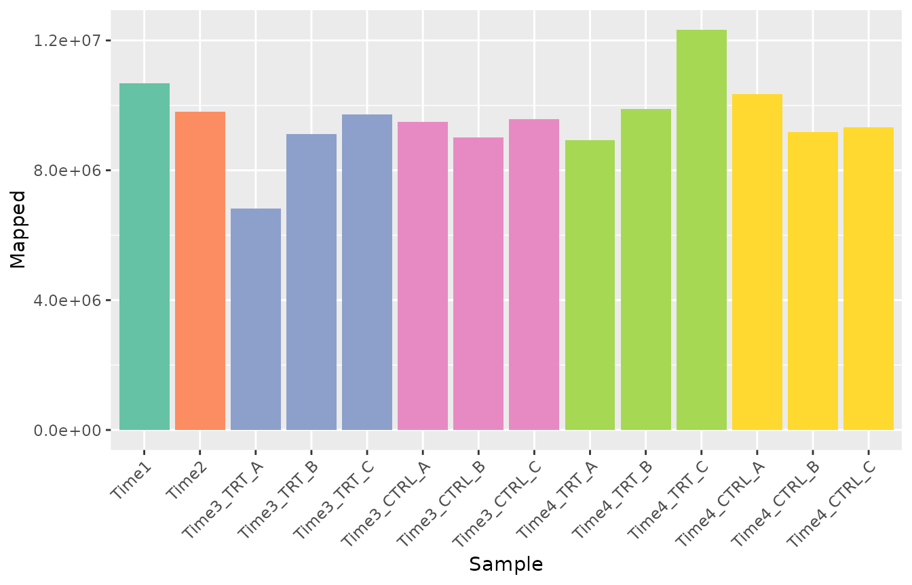

**What to look for.** All samples should have a similar number of reads,
and enough for the size of the library: a common rule of thumb is at
least a few hundred reads per barcode on average (here about 5300
barcodes, so about 1.5 million reads or more). A sample with far fewer
reads than its replicates is less reliable. Different depths are
corrected by the normalization; very low depth is not. Here every sample
has between about 7 and 12 million reads; `Time3_TRT_A` has fewer reads
than its replicates but still more than 1000 per barcode, which is
enough.

## Step 2: distribution of the counts

``` r

plot_mapped_reads_distribution(object, palette = palette,
    alpha = 0.8, type = "boxplot"
) +
    theme(axis.text.x = element_text(angle = 45, hjust = 1))
```

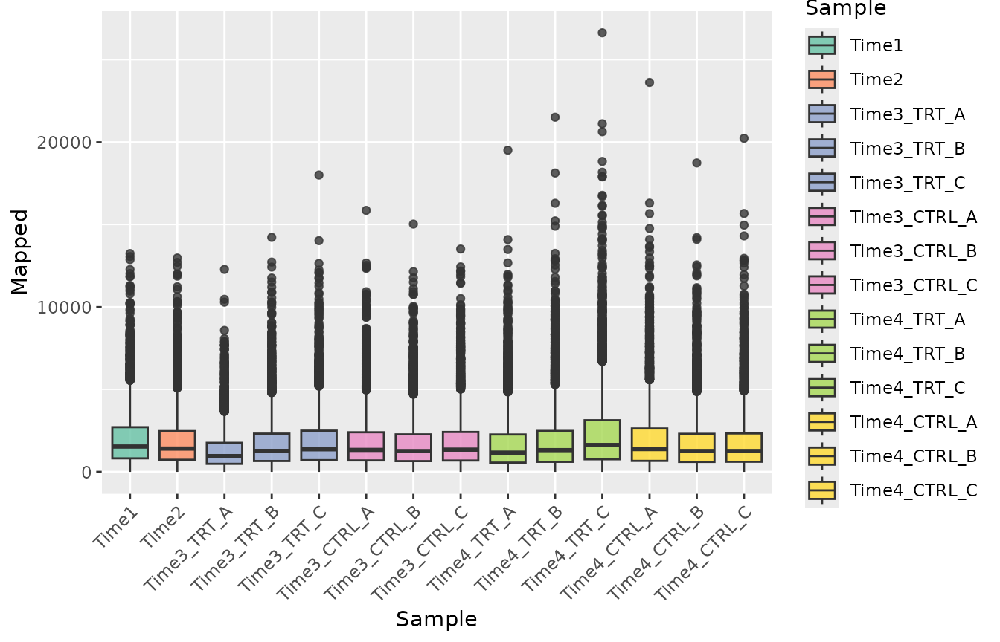

``` r

plot_mapped_reads_distribution(object, palette = palette,
    alpha = 0.4, type = "density"
)
```

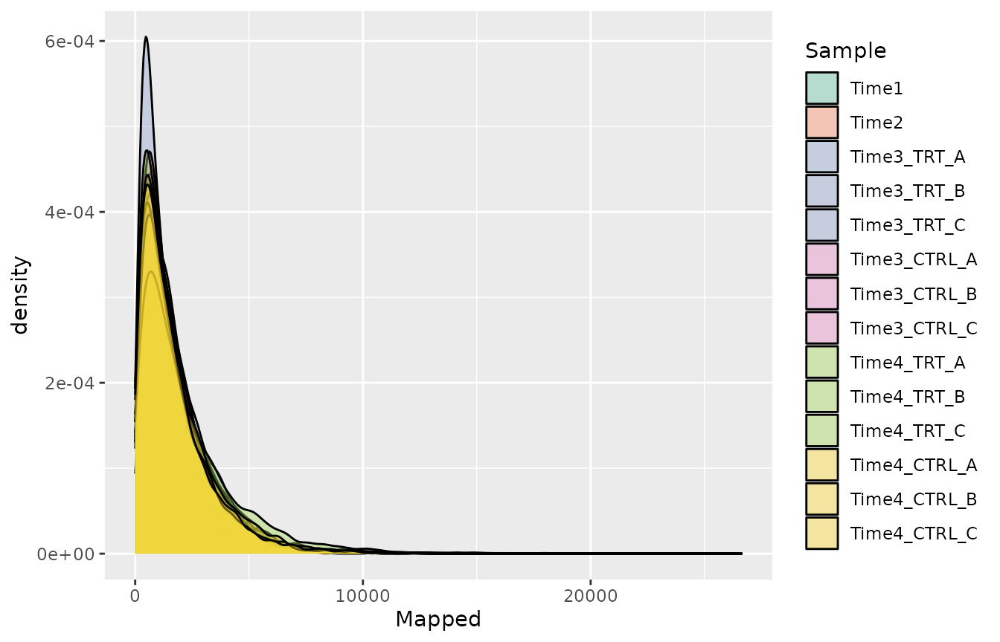

**What to look for.** The distributions should have a similar shape. A
sample whose distribution is much wider or shifted may have had a
technical problem (for example during PCR amplification).

## Step 3: lost barcodes

A barcode is lost in a sample when it has zero reads. Some loss over
time is expected in a dropout screen; a large loss means that the
library was not represented well enough (too few cells per barcode).

``` r

barcode_lost(object)
#> # A tibble: 14 × 2
#>    Sample       LostBarcode
#>    <fct>              <int>
#>  1 Time1                  2
#>  2 Time2                 18
#>  3 Time3_TRT_A           24
#>  4 Time3_TRT_B           25
#>  5 Time3_TRT_C           24
#>  6 Time3_CTRL_A           6
#>  7 Time3_CTRL_B           2
#>  8 Time3_CTRL_C          20
#>  9 Time4_TRT_A            8
#> 10 Time4_TRT_B           70
#> 11 Time4_TRT_C           58
#> 12 Time4_CTRL_A          45
#> 13 Time4_CTRL_B          34
#> 14 Time4_CTRL_C          51
plot_barcode_lost(object, palette = palette) +
    theme(axis.text.x = element_text(angle = 45, hjust = 1))
```

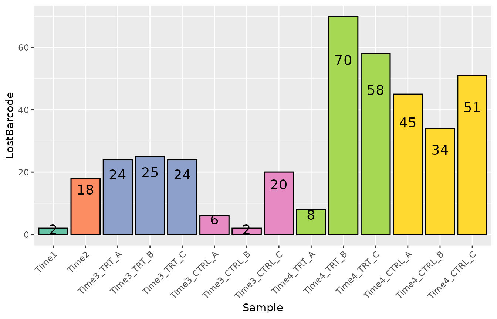

To see which genes lost barcodes in some samples:

``` r

plot_barcode_lost_for_gene(object, samples = c("Time3_TRT_A", "Time4_TRT_A"))
```

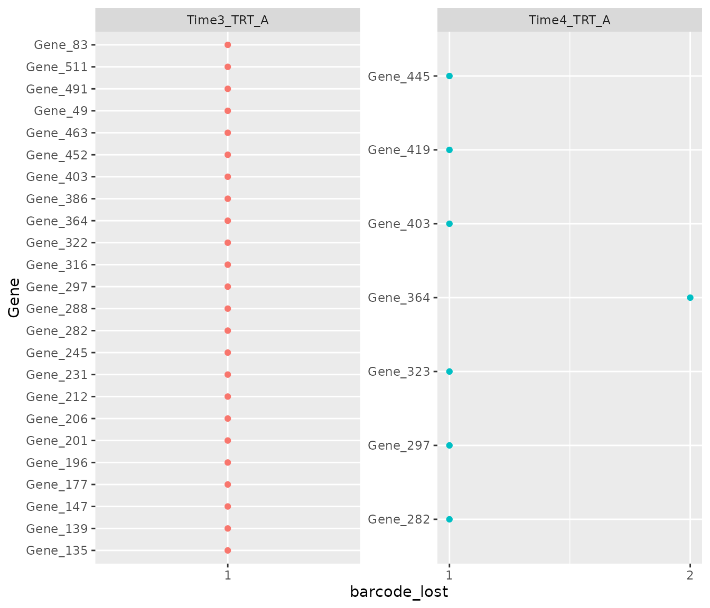

**What to look for.** A few lost barcodes per sample are normal. A gene
that lost most of its barcodes in all samples, including the controls,
was not represented well and its results are unreliable.

## Step 4: agreement between replicates

[`plot_replicate_correlation()`](https://emanuelsoda.github.io/ScreenR/reference/plot_replicate_correlation.md)
shows the correlation of the log2 counts per million between every pair
of samples.

``` r

plot_replicate_correlation(object)
```

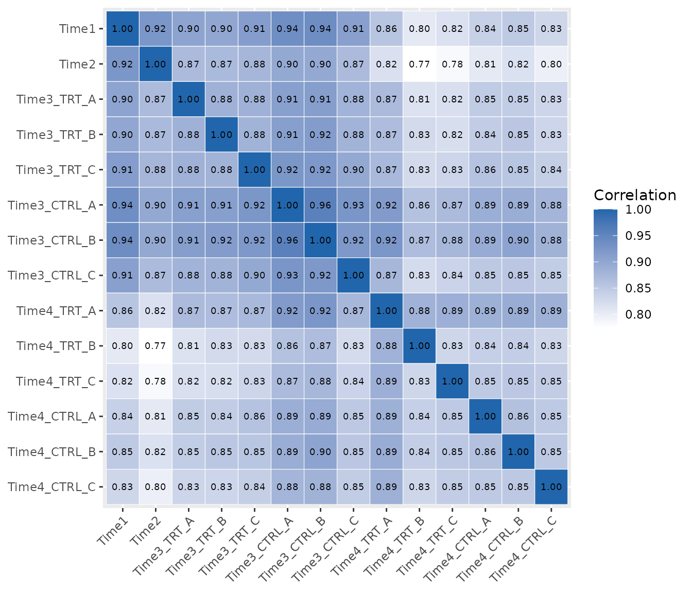

**What to look for.** Replicates of the same condition (the blocks along
the diagonal) should be the most correlated samples. A replicate with a
low correlation to its partners may be an outlier: check it in the next
plots before deciding whether to remove it.

## Step 5: evenness of the library

The Gini index measures how unevenly the reads are spread over the
barcodes: 0 means that every barcode has the same number of reads, 1
that a single barcode has all of them.

``` r

compute_gini(object)
#> # A tibble: 14 × 2
#>    Sample        Gini
#>    <fct>        <dbl>
#>  1 Time1        0.420
#>  2 Time2        0.434
#>  3 Time3_TRT_A  0.444
#>  4 Time3_TRT_B  0.445
#>  5 Time3_TRT_C  0.443
#>  6 Time3_CTRL_A 0.437
#>  7 Time3_CTRL_B 0.440
#>  8 Time3_CTRL_C 0.444
#>  9 Time4_TRT_A  0.477
#> 10 Time4_TRT_B  0.482
#> 11 Time4_TRT_C  0.482
#> 12 Time4_CTRL_A 0.470
#> 13 Time4_CTRL_B 0.466
#> 14 Time4_CTRL_C 0.471
plot_gini(object, palette = palette)
```

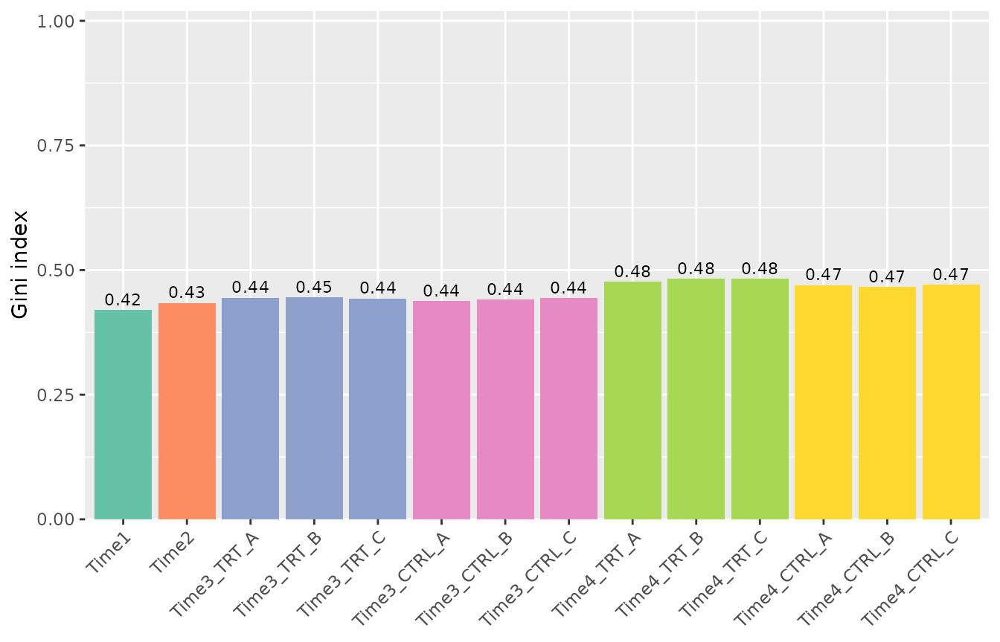

**What to look for.** In a dropout screen the Gini index usually
increases slowly over time, as some barcodes are depleted. A sudden
jump, or a large difference between replicates, suggests a bottleneck
(too few cells were kept at some step). Here it increases from about
0.42 to 0.48: a normal trend.

## Step 6: overall structure of the samples

The multidimensional scaling (MDS) plot places similar samples close to
each other. By default the points are labelled by sample:

``` r

plot_mds(object)
```

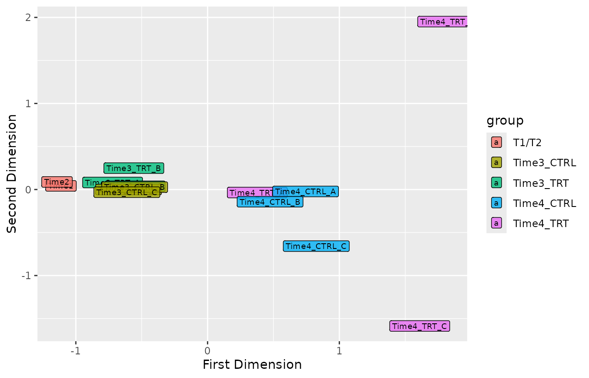

The `groups` argument colors the samples by any variable, for example by
treatment or by time point:

``` r

samples <- get_sample_table(object)

plot_mds(object, groups = factor(samples$Treatment))
```

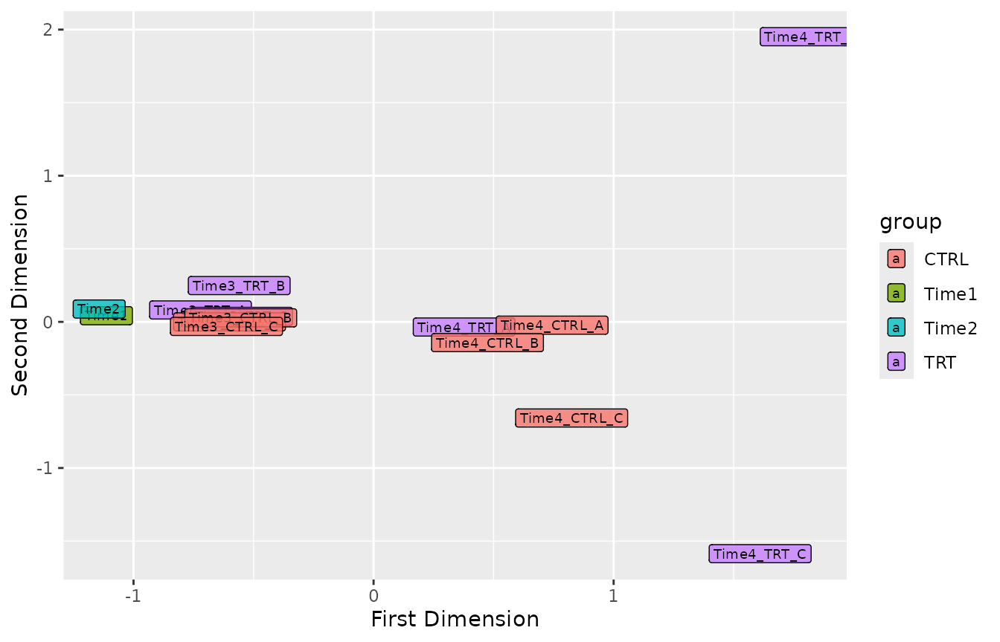

``` r

plot_mds(object, groups = factor(samples$Day))
```

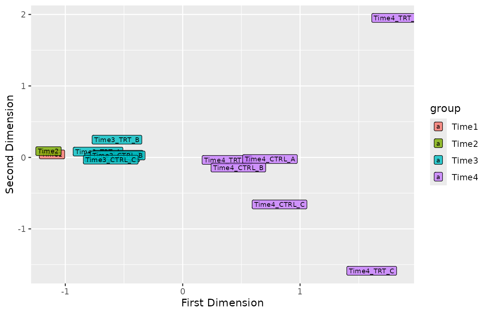

[`plot_explained_variance()`](https://emanuelsoda.github.io/ScreenR/reference/plot_explained_variance.md)
shows how much of the variability each dimension explains
(`cumulative = TRUE` for the cumulative proportion).

``` r

plot_explained_variance(object)
```

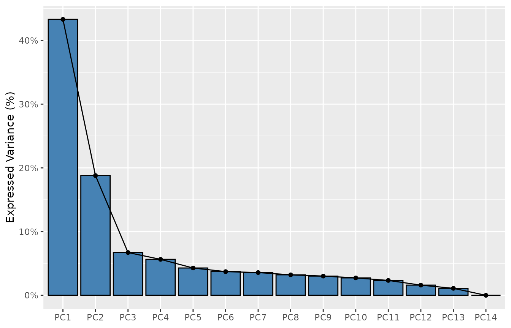

``` r

plot_explained_variance(object, cumulative = TRUE)
```

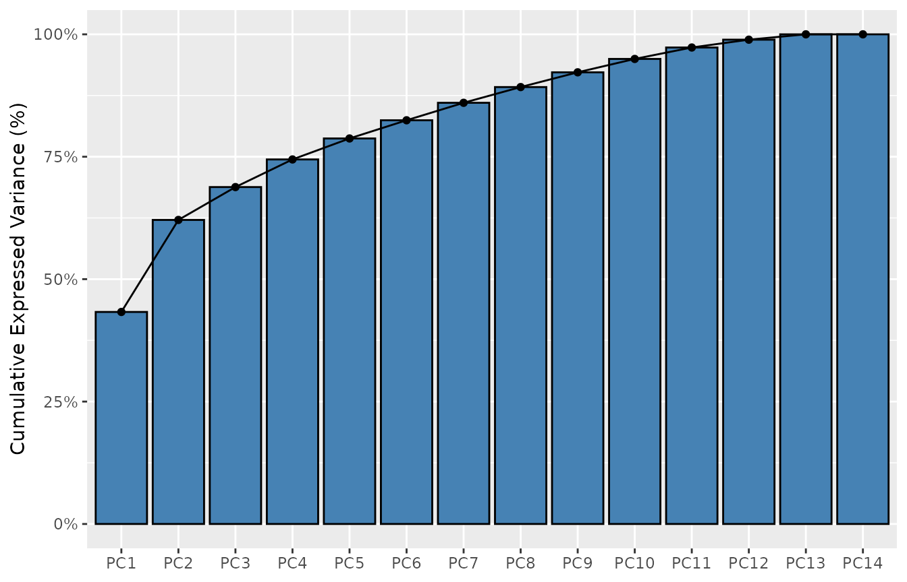

**What to look for.** Replicates should be close to each other. Samples
usually separate first by time point (cells change as they grow) and
then by treatment. A replicate far from its group is a candidate
outlier.

In this dataset the samples separate by time point along the first
dimension, as expected. Two treated replicates at Time4, `Time4_TRT_B`
and `Time4_TRT_C`, are far from the other samples along the second
dimension; `Time4_TRT_B` also has the most lost barcodes and the lowest
correlations with the other samples. They are worth a closer look.
Removing a replicate should be justified by a technical reason;
otherwise keep it, and use the replicate-aware methods of tutorial 3,
which take this variability into account.

## Step 7: choosing the normalization

[`normalize_data()`](https://emanuelsoda.github.io/ScreenR/reference/normalize_data.md)
offers three methods:

| Method | Divides the counts of each sample by | Use it when |
|----|----|----|
| `"cpm"` (default) | Its total number of reads | Most screens |
| `"tmm"` | Its total number of reads, corrected with the edgeR TMM factors | Strong hits deplete a large part of the library, so the total is biased |
| `"control"` | The reads of control barcodes (e.g. non-targeting shRNAs) | The library has control barcodes that are not affected by the treatment |

A quick way to decide between `"cpm"` and `"tmm"` is to compare them: if
they agree, the default is fine.

``` r

object_tmm <- normalize_data(object, method = "tmm")
ratio <- colMeans(SummarizedExperiment::assay(object_tmm, "normalized")) /
    colMeans(SummarizedExperiment::assay(object, "normalized"))
tibble(Sample = names(ratio), TMM_over_CPM = round(ratio, 3))
#> # A tibble: 14 × 2
#>    Sample       TMM_over_CPM
#>    <chr>               <dbl>
#>  1 Time1               0.983
#>  2 Time2               0.997
#>  3 Time3_TRT_A         0.998
#>  4 Time3_TRT_B         0.987
#>  5 Time3_TRT_C         0.998
#>  6 Time3_CTRL_A        0.983
#>  7 Time3_CTRL_B        0.982
#>  8 Time3_CTRL_C        0.992
#>  9 Time4_TRT_A         1.01 
#> 10 Time4_TRT_B         1.02 
#> 11 Time4_TRT_C         1.02 
#> 12 Time4_CTRL_A        1.00 
#> 13 Time4_CTRL_B        1.01 
#> 14 Time4_CTRL_C        1.01
```

Here the two methods differ by at most about 2%, so we keep the default.
With control barcodes the call would be
`normalize_data(object, method = "control", control_barcodes = my_controls)`,
where `my_controls` is the vector of their identifiers.

The normalization affects the frequencies, the Z-scores and the plots.
The edgeR-based methods of tutorial 3 (CAMERA, ROAST) always model the
raw counts and do their own normalization. After changing the
normalization, run
[`compute_data_table()`](https://emanuelsoda.github.io/ScreenR/reference/compute_data_table.md)
again.

## Checklist

Every sample has enough reads, and replicates have similar depths.

Few barcodes were lost, especially in the control samples.

Replicates are highly correlated and close in the MDS plot.

The Gini index increases smoothly, with similar values for replicates.

You chose a normalization and re-computed the data table if you changed
it.

The next tutorial, **3. Finding and validating hits**, uses this object.

``` r

sessionInfo()
#> R version 4.6.1 (2026-06-24)
#> Platform: x86_64-pc-linux-gnu
#> Running under: Ubuntu 24.04.5 LTS
#> 
#> Matrix products: default
#> BLAS:   /usr/lib/x86_64-linux-gnu/openblas-pthread/libblas.so.3 
#> LAPACK: /usr/lib/x86_64-linux-gnu/openblas-pthread/libopenblasp-r0.3.26.so;  LAPACK version 3.12.0
#> 
#> locale:
#>  [1] LC_CTYPE=C.UTF-8       LC_NUMERIC=C           LC_TIME=C.UTF-8       
#>  [4] LC_COLLATE=C.UTF-8     LC_MONETARY=C.UTF-8    LC_MESSAGES=C.UTF-8   
#>  [7] LC_PAPER=C.UTF-8       LC_NAME=C              LC_ADDRESS=C          
#> [10] LC_TELEPHONE=C         LC_MEASUREMENT=C.UTF-8 LC_IDENTIFICATION=C   
#> 
#> time zone: UTC
#> tzcode source: system (glibc)
#> 
#> attached base packages:
#> [1] stats     graphics  grDevices utils     datasets  methods   base     
#> 
#> other attached packages:
#> [1] ggplot2_4.0.3    dplyr_1.2.1      ScreenR_1.15.14  BiocStyle_2.40.0
#> 
#> loaded via a namespace (and not attached):
#>  [1] SummarizedExperiment_1.42.0 gtable_0.3.6               
#>  [3] xfun_0.61                   bslib_0.12.0               
#>  [5] Biobase_2.72.0              lattice_0.22-9             
#>  [7] vctrs_0.7.3                 tools_4.6.1                
#>  [9] generics_0.1.4              stats4_4.6.1               
#> [11] tibble_3.3.1                pkgconfig_2.0.3            
#> [13] Matrix_1.7-5                RColorBrewer_1.1-3         
#> [15] S7_0.2.2                    desc_1.4.3                 
#> [17] S4Vectors_0.50.3            lifecycle_1.0.5            
#> [19] compiler_4.6.1              farver_2.1.2               
#> [21] stringr_1.6.0               textshaping_1.0.5          
#> [23] statmod_1.5.2               Seqinfo_1.2.0              
#> [25] htmltools_0.5.9             sass_0.4.10                
#> [27] yaml_2.3.12                 pillar_1.11.1              
#> [29] pkgdown_2.2.1               jquerylib_0.1.4            
#> [31] tidyr_1.3.2                 DelayedArray_0.38.2        
#> [33] cachem_1.1.0                limma_3.68.5               
#> [35] abind_1.4-8                 tidyselect_1.2.1           
#> [37] locfit_1.5-9.12             digest_0.6.39              
#> [39] stringi_1.8.9               purrr_1.2.2                
#> [41] bookdown_0.48               labeling_0.4.3             
#> [43] fastmap_1.2.0               grid_4.6.1                 
#> [45] cli_3.6.6                   SparseArray_1.12.3         
#> [47] magrittr_2.0.5              patchwork_1.3.2            
#> [49] S4Arrays_1.12.1             utf8_1.2.6                 
#> [51] withr_3.0.3                 edgeR_4.10.5               
#> [53] scales_1.4.0                rmarkdown_2.32             
#> [55] XVector_0.52.0              matrixStats_1.5.0          
#> [57] otel_0.2.0                  ragg_1.5.2                 
#> [59] evaluate_1.0.5              knitr_1.52                 
#> [61] GenomicRanges_1.64.0        IRanges_2.46.0             
#> [63] rlang_1.3.0                 glue_1.8.1                 
#> [65] BiocManager_1.30.27         BiocGenerics_0.58.1        
#> [67] jsonlite_2.0.0              R6_2.6.1                   
#> [69] MatrixGenerics_1.24.0       systemfonts_1.3.2          
#> [71] fs_2.1.0
```
