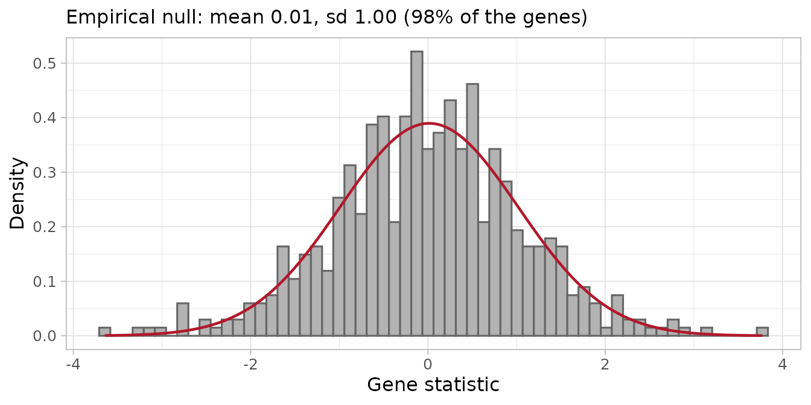
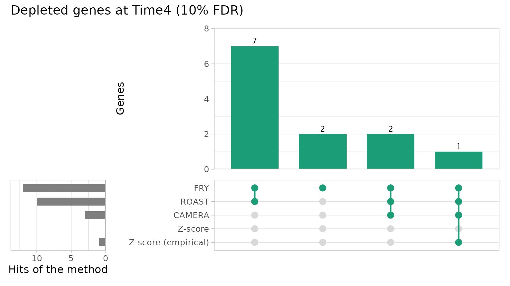
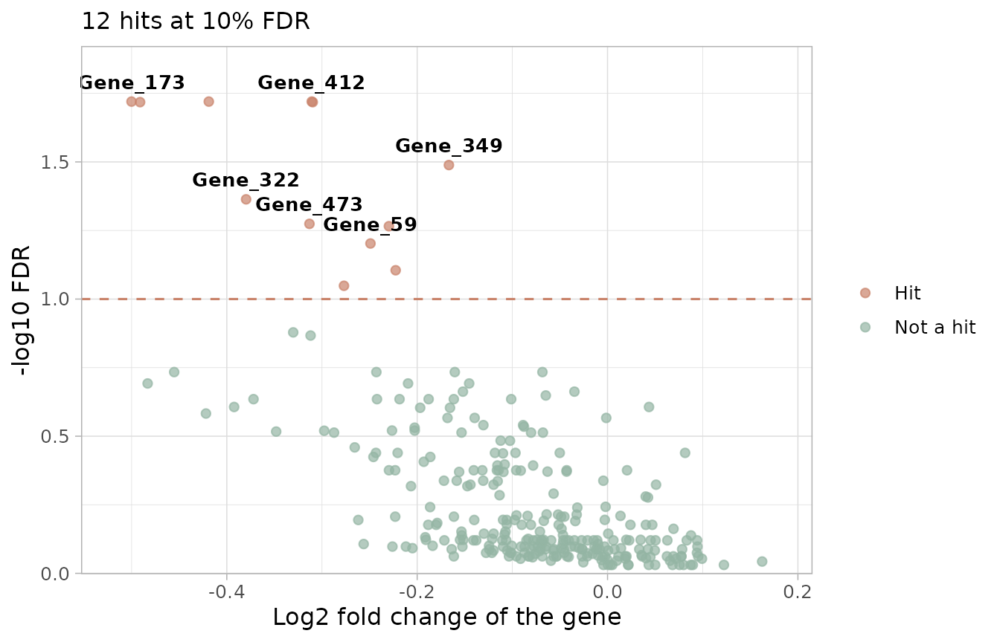
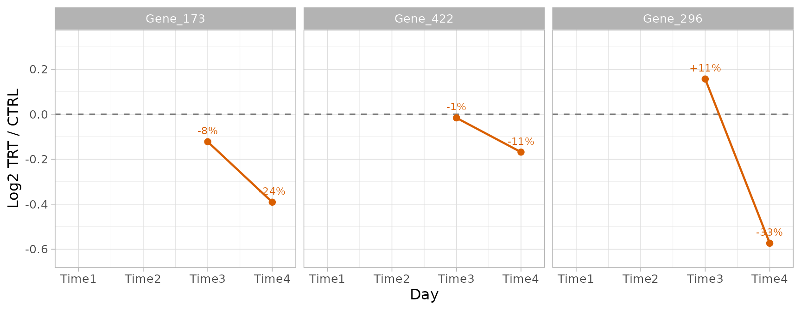
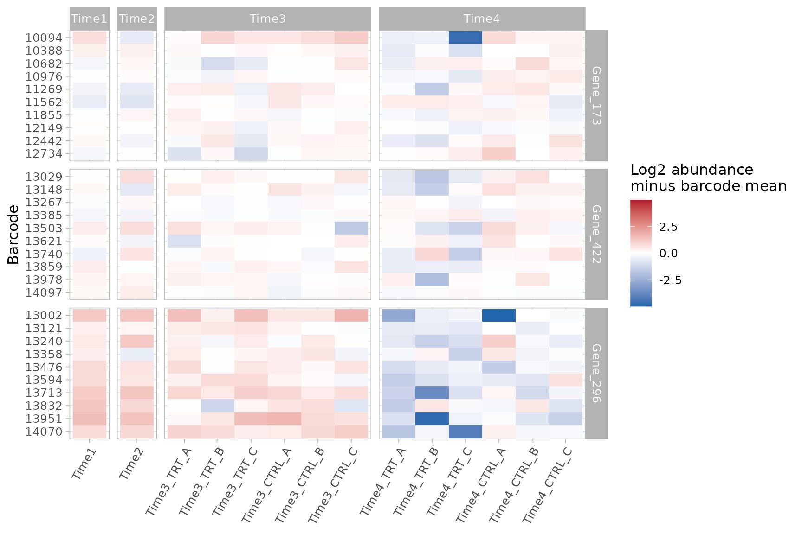

# Tutorial 3: Finding and validating hits

## About this tutorial

A **hit** is a gene whose barcodes change consistently in the treated
samples compared with the control samples. In a dropout (loss of
function) screen the interesting hits are usually depleted: their
knockdown kills the cells only in the presence of the treatment.

This tutorial goes through the functions of ScreenR that find hits and
check them, one step at a time:

1.  tell ScreenR which samples to compare (design matrix and contrasts);
2.  test each gene with FRY, ROAST and CAMERA;
3.  test each gene with the Z-score methods;
4.  compare the methods and combine their results;
5.  use several time points;
6.  check the candidates in the data, barcode by barcode.

It uses the example screen of ScreenR. The complete analysis of this
screen, from the quality control to the list of the genes to validate,
is in the [longitudinal screen
vignette](https://emanuelsoda.github.io/ScreenR/articles/Longitudinal_Screen_Analysis.md);
here the focus is on how each function works and how to read its result.

## The data

``` r

library(ScreenR)
library(dplyr)
library(ggplot2)
```

The plots of ScreenR have no theme of their own: choose one for the
whole session with
[`theme_set()`](https://ggplot2.tidyverse.org/reference/get_theme.html).

``` r

theme_set(theme_light(base_size = 12))
```

The screen has two samples taken before the treatment (`Time1`, before
the infection, and `Time2`, after the puromycin selection), then three
treated (`TRT`) and three control (`CTRL`) replicates 7 days (`Time3`)
and 14 days (`Time4`) after the selection. The `sample_table` describes
the samples, the `groups` (used by the statistical models) are the
combinations of time point and treatment, and the `palettes` give each
value of the sample variables the same color in every plot.

``` r

data(count_table)
data(annotation_table)

samples <- data.frame(
    Sample = c("Time1", "Time2",
        paste0("Time3_TRT_", c("A", "B", "C")),
        paste0("Time3_CTRL_", c("A", "B", "C")),
        paste0("Time4_TRT_", c("A", "B", "C")),
        paste0("Time4_CTRL_", c("A", "B", "C"))),
    Day = c("Time1", "Time2", rep(c("Time3", "Time4"), each = 6)),
    Treatment = c("Time1", "Time2", rep(rep(c("TRT", "CTRL"), each = 3), 2))
)
groups <- factor(ifelse(samples$Day %in% c("Time1", "Time2"), "T1/T2",
    paste(samples$Day, samples$Treatment, sep = "_")))

counts <- filter(count_table, Barcode != "*")
colnames(counts) <- c("Barcode", samples$Sample)

object <- create_screenr_object(
    table = counts, annotation = annotation_table, groups = groups,
    sample_table = samples,
    palettes = list(
        Treatment = c(Time1 = "#CCCCCC", Time2 = "#999999",
            CTRL = "#1B9E77", TRT = "#D95F02"),
        Day = c(Time1 = "#CCCCCC", Time2 = "#999999",
            Time3 = "#7570B3", Time4 = "#E7298A"),
        Group = c(`T1/T2` = "#999999", Time3_CTRL = "#66C2A5",
            Time3_TRT = "#FC8D62", Time4_CTRL = "#1B9E77",
            Time4_TRT = "#D95F02")
    )
)
object <- remove_all_zero_row(object)
get_sample_table(object)
#> # A tibble: 14 × 3
#>    Sample       Day   Treatment
#>    <chr>        <chr> <chr>    
#>  1 Time1        Time1 Time1    
#>  2 Time2        Time2 Time2    
#>  3 Time3_TRT_A  Time3 TRT      
#>  4 Time3_TRT_B  Time3 TRT      
#>  5 Time3_TRT_C  Time3 TRT      
#>  6 Time3_CTRL_A Time3 CTRL     
#>  7 Time3_CTRL_B Time3 CTRL     
#>  8 Time3_CTRL_C Time3 CTRL     
#>  9 Time4_TRT_A  Time4 TRT      
#> 10 Time4_TRT_B  Time4 TRT      
#> 11 Time4_TRT_C  Time4 TRT      
#> 12 Time4_CTRL_A Time4 CTRL     
#> 13 Time4_CTRL_B Time4 CTRL     
#> 14 Time4_CTRL_C Time4 CTRL
```

The counts are normalized once, and the same normalization is used by
every function below: the hit-finding methods, the fold changes and the
plots. TMM is used here, as in the longitudinal vignette (see
[`?normalize_data`](https://emanuelsoda.github.io/ScreenR/reference/normalize_data.md)
for the methods and for when TMM is biased).

``` r

object <- normalize_data(object, method = "tmm")
get_normalization(object)$method
#> [1] "tmm"
```

## Overview of the methods

| Method | Function | What it tests | Reference | Uses replicates |
|----|----|----|----|----|
| FRY | `find_roast_hit(method = "fry")` | The barcodes of the gene change | None (self-contained) | Yes |
| ROAST | [`find_roast_hit()`](https://emanuelsoda.github.io/ScreenR/reference/find_roast_hit.md) | As FRY, with random rotations | None (self-contained) | Yes |
| CAMERA | [`find_camera_hit()`](https://emanuelsoda.github.io/ScreenR/reference/find_camera_hit.md) | The barcodes of the gene change more than the others | The other genes (competitive) | Yes |
| Gene-level Z-score | [`find_gene_zscore_hit()`](https://emanuelsoda.github.io/ScreenR/reference/find_gene_zscore_hit.md) | The mean Z-score of the barcodes of the gene is extreme | Random sets of barcodes, or the empirical null | With [`compute_barcode_statistics()`](https://emanuelsoda.github.io/ScreenR/reference/compute_barcode_statistics.md) |
| All time points | [`find_consistent_hit()`](https://emanuelsoda.github.io/ScreenR/reference/find_consistent_hit.md) | The gene changes at every time point | As the chosen method | Yes |
| Time course | [`find_time_hit()`](https://emanuelsoda.github.io/ScreenR/reference/find_time_hit.md) | The treatment effect changes over time | None | Yes |
| Legacy Z-score rules | [`find_zscore_hit()`](https://emanuelsoda.github.io/ScreenR/reference/find_zscore_hit.md), [`find_robust_zscore_hit()`](https://emanuelsoda.github.io/ScreenR/reference/find_robust_zscore_hit.md) | Counts barcodes below the median Z-score | None | No |

The **FDR** (false discovery rate) is the expected proportion of false
hits among the genes you call hits: with an FDR cut off of 5%, about 1
in 20 of the reported genes is expected to be a false positive. Each
method returns only the genes with `FDR <= fdr` (default 0.05); use
`fdr = 1` to get all the genes and rank them yourself, as done below.

## Step 1: which samples to compare

The methods that use the replicates fit a linear model, which needs two
things:

- a **design matrix**, which says which group each sample belongs to;
- a **contrast**, which says which groups to compare.

[`create_design_matrix()`](https://emanuelsoda.github.io/ScreenR/reference/create_design_matrix.md)
builds the design matrix from the groups of the object: one column per
group, and a 1 in the column of the group of each sample. Group names
that are not valid R names are changed (`T1/T2` becomes `T1.T2`).

``` r

design <- create_design_matrix(object)
design
#>              T1.T2 Time3_CTRL Time3_TRT Time4_CTRL Time4_TRT
#> Time1            1          0         0          0         0
#> Time2            1          0         0          0         0
#> Time3_TRT_A      0          0         1          0         0
#> Time3_TRT_B      0          0         1          0         0
#> Time3_TRT_C      0          0         1          0         0
#> Time3_CTRL_A     0          1         0          0         0
#> Time3_CTRL_B     0          1         0          0         0
#> Time3_CTRL_C     0          1         0          0         0
#> Time4_TRT_A      0          0         0          0         1
#> Time4_TRT_B      0          0         0          0         1
#> Time4_TRT_C      0          0         0          0         1
#> Time4_CTRL_A     0          0         0          1         0
#> Time4_CTRL_B     0          0         0          1         0
#> Time4_CTRL_C     0          0         0          1         0
#> attr(,"assign")
#> [1] 1 1 1 1 1
#> attr(,"contrasts")
#> attr(,"contrasts")$groups
#> [1] "contr.treatment"
```

[`create_contrast()`](https://emanuelsoda.github.io/ScreenR/reference/create_contrast.md)
builds the comparison between groups by name: here treated against
control at each time point.

``` r

contrast_time3 <- create_contrast(design,
    treatment = "Time3_TRT", control = "Time3_CTRL"
)
contrast_time4 <- create_contrast(design,
    treatment = "Time4_TRT", control = "Time4_CTRL"
)
contrast_time4
#>      T1.T2 Time3_CTRL  Time3_TRT Time4_CTRL  Time4_TRT 
#>          0          0          0         -1          1
```

The contrast gives +1 to the treated group and -1 to the control group:
the result is the treated minus the control. With several groups on one
side (for example `treatment = c("Time3_TRT", "Time4_TRT")`) their
average is used.

**Common mistake.** Do not build the design with
`model.matrix(~ groups)` and rename its columns: the first group becomes
the intercept and the columns are in alphabetical order, so the names
end up on the wrong columns and the wrong samples are compared.
[`create_design_matrix()`](https://emanuelsoda.github.io/ScreenR/reference/create_design_matrix.md)
and
[`create_contrast()`](https://emanuelsoda.github.io/ScreenR/reference/create_contrast.md)
avoid this, and every function that takes a design checks that its rows
are the samples of the object, in the same order.

The examples below compare treated and control samples at Time4, the
time point with the larger effect.

## Step 2: FRY, ROAST and CAMERA

These methods test the barcodes of each gene as a set, with edgeR on the
raw counts and the normalization of the object.

- **FRY and ROAST** ask whether the barcodes of a gene **change at all**
  (a self-contained test). ROAST uses random rotations: set `seed` to
  get the same result every time and use many rotations (`nrot`,
  default 9999) for a real analysis; here 999 keep the tutorial fast.
  FRY (`method = "fry"`) computes the same test exactly, without
  rotations: it is faster, its p-values are not limited by the number of
  rotations, and it is the recommended choice.
- **CAMERA** asks whether the barcodes of a gene change **more than the
  other barcodes** (a competitive test), taking into account the
  correlation between barcodes.

The two kinds of tests answer different questions. A self-contained test
calls a gene when its barcodes are depleted more than the replicates
vary, even if many genes are depleted; a competitive test calls it only
when it stands out from the rest of the library, so it becomes
conservative when many genes have an effect. On the other hand FRY and
ROAST rely on the variability between replicates: they need replicates
in both groups, have little power with two replicates or noisy data, and
find almost nothing when the control is a single sample (for example a
plasmid library). All the p-values are one-sided, for the requested
direction.

`number_barcode` sets the minimum number of barcodes (more than
`number_barcode`) a gene needs to be tested, and `direction` chooses
depleted (`"Down"`) or enriched (`"Up"`) genes.

``` r

fry <- find_roast_hit(object, design, contrast_time4,
    method = "fry", fdr = 1
)
head(fry)
#> # A tibble: 6 × 8
#>   Gene     NGenes Direction    PValue    FDR  PValue.Mixed  FDR.Mixed Log2FC
#>   <chr>     <int> <fct>         <dbl>  <dbl>         <dbl>      <dbl>  <dbl>
#> 1 Gene_173     10 Down      0.0000891 0.0191 0.00000244    0.000217   -0.500
#> 2 Gene_422     10 Down      0.0000933 0.0191 0.0000525     0.00156    -0.419
#> 3 Gene_412     10 Down      0.000107  0.0191 0.00000579    0.000309   -0.311
#> 4 Gene_15      10 Down      0.000166  0.0191 0.00724       0.0390     -0.310
#> 5 Gene_296     10 Down      0.000179  0.0191 0.0158        0.0615     -0.491
#> 6 Gene_349     10 Down      0.000365  0.0325 0.00000000678 0.00000121 -0.167

roast <- find_roast_hit(object, design, contrast_time4,
    nrot = 999, seed = 42, fdr = 1
)
camera <- find_camera_hit(object, design, contrast_time4, fdr = 1)
head(camera)
#> # A tibble: 6 × 6
#>   Gene     NGenes Direction   PValue    FDR Log2FC
#>   <chr>     <dbl> <fct>        <dbl>  <dbl>  <dbl>
#> 1 Gene_173     10 Down      0.000218 0.0767 -0.500
#> 2 Gene_296     10 Down      0.000421 0.0767 -0.491
#> 3 Gene_422     10 Down      0.000431 0.0767 -0.419
#> 4 Gene_352     10 Down      0.00179  0.230  -0.455
#> 5 Gene_87      10 Down      0.00241  0.230  -0.422
#> 6 Gene_370     10 Down      0.00300  0.230  -0.330
```

| Column | Meaning |
|----|----|
| `NGenes` | Number of barcodes of the gene |
| `Direction` | Down or Up |
| `PValue`, `FDR` | Significance for the requested direction |
| `PValue.Mixed`, `FDR.Mixed` (FRY, ROAST) | Significance of a change in either direction of the barcodes |
| `PropDown`, `PropUp` (ROAST) | Proportion of barcodes going down or up |
| `Log2FC` | Median log2 fold change of the barcodes |

Use `PValue` and `FDR`: the “Mixed” columns test whether the barcodes
change in any direction, so they also call genes whose barcodes
disagree.

## Step 3: the Z-score methods

### Fold changes and Z-scores

[`compute_metrics()`](https://emanuelsoda.github.io/ScreenR/reference/compute_metrics.md)
averages the replicates of the treated and of the control samples of one
time point and computes for each barcode:

| Column | Meaning |
|----|----|
| `Treated`, `Control` | Mean normalized count |
| `Log2FC` | log2((Treated + 0.5) / (Control + 0.5)): negative means depleted in the treated samples |
| `Zscore` | Log2FC standardized with the mean and standard deviation of all barcodes |
| `ZscoreRobust` | Log2FC standardized with the median and MAD, less sensitive to outliers |

The `treatment` and `control` arguments are values of the Treatment
column of
[`get_sample_table()`](https://emanuelsoda.github.io/ScreenR/reference/get_sample_table.md),
and `day` a value of its Day column.

``` r

metrics_time3 <- compute_metrics(object,
    control = "CTRL", treatment = "TRT", day = "Time3"
)
metrics_time4 <- compute_metrics(object,
    control = "CTRL", treatment = "TRT", day = "Time4"
)
head(metrics_time4)
#> # A tibble: 6 × 9
#>   Barcode Gene     Treated Control Log2FC Zscore ZscoreRobust Day   Treatment
#>   <fct>   <chr>      <dbl>   <dbl>  <dbl>  <dbl>        <dbl> <chr> <chr>    
#> 1 10208   Gene_380   395.    365.   0.111  0.289        0.331 Time4 TRT      
#> 2 10502   Gene_380    27.8    37.9 -0.441 -0.863       -1.25  Time4 TRT      
#> 3 10796   Gene_380    35.7    59.0 -0.718 -1.44        -2.04  Time4 TRT      
#> 4 11089   Gene_380   294.    327.  -0.152 -0.259       -0.421 Time4 TRT      
#> 5 11382   Gene_380    26.8    43.0 -0.671 -1.34        -1.91  Time4 TRT      
#> 6 11675   Gene_380   813.    982.  -0.272 -0.509       -0.764 Time4 TRT
```

[`plot_zscore_distribution()`](https://emanuelsoda.github.io/ScreenR/reference/plot_zscore_distribution.md)
compares the Z-scores of several time points: a treatment with an effect
gives a longer left tail at the later time point. It receives the
tables, not the object, so the palette of the time points is given
explicitly to keep the colors of the other plots:

``` r

plot_zscore_distribution(
    list(Time3 = metrics_time3, Time4 = metrics_time4),
    alpha = 0.6, palette = get_palettes(object)$Day
)
```


### Using the replicates

[`compute_metrics()`](https://emanuelsoda.github.io/ScreenR/reference/compute_metrics.md)
averages the replicates, so it cannot tell a consistent barcode from a
noisy one.
[`compute_barcode_statistics()`](https://emanuelsoda.github.io/ScreenR/reference/compute_barcode_statistics.md)
tests each barcode with edgeR, using the variability between replicates,
and returns a Z-score with the same columns. This is the recommended
input of the gene-level test.

``` r

barcode_statistics <- compute_barcode_statistics(
    object, design, contrast_time4
)
head(barcode_statistics)
#> # A tibble: 6 × 8
#>   Barcode Gene     Log2FC logCPM     F PValue   FDR Zscore
#>   <chr>   <chr>     <dbl>  <dbl> <dbl>  <dbl> <dbl>  <dbl>
#> 1 10208   Gene_380  0.124   8.56 0.566 0.455  0.801  0.748
#> 2 10502   Gene_380 -0.464   4.97 0.702 0.405  0.776 -0.832
#> 3 10796   Gene_380 -0.650   6.60 2.36  0.129  0.525 -1.52 
#> 4 11089   Gene_380 -0.153   8.44 0.818 0.369  0.749 -0.898
#> 5 11382   Gene_380 -0.636   5.62 1.37  0.247  0.655 -1.16 
#> 6 11675   Gene_380 -0.271   9.66 5.92  0.0178 0.251 -2.37
```

### Gene-level test

[`find_gene_zscore_hit()`](https://emanuelsoda.github.io/ScreenR/reference/find_gene_zscore_hit.md)
computes for each gene the mean Z-score of its barcodes
(`statistic = "median"` uses the median, which is less affected by a
single barcode with a strong, possibly off-target, effect) and compares
it with a reference distribution:

- `reference = "random"` (default): the scores of random sets of
  barcodes of the same size, drawn `n_permutations` times (`seed` makes
  it reproducible). With `control_genes` the random sets are drawn from
  control genes instead. Do this only if the controls behave like genes
  without effect: non-targeting shRNAs often do not (targeting shRNAs
  are usually somewhat depleted compared with them, so every gene looks
  depleted).
- `reference = "empirical"`: the distribution of the scores of the genes
  without effect, estimated from the centre of the distribution of all
  the genes. It accounts for the barcodes of a gene varying together,
  which makes the random sets give too small p-values, especially in
  shRNA screens. It needs a library with hundreds of genes, most of them
  without effect (see the [empirical null
  vignette](https://emanuelsoda.github.io/ScreenR/articles/Empirical_null.md)).

``` r

zscore <- find_gene_zscore_hit(barcode_statistics, fdr = 1, seed = 1)
zscore_empirical <- find_gene_zscore_hit(barcode_statistics,
    reference = "empirical", fdr = 1
)
head(zscore_empirical)
#> # A tibble: 6 × 7
#>   Gene     NBarcodes Score Log2FC Statistic   PValue    FDR
#>   <chr>        <int> <dbl>  <dbl>     <dbl>    <dbl>  <dbl>
#> 1 Gene_173        10 -1.53 -0.506     -3.65 0.000135 0.0719
#> 2 Gene_422        10 -1.39 -0.436     -3.31 0.000474 0.127 
#> 3 Gene_15         10 -1.31 -0.305     -3.12 0.000901 0.155 
#> 4 Gene_296        10 -1.28 -0.477     -3.05 0.00116  0.155 
#> 5 Gene_370        10 -1.19 -0.378     -2.83 0.00235  0.223 
#> 6 Gene_168        10 -1.15 -0.242     -2.74 0.00306  0.223
```

| Column          | Meaning                                 |
|-----------------|-----------------------------------------|
| `NBarcodes`     | Number of barcodes of the gene          |
| `Score`         | Mean Z-score of the barcodes            |
| `Log2FC`        | Median log2 fold change of the barcodes |
| `PValue`, `FDR` | Significance                            |

[`plot_empirical_null()`](https://emanuelsoda.github.io/ScreenR/reference/plot_empirical_null.md)
shows the gene scores and the fitted null, which should follow the
centre of the distribution:

``` r

plot_empirical_null(barcode_statistics)
```



Here the null is almost the standard normal (mean 0.01, standard
deviation 1), with no long tail of depleted genes: the treatment effect
is moderate and concerns a few genes.

### Legacy rules

[`find_zscore_hit()`](https://emanuelsoda.github.io/ScreenR/reference/find_zscore_hit.md)
and
[`find_robust_zscore_hit()`](https://emanuelsoda.github.io/ScreenR/reference/find_robust_zscore_hit.md)
call a gene a hit when more than `number_barcode` of its barcodes are
below the median Z-score. They are kept for compatibility, but they do
not give a p-value and many genes without an effect pass them by chance
(about 17% with 10 barcodes and `number_barcode = 6`): prefer
[`find_gene_zscore_hit()`](https://emanuelsoda.github.io/ScreenR/reference/find_gene_zscore_hit.md).

``` r

nrow(find_zscore_hit(metrics_time4, number_barcode = 6))
#> [1] 96
```

## Step 4: comparing and combining the methods

### How many genes each method finds

``` r

results <- list(
    FRY = fry, ROAST = roast, CAMERA = camera,
    `Z-score` = zscore, `Z-score (empirical)` = zscore_empirical
)
fdr_levels <- c(0.05, 0.1, 0.25)
bind_rows(lapply(results, function(result) {
    vapply(fdr_levels, function(x) sum(result$FDR <= x), integer(1))
}), .id = "Method") %>%
    mutate(FDR = paste0(100 * fdr_levels, "%"), .before = 1)
#> # A tibble: 3 × 6
#>   FDR     FRY ROAST CAMERA `Z-score` `Z-score (empirical)`
#>   <chr> <int> <int>  <int>     <int>                 <int>
#> 1 5%        7     0      0         0                     0
#> 2 10%      12    10      3         0                     1
#> 3 25%      34    28      7         4                     8
```

FRY, the most powerful test here, finds 7 genes at 5% FDR. ROAST tests
the same hypothesis, but with 999 rotations its p-values cannot be
smaller than 1/1000, which after the correction for the 283 genes is not
enough to reach 5% (use `nrot = 9999`, or FRY). The competitive tests
(CAMERA and the Z-score tests) find none at 5%: the depletions are
reproducible, but they do not stand out against all the other genes of
the library. Choose the cut off before looking at the results and report
it; below, 10% is used to compare the methods.

### Overlap between the methods

[`plot_common_hit()`](https://emanuelsoda.github.io/ScreenR/reference/plot_common_hit.md)
takes the results of any number of methods (any table with Gene and FDR)
and shows the overlap of their hits at the cut off given with `fdr`.
With up to three methods it draws a Venn diagram:

``` r

plot_common_hit(results[c("FRY", "ROAST", "CAMERA")], fdr = 0.1,
    title = "Depleted genes at Time4 (10% FDR)")
```


With more methods it draws an UpSet plot: each column is a combination
of methods (the dots below), and the bar on top counts the genes found
by exactly that combination; the bars on the left count the genes found
by each method.

``` r

plot_common_hit(results, fdr = 0.1,
    title = "Depleted genes at Time4 (10% FDR)")
```



[`find_common_hit()`](https://emanuelsoda.github.io/ScreenR/reference/find_common_hit.md)
returns the genes found by at least `common_in` methods (by default by
all of them):

``` r

common <- find_common_hit(results, fdr = 0.1, common_in = 3)
common
#> [1] "Gene_173" "Gene_422" "Gene_296"
```

[`summarise_hits()`](https://emanuelsoda.github.io/ScreenR/reference/summarise_hits.md)
puts the FDR of every method in one table. `NMethods` counts the methods
in which the gene passes the cut off, and `MaxFDR` (the largest FDR) is
a conservative score to rank the genes supported by all the methods.
Pass the tables computed with `fdr = 1`, so that every gene has a value.

``` r

summary <- summarise_hits(results, fdr = 0.1)
summary %>%
    select(Gene, starts_with("FDR"), NMethods) %>%
    head(8) %>%
    knitr::kable(digits = 3)
```

| Gene | FDR_FRY | FDR_ROAST | FDR_CAMERA | FDR_Z-score | FDR_Z-score (empirical) | NMethods |
|:---|---:|---:|---:|---:|---:|---:|
| Gene_173 | 0.019 | 0.076 | 0.077 | 0.123 | 0.072 | 4 |
| Gene_422 | 0.019 | 0.076 | 0.077 | 0.192 | 0.127 | 3 |
| Gene_296 | 0.019 | 0.076 | 0.077 | 0.203 | 0.155 | 3 |
| Gene_15 | 0.019 | 0.076 | 0.230 | 0.203 | 0.155 | 2 |
| Gene_370 | 0.132 | 0.144 | 0.230 | 0.271 | 0.223 | 0 |
| Gene_352 | 0.185 | 0.173 | 0.230 | 0.271 | 0.223 | 0 |
| Gene_87 | 0.261 | 0.267 | 0.230 | 0.271 | 0.223 | 0 |
| Gene_349 | 0.032 | 0.076 | 0.254 | 0.363 | 0.311 | 2 |

[`plot_volcano()`](https://emanuelsoda.github.io/ScreenR/reference/plot_volcano.md)
shows every gene with its effect (x) and its significance (y): the hits
are above the dashed line, and the most significant are labelled. Here
the 12 genes that FRY finds at 10% FDR:

``` r

plot_volcano(fry, fdr = 0.1)
```



With the table of
[`summarise_hits()`](https://emanuelsoda.github.io/ScreenR/reference/summarise_hits.md)
the significance is the largest FDR of the methods, so the genes above
the line are found by every method; give the barcode statistics, from
which the mean log2 fold change of each gene is computed:
`plot_volcano(summary, statistics = barcode_statistics)`. None of the
genes of this screen is found by all five methods at 10% FDR.

The combined list has no guaranteed false discovery rate: treat it as a
short list of candidates to check and validate.

## Step 5: several time points

“Depleted over time” can mean different things, which need different
tests.

### Depleted at every time point

[`find_consistent_hit()`](https://emanuelsoda.github.io/ScreenR/reference/find_consistent_hit.md)
runs the same method for several contrasts and calls a gene only if it
is depleted in **all** of them (an intersection-union test: the p-value
of the gene is the largest of its p-values, then corrected for the
number of genes).

``` r

consistent <- find_consistent_hit(object, design,
    contrasts = list(Time3 = contrast_time3, Time4 = contrast_time4),
    method = "fry", fdr = 1
)
head(consistent)
#> # A tibble: 6 × 9
#>   Gene     Direction NContrasts  PValue   FDR PValue_Time3 Log2FC_Time3
#>   <chr>    <chr>          <int>   <dbl> <dbl>        <dbl>        <dbl>
#> 1 Gene_173 Down               2 0.00986 1.000      0.00986      -0.211 
#> 2 Gene_457 Down               2 0.0377  1.000      0.00858      -0.121 
#> 3 Gene_121 Down               2 0.0428  1.000      0.0428       -0.0741
#> 4 Gene_293 Down               2 0.0516  1.000      0.0516       -0.134 
#> 5 Gene_394 Down               2 0.0577  1.000      0.0577       -0.0813
#> 6 Gene_377 Down               2 0.0707  1.000      0.00138      -0.249 
#> # ℹ 2 more variables: PValue_Time4 <dbl>, Log2FC_Time4 <dbl>
```

The smallest FDR is 1: no gene is depleted at both time points. The
candidates of Time4 have small effects at Time3 (see `Log2FC_Time3`), so
in this screen the treatment-specific depletion appears at the later
time point.
[`combine_consistent_hits()`](https://emanuelsoda.github.io/ScreenR/reference/combine_consistent_hits.md)
does the same with tables of p-values computed beforehand.

### A treatment effect that changes over time

[`find_time_hit()`](https://emanuelsoda.github.io/ScreenR/reference/find_time_hit.md)
asks whether the treatment effect **changes over time**, with one model
for the treated and control samples of all the time points: untreated
and treated samples each follow a line over time, and the method tests
the difference between the slopes. Give the real times of the time
points with `time` (here days after the selection); otherwise they are
treated as equally spaced. Samples taken before the treatment can be
added as untreated samples with `baseline`, when their times are known
too.

``` r

time_hit <- find_time_hit(object,
    treatment = "TRT", control = "CTRL",
    days = c("Time3", "Time4"), time = c(Time3 = 7, Time4 = 14),
    fdr = 1
)
head(time_hit)
#> # A tibble: 6 × 6
#>   Gene     NGenes Direction   PValue   FDR  Log2FC
#>   <chr>     <dbl> <fct>        <dbl> <dbl>   <dbl>
#> 1 Gene_296     10 Down      0.000596 0.318 -0.0964
#> 2 Gene_372     12 Down      0.00156  0.323 -0.104 
#> 3 Gene_422     10 Down      0.00181  0.323 -0.0672
#> 4 Gene_412     10 Down      0.00480  0.483 -0.0812
#> 5 Gene_419     10 Down      0.00510  0.483 -0.0826
#> 6 Gene_87      10 Down      0.00566  0.483 -0.0585
```

`Log2FC` is the change of the treatment log2 fold change per day: a
negative value means that the depletion grows over time. With two time
points this is the difference between the effects at Time4 and at Time3,
divided by 7 days. Here 0 genes have an FDR below 5% (smallest FDR
0.32): the effects grow between the two time points, but not enough to
be detected gene by gene with three replicates.

## Step 6: checking the candidates

Statistics can produce false positives, so look at the data of each
candidate. The candidates here are the genes found by at least three of
the five methods at 10% FDR:

``` r

candidates <- common
candidates
#> [1] "Gene_173" "Gene_422" "Gene_296"
```

### Trend over time

[`plot_trend()`](https://emanuelsoda.github.io/ScreenR/reference/plot_trend.md)
shows the mean normalized count of the barcodes of a gene in each sample
over the time points. With `color_by` the treated and control samples
get their own trend (the mean of each time point), the samples before
the treatment are drawn once as shared references (`reference_groups`),
and `highlight_difference` shades the gap between the two conditions. A
treatment-specific hit goes down in the treated samples more than in the
controls.

``` r

plot_trend(object,
    genes = candidates, group_var = c("Time1", "Time2", "CTRL", "TRT"),
    color_by = "Treatment", reference_groups = c("Time1", "Time2"),
    connect_reference = TRUE, highlight_difference = TRUE,
    nrow = 1, scales = "free_y"
) +
    labs(x = "Time point (equally spaced)",
        y = "Mean normalized counts per shRNA")
```


### Size of the effect

[`plot_treatment_separation()`](https://emanuelsoda.github.io/ScreenR/reference/plot_treatment_separation.md)
shows the log2 ratio of the treated to the control samples at each time
point, labelled with the percentage difference. It shows how far the
conditions separate and at which time point; it is descriptive, not a
test.

Gene_173 and Gene_422 decrease in the treated samples while the controls
stay stable or grow. Gene_296 decreases in the controls too (its
knockdown slows growth even without the treatment), and more in the
treated samples: the treatment adds to a fitness effect.

``` r

plot_treatment_separation(object, candidates,
    treatment = "TRT", control = "CTRL", nrow = 1
)
```



### Distribution of the barcodes

[`plot_boxplot()`](https://emanuelsoda.github.io/ScreenR/reference/plot_boxplot.md)
shows the normalized counts of all the barcodes of a gene in each
sample, colored by the variable given with `fill_var` (here with the
palette of the Treatment):

``` r

plot_boxplot(object,
    genes = candidates[1], group_var = c("TRT", "CTRL"),
    fill_var = "Treatment"
) +
    scale_x_discrete(guide = guide_axis(angle = 45))
```


### Barcode by barcode

A real hit should be supported by most of its barcodes, not by one or
two.
[`plot_barcode_heatmap()`](https://emanuelsoda.github.io/ScreenR/reference/plot_barcode_heatmap.md)
shows every barcode of the genes in every sample, centred on the mean of
the barcode across the samples shown: blue is lower and red higher than
the usual abundance of the barcode.

``` r

plot_barcode_heatmap(object, candidates, column_group = "Day") +
    scale_x_discrete(guide = guide_axis(angle = 60))
```



At Time4 several barcodes of each gene are lower in the treated samples
than in the controls, so the depletion is not driven by a single
barcode; it is clearest for Gene_296. The effects are moderate, and they
vary between the replicates.

[`plot_barcode_trend()`](https://emanuelsoda.github.io/ScreenR/reference/plot_barcode_trend.md)
shows the log2 fold change of each barcode at each time point (it
returns one plot per gene):

``` r

barcode_trends <- plot_barcode_trend(
    list(Time3 = metrics_time3, Time4 = metrics_time4),
    genes = candidates[1]
)
barcode_trends[[candidates[1]]]
```


[`plot_barcode_hit()`](https://emanuelsoda.github.io/ScreenR/reference/plot_barcode_hit.md)
ranks all the barcodes by their log2 fold change and places the barcodes
of a gene on the ranking (vertical lines): most lines on the left side
means that the gene is depleted. The line on top shows where the
barcodes of the gene are concentrated (above 1, dashed line), and the
bottom panel shows their log2 fold changes (`show_log2fc = FALSE` hides
it):

``` r

plot_barcode_hit(object, design,
    contrast = contrast_time4, gene = candidates[1]
)
```


[`find_discordant_barcodes()`](https://emanuelsoda.github.io/ScreenR/reference/find_discordant_barcodes.md)
lists the barcodes that behave very differently from the other barcodes
of their gene, which may have off-target effects. They are a warning to
read the result of the gene with care; do not remove them before the
tests.

``` r

discordant <- find_discordant_barcodes(metrics_time4, threshold = 3)
filter(discordant, Gene %in% candidates)
#> # A tibble: 0 × 5
#> # ℹ 5 variables: Barcode <fct>, Gene <chr>, Log2FC <dbl>, GeneLog2FC <dbl>,
#> #   Deviation <dbl>
```

### Additional filters

Two filters can remove candidates that are not convincing:

- [`filter_by_slope()`](https://emanuelsoda.github.io/ScreenR/reference/filter_by_slope.md)
  keeps the genes whose normalized counts decrease more over time in the
  treated samples than in the control samples (with `time`, the slopes
  are per unit of time);
- [`filter_by_variance()`](https://emanuelsoda.github.io/ScreenR/reference/filter_by_variance.md)
  removes the genes whose barcodes disagree too much (variance of the
  barcode log2 fold changes above `variance`).

``` r

filter_by_slope(object,
    genes = candidates,
    group_var_treatment = "TRT", group_var_control = "CTRL",
    time = c(Time3 = 7, Time4 = 14)
)
#> # A tibble: 3 × 3
#>   Gene     slope_control slope_treatment
#>   <chr>            <dbl>           <dbl>
#> 1 Gene_173          1.14          -3.47 
#> 2 Gene_296         -4.64          -8.92 
#> 3 Gene_422          2.98          -0.680

filter_by_variance(object,
    genes = candidates, matrix_model = design,
    contrast = contrast_time4, variance = 0.5
) %>%
    distinct(Gene, Variance)
#> # A tibble: 3 × 2
#>   Gene     Variance
#>   <chr>       <dbl>
#> 1 Gene_173    0.325
#> 2 Gene_296    0.287
#> 3 Gene_422    0.226
```

## Summary

| Step | What to do |
|----|----|
| 1 | [`create_design_matrix()`](https://emanuelsoda.github.io/ScreenR/reference/create_design_matrix.md) and [`create_contrast()`](https://emanuelsoda.github.io/ScreenR/reference/create_contrast.md) for the comparison |
| 2 | `find_roast_hit(method = "fry")`; [`find_camera_hit()`](https://emanuelsoda.github.io/ScreenR/reference/find_camera_hit.md) for a competitive test |
| 3 | [`compute_barcode_statistics()`](https://emanuelsoda.github.io/ScreenR/reference/compute_barcode_statistics.md) + [`find_gene_zscore_hit()`](https://emanuelsoda.github.io/ScreenR/reference/find_gene_zscore_hit.md), with `reference = "empirical"` for shRNA libraries |
| 4 | [`plot_common_hit()`](https://emanuelsoda.github.io/ScreenR/reference/plot_common_hit.md), [`find_common_hit()`](https://emanuelsoda.github.io/ScreenR/reference/find_common_hit.md), [`summarise_hits()`](https://emanuelsoda.github.io/ScreenR/reference/summarise_hits.md) and [`plot_volcano()`](https://emanuelsoda.github.io/ScreenR/reference/plot_volcano.md) |
| 5 | [`find_consistent_hit()`](https://emanuelsoda.github.io/ScreenR/reference/find_consistent_hit.md) (every time point) and [`find_time_hit()`](https://emanuelsoda.github.io/ScreenR/reference/find_time_hit.md) (an effect that changes over time) |
| 6 | [`plot_trend()`](https://emanuelsoda.github.io/ScreenR/reference/plot_trend.md), [`plot_treatment_separation()`](https://emanuelsoda.github.io/ScreenR/reference/plot_treatment_separation.md), [`plot_boxplot()`](https://emanuelsoda.github.io/ScreenR/reference/plot_boxplot.md), [`plot_barcode_heatmap()`](https://emanuelsoda.github.io/ScreenR/reference/plot_barcode_heatmap.md), [`plot_barcode_hit()`](https://emanuelsoda.github.io/ScreenR/reference/plot_barcode_hit.md), [`find_discordant_barcodes()`](https://emanuelsoda.github.io/ScreenR/reference/find_discordant_barcodes.md) |

Choose the FDR cut off before the analysis, report it, and validate the
candidates experimentally. The [longitudinal screen
vignette](https://emanuelsoda.github.io/ScreenR/articles/Longitudinal_Screen_Analysis.md)
puts these steps together and ends with the genes of this screen to
validate.

``` r

sessionInfo()
#> R version 4.6.1 (2026-06-24)
#> Platform: x86_64-pc-linux-gnu
#> Running under: Ubuntu 26.04.1 LTS
#> 
#> Matrix products: default
#> BLAS:   /usr/lib/x86_64-linux-gnu/openblas-pthread/libblas.so.3 
#> LAPACK: /usr/lib/x86_64-linux-gnu/openblas-pthread/libopenblasp-r0.3.32.so;  LAPACK version 3.12.0
#> 
#> locale:
#>  [1] LC_CTYPE=C.UTF-8       LC_NUMERIC=C           LC_TIME=C.UTF-8       
#>  [4] LC_COLLATE=C.UTF-8     LC_MONETARY=C.UTF-8    LC_MESSAGES=C.UTF-8   
#>  [7] LC_PAPER=C.UTF-8       LC_NAME=C              LC_ADDRESS=C          
#> [10] LC_TELEPHONE=C         LC_MEASUREMENT=C.UTF-8 LC_IDENTIFICATION=C   
#> 
#> time zone: UTC
#> tzcode source: system (glibc)
#> 
#> attached base packages:
#> [1] stats     graphics  grDevices utils     datasets  methods   base     
#> 
#> other attached packages:
#> [1] ggplot2_4.0.3    dplyr_1.2.1      ScreenR_1.15.16  BiocStyle_2.40.0
#> 
#> loaded via a namespace (and not attached):
#>  [1] SummarizedExperiment_1.42.0 gtable_0.3.6               
#>  [3] xfun_0.62                   bslib_0.12.0               
#>  [5] htmlwidgets_1.6.4           Biobase_2.72.0             
#>  [7] lattice_0.22-9              vctrs_0.7.3                
#>  [9] tools_4.6.1                 generics_0.1.4             
#> [11] stats4_4.6.1                tibble_3.3.1               
#> [13] pkgconfig_2.0.3             Matrix_1.7-5               
#> [15] RColorBrewer_1.1-3          S7_0.2.2                   
#> [17] desc_1.4.3                  S4Vectors_0.50.3           
#> [19] lifecycle_1.0.5             compiler_4.6.1             
#> [21] farver_2.1.2                stringr_1.6.0              
#> [23] textshaping_1.0.5           statmod_1.5.2              
#> [25] Seqinfo_1.2.0               htmltools_0.5.9            
#> [27] sass_0.4.10                 yaml_2.3.12                
#> [29] tidyr_1.3.2                 pillar_1.11.1              
#> [31] pkgdown_2.2.1               jquerylib_0.1.4            
#> [33] DelayedArray_0.38.2         cachem_1.1.0               
#> [35] limma_3.68.5                abind_1.4-8                
#> [37] tidyselect_1.2.1            locfit_1.5-9.12            
#> [39] digest_0.6.39               stringi_1.8.9              
#> [41] purrr_1.2.2                 bookdown_0.48              
#> [43] labeling_0.4.3              fastmap_1.2.0              
#> [45] grid_4.6.1                  cli_3.6.6                  
#> [47] SparseArray_1.12.3          magrittr_2.0.5             
#> [49] patchwork_1.3.2             S4Arrays_1.12.1            
#> [51] utf8_1.2.6                  withr_3.0.3                
#> [53] edgeR_4.10.7                scales_1.4.0               
#> [55] rmarkdown_2.32              XVector_0.52.0             
#> [57] matrixStats_1.5.0           otel_0.2.0                 
#> [59] ragg_1.5.2                  evaluate_1.0.5             
#> [61] knitr_1.52                  GenomicRanges_1.64.0       
#> [63] IRanges_2.46.0              rlang_1.3.0                
#> [65] glue_1.8.1                  BiocManager_1.30.27        
#> [67] BiocGenerics_0.58.1         jsonlite_2.0.0             
#> [69] R6_2.6.1                    MatrixGenerics_1.24.0      
#> [71] systemfonts_1.3.2           fs_2.1.0
```
