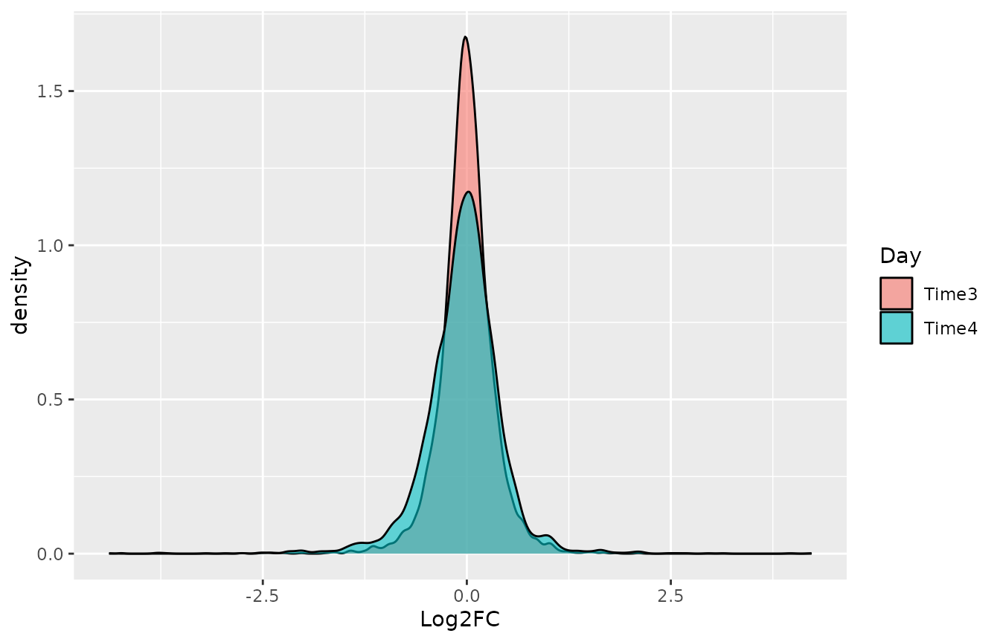
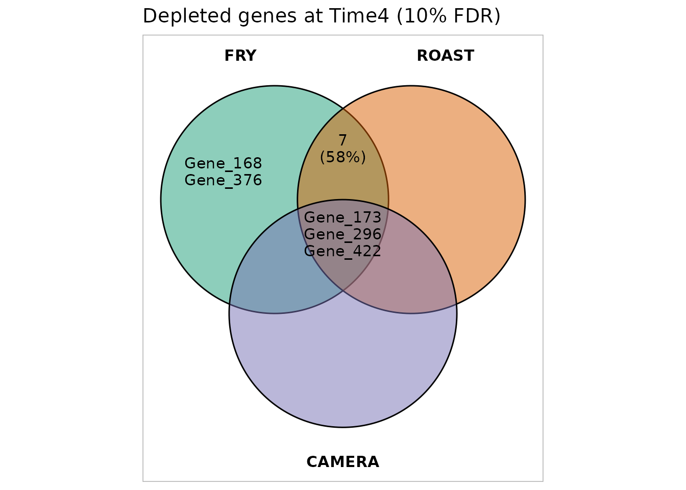
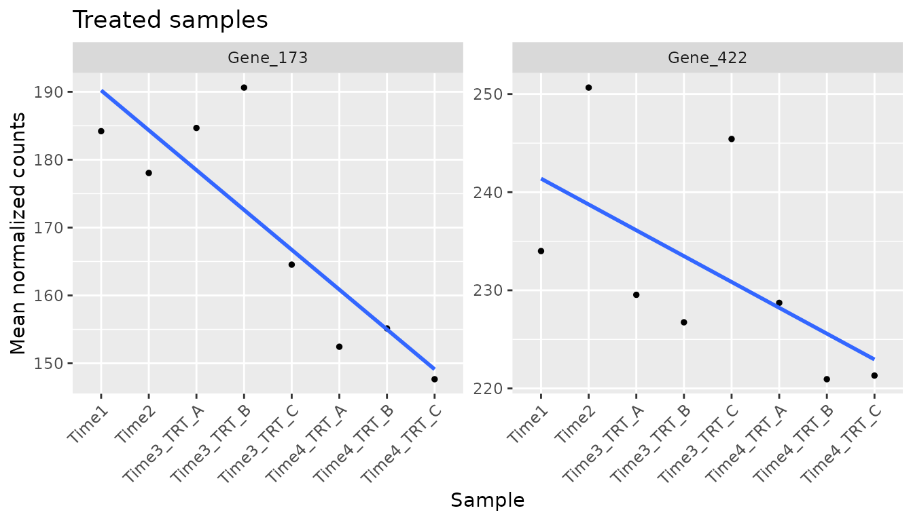
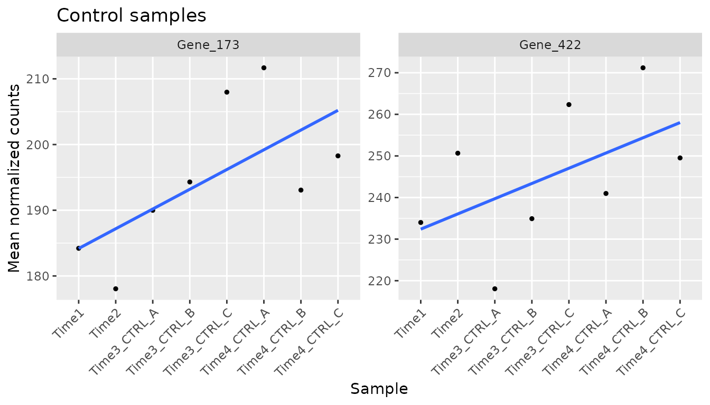
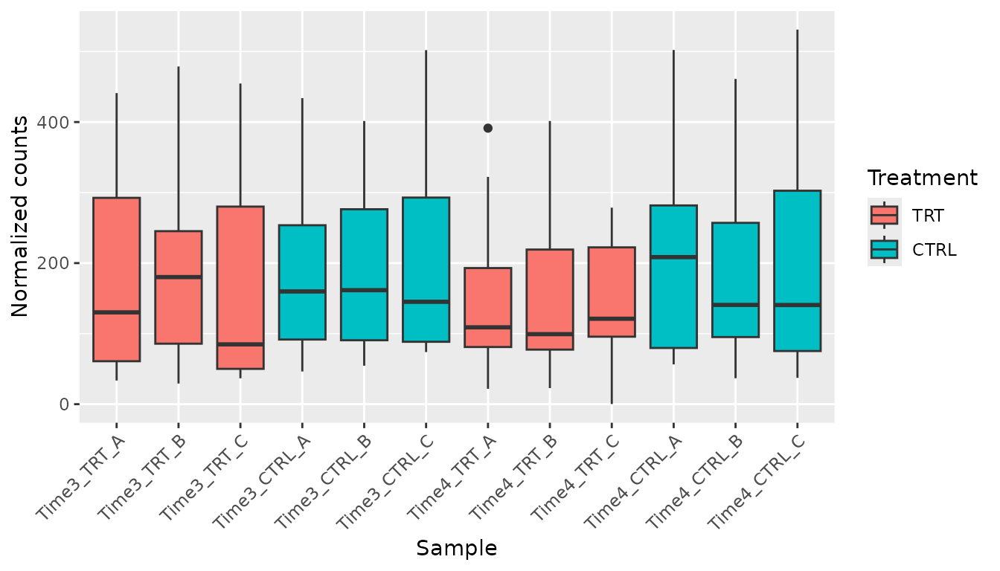
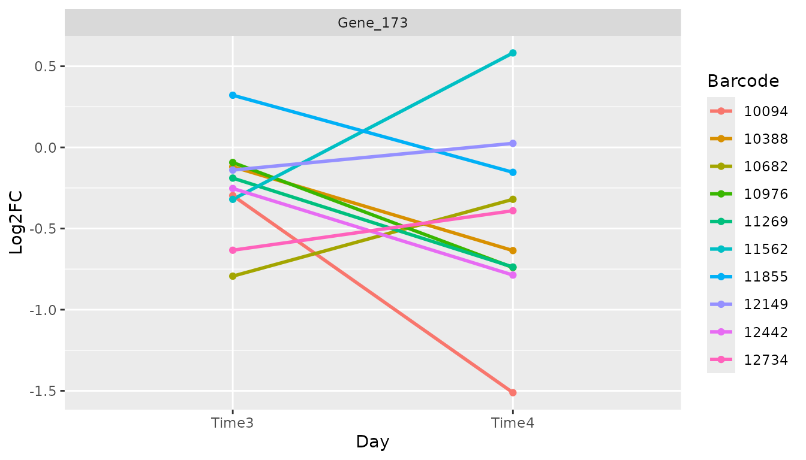
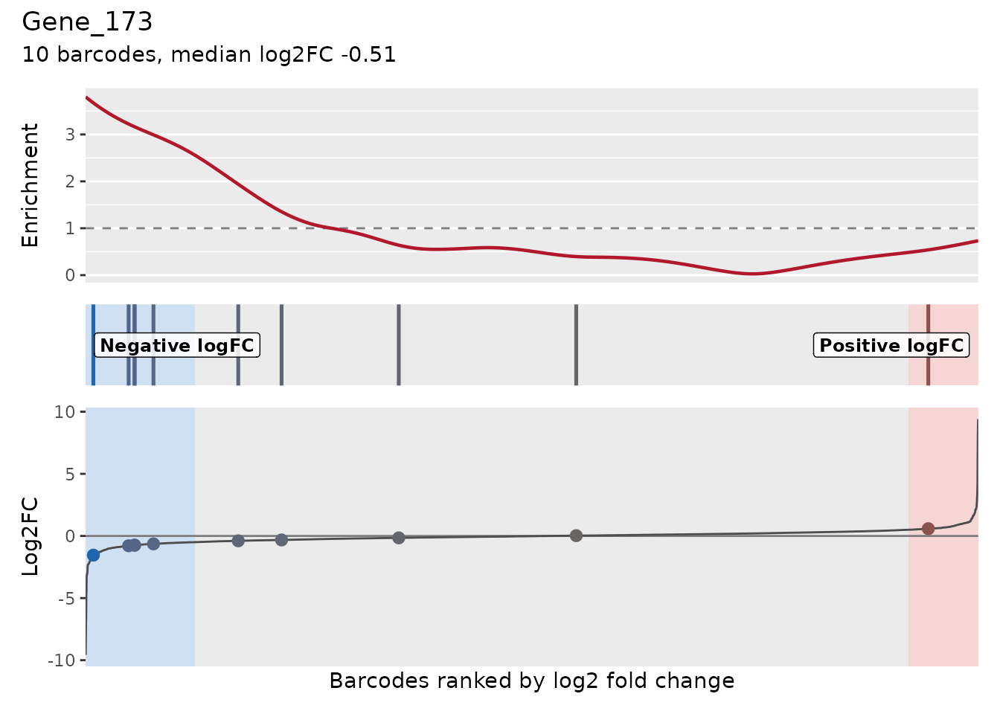

# Tutorial 3: Finding and validating hits

## About this tutorial

A **hit** is a gene whose barcodes change consistently in the treated
samples compared with the control samples. In a dropout (loss of
function) screen the interesting hits are usually depleted: their
knockdown kills the cells only in the presence of the treatment.

This tutorial explains, step by step:

1.  how to tell ScreenR which samples to compare;
2.  the statistical methods to find hits and how to read their results;
3.  how to combine the methods;
4.  how to check the candidate hits before trusting them.

It continues from the object of the previous tutorials:

``` r

library(ScreenR)
#> Warning: replacing previous import 'S4Arrays::makeNindexFromArrayViewport' by
#> 'DelayedArray::makeNindexFromArrayViewport' when loading 'SummarizedExperiment'
library(dplyr)
library(ggplot2)

data(count_table)
data(annotation_table)

counts <- count_table
colnames(counts) <- c(
    "Barcode", "Time1", "Time2", "Time3_TRT_A", "Time3_TRT_B", "Time3_TRT_C",
    "Time3_CTRL_A", "Time3_CTRL_B", "Time3_CTRL_C",
    "Time4_TRT_A", "Time4_TRT_B", "Time4_TRT_C",
    "Time4_CTRL_A", "Time4_CTRL_B", "Time4_CTRL_C"
)
counts <- filter(counts, Barcode != "*")
groups <- factor(c(
    "T1/T2", "T1/T2",
    rep("Time3_TRT", 3), rep("Time3_CTRL", 3),
    rep("Time4_TRT", 3), rep("Time4_CTRL", 3)
))

object <- create_screenr_object(
    table = counts, annotation = annotation_table, groups = groups
)
object <- remove_all_zero_row(object)
object <- normalize_data(object)
object <- compute_data_table(object)
```

## Overview of the methods

| Method | Function | Unit | Gives an FDR | Uses replicates |
|----|----|----|----|----|
| Gene-level Z-score test | [`find_gene_zscore_hit()`](https://emanuelsoda.github.io/ScreenR/reference/find_gene_zscore_hit.md) | Compares the mean Z-score of the barcodes of each gene with random sets of barcodes | Yes | With [`compute_barcode_statistics()`](https://emanuelsoda.github.io/ScreenR/reference/compute_barcode_statistics.md) |
| CAMERA | [`find_camera_hit()`](https://emanuelsoda.github.io/ScreenR/reference/find_camera_hit.md) | Tests whether the barcodes of a gene change more than the others | Yes | Yes |
| ROAST | [`find_roast_hit()`](https://emanuelsoda.github.io/ScreenR/reference/find_roast_hit.md) | Tests whether the barcodes of a gene change | Yes | Yes |
| Time course | [`find_time_hit()`](https://emanuelsoda.github.io/ScreenR/reference/find_time_hit.md) | Tests whether the treatment effect changes over time | Yes | Yes |
| Legacy Z-score rules | [`find_zscore_hit()`](https://emanuelsoda.github.io/ScreenR/reference/find_zscore_hit.md), [`find_robust_zscore_hit()`](https://emanuelsoda.github.io/ScreenR/reference/find_robust_zscore_hit.md) | Counts barcodes below the median Z-score | No | No |

The **FDR** (false discovery rate) is the expected proportion of false
hits among the genes you call hits: with an FDR cut off of 5%, about 1
in 20 of the reported genes is expected to be a false positive. Each
method returns only the genes with `FDR <= fdr` (default 0.05); use
`fdr = 1` to get all the genes and rank them yourself.

## Step 1: which samples to compare

CAMERA, ROAST and the replicate-aware statistics use a linear model,
which needs two things:

- a **design matrix**, which says which group each sample belongs to;
- a **contrast**, which says which groups to compare.

[`create_design_matrix()`](https://emanuelsoda.github.io/ScreenR/reference/create_design_matrix.md)
builds the design matrix from the groups of the object: one column per
group, and a 1 in the column of the group of each sample. Group names
that are not valid R names are changed (`T1/T2` becomes `T1.T2`).

``` r

design <- create_design_matrix(object)
design
#>    T1.T2 Time3_CTRL Time3_TRT Time4_CTRL Time4_TRT
#> 1      1          0         0          0         0
#> 2      1          0         0          0         0
#> 3      0          0         1          0         0
#> 4      0          0         1          0         0
#> 5      0          0         1          0         0
#> 6      0          1         0          0         0
#> 7      0          1         0          0         0
#> 8      0          1         0          0         0
#> 9      0          0         0          0         1
#> 10     0          0         0          0         1
#> 11     0          0         0          0         1
#> 12     0          0         0          1         0
#> 13     0          0         0          1         0
#> 14     0          0         0          1         0
#> attr(,"assign")
#> [1] 1 1 1 1 1
#> attr(,"contrasts")
#> attr(,"contrasts")$groups
#> [1] "contr.treatment"
```

[`create_contrast()`](https://emanuelsoda.github.io/ScreenR/reference/create_contrast.md)
builds the comparison between groups by name: here treated against
control at each time point.

``` r

contrast_time3 <- create_contrast(design,
    treatment = "Time3_TRT", control = "Time3_CTRL"
)
contrast_time4 <- create_contrast(design,
    treatment = "Time4_TRT", control = "Time4_CTRL"
)
contrast_time4
#>      T1.T2 Time3_CTRL  Time3_TRT Time4_CTRL  Time4_TRT 
#>          0          0          0         -1          1
```

The contrast gives +1 to the treated group and -1 to the control group:
the result is the treated minus the control. With several groups on one
side (for example `treatment = c("Time3_TRT", "Time4_TRT")`) their
average is used.

**Common mistake.** Do not build the design with
`model.matrix(~ groups)` and rename its columns: the first group becomes
the intercept and the columns are in alphabetical order, so the names
end up on the wrong columns and the wrong samples are compared.
[`create_design_matrix()`](https://emanuelsoda.github.io/ScreenR/reference/create_design_matrix.md)
and
[`create_contrast()`](https://emanuelsoda.github.io/ScreenR/reference/create_contrast.md)
avoid this.

The examples below compare treated and control samples at Time4.

## Step 2: the Z-score method

### Fold changes and Z-scores

[`compute_metrics()`](https://emanuelsoda.github.io/ScreenR/reference/compute_metrics.md)
averages the replicates of the treated and of the control samples of one
time point and computes for each barcode:

| Column | Meaning |
|----|----|
| `Treated`, `Control` | Mean normalized count |
| `Log2FC` | log2((Treated + 0.5) / (Control + 0.5)): negative means depleted in the treated samples |
| `Zscore` | Log2FC standardized with the mean and standard deviation of all barcodes |
| `ZscoreRobust` | Log2FC standardized with the median and MAD, less sensitive to outliers |

The `treatment` and `control` arguments are values of the Treatment
column of
[`get_sample_table()`](https://emanuelsoda.github.io/ScreenR/reference/get_sample_table.md),
and `day` a value of its Day column.

``` r

metrics_time4 <- compute_metrics(object,
    control = "CTRL", treatment = "TRT", day = "Time4"
)
head(metrics_time4)
#> # A tibble: 6 × 9
#>   Barcode Gene     Treated Control Log2FC Zscore ZscoreRobust Day   Treatment
#>   <fct>   <chr>      <dbl>   <dbl>  <dbl>  <dbl>        <dbl> <chr> <chr>    
#> 1 1       Gene_386   245.    279.  -0.187 -0.303       -0.482 Time4 TRT      
#> 2 10      Gene_519    74.3   118.  -0.665 -1.30        -1.85  Time4 TRT      
#> 3 100     Gene_84     38.6    32.1  0.262  0.634        0.806 Time4 TRT      
#> 4 1000    Gene_350   126.    115.   0.138  0.376        0.452 Time4 TRT      
#> 5 10001   Gene_379   412.    453.  -0.138 -0.200       -0.340 Time4 TRT      
#> 6 10002   Gene_379   191.    207.  -0.116 -0.155       -0.278 Time4 TRT
```

[`plot_zscore_distribution()`](https://emanuelsoda.github.io/ScreenR/reference/plot_zscore_distribution.md)
compares the Z-scores of several time points: a treatment with an effect
gives a longer left tail at the later time point.

``` r

metrics_time3 <- compute_metrics(object,
    control = "CTRL", treatment = "TRT", day = "Time3"
)
plot_zscore_distribution(
    list(Time3 = metrics_time3, Time4 = metrics_time4),
    alpha = 0.6
)
```



### Gene-level test

[`find_gene_zscore_hit()`](https://emanuelsoda.github.io/ScreenR/reference/find_gene_zscore_hit.md)
computes for each gene the mean Z-score of its barcodes and asks how
often a random set of barcodes of the same size has a score at least as
low (`direction = "Down"`). The random sets are drawn many times
(`n_permutations`), so the p-value needs no assumption on the
distribution of the Z-scores; `seed` makes it reproducible. The p-values
are then corrected for testing many genes (FDR).

If the library has control genes, their gene name can be given with
`control_genes` (for example `control_genes = "non-targeting"`): the
random sets are then drawn from the controls, which cannot contain true
hits. Do this only if the controls behave like genes without effect.
Non-targeting shRNAs often do not: targeting shRNAs are usually somewhat
depleted compared with them, so every gene looks depleted (in the K562
screen of ScreenR this called hundreds of non-essential genes). Check
first that the controls have the same scores as genes known to have no
effect; when in doubt, keep the default. `statistic = "median"` uses the
median instead of the mean, which is less affected by a single barcode
with a strong (possibly off-target) effect.

``` r

gene_zscore <- find_gene_zscore_hit(metrics_time4, fdr = 1, seed = 1)
head(gene_zscore)
#> # A tibble: 6 × 6
#>   Gene     NBarcodes  Score Log2FC    PValue    FDR
#>   <chr>        <int>  <dbl>  <dbl>     <dbl>  <dbl>
#> 1 Gene_364        12 -1.55  -0.473 0.0000500 0.0267
#> 2 Gene_296        10 -1.31  -0.499 0.000460  0.123 
#> 3 Gene_322        10 -1.13  -0.386 0.00148   0.263 
#> 4 Gene_419        10 -1.08  -0.311 0.00209   0.279 
#> 5 Gene_352        10 -1.02  -0.455 0.00318   0.340 
#> 6 Gene_422        10 -0.951 -0.430 0.00455   0.405
```

| Column          | Meaning                                 |
|-----------------|-----------------------------------------|
| `NBarcodes`     | Number of barcodes of the gene          |
| `Score`         | Mean Z-score of the barcodes            |
| `Log2FC`        | Median log2 fold change of the barcodes |
| `PValue`, `FDR` | Significance                            |

### Using the replicates

[`compute_metrics()`](https://emanuelsoda.github.io/ScreenR/reference/compute_metrics.md)
averages the replicates, so it cannot tell a consistent barcode from a
noisy one.
[`compute_barcode_statistics()`](https://emanuelsoda.github.io/ScreenR/reference/compute_barcode_statistics.md)
tests each barcode with edgeR, using the variability between replicates,
and returns a Z-score that can be used by
[`find_gene_zscore_hit()`](https://emanuelsoda.github.io/ScreenR/reference/find_gene_zscore_hit.md)
in the same way. This is the recommended input.

``` r

barcode_statistics <- compute_barcode_statistics(
    object, design, contrast_time4
)
head(barcode_statistics)
#> # A tibble: 6 × 8
#>   Barcode Gene     Log2FC logCPM     F PValue   FDR Zscore
#>   <chr>   <chr>     <dbl>  <dbl> <dbl>  <dbl> <dbl>  <dbl>
#> 1 10208   Gene_380  0.109   8.56 0.438 0.510  0.835  0.658
#> 2 10502   Gene_380 -0.480   4.97 0.748 0.390  0.765 -0.859
#> 3 10796   Gene_380 -0.665   6.61 2.49  0.120  0.515 -1.56 
#> 4 11089   Gene_380 -0.169   8.44 0.992 0.323  0.716 -0.988
#> 5 11382   Gene_380 -0.651   5.62 1.44  0.235  0.643 -1.19 
#> 6 11675   Gene_380 -0.286   9.66 6.71  0.0119 0.219 -2.51

gene_zscore_edger <- find_gene_zscore_hit(barcode_statistics, fdr = 1,
    seed = 1)
head(gene_zscore_edger)
#> # A tibble: 6 × 6
#>   Gene     NBarcodes Score Log2FC   PValue   FDR
#>   <chr>        <int> <dbl>  <dbl>    <dbl> <dbl>
#> 1 Gene_173        10 -1.58 -0.521 0.000240 0.128
#> 2 Gene_422        10 -1.45 -0.451 0.000700 0.187
#> 3 Gene_15         10 -1.37 -0.321 0.00131  0.233
#> 4 Gene_296        10 -1.31 -0.493 0.00187  0.250
#> 5 Gene_370        10 -1.24 -0.394 0.00304  0.280
#> 6 Gene_168        10 -1.21 -0.256 0.00355  0.280
```

### Legacy rules

[`find_zscore_hit()`](https://emanuelsoda.github.io/ScreenR/reference/find_zscore_hit.md)
and
[`find_robust_zscore_hit()`](https://emanuelsoda.github.io/ScreenR/reference/find_robust_zscore_hit.md)
call a gene a hit when more than `number_barcode` of its barcodes are
below the median Z-score. They are kept for compatibility, but they do
not give a p-value and many genes without an effect pass them by chance
(about 17% with 10 barcodes and `number_barcode = 6`): prefer
[`find_gene_zscore_hit()`](https://emanuelsoda.github.io/ScreenR/reference/find_gene_zscore_hit.md).

``` r

nrow(find_zscore_hit(metrics_time4, number_barcode = 6))
#> [1] 97
```

## Step 3: CAMERA and ROAST

Both test the barcodes of each gene as a set, using edgeR on the raw
counts.

- **CAMERA** asks whether the barcodes of a gene change **more than the
  other barcodes** (a competitive test), taking into account the
  correlation between barcodes.
- **ROAST** asks whether the barcodes of a gene **change at all** (a
  self-contained test). It uses random rotations: set `seed` to get the
  same result every time, and use many rotations (`nrot`, default 9999)
  for a real analysis; here 999 keep the tutorial fast. With
  `method = "fry"` the same test is computed exactly, without rotations:
  it is faster and its p-values are not limited by the number of
  rotations.

CAMERA becomes conservative when many genes have an effect, because the
other barcodes it compares with then include true hits; ROAST and fry do
not have this limitation. On the other hand ROAST and fry test each gene
on its own barcodes, so they rely on the variability between replicates:
they need replicates in both groups, have little power with two
replicates or noisy data, and find almost nothing when the control is a
single sample (for example a plasmid library). The p-values of all three
are one-sided, for the requested direction.

`number_barcode` sets the minimum number of barcodes (more than
`number_barcode`) a gene needs to be tested, and `direction` chooses
depleted (`"Down"`) or enriched (`"Up"`) genes.

``` r

camera <- find_camera_hit(object, design, contrast_time4, fdr = 1)
head(camera)
#> # A tibble: 6 × 6
#>   Gene     NGenes Direction   PValue    FDR Log2FC
#>   <chr>     <dbl> <fct>        <dbl>  <dbl>  <dbl>
#> 1 Gene_173     10 Down      0.000214 0.0882 -0.515
#> 2 Gene_422     10 Down      0.000418 0.0882 -0.433
#> 3 Gene_296     10 Down      0.000495 0.0882 -0.508
#> 4 Gene_352     10 Down      0.00200  0.232  -0.467
#> 5 Gene_87      10 Down      0.00250  0.232  -0.436
#> 6 Gene_370     10 Down      0.00295  0.232  -0.344

roast <- find_roast_hit(object, design, contrast_time4,
    nrot = 999, seed = 42, fdr = 1
)
head(select(roast, Gene, NGenes, PropDown, PropUp, Direction, PValue, FDR,
    Log2FC))
#> # A tibble: 6 × 8
#>   Gene     NGenes PropDown PropUp Direction PValue    FDR Log2FC
#>   <chr>     <int>    <dbl>  <dbl> <fct>      <dbl>  <dbl>  <dbl>
#> 1 Gene_296     10      0.6    0   Down      0.0005 0.0534 -0.508
#> 2 Gene_173     10      0.5    0.1 Down      0.0005 0.0534 -0.515
#> 3 Gene_412     10      0.5    0.1 Down      0.0005 0.0534 -0.325
#> 4 Gene_422     10      0.5    0   Down      0.0005 0.0534 -0.433
#> 5 Gene_325     10      0.3    0.1 Down      0.0005 0.0534 -0.246
#> 6 Gene_15      10      0.5    0   Down      0.001  0.0668 -0.325
```

| Column                       | Meaning                                 |
|------------------------------|-----------------------------------------|
| `NGenes`                     | Number of barcodes of the gene          |
| `Direction`                  | Down or Up                              |
| `PValue`, `FDR`              | Significance                            |
| `PropDown`, `PropUp` (ROAST) | Proportion of barcodes going down or up |
| `Log2FC`                     | Median log2 fold change of the barcodes |

How many genes pass different FDR cut offs:

``` r

fdr_levels <- c(0.05, 0.1, 0.25)
tibble(
    FDR = fdr_levels,
    zscore = vapply(fdr_levels, function(x) sum(gene_zscore_edger$FDR <= x),
        1L),
    CAMERA = vapply(fdr_levels, function(x) sum(camera$FDR <= x), 1L),
    ROAST = vapply(fdr_levels, function(x) sum(roast$FDR <= x), 1L)
)
#> # A tibble: 3 × 4
#>     FDR zscore CAMERA ROAST
#>   <dbl>  <int>  <int> <int>
#> 1  0.05      0      0     0
#> 2  0.1       0      3    11
#> 3  0.25      4      7    55
```

The effect of the treatment in this example is weak: no gene reaches an
FDR of 5%. In the rest of the tutorial we use 25% to illustrate the
steps; in your own analysis, choose the cut off before looking at the
results and report it.

``` r

alpha <- 0.25
```

## Step 4: the time course

When the screen has several time points,
[`find_time_hit()`](https://emanuelsoda.github.io/ScreenR/reference/find_time_hit.md)
asks whether the treatment effect **changes over time**, with one model
for all the time points instead of one analysis per time point.
Untreated and treated samples each follow a line over time; the method
tests the difference between the slopes. Early samples taken before the
treatment can be added as `baseline`. The time points are given in order
with `days` and are treated as equally spaced.

``` r

time_hit <- find_time_hit(object,
    treatment = "TRT", control = "CTRL",
    baseline = c("Time1", "Time2"),
    days = c("Time1", "Time2", "Time3", "Time4"),
    fdr = 1
)
head(time_hit)
#> # A tibble: 6 × 6
#>   Gene     NGenes Direction      PValue       FDR Log2FC
#>   <chr>     <dbl> <fct>           <dbl>     <dbl>  <dbl>
#> 1 Gene_372     12 Down      0.000000157 0.0000836 -0.974
#> 2 Gene_296     10 Down      0.000000706 0.000135  -1.17 
#> 3 Gene_364     12 Down      0.000000760 0.000135  -1.01 
#> 4 Gene_412     10 Down      0.000112    0.0149    -0.815
#> 5 Gene_370     10 Down      0.000565    0.0604    -0.389
#> 6 Gene_349     10 Down      0.00376     0.318     -0.192
```

Here `Log2FC` is the change of the treatment log2 fold change per time
point: a negative value means that the depletion grows over time. In
this dataset 4 genes have an FDR below 5% (Gene_372, Gene_296, Gene_364,
Gene_412): the time course model is more powerful here than the
comparison at a single time point, because it uses all the samples.

## Step 5: combining the methods

The methods look at the data in different ways, so genes found by
several of them are the most convincing.
[`plot_common_hit()`](https://emanuelsoda.github.io/ScreenR/reference/plot_common_hit.md)
shows the overlap between the hits of three methods:

``` r

plot_common_hit(
    hit_zscore = filter(gene_zscore_edger, FDR <= alpha),
    hit_camera = filter(camera, FDR <= alpha),
    hit_roast = filter(roast, FDR <= alpha),
    show_elements = FALSE, show_percentage = FALSE
)
```



[`find_common_hit()`](https://emanuelsoda.github.io/ScreenR/reference/find_common_hit.md)
returns the genes found by at least `common_in` methods:

``` r

common <- find_common_hit(
    filter(gene_zscore_edger, FDR <= alpha),
    filter(camera, FDR <= alpha),
    filter(roast, FDR <= alpha),
    common_in = 2
)
common
#> [1] "Gene_173" "Gene_422" "Gene_15"  "Gene_296" "Gene_352" "Gene_87"  "Gene_370"
```

[`summarise_hits()`](https://emanuelsoda.github.io/ScreenR/reference/summarise_hits.md)
puts the FDR of every method in one table. `NMethods` counts the methods
in which the gene passes the cut off, and `MaxFDR` (the largest FDR) is
a conservative score to rank the genes supported by all the methods.
Pass the tables computed with `fdr = 1`, so that every gene has a value.

``` r

summary <- summarise_hits(
    list(
        zscore = gene_zscore_edger, camera = camera,
        roast = roast, time = time_hit
    ),
    fdr = alpha
)
head(summary, 10)
#> # A tibble: 10 × 8
#>    Gene     FDR_zscore FDR_camera FDR_roast FDR_time NMethods MaxFDR Hit  
#>    <chr>         <dbl>      <dbl>     <dbl>    <dbl>    <dbl>  <dbl> <lgl>
#>  1 Gene_296      0.250     0.0882    0.0534 0.000135        4  0.250 TRUE 
#>  2 Gene_370      0.280     0.232     0.111  0.0604          3  0.280 FALSE
#>  3 Gene_349      0.390     0.263     0.0668 0.318           1  0.390 FALSE
#>  4 Gene_352      0.280     0.232     0.157  0.508           2  0.508 FALSE
#>  5 Gene_87       0.280     0.232     0.207  0.508           2  0.508 FALSE
#>  6 Gene_422      0.187     0.0882    0.0534 0.545           3  0.545 FALSE
#>  7 Gene_412      0.590     0.306     0.0534 0.0149          2  0.590 FALSE
#>  8 Gene_325      0.649     0.738     0.0534 0.318           1  0.738 FALSE
#>  9 Gene_173      0.128     0.0882    0.0534 0.742           3  0.742 FALSE
#> 10 Gene_168      0.280     0.380     0.153  0.742           1  0.742 FALSE
```

The column `Hit` is `TRUE` when the gene passes the cut off in every
method (`MaxFDR <= alpha`). A note on interpretation: the combined list
does not have a guaranteed false discovery rate, so treat it as a short
list of candidates to validate. In this dataset 1 gene(s) pass all four
methods at 25%, so below we check the genes found by at least two of the
three methods of the Venn diagram.

## Step 6: checking the candidates

Statistics can produce false positives, so look at the data of each
candidate.

``` r

candidates <- head(common, 2)
candidates
#> [1] "Gene_173" "Gene_422"
```

### Trend over time

[`plot_trend()`](https://emanuelsoda.github.io/ScreenR/reference/plot_trend.md)
shows the mean frequency of the barcodes of a gene in the chosen samples
(`group_var` takes values of the Treatment column). A depleted hit goes
down in the treated samples but not in the controls.

``` r

plot_trend(object,
    genes = candidates, group_var = c("Time1", "Time2", "TRT"),
    nrow = 1, ncol = 2
) +
    theme(axis.text.x = element_text(angle = 45, hjust = 1)) +
    ggtitle("Treated samples")
```



``` r


plot_trend(object,
    genes = candidates, group_var = c("Time1", "Time2", "CTRL"),
    nrow = 1, ncol = 2
) +
    theme(axis.text.x = element_text(angle = 45, hjust = 1)) +
    ggtitle("Control samples")
```



### Distribution of the barcodes

[`plot_boxplot()`](https://emanuelsoda.github.io/ScreenR/reference/plot_boxplot.md)
shows the frequencies of all the barcodes of a gene in each sample:

``` r

plot_boxplot(object,
    genes = candidates[1], group_var = c("TRT", "CTRL"),
    fill_var = "Treatment"
) +
    theme(axis.text.x = element_text(angle = 45, hjust = 1))
```



### Barcode by barcode

A real hit should be supported by most of its barcodes, not by one or
two.
[`plot_barcode_trend()`](https://emanuelsoda.github.io/ScreenR/reference/plot_barcode_trend.md)
shows the log2 fold change of each barcode over the time points:

``` r

plot_barcode_trend(
    list(Time3 = metrics_time3, Time4 = metrics_time4),
    genes = candidates[1]
)
#> $Gene_173
```



[`plot_barcode_hit()`](https://emanuelsoda.github.io/ScreenR/reference/plot_barcode_hit.md)
ranks all the barcodes by their log2 fold change and places the barcodes
of a gene on the ranking (vertical lines): most lines on the left side
means that the gene is depleted. The line on top shows where the
barcodes of the gene are concentrated (above 1, dashed line), and the
bottom panel shows their log2 fold changes (`show_log2fc = FALSE` hides
it):

``` r

plot_barcode_hit(object, design,
    contrast = contrast_time4, gene = candidates[1]
)
```



[`find_discordant_barcodes()`](https://emanuelsoda.github.io/ScreenR/reference/find_discordant_barcodes.md)
lists the barcodes that behave very differently from the other barcodes
of their gene, which may have off-target effects:

``` r

discordant <- find_discordant_barcodes(metrics_time4, threshold = 3)
filter(discordant, Gene %in% candidates)
#> # A tibble: 0 × 5
#> # ℹ 5 variables: Barcode <fct>, Gene <chr>, Log2FC <dbl>, GeneLog2FC <dbl>,
#> #   Deviation <dbl>
```

### Additional filters

Two filters can remove candidates that are not convincing:

- [`filter_by_slope()`](https://emanuelsoda.github.io/ScreenR/reference/filter_by_slope.md)
  keeps the genes whose frequency decreases more over time in the
  treated samples than in the control samples;
- [`filter_by_variance()`](https://emanuelsoda.github.io/ScreenR/reference/filter_by_variance.md)
  removes the genes whose barcodes disagree too much (variance of the
  barcode log2 fold changes above `variance`).

``` r

filter_by_slope(object,
    genes = candidates,
    group_var_treatment = c("Time1", "Time2", "TRT"),
    group_var_control = c("Time1", "Time2", "CTRL")
)
#> # A tibble: 2 × 3
#>   Gene     slope_control slope_treatment
#>   <chr>            <dbl>           <dbl>
#> 1 Gene_173          7.07          -11.4 
#> 2 Gene_422          5.38           -5.96

filter_by_variance(object,
    genes = candidates, matrix_model = design,
    contrast = contrast_time4, variance = 0.5
) %>%
    distinct(Gene, Variance)
#> # A tibble: 2 × 2
#>   Gene     Variance
#>   <chr>       <dbl>
#> 1 Gene_173    0.324
#> 2 Gene_422    0.227
```

## Summary

| Step | What to do |
|----|----|
| 1 | [`create_design_matrix()`](https://emanuelsoda.github.io/ScreenR/reference/create_design_matrix.md) and [`create_contrast()`](https://emanuelsoda.github.io/ScreenR/reference/create_contrast.md) for the comparison |
| 2 | [`compute_barcode_statistics()`](https://emanuelsoda.github.io/ScreenR/reference/compute_barcode_statistics.md) + [`find_gene_zscore_hit()`](https://emanuelsoda.github.io/ScreenR/reference/find_gene_zscore_hit.md) |
| 3 | [`find_camera_hit()`](https://emanuelsoda.github.io/ScreenR/reference/find_camera_hit.md) and [`find_roast_hit()`](https://emanuelsoda.github.io/ScreenR/reference/find_roast_hit.md) (with `seed`) |
| 4 | [`find_time_hit()`](https://emanuelsoda.github.io/ScreenR/reference/find_time_hit.md) if there are several time points |
| 5 | [`plot_common_hit()`](https://emanuelsoda.github.io/ScreenR/reference/plot_common_hit.md) and [`summarise_hits()`](https://emanuelsoda.github.io/ScreenR/reference/summarise_hits.md) |
| 6 | [`plot_trend()`](https://emanuelsoda.github.io/ScreenR/reference/plot_trend.md), [`plot_boxplot()`](https://emanuelsoda.github.io/ScreenR/reference/plot_boxplot.md), [`plot_barcode_trend()`](https://emanuelsoda.github.io/ScreenR/reference/plot_barcode_trend.md), [`plot_barcode_hit()`](https://emanuelsoda.github.io/ScreenR/reference/plot_barcode_hit.md), [`find_discordant_barcodes()`](https://emanuelsoda.github.io/ScreenR/reference/find_discordant_barcodes.md) |

Choose the FDR cut off before the analysis, report it, and validate the
candidates experimentally.

``` r

sessionInfo()
#> R version 4.6.1 (2026-06-24)
#> Platform: x86_64-pc-linux-gnu
#> Running under: Ubuntu 24.04.5 LTS
#> 
#> Matrix products: default
#> BLAS:   /usr/lib/x86_64-linux-gnu/openblas-pthread/libblas.so.3 
#> LAPACK: /usr/lib/x86_64-linux-gnu/openblas-pthread/libopenblasp-r0.3.26.so;  LAPACK version 3.12.0
#> 
#> locale:
#>  [1] LC_CTYPE=C.UTF-8       LC_NUMERIC=C           LC_TIME=C.UTF-8       
#>  [4] LC_COLLATE=C.UTF-8     LC_MONETARY=C.UTF-8    LC_MESSAGES=C.UTF-8   
#>  [7] LC_PAPER=C.UTF-8       LC_NAME=C              LC_ADDRESS=C          
#> [10] LC_TELEPHONE=C         LC_MEASUREMENT=C.UTF-8 LC_IDENTIFICATION=C   
#> 
#> time zone: UTC
#> tzcode source: system (glibc)
#> 
#> attached base packages:
#> [1] stats     graphics  grDevices utils     datasets  methods   base     
#> 
#> other attached packages:
#> [1] ggplot2_4.0.3    dplyr_1.2.1      ScreenR_1.15.15  BiocStyle_2.40.0
#> 
#> loaded via a namespace (and not attached):
#>  [1] SummarizedExperiment_1.42.0 gtable_0.3.6               
#>  [3] xfun_0.61                   bslib_0.12.0               
#>  [5] Biobase_2.72.0              lattice_0.22-9             
#>  [7] vctrs_0.7.3                 tools_4.6.1                
#>  [9] generics_0.1.4              stats4_4.6.1               
#> [11] tibble_3.3.1                pkgconfig_2.0.3            
#> [13] Matrix_1.7-5                RColorBrewer_1.1-3         
#> [15] S7_0.2.2                    desc_1.4.3                 
#> [17] S4Vectors_0.50.3            lifecycle_1.0.5            
#> [19] compiler_4.6.1              farver_2.1.2               
#> [21] stringr_1.6.0               textshaping_1.0.5          
#> [23] statmod_1.5.2               Seqinfo_1.2.0              
#> [25] ggvenn_0.1.19               htmltools_0.5.9            
#> [27] sass_0.4.10                 yaml_2.3.12                
#> [29] pillar_1.11.1               pkgdown_2.2.1              
#> [31] jquerylib_0.1.4             tidyr_1.3.2                
#> [33] DelayedArray_0.38.2         cachem_1.1.0               
#> [35] limma_3.68.5                abind_1.4-8                
#> [37] nlme_3.1-169                tidyselect_1.2.1           
#> [39] locfit_1.5-9.12             digest_0.6.39              
#> [41] stringi_1.8.9               purrr_1.2.2                
#> [43] bookdown_0.48               splines_4.6.1              
#> [45] labeling_0.4.3              fastmap_1.2.0              
#> [47] grid_4.6.1                  cli_3.6.6                  
#> [49] SparseArray_1.12.3          magrittr_2.0.5             
#> [51] patchwork_1.3.2             S4Arrays_1.12.1            
#> [53] utf8_1.2.6                  withr_3.0.3                
#> [55] edgeR_4.10.5                scales_1.4.0               
#> [57] rmarkdown_2.32              XVector_0.52.0             
#> [59] matrixStats_1.5.0           otel_0.2.0                 
#> [61] ragg_1.5.2                  evaluate_1.0.5             
#> [63] knitr_1.52                  GenomicRanges_1.64.0       
#> [65] IRanges_2.46.0              mgcv_1.9-4                 
#> [67] rlang_1.3.0                 glue_1.8.1                 
#> [69] BiocManager_1.30.27         BiocGenerics_0.58.1        
#> [71] jsonlite_2.0.0              R6_2.6.1                   
#> [73] MatrixGenerics_1.24.0       systemfonts_1.3.2          
#> [75] fs_2.1.0
```
