# Tutorial 4: CRISPR-Cas9 screens

## About this tutorial

ScreenR was written for shRNA screens, but CRISPR-Cas9 knockout screens
produce the same kind of data: a table of read counts, one row for each
guide RNA (sgRNA) and one column for each sample. In ScreenR an sgRNA is
simply a “barcode”, and everything in the other tutorials applies. This
tutorial goes through a CRISPR dropout screen step by step and shows
what is specific to CRISPR:

1.  installing ScreenR and, optionally, CRISPRcleanR;
2.  describing a time-course dropout screen (T0 and later time points);
3.  choosing the thresholds on the number of sgRNAs per gene;
4.  checking the quality of the screen with essential and non-essential
    reference genes;
5.  correcting the copy-number bias of CRISPR-Cas9 with CRISPRcleanR;
6.  finding the hits, using the non-essential genes as reference;
7.  positive-selection screens.

|  | shRNA screen | CRISPR-Cas9 knockout screen |
|----|----|----|
| Reagent (a “barcode” in ScreenR) | shRNA | sgRNA |
| Reagents per gene | often 5 to 25 | usually 3 to 6 (4 in TKOv3 and Brunello) |
| Typical design | treated vs control at each time point | late time point vs T0 or plasmid |
| Gene-independent effects | seed (off-target) effects | DNA cutting: copy-number and proximity bias |
| Good null reference | non-essential genes | non-essential genes (non-targeting sgRNAs do not cut, so they are not a good null) |

## Installation

ScreenR is on Bioconductor:

``` r

if (!requireNamespace("BiocManager", quietly = TRUE)) {
    install.packages("BiocManager")
}
BiocManager::install("ScreenR")
```

The copy-number correction uses the
[CRISPRcleanR](https://github.com/francescojm/CRISPRcleanR) package
(Iorio et al. 2018). It is optional: everything else in this tutorial
works without it. CRISPRcleanR is not on CRAN or Bioconductor, so it is
installed from GitHub;
[`BiocManager::install()`](https://bioconductor.github.io/BiocManager/reference/install.html)
also installs its Bioconductor dependencies:

``` r

BiocManager::install("francescojm/CRISPRcleanR")
```

[`crisprcleanr_available()`](https://emanuelsoda.github.io/ScreenR/reference/crisprcleanr_available.md)
tells whether it is installed:

``` r

library(ScreenR)
library(dplyr)
library(ggplot2)
```

``` r

crisprcleanr_available()
```

*CRISPRcleanR is not installed where this tutorial was built: the code
of the copy-number correction is shown but not run, and its results are
read from a precomputed table.*

## The data

`hap1_count_table` comes from a genome-wide CRISPR-Cas9 knockout screen
of HAP1 cells with the TKOv3 library (Hart et al. 2017): the T0 sample
and three replicates after 3 and 18 days of growth. Cells that lose a
gene needed for growth (an essential gene) are lost over time, so the
sgRNAs of essential genes are depleted at day 18. To keep the package
small the dataset is a subset of the 70,877 sgRNAs of the library (see
[`?hap1_count_table`](https://emanuelsoda.github.io/ScreenR/reference/hap1_count_table.md)).

``` r

data(hap1_count_table)
data(hap1_annotation_table)
head(hap1_count_table)
#>                     Barcode  T0 T3_A T3_B T3_C T18_A T18_B T18_C
#> 1 EGFP_TGGTTGTCGGGCAGCAGCAC 537  222  150  216   243   115   304
#> 2 EGFP_GGTTGTCGGGCAGCAGCACG 210  197   92  125   195   177   115
#> 3 EGFP_TTCAAGTCCGCCATGCCCGA 517  423  255  282   329   309   433
#> 4 EGFP_CGGCGGTCACGAACTCCAGC 278  167   54  120   165   184    65
#> 5 EGFP_GGTGCCCATCCTGGTCGAGC  83   99   41   19   107   103    44
#> 6 EGFP_GAAGTTCGAGGGCGACACCC 268  145  153  204   133   295   228
head(hap1_annotation_table)
#>                     Barcode Gene Chromosome Strand Start End   Class
#> 1 EGFP_TGGTTGTCGGGCAGCAGCAC EGFP       <NA>   <NA>    NA  NA control
#> 2 EGFP_GGTTGTCGGGCAGCAGCACG EGFP       <NA>   <NA>    NA  NA control
#> 3 EGFP_TTCAAGTCCGCCATGCCCGA EGFP       <NA>   <NA>    NA  NA control
#> 4 EGFP_CGGCGGTCACGAACTCCAGC EGFP       <NA>   <NA>    NA  NA control
#> 5 EGFP_GGTGCCCATCCTGGTCGAGC EGFP       <NA>   <NA>    NA  NA control
#> 6 EGFP_GAAGTTCGAGGGCGACACCC EGFP       <NA>   <NA>    NA  NA control
```

The annotation has the gene of each sgRNA and its position in the genome
(used by CRISPRcleanR), and a Class column that tells the core essential
and non-essential reference genes, the controls and the other genes.

## Creating the ScreenR object

The sample names (`T0`, `T3_A`, …) do not follow the
`Day_Treatment_Replicate` convention of ScreenR, so the samples are
described with a `sample_table`. In a dropout screen the comparison is
between time points, so all the samples belong to the same experiment
(`Day = "Screen"`) and the time point is used as the `Treatment`; the
`groups` (used by the statistical models) are the time points too.

``` r

samples <- data.frame(
    Sample = colnames(hap1_count_table)[-1],
    Day = "Screen",
    Treatment = c("T0", "T3", "T3", "T3", "T18", "T18", "T18")
)
samples
#>   Sample    Day Treatment
#> 1     T0 Screen        T0
#> 2   T3_A Screen        T3
#> 3   T3_B Screen        T3
#> 4   T3_C Screen        T3
#> 5  T18_A Screen       T18
#> 6  T18_B Screen       T18
#> 7  T18_C Screen       T18
object <- create_screenr_object(
    table = hap1_count_table,
    annotation = hap1_annotation_table,
    groups = factor(samples$Treatment, levels = c("T0", "T3", "T18")),
    sample_table = samples
)
object <- remove_all_zero_row(object)
object
#> class: screenr_object 
#> dim: 13598 7 
#> metadata(1): screenr_layout
#> assays(1): counts
#> rownames(13598): EGFP_TGGTTGTCGGGCAGCAGCAC EGFP_GGTTGTCGGGCAGCAGCACG
#>   ... luciferase_GGCTATGAAGAGATACGCCC luciferase_GGCATGCGAGAATCTGACGC
#> rowData names(7): Barcode Gene ... End Class
#> colnames(7): T0 T3_A ... T18_B T18_C
#> colData names(4): Sample Day Treatment Group
#> normalization: none (run normalize_data())
```

## How many sgRNAs per gene?

Several functions test a gene only if it has enough barcodes:
`number_barcode` in
[`find_camera_hit()`](https://emanuelsoda.github.io/ScreenR/reference/find_camera_hit.md),
[`find_roast_hit()`](https://emanuelsoda.github.io/ScreenR/reference/find_roast_hit.md),
[`find_time_hit()`](https://emanuelsoda.github.io/ScreenR/reference/find_time_hit.md)
and
[`plot_barcode_hit()`](https://emanuelsoda.github.io/ScreenR/reference/plot_barcode_hit.md)
(genes need *more than* `number_barcode` barcodes, default 3) and
`min_barcodes` in
[`find_gene_zscore_hit()`](https://emanuelsoda.github.io/ScreenR/reference/find_gene_zscore_hit.md)
(genes need *at least* `min_barcodes`, default 3). These defaults were
chosen for shRNA libraries.
[`barcodes_per_gene()`](https://emanuelsoda.github.io/ScreenR/reference/barcodes_per_gene.md)
shows what the library has:

``` r

per_gene <- barcodes_per_gene(object)
table(per_gene$NBarcodes)
#> 
#>    1    2    3    4   22   24   94 
#>   52   51   88 3260    1    1    1
```

Most genes have 4 sgRNAs. With `number_barcode = 3`, genes that lost one
sgRNA (and genes designed with 3) are not tested; when this excludes
many genes the functions give a warning that suggests a better value, so
it is safe to start from the defaults. Here `number_barcode = 2` (at
least 3 sgRNAs) keeps almost every gene.

## Quality control

The general quality control of [Tutorial
2](https://emanuelsoda.github.io/ScreenR/articles/Tutorial_2_Quality_control.md)
applies to CRISPR screens, with any sample names and time points.

### Sequencing depth

[`plot_mapped_reads()`](https://emanuelsoda.github.io/ScreenR/reference/plot_mapped_reads.md)
shows the number of reads of each sample. Samples with far fewer reads
than the others are less reliable:

``` r

plot_mapped_reads(object)
```

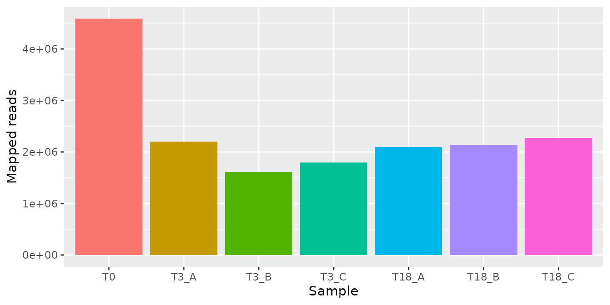

The T0 sample was sequenced about twice as deeply as the others, which
is common: it is the reference of every comparison. Every sample has at
least 1.6 million reads, more than 100 for each sgRNA of this subset.

[`plot_mapped_reads_distribution()`](https://emanuelsoda.github.io/ScreenR/reference/plot_mapped_reads_distribution.md)
shows the distribution of the reads of the sgRNAs in each sample:

``` r

plot_mapped_reads_distribution(object)
```

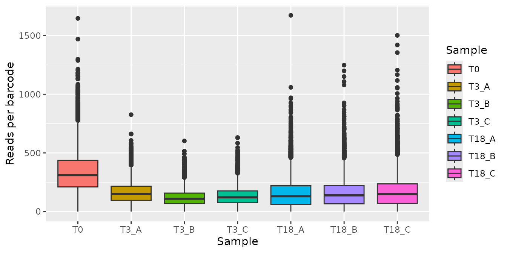

``` r

plot_mapped_reads_distribution(object, type = "density", alpha = 0.3)
```

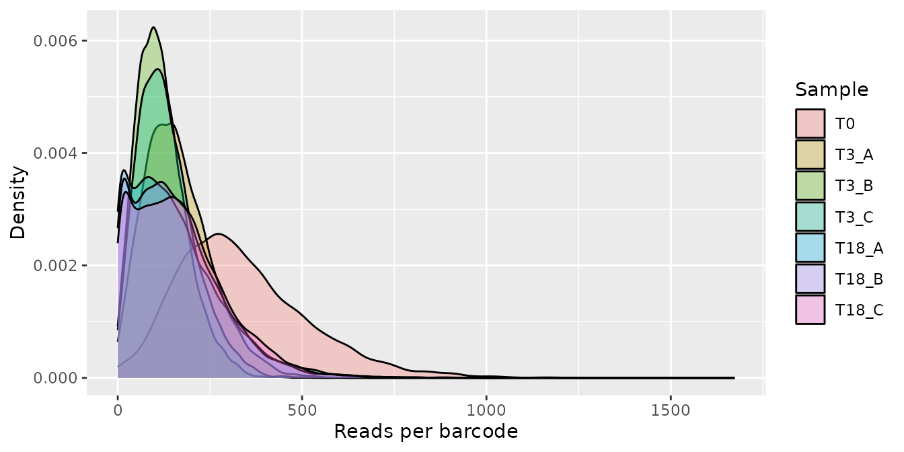

The counts are raw, so the T0 sample, sequenced more deeply, is shifted
to the right. At day 18 the distribution is wider than at day 3, with
more sgRNAs close to 0: the sgRNAs of the essential genes are dropping
out.

### Library representation and replicates

The library should be evenly represented at T0 (low Gini index) and the
replicates should agree:

``` r

plot_gini(object)
```

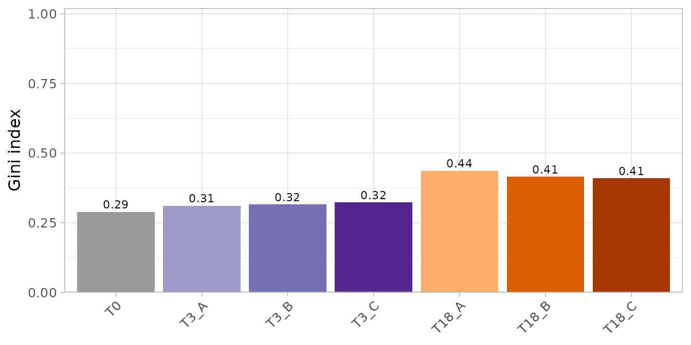

The plots so far use the raw counts. The correlation between replicates
and the sample plots below compare normalized counts, so the counts are
normalized first (counts per million; the choice of the normalization is
discussed below):

``` r

object <- normalize_data(object)
```

``` r

plot_replicate_correlation(object)
```

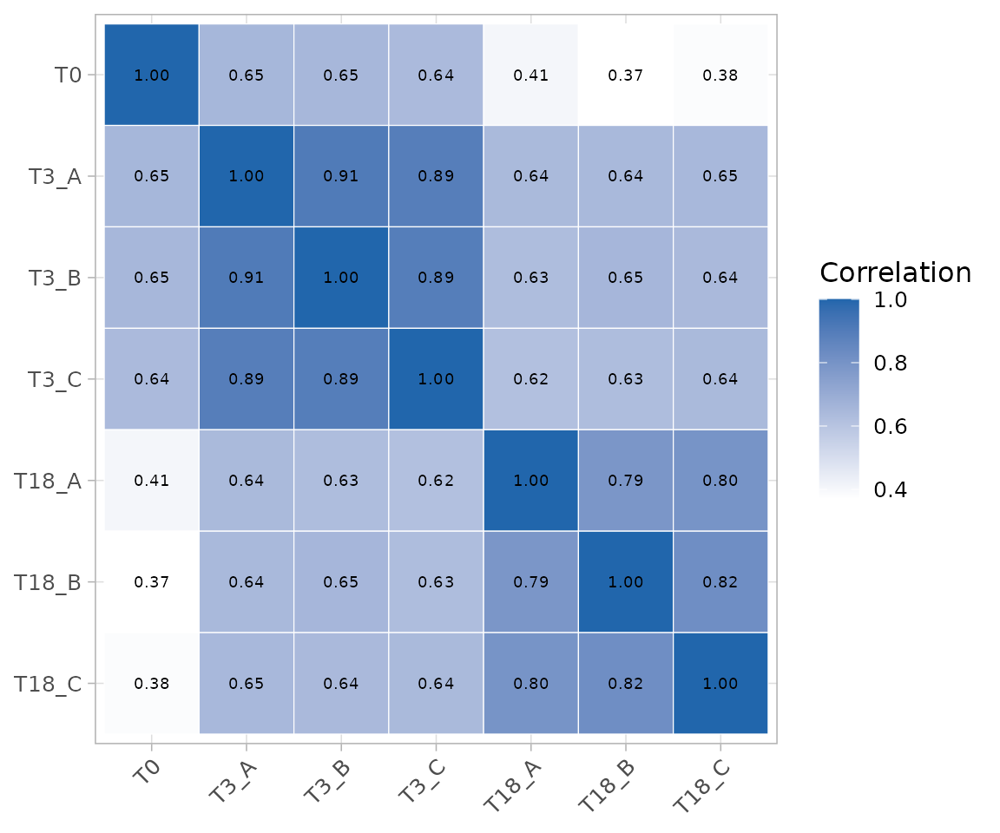

### Clustering of the samples

[`plot_mds()`](https://emanuelsoda.github.io/ScreenR/reference/plot_mds.md)
and
[`plot_pca()`](https://emanuelsoda.github.io/ScreenR/reference/plot_pca.md)
place the samples so that similar samples are close, and
[`plot_explained_variance()`](https://emanuelsoda.github.io/ScreenR/reference/plot_explained_variance.md)
shows how much of the differences between the samples each principal
component explains. Both the MDS and the PCA use the log2 normalized
counts, with the normalization chosen in
[`normalize_data()`](https://emanuelsoda.github.io/ScreenR/reference/normalize_data.md)
(here counts per million), so that the sequencing depth of the samples
does not drive the result:

``` r

plot_mds(object)
```

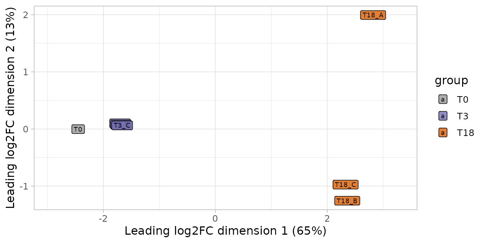

``` r

plot_pca(object)
```

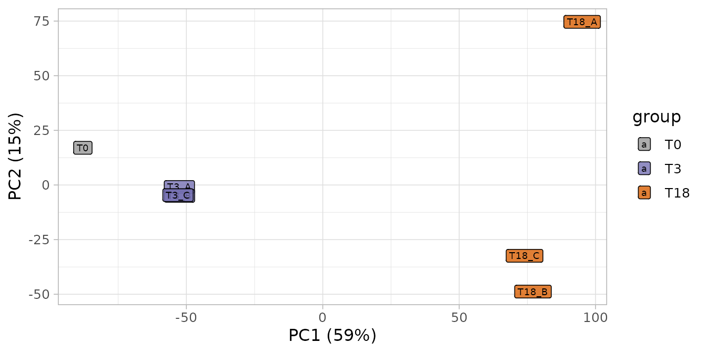

``` r

plot_explained_variance(object)
```

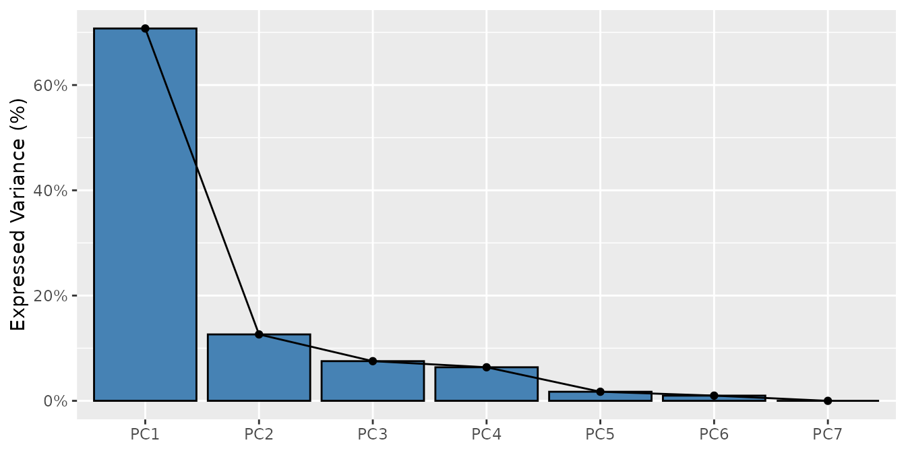

``` r

plot_explained_variance(object, cumulative = TRUE)
```

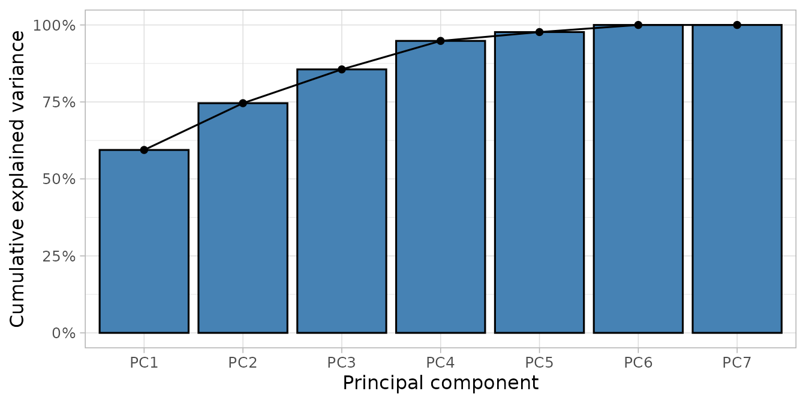

The first dimension of both plots orders the samples by time point (T0,
then day 3, then day 18): the main difference between the samples is the
growth of the cells, as expected in a dropout screen. The day 3
replicates are very close; the day 18 replicates differ more, because
the depletion has had more time to diverge. The first principal
component explains 59% of the variability.

### Quality with reference genes

The most informative check of a dropout screen uses genes whose
behaviour is known: the core essential genes should be depleted, the
non-essential genes should not. `hart_reference_genes` has the lists of
Hart et al. for human cells.
[`compute_screen_quality()`](https://emanuelsoda.github.io/ScreenR/reference/compute_screen_quality.md)
measures how well the two groups are separated (NNMD and Cohen’s d: more
negative is better; ROC AUC: 0.5 is no separation, 1 is perfect) and
[`plot_reference_separation()`](https://emanuelsoda.github.io/ScreenR/reference/plot_reference_separation.md)
shows it.

``` r

data(hart_reference_genes)
essential <- hart_reference_genes$Gene[
    hart_reference_genes$Class == "core essential"]
nonessential <- hart_reference_genes$Gene[
    hart_reference_genes$Class == "non-essential"]
```

[`compute_metrics()`](https://emanuelsoda.github.io/ScreenR/reference/compute_metrics.md)
computes the log2 fold change of each sgRNA between two groups of
samples (`control` and `treatment` are values of the Treatment column):

``` r

day3 <- compute_metrics(object,
    control = "T0", treatment = "T3", day = "Screen"
)
day18 <- compute_metrics(object,
    control = "T0", treatment = "T18", day = "Screen"
)
quality <- bind_rows(
    `Day 3` = compute_screen_quality(day3, essential, nonessential),
    `Day 18` = compute_screen_quality(day18, essential, nonessential),
    .id = "Time point"
)
knitr::kable(quality, digits = 3)
```

| Time point | NEssential | NNonessential | MeanEssential | MeanNonessential | NNMD | CohenD | AUC |
|:---|---:|---:|---:|---:|---:|---:|---:|
| Day 3 | 646 | 797 | -0.722 | 0.178 | -2.510 | -1.604 | 0.881 |
| Day 18 | 646 | 797 | -2.346 | 0.358 | -7.199 | -3.868 | 0.998 |

After 3 days the essential genes are only starting to drop out; after 18
days the separation is almost perfect.

``` r

plot_reference_separation(day18, essential, nonessential) +
    ggtitle("Day 18 vs T0")
```

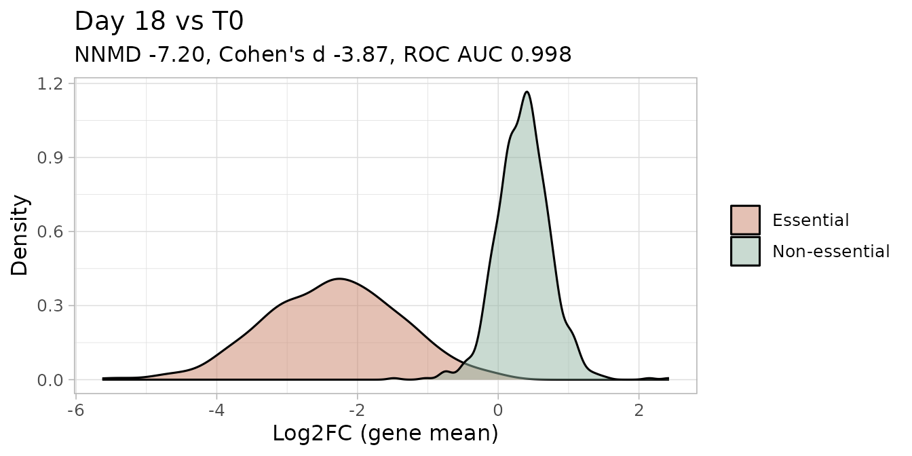

[`plot_boxplot()`](https://emanuelsoda.github.io/ScreenR/reference/plot_boxplot.md)
shows the normalized counts of the sgRNAs of single genes in each
sample, for example two core essential genes and the EGFP control
(sgRNAs that target a gene not present in the cells):

``` r

plot_boxplot(object,
    genes = c("POLR2L", "RPL14", "EGFP"),
    group_var = c("T0", "T3", "T18"), fill_var = "Treatment", ncol = 3
) +
    theme(axis.text.x = element_text(angle = 45, hjust = 1))
```

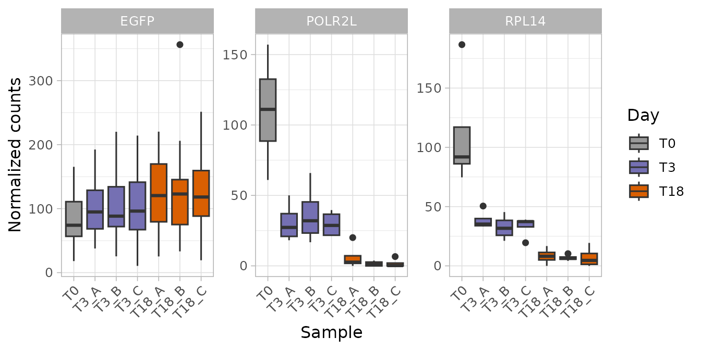

The sgRNAs of the essential genes are depleted at day 3 and almost gone
at day 18; those of EGFP are stable (slightly higher, because of the CPM
normalization described below).

The non-essential genes have a positive mean log2 fold change (0.36 at
day 18) although they have no effect. This is a side effect of the CPM
normalization: when many sgRNAs drop out, the reads of the sample go to
the others, which look enriched. The ranking of the genes does not
change, but the baseline is not 0. Normalizing to the sgRNAs of the
non-essential genes (`method = "control"`) puts it back at 0:

``` r

nonessential_sgrnas <- hap1_annotation_table$Barcode[
    hap1_annotation_table$Gene %in% nonessential]
day18_control <- normalize_data(object,
    method = "control", control_barcodes = nonessential_sgrnas
) %>%
    compute_metrics(control = "T0", treatment = "T18", day = "Screen")
#> Warning: 1 of the 3067 control barcodes are not in the object
#> (OTOP3_TCTCCGGAAAGCTTCACACG): the other 3066 are used.
knitr::kable(compute_screen_quality(day18_control, essential, nonessential),
    digits = 3)
```

| NEssential | NNonessential | MeanEssential | MeanNonessential |   NNMD | CohenD |   AUC |
|-----------:|--------------:|--------------:|-----------------:|-------:|-------:|------:|
|        646 |           797 |        -2.782 |            0.027 | -7.184 | -3.688 | 0.997 |

## Copy-number bias and CRISPRcleanR

Cas9 cuts the DNA, and cells with many cuts grow less. sgRNAs that
target amplified regions of the genome therefore deplete the cells
whatever the gene they target, and the genes there look essential.
CRISPRcleanR (Iorio et al. 2018) finds the regions where many
neighbouring sgRNAs that target different genes are depleted together
and corrects their fold changes, without needing copy-number data.
[`correct_crispr_bias()`](https://emanuelsoda.github.io/ScreenR/reference/correct_crispr_bias.md)
runs CRISPRcleanR on a ScreenR object and returns a new ScreenR object
with the corrected counts. ScreenR does not reimplement the method: it
only calls CRISPRcleanR.

The correction needs

- the **complete genome-wide library**: CRISPRcleanR assumes that most
  of the genes in a region have no effect. On a subset of genes enriched
  in hits it removes real signal, so it must not be used on
  `hap1_count_table`;
- a **library annotation** with the position of each sgRNA, in the
  format of CRISPRcleanR (row names: the sgRNA identifiers; columns
  GENES, CHRM, STARTpos and ENDpos). CRISPRcleanR includes the
  annotation of several libraries (`KY_Library_v1.0`,
  `Brunello_Library`, `AVANA_Library`, `GeCKO_Library_v2`, …); for
  another library, build the data frame from its annotation file.

This example uses the complete HT-29 screen distributed with
CRISPRcleanR (KY library, about 90,000 sgRNAs; HT-29 cells carry an
amplification of the MYC region on chromosome 8q24). It takes about a
minute.

``` r

ccr <- "CRISPRcleanR"
# Library annotation and counts distributed with CRISPRcleanR
library_annotation <- get(utils::data("KY_Library_v1.0", package = ccr))
counts <- read.delim(system.file("extdata", "HT-29_counts.tsv",
    package = ccr
))
colnames(counts) <- c("Barcode", "Gene", "Plasmid", "HT29_R1", "HT29_R2",
    "HT29_R3")
ht29 <- create_screenr_object(
    table = counts[, -2], annotation = counts[, c("Barcode", "Gene")],
    groups = factor(c("Plasmid", "Late", "Late", "Late")),
    sample_table = data.frame(
        Sample = c("Plasmid", "HT29_R1", "HT29_R2", "HT29_R3"),
        Day = "Screen", Treatment = c("Plasmid", "Late", "Late", "Late")
    )
)
ht29_corrected <- correct_crispr_bias(ht29,
    library_annotation = library_annotation,
    control = "Plasmid", treatment = c("HT29_R1", "HT29_R2", "HT29_R3")
)
ht29_corrected
```

The corrected object is analysed like any other: normalize it, compute
the data table and find the hits. CRISPRcleanR’s own results (the
corrected sgRNA fold changes and the segments of the genome) are in
`S4Vectors::metadata(ht29_corrected)$crisprcleanr`.

The effect of the correction on this screen (computed with the code
above; the script is in the `benchmark/crispr` folder of the GitHub
repository):

``` r

correction <- read.csv(system.file("extdata", "crisprcleanr_ht29.csv",
    package = "ScreenR"
))
knitr::kable(correction, digits = 3,
    col.names = c("Counts", "NNMD", "Cohen's d", "ROC AUC",
        "Mean log2FC in 8q24 (genes not known to be essential)")
)
```

| Counts | NNMD | Cohen’s d | ROC AUC | Mean log2FC in 8q24 (genes not known to be essential) |
|:---|---:|---:|---:|---:|
| Raw | -8.288 | -2.947 | 0.994 | -0.260 |
| Corrected (CRISPRcleanR) | -8.765 | -2.617 | 0.979 | 0.019 |

Before the correction, the genes in the amplified 8q24 region that are
not known to be essential are depleted (mean log2 fold change about
-0.26); after the correction they are not (about 0). The separation of
the reference genes is similar, with a slightly lower ROC AUC: the
correction removes a gene-independent bias, it does not make the screen
stronger.

## Finding the hits

The hit-finding functions are used as in [Tutorial
3](https://emanuelsoda.github.io/ScreenR/articles/Tutorial_3_Finding_hits.md).
The comparison is day 18 against T0:

``` r

design <- create_design_matrix(object)
contrast <- create_contrast(design, treatment = "T18", control = "T0")
```

### Gene-level Z-score test with the non-essential genes as reference

[`find_gene_zscore_hit()`](https://emanuelsoda.github.io/ScreenR/reference/find_gene_zscore_hit.md)
compares the mean score of the sgRNAs of each gene with the scores of
random sets of sgRNAs. By default the random sgRNAs come from all the
genes, which include the hits, so the test is conservative when many
genes have an effect, as in proliferation screens. When genes known to
have no effect are available, they are a better reference
(`control_genes`). For CRISPR screens the non-essential genes are the
natural choice: their sgRNAs cut the DNA like any other, while
non-targeting sgRNAs do not.

To be able to check the result, here half of the non-essential genes are
used as reference and the other half is kept to count the false calls;
in a real analysis use all of them.

``` r

set.seed(2017)
reference <- sample(nonessential, length(nonessential) %/% 2)
held_out <- setdiff(nonessential, reference)
statistics <- compute_barcode_statistics(object, design, contrast)
zscore <- find_gene_zscore_hit(statistics,
    control_genes = reference, fdr = 1, seed = 1
)
head(zscore)
#> # A tibble: 6 × 6
#>   Gene   NBarcodes Score Log2FC     PValue       FDR
#>   <chr>      <int> <dbl>  <dbl>      <dbl>     <dbl>
#> 1 AARS           4 -2.73  -2.41 0.00001000 0.0000476
#> 2 ABCE1          4 -3.17  -3.15 0.00001000 0.0000476
#> 3 ABCF1          4 -2.37  -1.74 0.00001000 0.0000476
#> 4 ACTR10         4 -3.47  -3.18 0.00001000 0.0000476
#> 5 ACTR2          4 -2.94  -2.21 0.00001000 0.0000476
#> 6 ADSL           4 -3.52  -3.07 0.00001000 0.0000476
```

``` r

called <- zscore$Gene[zscore$FDR <= 0.05]
data.frame(
    `Genes called` = length(called),
    `Core essential` = sum(called %in% essential),
    `Held-out non-essential` = sum(called %in% held_out),
    `Other genes` = sum(!called %in% c(essential, nonessential)),
    check.names = FALSE
)
#>   Genes called Core essential Held-out non-essential Other genes
#> 1          911            619                      5         287
```

Almost all the 646 core essential genes of the dataset are found at 5%
FDR, with very few of the held-out non-essential genes. The other genes
called are not in the reference lists: HAP1 cells need many more genes
than the core essential set, which contains only the genes essential in
almost every cell line.

### Without reference genes: the empirical null

When no reference genes are available, `reference = "empirical"`
estimates the scores of the genes without effect from the data. Most
genes have no effect, so the centre of the distribution of the gene
statistics is the null; a normal distribution is fitted there and gives
the p-values. The hits, in the tail, do not widen it.
`empirical_fit = "one-sided"` estimates the spread from the side without
hits only (above the centre for depleted genes), which gives more power
when the hits are well separated, as in CRISPR screens; the default,
`"central"`, is the safer choice (see
[`?find_gene_zscore_hit`](https://emanuelsoda.github.io/ScreenR/reference/find_gene_zscore_hit.md)).

``` r

zscore_empirical <- find_gene_zscore_hit(statistics,
    reference = "empirical", fdr = 1
)
zscore_one_sided <- find_gene_zscore_hit(statistics,
    reference = "empirical", empirical_fit = "one-sided", fdr = 1
)
attr(zscore_one_sided, "null")
#>      mean        sd 
#> 0.5670556 0.6900248
```

[`plot_empirical_null()`](https://emanuelsoda.github.io/ScreenR/reference/plot_empirical_null.md)
shows the gene statistics and the fitted null, which should follow the
centre of the distribution; the depleted genes are in the tail on the
left:

``` r

plot_empirical_null(statistics, empirical_fit = "one-sided")
```

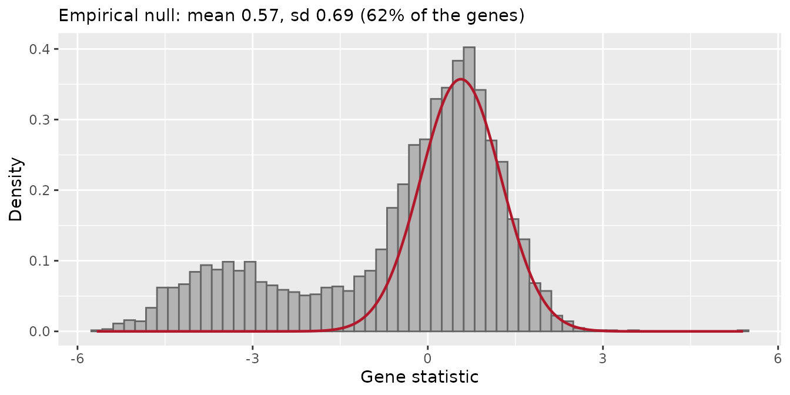

### Other methods and their consensus

The other methods need no reference genes either: the default reference
of the Z-score test (random sets of sgRNAs of all the genes), CAMERA and
FRY. `number_barcode = 2` keeps the genes with 3 or 4 sgRNAs.

``` r

zscore_default <- find_gene_zscore_hit(statistics, fdr = 1, seed = 1)
camera <- find_camera_hit(object, design, contrast,
    number_barcode = 2, fdr = 1
)
fry <- find_roast_hit(object, design, contrast,
    method = "fry", number_barcode = 2, fdr = 1
)
hit_list <- list(zscore_reference = zscore,
    zscore_empirical = zscore_empirical,
    zscore_one_sided = zscore_one_sided, zscore = zscore_default,
    camera = camera, fry = fry)
hits <- summarise_hits(hit_list, fdr = 0.05)
head(hits)
#> # A tibble: 6 × 10
#>   Gene    FDR_zscore_reference FDR_zscore_empirical FDR_zscore_one_sided
#>   <chr>                  <dbl>                <dbl>                <dbl>
#> 1 ATP6V1F            0.0000476         0.0000000236             4.47e-14
#> 2 BUB3               0.0000476         0.0000000130             1.47e-14
#> 3 CPSF1              0.0000476         0.0000000345             9.08e-14
#> 4 DHX15              0.0000476         0.0000000102             8.10e-15
#> 5 DPAGT1             0.0000476         0.0000000262             5.44e-14
#> 6 EIF3A              0.0000476         0.0000000101             6.35e-15
#> # ℹ 6 more variables: FDR_zscore <dbl>, FDR_camera <dbl>, FDR_fry <dbl>,
#> #   NMethods <dbl>, MaxFDR <dbl>, Hit <lgl>
table(hits$NMethods)
#> 
#>    0    1    2    3    4    5    6 
#> 2415   22   98  121  294   69  332
```

``` r

evaluate_hits <- function(result) {
    called <- result$Gene[result$FDR <= 0.05]
    data.frame(
        `Genes called` = length(called),
        `Core essential` = sum(called %in% essential),
        `Held-out non-essential` = sum(called %in% held_out),
        check.names = FALSE
    )
}
knitr::kable(bind_rows(lapply(hit_list, evaluate_hits), .id = "Method"))
```

| Method           | Genes called | Core essential | Held-out non-essential |
|:-----------------|-------------:|---------------:|-----------------------:|
| zscore_reference |          911 |            619 |                      5 |
| zscore_empirical |          798 |            596 |                      3 |
| zscore_one_sided |          932 |            619 |                      7 |
| zscore           |          352 |            305 |                      0 |
| camera           |          381 |            326 |                      0 |
| fry              |          720 |            552 |                      1 |

The empirical null finds almost as many core essential genes as the
non-essential reference, without reference genes and with very few
held-out non-essential genes. The two tests that compare each gene with
all the others (the default Z-score test and CAMERA) are much more
conservative: they find less than half of the core essential genes, and
the default Z-score test does not give a p-value below 0.05 to any of
the held-out non-essential genes. Their reference is all the genes of
the library, and here it is full of hits: the subset keeps all the
reference genes, so 19% of its genes are core essential, against about
4% in the complete TKOv3 library. They remain conservative on the
complete library: there the default Z-score test found 58% of the core
essential genes at 5% FDR, the empirical null 90% (`"central"`) and 94%
(`"one-sided"`), and the non-essential reference 96%. The default
Z-score test and CAMERA rank the genes almost in the same way (Spearman
correlation of the p-values above 0.99).

FRY
([`find_roast_hit()`](https://emanuelsoda.github.io/ScreenR/reference/find_roast_hit.md))
tests each gene on its own sgRNAs. It estimates the variability from the
replicates of the model, so a single T0 sample is enough when the other
time points have replicates, as here. It finds more essential genes than
the tests without reference, with very few held-out non-essential genes.

### Comparable fold changes

[`scale_by_reference()`](https://emanuelsoda.github.io/ScreenR/reference/scale_by_reference.md)
scales the fold changes so that the non-essential genes are at 0 and the
essential genes at -1. Scaled values can be compared between screens of
different strength, for example between cell lines or time points:

``` r

scaled <- scale_by_reference(day18, essential, nonessential)
scaled %>%
    group_by(Gene) %>%
    summarise(ScaledLog2FC = mean(ScaledLog2FC)) %>%
    arrange(ScaledLog2FC) %>%
    head()
#> # A tibble: 6 × 2
#>   Gene    ScaledLog2FC
#>   <chr>          <dbl>
#> 1 POLR2L         -2.23
#> 2 POLR3H         -2.15
#> 3 GPN3           -2.11
#> 4 ISG20L2        -1.94
#> 5 RRM1           -1.93
#> 6 MRPL53         -1.91
```

## Positive-selection screens

In a drug-resistance or positive-selection screen the interesting genes
are **enriched**: their knockout makes the cells survive. Every
hit-finding function takes `direction = "Up"`:

``` r

find_gene_zscore_hit(statistics, direction = "Up")
find_camera_hit(object, design, contrast, direction = "Up")
```

The reference genes are not useful there (they describe fitness, not
resistance); use the default reference of
[`find_gene_zscore_hit()`](https://emanuelsoda.github.io/ScreenR/reference/find_gene_zscore_hit.md)
or control genes known to have no effect on the selection.

## Summary

| Step | CRISPR-specific advice | Functions |
|----|----|----|
| Create the object | describe time points with a `sample_table` | [`create_screenr_object()`](https://emanuelsoda.github.io/ScreenR/reference/create_screenr_object.md) |
| sgRNAs per gene | lower `number_barcode` / `min_barcodes` for 3-6 sgRNAs per gene | [`barcodes_per_gene()`](https://emanuelsoda.github.io/ScreenR/reference/barcodes_per_gene.md) |
| Quality control | check the separation of essential and non-essential genes | [`compute_screen_quality()`](https://emanuelsoda.github.io/ScreenR/reference/compute_screen_quality.md), [`plot_reference_separation()`](https://emanuelsoda.github.io/ScreenR/reference/plot_reference_separation.md) |
| Copy-number bias | correct with CRISPRcleanR on the complete library | [`correct_crispr_bias()`](https://emanuelsoda.github.io/ScreenR/reference/correct_crispr_bias.md) |
| Hits | use the non-essential genes as reference when available, otherwise the empirical null | `find_gene_zscore_hit(control_genes = )`, `find_gene_zscore_hit(reference = "empirical")`, [`plot_empirical_null()`](https://emanuelsoda.github.io/ScreenR/reference/plot_empirical_null.md), [`find_camera_hit()`](https://emanuelsoda.github.io/ScreenR/reference/find_camera_hit.md), [`find_roast_hit()`](https://emanuelsoda.github.io/ScreenR/reference/find_roast_hit.md), [`summarise_hits()`](https://emanuelsoda.github.io/ScreenR/reference/summarise_hits.md) |
| Compare screens | scale to the reference genes | [`scale_by_reference()`](https://emanuelsoda.github.io/ScreenR/reference/scale_by_reference.md) |
| Positive selection | look for enriched genes | `direction = "Up"` |

## Literature

- Hart T, Tong AHY, Chan K et al. (2017). Evaluation and design of
  genome-wide CRISPR/SpCas9 knockout screens. G3 7:2719-2727.
- Hart T, Brown KR, Sircoulomb F, Rottapel R, Moffat J (2014). Measuring
  error rates in genomic perturbation screens: gold standards for human
  functional genomics. Mol Syst Biol 10:733.
- Iorio F, Behan FM, Goncalves E et al. (2018). Unsupervised correction
  of gene-independent cell responses to CRISPR-Cas9 targeting. BMC
  Genomics 19:604.

## Session info

``` r

sessionInfo()
#> R version 4.6.1 (2026-06-24)
#> Platform: x86_64-pc-linux-gnu
#> Running under: Ubuntu 24.04.5 LTS
#> 
#> Matrix products: default
#> BLAS:   /usr/lib/x86_64-linux-gnu/openblas-pthread/libblas.so.3 
#> LAPACK: /usr/lib/x86_64-linux-gnu/openblas-pthread/libopenblasp-r0.3.26.so;  LAPACK version 3.12.0
#> 
#> locale:
#>  [1] LC_CTYPE=C.UTF-8       LC_NUMERIC=C           LC_TIME=C.UTF-8       
#>  [4] LC_COLLATE=C.UTF-8     LC_MONETARY=C.UTF-8    LC_MESSAGES=C.UTF-8   
#>  [7] LC_PAPER=C.UTF-8       LC_NAME=C              LC_ADDRESS=C          
#> [10] LC_TELEPHONE=C         LC_MEASUREMENT=C.UTF-8 LC_IDENTIFICATION=C   
#> 
#> time zone: UTC
#> tzcode source: system (glibc)
#> 
#> attached base packages:
#> [1] stats     graphics  grDevices utils     datasets  methods   base     
#> 
#> other attached packages:
#> [1] ggplot2_4.0.3    dplyr_1.2.1      ScreenR_1.15.16  BiocStyle_2.40.0
#> 
#> loaded via a namespace (and not attached):
#>  [1] SummarizedExperiment_1.42.0 gtable_0.3.6               
#>  [3] xfun_0.62                   bslib_0.12.0               
#>  [5] Biobase_2.72.0              lattice_0.22-9             
#>  [7] vctrs_0.7.3                 tools_4.6.1                
#>  [9] generics_0.1.4              stats4_4.6.1               
#> [11] tibble_3.3.1                pkgconfig_2.0.3            
#> [13] Matrix_1.7-5                RColorBrewer_1.1-3         
#> [15] S7_0.2.2                    desc_1.4.3                 
#> [17] S4Vectors_0.50.3            lifecycle_1.0.5            
#> [19] compiler_4.6.1              farver_2.1.2               
#> [21] stringr_1.6.0               textshaping_1.0.5          
#> [23] statmod_1.5.2               Seqinfo_1.2.0              
#> [25] htmltools_0.5.9             sass_0.4.10                
#> [27] yaml_2.3.12                 pillar_1.11.1              
#> [29] pkgdown_2.2.1               jquerylib_0.1.4            
#> [31] tidyr_1.3.2                 DelayedArray_0.38.2        
#> [33] cachem_1.1.0                limma_3.68.5               
#> [35] abind_1.4-8                 tidyselect_1.2.1           
#> [37] locfit_1.5-9.12             digest_0.6.39              
#> [39] stringi_1.8.9               purrr_1.2.2                
#> [41] bookdown_0.48               labeling_0.4.3             
#> [43] fastmap_1.2.0               grid_4.6.1                 
#> [45] cli_3.6.6                   SparseArray_1.12.3         
#> [47] magrittr_2.0.5              patchwork_1.3.2            
#> [49] S4Arrays_1.12.1             utf8_1.2.6                 
#> [51] withr_3.0.3                 edgeR_4.10.6               
#> [53] scales_1.4.0                rmarkdown_2.32             
#> [55] XVector_0.52.0              matrixStats_1.5.0          
#> [57] otel_0.2.0                  ragg_1.5.2                 
#> [59] evaluate_1.0.5              knitr_1.52                 
#> [61] GenomicRanges_1.64.0        IRanges_2.46.0             
#> [63] rlang_1.3.0                 glue_1.8.1                 
#> [65] BiocManager_1.30.27         BiocGenerics_0.58.1        
#> [67] jsonlite_2.0.0              R6_2.6.1                   
#> [69] MatrixGenerics_1.24.0       systemfonts_1.3.2          
#> [71] fs_2.1.0
```
