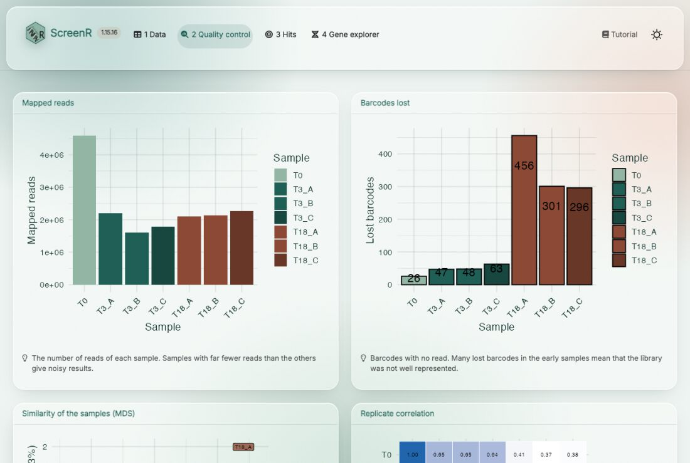
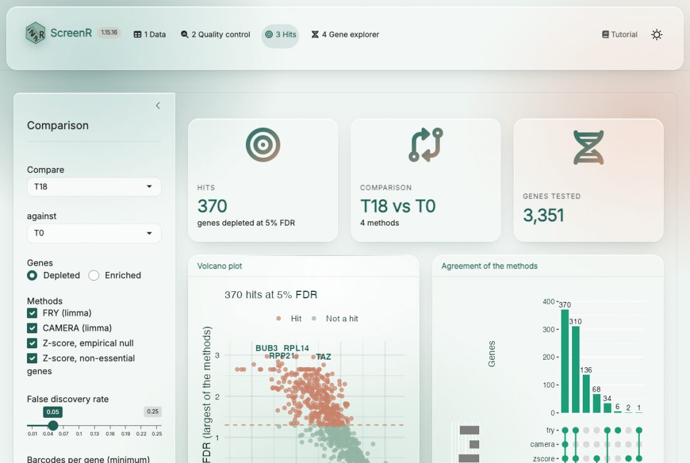

```{r setup, include=FALSE}
knitr::opts_chunk$set(collapse = TRUE, comment = "#>")
```

# About this tutorial

ScreenR includes an app that runs in the web browser and analyses a screen
without writing code. It is meant for the people who did the experiment:
load the counts, describe the samples, check their quality, find the hits and
look at each hit at the level of its barcodes. The app uses the same
functions as the other tutorials, and it gives back an R script that repeats
the analysis, so that a bioinformatician can check it or take it further.

This tutorial explains how to install and launch the app, and goes through
its four tabs.

# Installation

The app needs three packages that are not installed with ScreenR: shiny,
bslib and DT.

```{r install, eval = FALSE}
if (!requireNamespace("BiocManager", quietly = TRUE)) {
    install.packages("BiocManager")
}
BiocManager::install(c("ScreenR", "shiny", "bslib", "DT"))
```

# Launching the app

Open R (or RStudio) and type:

```{r launch, eval = FALSE}
library(ScreenR)
run_screenr_app()
```

The app opens in the web browser. It runs on your computer: the data are not
sent anywhere. To stop it, close the browser tab and press Esc (RStudio) or
Ctrl + C (terminal) in R.

An object created in R can be opened directly in the app, for example to show
a screen to a colleague:

```{r launch-object, eval = FALSE}
run_screenr_app(object)
```

`screenr_app()` returns the app without running it, which can be used to
deploy it on a Shiny server for the whole lab.

# 1. Data

```{r data, echo = FALSE, out.width = "100%", fig.alt = "The Data tab"}
knitr::include_graphics("app/app-data.jpg")
```

**Load a screen.** Choose one of the two example screens included in
ScreenR to try the app (a CRISPR-Cas9 dropout screen in HAP1 cells and an
shRNA screen with treated and control cells), or *My own data*:

- **Count table**: one row per barcode (shRNA or sgRNA) and one column per
  sample, as a tab-separated (`.txt`, `.tsv`) or comma-separated (`.csv`)
  file. A count file of MAGeCK (`mageck count`), with the sgRNA and Gene
  columns, works as it is. Choose the columns with the barcode and the gene.
- **Annotation**: only when the count table has no gene column, a table with
  the Barcode and Gene columns.

**Normalization.** Counts per million (CPM) or TMM; CPM is a good default.

**CRISPR screen in human cells.** Uses the core essential and non-essential
genes of Hart et al. (2017) as references: to measure the quality of the
screen and as an extra method to find the hits.

**Describe the samples.** The app guesses the description of the samples
from their names; double-click a cell to correct it:

- **Group**: the samples that are replicates of each other. The statistical
  models compare groups, so this is the most important column.
- **Day**: the time point.
- **Treatment**: the condition (for example treated and control), or
  "Untreated" in a dropout screen, where the comparison is between time
  points.

Then press **Create the ScreenR object**. The boxes at the bottom summarise
the screen: samples, barcodes, genes and mapped reads.

# 2. Quality control

```{r qc, echo = FALSE, out.width = "100%", fig.alt = "The Quality control tab"}

```

Check the samples before looking for hits. Each plot has a short note on
what to look for:

- **Mapped reads**: samples with far fewer reads than the others give noisy
  results.
- **Barcodes lost**: many barcodes without reads in the early samples mean
  that the library was not well represented.
- **Similarity of the samples (MDS)** and **replicate correlation**:
  replicates should be close to each other.
- **Distribution of the counts** and **Gini index**: how even the library is;
  the Gini index grows over time as barcodes drop out.

The details are in [Tutorial 2](Tutorial_2_Quality_control.html). Every card
can be enlarged with the button in its bottom right corner.

# 3. Hits

```{r hits, echo = FALSE, out.width = "100%", fig.alt = "The Hits tab"}

```

Choose the comparison in the panel on the left: the group to **compare**
(for example the treated cells, or the last time point) **against** a
control group (the control cells, or T0), and whether to look for
**depleted** or **enriched** genes. Then choose the methods:

- **FRY** (limma): do the barcodes of the gene change?
- **CAMERA** (limma): do they change more than the barcodes of the other
  genes?
- **Z-score, empirical null**: is the mean score of the barcodes extreme,
  compared with the genes without effect?
- **Z-score, non-essential genes** (CRISPR screens): the same test, with the
  non-essential genes as reference.

A gene is a **hit** when every method finds it at the chosen **false
discovery rate**. Genes with fewer barcodes than **barcodes per gene** are not
tested. Press **Find hits**.

- The **volcano plot** (`plot_volcano()`) shows every gene: how much its
  barcodes change (x) and how significant it is in the least favourable
  method (y). The hits are above the dashed line.
- **Agreement of the methods** shows how many genes each method finds and how
  they overlap.
- The **table** lists all the genes with the FDR of each method, the hits
  first. Download it with **Table (.csv)**.
- **R script** downloads the R code of the analysis.
- For CRISPR screens, **screen quality** shows how well the core essential
  genes separate from the non-essential genes (an AUC above 0.9 is a good
  screen).

Click a gene in the volcano plot or in the table to open it in the gene explorer.

The methods are described in [Tutorial 3](Tutorial_3_Finding_hits.html) and
[Tutorial 4](Tutorial_4_CRISPR_screens.html).

# 4. Gene explorer

```{r gene, echo = FALSE, out.width = "100%", fig.alt = "The Gene explorer tab"}
knitr::include_graphics("app/app-gene.jpg")
```

Look at a hit in the data before validating it. Search a gene (or click it
in the Hits tab); the badges show whether it is a hit and its FDR in each
method. The plots show:

- all the barcodes ranked by their log2 fold change, with the barcodes of the
  gene marked: a good hit has its barcodes on the same side;
- each barcode in each sample: a gene supported by a single barcode can be an
  off-target effect;
- the mean normalized count of the barcodes over time;
- the normalized counts of the barcodes in each sample.

# From the app to R

The **R script** of the Hits tab repeats the analysis in R, with the same
sample description, normalization, comparison and methods:

```{r script, eval = FALSE}
# Analysis made with the ScreenR app
library(ScreenR)

data(hap1_count_table)
data(hap1_annotation_table)
counts <- hap1_count_table
annotation <- hap1_annotation_table
# ... the sample table and the object ...
design <- create_design_matrix(object)
contrast <- create_contrast(design, treatment = "T18", control = "T0")
statistics <- compute_barcode_statistics(object, design, contrast)
hit_list <- list(
    fry = find_roast_hit(object, design, contrast, method = "fry",
        number_barcode = 2, direction = "Down", fdr = 1, seed = 1),
    camera = find_camera_hit(object, design, contrast,
        number_barcode = 2, direction = "Down", fdr = 1),
    zscore = find_gene_zscore_hit(statistics, reference = "empirical",
        min_barcodes = 3, direction = "Down", fdr = 1)
)
hits <- summarise_hits(hit_list, fdr = 0.05)
```

Running it gives the same table as the app. From there, all the functions of
ScreenR are available: see the other tutorials.

# Session info

```{r session}
sessionInfo()
```
